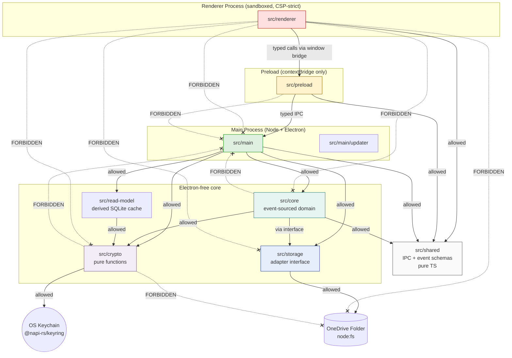
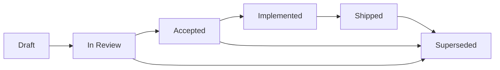

# ADR-002 — Repository Structure for OpenTreasury Desktop

- **Status:** **Proposed** — 2026-04-19
- **Date:** 2026-04-19
- **Authors:** Neo (Lead / Architect)
- **Reviewers required:** Pedro (decision owner), Switch (security — boundaries), Link (PM — docs layout), Niobe (UX) & Mouse (design) — confirm their folders
- **Depends on:** [ADR-001](./adr-001-tech-stack.md) (Accepted with conditions C1–C15), [`docs/security/crypto-spec.md`](../security/crypto-spec.md) v1.0, [`docs/security/security-requirements-v0.1.md`](../security/security-requirements-v0.1.md) v0.2

---

## 1. Context

With ADR-001 accepted (Option A: React + TS + event-sourced JSON + derived SQLite + XChaCha20-Poly1305 via `sodium-native`), we need a repo structure that:

- Holds our **Spec-Driven Development** artifacts as first-class citizens (vision, PRDs, ADRs, specs, UX, design, security) traceable to code.
- Mirrors the cloud repo [`rett-europe/opentreasury`](https://github.com/rett-europe/opentreasury) where it reduces cognitive load for contributors who cross both projects — diverges where desktop semantics demand it (no `api/`, no `infra/`, no `deploy-template/`).
- Makes the Electron **main / preload / renderer** split a **physical boundary** the filesystem enforces, so C1 (Electron hardening) and C6 (renderer isolation) can't accidentally regress.
- Keeps the **event-sourced core, crypto module, and OneDrive storage adapter** testable in isolation from Electron — i.e., runnable under plain Node for unit tests.
- Keeps **crypto code in one place**, auditable by Switch in a single PR diff.
- Is pragmatic for a small, volunteer-friendly team. **Not a 20-package monorepo.** The cloud repo uses a flat `frontend/` + `api/` layout; we match that tone.

The existing `prototype/` stays put as historical reference — do not delete, do not refactor into the new tree.

---

## 2. Goals

1. **Spec-first is enforceable** — every non-trivial feature ships with a `docs/specs/{feature}.md` reviewed before code, mirroring the cloud repo's discipline (per vision §11).
2. **Mirror the cloud repo where it adds clarity** — `docs/product/`, `docs/specs/`, `docs/architecture/`, `docs/security/`, `docs/ux/`, `docs/guides/` all parallel the cloud side. Diverge cleanly on `api/`, `infra/`, `deploy-template/` (we have no server, no cloud).
3. **Electron process boundaries are filesystem boundaries.** Renderer code physically cannot `import` main-process code; preload is the only bridge; shared code is a typed contracts module with no Electron imports.
4. **Core is Electron-free.** The event-sourced domain logic, crypto envelope, audit-chain verifier, and storage adapter interface compile and test under plain Node — CI can exercise them without spinning Electron.
5. **Crypto lives in exactly one module.** `crypto/` has no dependency on `electron` or `fs` at its API surface — pure functions taking `Uint8Array` in and `Uint8Array` out, plus a thin `sodium-native` initialization shim. Switch audits this folder in one pass.
6. **Storage adapter is mockable.** OneDrive folder I/O is behind an interface so tests substitute an in-memory filesystem — the event-sourced core never sees `node:fs`.
7. **IPC contracts are a single typed source of truth**, consumed by both the main and renderer sides, validated at runtime with Zod (per C13).
8. **Pragmatic for a small team.** One package by default; carve out workspaces only if/when a real consumer appears. No Nx/Turbo unless we can point at a specific pain they solve.

---

## 3. Top-Level Layout

```text
opentreasury-desktop/
├── .github/                   # Workflows, PR/issue templates, agent configs
│   ├── workflows/             # CI (to be added — deferred, §8)
│   ├── ISSUE_TEMPLATE/        # Bug / feature / spec-proposal templates (deferred)
│   ├── agents/                # (exists) per-agent instructions for Copilot
│   └── pull_request_template.md
├── .squad/                    # (exists) Squad team state — leave alone
├── .copilot/                  # (exists) Copilot-specific config — leave alone
├── docs/                      # All specs, decisions, and product artifacts
│   ├── product/               # Link (PM) — vision, PRDs, roadmap
│   │   ├── vision.md          # (exists)
│   │   └── prds/              # Per-feature PRDs (deferred; created as needed)
│   ├── architecture/          # Neo (Lead) — ADRs, diagrams, cross-cutting notes
│   │   ├── adr-001-tech-stack.md                 # (exists, Accepted)
│   │   └── adr-002-repo-structure.md             # (this doc)
│   ├── security/              # Switch (final say) — crypto, threat models, reqs
│   │   ├── crypto-spec.md                        # (exists, v1.0)
│   │   └── security-requirements-v0.1.md         # (exists, bumped to v0.2)
│   ├── ux/                    # Niobe — user flows, wireframes, interaction specs
│   │   └── README.md
│   ├── design/                # Mouse — visual design, tokens, component specs
│   │   └── README.md
│   ├── specs/                 # Feature technical specs (the SDD heart)
│   │   ├── README.md          # SDD lifecycle + how to write a spec
│   │   └── _template.md       # Canonical feature-spec template
│   └── guides/                # (deferred) user install/upgrade guides, contributor docs
├── prototype/                 # (exists) HTML/React prototype — historical reference
├── scripts/                   # Build, packaging, release, dev tooling
│   └── README.md
├── app/                       # Electron app source — DEFERRED (see §4)
├── CODE_OF_CONDUCT.md         # (deferred — mirror cloud repo's file)
├── CONTRIBUTING.md            # (deferred — references SDD flow in docs/specs/README.md)
├── LICENSE                    # (exists)
├── README.md                  # (exists — update at scaffold completion)
└── .gitignore, .gitattributes # (exist)
```

**Per-folder rationale:**

| Folder | Rationale |
|---|---|
| `.github/` | Mirrors cloud repo. `agents/` hosts Squad agent files consumed by Copilot. `pull_request_template.md` enforces the PR checklist (spec ref, ADR conditions, security checklist). |
| `.squad/` | Team state. Off-limits to domain work per governance. |
| `docs/product/` | Link's domain. Vision is here. PRDs land in `prds/` as Link writes them. |
| `docs/architecture/` | Neo's domain. ADRs only — one file per decision, numbered. |
| `docs/security/` | Switch's domain. Crypto spec is the implementation bar; security requirements is the policy. |
| `docs/ux/` | Niobe's domain. User flows, interaction specs, first-run wizard copy (R20). |
| `docs/design/` | Mouse's domain. Visual tokens, component specs, screen-level mocks. Distinct from `ux/` — UX is "what happens", design is "what it looks like". |
| `docs/specs/` | The SDD heart. Feature technical specs referencing PRDs, ADRs, R-series, and C-series conditions. `_template.md` is canonical. |
| `docs/guides/` | User docs and contributor docs. Deferred until v1 approaches. |
| `prototype/` | Frozen UX reference. Vision Q7 (*prototype as UX contract*) is still open — resolution goes in a PRD, not here. |
| `scripts/` | Build/release/dev tooling. Keep it small — most release work will be in `.github/workflows/`. |
| `app/` | Electron source tree. **Not scaffolded in this ADR** — see §4. |

---

## 4. Package / Source Layout (inside `app/`)

**Deferred creation.** The ADR describes the *intended* layout; actual folders are created in the first implementation PR, when package-manager and TypeScript-config choices are settled (see §9 Open Questions). Stubbing them now would freeze decisions we haven't made.

The proposed structure:

```text
app/
├── package.json                 # Single package by default
├── tsconfig.json                # Root TS config (shared strictness)
├── tsconfig.main.json           # Main-process compile target (Node)
├── tsconfig.renderer.json       # Renderer compile target (DOM, Vite)
├── vite.config.ts               # Renderer build (Vite)
├── electron-builder.yml         # Installer config (Windows NSIS/MSI first — AR10)
│
├── src/
│   ├── main/                    # MAIN PROCESS — Node, Electron, filesystem, IPC server
│   │   ├── index.ts             # App entry, BrowserWindow config (C1, C7, C11)
│   │   ├── windows/             # Window creation helpers (hardening applied here)
│   │   ├── ipc/                 # IPC channel handlers (schema-validated per C6, C13)
│   │   ├── updater/             # electron-updater wiring + Ed25519 verify (C12)
│   │   └── services/            # Glue between IPC and core
│   │
│   ├── preload/                 # PRELOAD — the ONLY bridge between main and renderer
│   │   └── index.ts             # contextBridge.exposeInMainWorld with narrow API (C6)
│   │
│   ├── renderer/                # RENDERER — React + TS, no Node, no fs, CSP-strict
│   │   ├── index.html
│   │   ├── main.tsx
│   │   ├── app/                 # Top-level app shell, routing
│   │   ├── features/            # Feature modules (transactions, accounts, dashboard…)
│   │   │                        # Mirrors cloud repo `frontend/src/app/features/`
│   │   ├── components/          # Shared UI components
│   │   ├── state/               # Zustand stores
│   │   ├── i18n/                # ES + EN resource files
│   │   └── styles/              # CSS / tokens (consumed from docs/design)
│   │
│   ├── shared/                  # TYPED CONTRACTS — pure TS, NO Electron, NO Node APIs
│   │   ├── ipc-contracts/       # Zod schemas + TS types for every IPC channel
│   │   ├── events/              # Event-sourced domain event schemas (Zod → TS)
│   │   ├── errors/              # Shared error types
│   │   └── constants/           # Shared literals (magic bytes, version, etc.)
│   │
│   ├── core/                    # EVENT-SOURCED DOMAIN — pure TS, runnable under Node
│   │   ├── events/              # Event definitions + validators
│   │   ├── reducers/            # Event → read-model projections
│   │   ├── commands/            # Command handlers (produce events)
│   │   ├── audit/               # Hash-chain build + verify (C10)
│   │   └── query/               # Read-model queries
│   │
│   ├── crypto/                  # CRYPTO — no electron, no fs. Pure functions.
│   │   ├── envelope.ts          # Encrypt/decrypt envelope per crypto-spec §2.1 (C1, C2, C3)
│   │   ├── sealed-box.ts        # X25519 sealed-box DEK wrapping
│   │   ├── signatures.ts        # Ed25519 sign/verify
│   │   ├── hash.ts              # BLAKE2b helpers
│   │   ├── keychain.ts          # @napi-rs/keyring adapter (C4) — only this file imports it
│   │   └── escrow.ts            # escrow.json read/write + canonical-JSON signing (C8)
│   │
│   ├── storage/                 # ONEDRIVE FOLDER ADAPTER — behind an interface
│   │   ├── adapter.ts           # StorageAdapter interface
│   │   ├── onedrive-folder.ts   # Node fs implementation (production)
│   │   ├── memory.ts            # In-memory implementation (tests)
│   │   └── paths.ts             # ULID filename helpers (C11), path-traversal guards (R18)
│   │
│   └── read-model/              # LOCAL SQLITE CACHE — separate from core
│       ├── sqlite.ts            # better-sqlite3 wrapper
│       ├── schema.sql           # Cache schema
│       ├── cache-crypto.ts      # Per-cache-key XChaCha20-Poly1305 (C14)
│       └── rebuild.ts           # Replay events → cache
│
└── tests/
    ├── unit/                    # Per-module; runs under plain Node + Vitest
    ├── integration/             # Core + crypto + storage (memory adapter)
    └── e2e/                     # Playwright against built Electron binary
```

### 4.1 Boundaries the structure enforces

- **Renderer cannot import main.** `src/renderer/` has no path to `src/main/` or `src/crypto/` — ESLint rule (`import/no-restricted-paths`) backs this, and TS project references break compilation if violated.
- **Renderer cannot import Node.** Renderer `tsconfig` excludes `@types/node`. `lib` is DOM only.
- **Preload is the only bridge.** `src/preload/index.ts` imports from `src/shared/ipc-contracts/` only. It MUST NOT import from `src/main/` or from `src/crypto/`.
- **`src/crypto/` has zero Electron imports.** Verified by lint rule and CI grep. Switch audits this folder as a single unit.
- **`src/core/` has zero Electron and zero `node:fs` imports.** It uses the `StorageAdapter` interface from `src/storage/adapter.ts`. Tests swap in the in-memory adapter.
- **IPC contracts are the single shape** both sides agree on. Change a contract → both main and renderer recompile against it — no silent drift.

### 4.2 Module dependency diagram



**How to read it:**
- Solid arrow = allowed import direction.
- Dashed red X = forbidden; caught by ESLint `import/no-restricted-paths` and/or TS project references, with a CI grep as belt-and-suspenders.
- `src/preload` imports *types* from `src/shared` but never implementation from `src/main`. It invokes main via `ipcRenderer.invoke` through a schema-validated facade.
- `src/crypto` is the only module that touches the keychain. `src/storage` is the only module that touches `node:fs`. Every other module stays pure.

---

## 5. Spec-Driven Development Layout

### 5.1 Where specs live

| Artifact | Path | Owner |
|---|---|---|
| Product vision | `docs/product/vision.md` | Link |
| Feature PRDs | `docs/product/prds/{feature}.md` | Link |
| Architecture decisions | `docs/architecture/adr-NNN-{title}.md` | Neo |
| Feature technical specs | `docs/specs/{NNN}-{feature}.md` | Neo + domain agent |
| UX specs | `docs/ux/{feature}.md` | Niobe |
| Design specs | `docs/design/{feature}.md` | Mouse |
| Security specs / threat models | `docs/security/{topic}.md` | Switch (final say) |

### 5.2 Naming

- **ADRs:** `adr-NNN-{kebab-case-title}.md`, three-digit zero-padded, monotonic.
- **Specs:** `{NNN}-{kebab-case-feature}.md` in `docs/specs/`, three-digit zero-padded. Example: `001-accounts.md`, `002-transactions.md`, `003-csv-import.md`.
- **PRDs:** `{feature}.md` under `docs/product/prds/`. One PRD per coherent product unit.
- **UX / Design:** match the spec name where possible (`docs/ux/002-transactions.md` pairs with `docs/specs/002-transactions.md`).

### 5.3 Lifecycle



- **Draft** — author writes; open for async comments.
- **In Review** — tagged reviewers required (Pedro, Switch for security-touching specs, Link for product-touching specs).
- **Accepted** — green-light for implementation PRs to start.
- **Implemented** — code merged to `main`; spec references commit SHAs.
- **Shipped** — released in a tagged version.
- **Superseded** — replaced by another spec; header links forward.

Every spec states its status in the front-matter block.

### 5.4 Traceability

Every feature spec MUST include a `## Traceability` section citing:
- Source PRD(s) at `docs/product/prds/...`
- Relevant ADR(s) — always at minimum ADR-001 (stack) and ADR-002 (structure).
- Specific ADR-001 condition IDs (C1–C15) the spec's implementation must satisfy.
- Specific security requirement IDs (R1–R20) the spec's implementation must satisfy.
- Relevant crypto-spec §-numbers if the feature touches encrypted artifacts.

Example (from the template):

> **Traceability**
> - PRD: `docs/product/prds/transactions.md`
> - ADRs: ADR-001, ADR-002
> - ADR-001 conditions satisfied: C1 (AEAD envelope), C2 (AAD binding), C5 (DEK main-only), C10 (audit entry on every tx mutation), C11 (ULID filenames)
> - Security requirements: R1, R3, R5, R8, R15
> - Crypto-spec sections: §2.1 (envelope), §8 (audit log)

Template lives at `docs/specs/_template.md`. The `README.md` in the same folder explains the lifecycle and review process in human terms.

---

## 6. Mirror vs. Diverge — Cloud Repo (`rett-europe/opentreasury`) Side-by-Side

| Cloud repo has | Desktop equivalent | Rationale |
|---|---|---|
| `frontend/` (Angular 19 SPA) | `app/src/renderer/` (React + TS) | Different framework per ADR-001, but both are "the UI tier". Features laid out in parallel (`features/transactions/`, `features/dashboard/`, …) so mental map is shared. |
| `api/` (FastAPI + Python) | **None.** Equivalent role played by `app/src/main/` + `app/src/core/` | Product constraint: no server. Domain logic runs in-process in the Electron main tier. |
| `infra/` (Bicep, KeyVault, Cosmos) | **None.** | No Azure. OneDrive folder replaces the data infrastructure. |
| `deploy-template/` | **None.** Replaced by `scripts/` + `.github/workflows/` + `electron-builder.yml` | We ship installers, not cloud deployments. |
| `docs/architecture.md`, `docs/features.md`, `docs/features/`, `docs/specs/` | `docs/architecture/`, `docs/product/prds/`, `docs/specs/` (split into ADRs + PRDs + specs as separate files) | We separate *decisions* (ADRs) from *product intent* (PRDs) from *technical design* (specs) because the desktop project intentionally writes more specs. |
| `docs/security/` | `docs/security/` (same) | Direct mirror — Switch owns both sides' equivalent. |
| `docs/guides/` | `docs/guides/` (deferred) | Direct mirror. Will hold install guide (incl. AR9 SmartScreen screenshots) and contributor guide. |
| `.github/workflows/` | `.github/workflows/` (deferred) | CI pipelines; ours target lint + test + build + signed-release, not cloud deploy. |
| `.github/agents/` | `.github/agents/` (exists) | Direct mirror — we already use this. |
| `CODE_OF_CONDUCT.md`, `CONTRIBUTING.md` | Deferred — mirror on v1 approach | Community hygiene; not urgent for pre-implementation. |
| `package-lock.json` at root | `app/package-lock.json` (or root, TBD per §9 Q1) | Lockfile committed per R9. |
| `scripts/` | `scripts/` (direct mirror) | Release + dev tooling. |

**What we intentionally do not mirror:** Angular project scaffolding, Python virtualenv layout, Bicep, KeyVault, Cosmos migrations. These are cloud-specific and add no value here.

---

## 7. Naming Conventions

### 7.1 Branches (already locked)

Per team decision 2026-04-19 (trunk-based):
- `main` is protected; no direct commits.
- Feature work: `feat/{short-slug}` or `feat/{NNN}-{feature}` matching spec ID.
- Fixes: `fix/{short-slug}`.
- Docs / chores: `docs/{slug}`, `chore/{slug}`.
- Security-sensitive: `sec/{slug}` (auto-flagged for Switch review).

### 7.2 Commits

**Recommended (not mandated beyond current practice):** Conventional Commits (`feat:`, `fix:`, `docs:`, `chore:`, `refactor:`, `test:`, `sec:`). Rationale: cheap to adopt, pays off when we generate changelogs for signed releases (R13.1 publishes update manifests — a parseable history helps). We do not enforce with a commit-lint hook yet; revisit if we adopt automated release notes.

### 7.3 Files & folders

- **Folders:** `kebab-case`.
- **TypeScript source files:** `kebab-case.ts`; one top-level export per file where practical.
- **React components:** `PascalCase.tsx`.
- **Tests:** mirror source path under `tests/unit/` with `.test.ts` suffix; co-located `*.test.ts` next to source is also acceptable, team preference TBD.
- **Specs / ADRs / PRDs:** `kebab-case.md`.
- **Schemas:** `kebab-case.schema.json` when JSON Schema; `kebab-case.ts` when Zod.

### 7.4 IDs

- **ADR IDs:** `ADR-001`, `ADR-002`, …
- **Spec IDs:** `SPEC-001`, `SPEC-002`, … (same number used in filename prefix).
- **PRD IDs:** `PRD-{feature-slug}` — non-numeric; PRDs are more fluid.
- **Security requirements:** `R1`, `R2`, … (Switch-owned, already in place).
- **ADR-001 conditions:** `C1`–`C15` (Switch-owned, already in place).
- **Accepted risks:** `AR1`, `AR2`, … (Switch-owned, already in place).

---

## 8. What This Structure Enforces (Guardrails)

1. **Renderer cannot import main directly.** Only via `preload/` using `contextBridge`-exposed, schema-validated IPC (C6, C13). Enforced by ESLint `import/no-restricted-paths` + TS project references + CI grep.
2. **`crypto/` has no dependency on `electron` or `node:fs`.** Pure functions in → ciphertext out. Switch reviews this folder as one unit. Enforced by ESLint rule + CI check that `import` statements in `src/crypto/**` match an allowlist (only `sodium-native`, `@napi-rs/keyring`, stdlib types).
3. **`core/` is Electron-free and fs-free.** Uses the `StorageAdapter` interface; fs I/O lives only in `src/storage/onedrive-folder.ts`. Tests run on plain Node.
4. **IPC contracts are the single source of truth.** `src/shared/ipc-contracts/` is the only place IPC channel names and payload shapes exist. Main and renderer both import from there. Drift is a compile error.
5. **Every spec references its ADR conditions and R-requirements.** The `_template.md` Traceability section is mandatory; PRs that add specs without it are rejected.
6. **Electron hardening is declarative in one place.** All `BrowserWindow` construction goes through `src/main/windows/` helpers that set `contextIsolation`/`sandbox`/CSP per C7. No ad-hoc `new BrowserWindow({...})` scattered across the codebase.
7. **Filenames are always opaque (ULID).** CI grep forbids `donation-`, `{name}-`, or date-prefix patterns anywhere under `{dataset-root}/events/`, `{dataset-root}/snapshots/` (C11, R3).
8. **Local cache uses a separate key from the DEK.** The `src/read-model/cache-crypto.ts` module takes its key from `src/crypto/keychain.ts` via a distinct keychain service name; the DEK never reaches this module (C14).

---

## 9. Open Questions (block "Accepted")

1. **Package manager — `npm`, `pnpm`, or `yarn`?** Recommendation: **`npm`** for ecosystem compatibility with the cloud repo and zero setup for volunteer contributors. `pnpm` only if we adopt workspaces (we don't, yet). **Pedro decides.**
2. **Monorepo tool — Nx, Turborepo, or none?** Recommendation: **none.** Single `app/` package, plain `tsc -b` with project references for the main/preload/renderer split. Revisit only if a second consumer of `src/shared/` appears (e.g., a CLI or a companion tool). **Pedro decides.**
3. **TypeScript strictness level?** Recommendation: `strict: true` + `noUncheckedIndexedAccess: true` + `exactOptionalPropertyTypes: true`. Stricter now is cheaper than loosening retroactively. **Pedro confirms.**
4. **Root-level `app/` vs `apps/opentreasury-desktop/`?** Recommendation: `app/` (flat) for now — aligns with cloud's `frontend/` tone and avoids premature workspace structure. If we ever add a companion CLI, we promote to `apps/` at that point. **Pedro confirms.**
5. **Tests — co-located `*.test.ts` or separate `tests/` tree?** Recommendation: **separate `tests/`** for `integration/` and `e2e/`, **co-located `*.test.ts`** for pure unit tests next to the code they test. Hybrid is pragmatic. **Team confirms.**

---

## 10. What's Deferred

- **CI workflows** (`.github/workflows/*.yml`) — separate piece of work; scope: lint, test, build, Electron security check (C7 via `electronegativity`), `npm audit`, release with Ed25519 signed update payload (R13.1). Tracked as its own ADR when we start.
- **`app/` source scaffolding** — first implementation PR after this ADR is accepted and the open questions are answered.
- **`docs/guides/`** — install/upgrade/contributor guides; v1-approach work.
- **`CODE_OF_CONDUCT.md`, `CONTRIBUTING.md`** — mirror cloud repo; low-priority until external contributors arrive.
- **Commit-message enforcement (commitlint + husky)** — decide after a few weeks of manual practice.
- **Issue templates** — scaffolded empty; fill with bug / feature / spec-proposal templates when we triage our first external issues.
- **`package-lock.json` location** — depends on §9 Q1; locked when the first `app/package.json` lands.

---

## 11. Consequences

**If accepted:**
- The scaffolding PR (Output 2 of this work item) lands the folder tree with READMEs and the PR template only — **no source code**.
- Link files PRDs under `docs/product/prds/` as she writes them.
- Niobe files UX specs under `docs/ux/` starting from the first PRD.
- Mouse files design specs under `docs/design/`.
- Neo + Morpheus write the first feature specs under `docs/specs/` using `_template.md`, each referencing the ADR-001 conditions their implementation satisfies.
- The next ADR (ADR-003, candidate scope: CI workflows + release pipeline) can be written against this structure.

**If revised:**
- Structural revisions should be narrow (rename a folder, adjust a boundary rule). Wholesale changes warrant a superseding ADR.

---

## 12. References

- [ADR-001 — Tech Stack](./adr-001-tech-stack.md)
- [Crypto & Key Management Spec v1.0](../security/crypto-spec.md)
- [Security Requirements & Threat Model v0.2](../security/security-requirements-v0.1.md)
- [Product Vision v0.1](../product/vision.md)
- Cloud reference repo: `rett-europe/opentreasury`

---

*End of ADR-002 — Proposed 2026-04-19. Accepted pending Pedro's answers to §9 open questions.*
