# ADR-003 — Internationalization (i18n) Framework

- **Status:** **Accepted**
- **Date:** 2026-04-19
- **Decided:** 2026-04-19 (Pedro delegated day-0 i18n framework choice to Neo; i18n is a structural M0 decision)
- **Authors:** Neo (Lead / Architect)
- **Reviewers:** Pedro (informed), Link (PRD-009 owner), Niobe (UX strings), Switch (no crypto surface — informational only)
- **Depends on:** [ADR-001](./adr-001-tech-stack.md) (React + TS renderer), [ADR-002](./adr-002-repo-structure.md) (`app/src/renderer/i18n/` location)

---

## 1. Context

Per Pedro's 2026-04-19 resolution (vision Q6, roadmap M0), **i18n is day-0 foundational infrastructure, not a late feature**. Spanish (primary — Rett Spain pilot) and English (pilot-ready) are both **v1.0 ship-blockers**. Every user-facing surface from M1 onward MUST go through the i18n layer — no hardcoded strings allowed past the scaffold commit.

The renderer is React 18 + TypeScript (ADR-001). The Electron main process has essentially no user-facing strings (installer + system dialogs excepted), so this ADR scopes to the renderer.

**Requirements driving the choice:**

| # | Requirement | Source |
|---|---|---|
| I1 | Two locales from day 0 — `es` (primary) and `en` (pilot-ready) | PRD-plan §0.1 Assumptions |
| I2 | ICU-class plural / gender / date / number formatting | PRD-001 PR19.1, PRD-002 PR18.1, PRD-003 PR17.1 |
| I3 | TypeScript — type-safe translation keys (compile-time detection of typos) | ADR-002 strict TS posture |
| I4 | CI "missing key" lint rule from M1 | PRD-009 scope |
| I5 | Pseudo-locale for dev / extraction QA | Standard practice |
| I6 | Locale detection via OS + in-app override, persisted | Niobe UX principle |
| I7 | Fail-loud in dev, graceful fallback to EN in prod | Error-surface discipline |
| I8 | Small team DX — adding a string must be ≤3 lines of diff | Principle 7 (boring wins) |
| I9 | Bundle-size-conscious (Electron app, not SPA — but keep lean) | Non-primary but considered |

---

## 2. Options Considered

Rolling our own is dismissed up front: building yet another `t()` helper with interpolation, pluralization, and CLDR-backed `Intl` wrappers in a volunteer-staffed project, with no ecosystem of extraction tools, buys us nothing and costs every contributor. All three candidates below are mature and maintained.

### Option A — `react-i18next` (with `i18next` core)

**Stack:** `i18next` (engine) + `react-i18next` (bindings) + `i18next-browser-languagedetector` (locale detection, optional) + `@formatjs/intl-*` polyfills only if needed (Electron ships modern Chromium → not needed).

**Pros**
- Largest ecosystem by a wide margin — bindings for every framework, huge StackOverflow surface.
- Excellent TypeScript support: strongly-typed keys via `i18next.d.ts` module augmentation pointing at JSON resources — typos are compile errors.
- Plural / context / nesting / interpolation all built in. ICU MessageFormat available via `i18next-icu` plugin if needed.
- Namespaces (multiple JSON files per language) make feature-scoped bundles trivial.
- `Trans` component handles React nodes inside translations cleanly.
- Mature extraction tooling (`i18next-parser`).

**Cons**
- Own plural syntax (`key_one` / `key_other`) differs from ICU by default; ICU is an add-on plugin (~5KB).
- Runtime cost is non-zero (~40KB min+gz for i18next + react-i18next combined).
- Some API surface is legacy (v11 → v23 evolution).

**Bundle impact:** ~40KB min+gz core; acceptable for Electron.
**DX for a new string:** add key to `locales/en/common.json` + `locales/es/common.json`, use `t('my.key')`. 3-file diff (extraction can automate one).
**Plural / gender / date / number:** plural built-in (key suffixes); gender via context; date/number via `Intl` in-app (Intl, not i18next, handles those).
**Test story:** Vitest + `react-i18next` testing utilities; pseudo-locale via `i18next-pseudo` plugin or hand-rolled loader.
**TS support:** Best-in-class — module augmentation makes keys type-safe.

### Option B — `react-intl` / FormatJS

**Stack:** `react-intl` + `@formatjs/cli` (extraction) + optional `babel-plugin-formatjs`.

**Pros**
- **Native ICU MessageFormat** — the reference implementation for plural / gender / select / number / date. Best formatting semantics in class.
- Extraction is first-class — `@formatjs/cli` pulls messages from source into JSON.
- TypeScript support via `IntlMessageFormat` types.
- Backed by FormatJS (OpenJS-graduated); strong governance.

**Cons**
- More verbose API: `<FormattedMessage id="..." defaultMessage="..." />` or `intl.formatMessage(...)` — heavier at call sites than `t('key')`.
- Bundle is larger: `react-intl` + `intl-messageformat` is ~55–65KB min+gz (the MessageFormat parser is non-trivial).
- Typed keys require generated types from extraction output — extra build step.
- `defaultMessage` convention means strings often live inline in source, not in a dedicated resource file — good for extraction, mixed for translator UX.

**Bundle impact:** ~55–65KB min+gz.
**DX for a new string:** write `<FormattedMessage id="..." defaultMessage="..." />` in JSX; run extractor to update JSON. 2-file diff at call site, more verbose tag.
**Plural / gender / date / number:** ICU-native — best in class.
**Test story:** `react-intl`'s testing utilities; extraction tooling doubles as coverage check.
**TS support:** Good; extraction step generates types.

### Option C — `@lingui/react`

**Stack:** `@lingui/core` + `@lingui/react` + `@lingui/cli` (extraction) + macro babel plugin.

**Pros**
- **Compile-time extraction via babel/SWC macros** — smaller runtime, strings literally live in source.
- ICU MessageFormat support.
- Smaller runtime than i18next / react-intl (~15KB min+gz).
- Good TS support.

**Cons**
- **Requires a babel / SWC macro in the build pipeline** — one more moving part Vite must be configured for; well-supported but adds a step.
- Smaller ecosystem than i18next. Fewer third-party plugins (detectors, backends).
- `msg` and `<Trans>` syntax is idiomatic but less familiar to contributors than `t('key')`.
- Extraction-driven workflow can surprise newcomers (the source of truth is the source code, not the JSON).

**Bundle impact:** ~15KB min+gz.
**DX for a new string:** write `t\`my string\`` or `<Trans>…</Trans>` in source; run `lingui extract` to sync catalogs. Good workflow for developer; slightly more opaque for translator-only contributors.
**Plural / gender / date / number:** ICU-native; plus `@lingui/detect-locale` helpers.
**Test story:** Standard Vitest + lingui's utilities.
**TS support:** Good; lingui generates types.

### Option D — Roll our own

**Dismissed.** No extraction tooling, no translator workflow, no plural/gender/context handling, no ecosystem. Every hour spent on this is an hour not spent on treasury features. Not viable.

---

## 3. Comparison

| Axis | A — react-i18next | B — react-intl | C — @lingui/react |
|---|---|---|---|
| Bundle (min+gz) | ~40KB | ~55–65KB | ~15KB |
| DX — add a string | `t('key')` + JSON entry | `<FormattedMessage defaultMessage="…">` | `t\`string\`` + extract |
| Plural / gender | Built-in (non-ICU by default; ICU via plugin) | ICU-native | ICU-native |
| Date / number / currency | Via `Intl` in-app | `<FormattedNumber/Date>` + Intl | Via `Intl` in-app |
| TypeScript | Best-in-class (module augmentation, type-safe keys) | Good (generated types) | Good (generated types) |
| Ecosystem | Largest | Large | Smaller |
| Familiarity | High (most JS devs have used it) | High | Medium |
| Extraction tooling | `i18next-parser` (separate) | `@formatjs/cli` (first-class) | `lingui extract` (core workflow) |
| Build pipeline impact | None (runtime-only) | None (optional babel plugin) | Requires babel/SWC macro |
| Fits small volunteer team? | Best (lowest friction) | OK (more verbose) | OK (one more build step) |

---

## 4. Decision

**Option A — `react-i18next`.**

Rationale (tie-broken by Principle 7 *"boring wins"* + small-team DX):

1. **Lowest friction to add a string.** `t('screen.movements.title')` + two JSON edits is the shortest path any of the three offers. Contributors know this API already.
2. **Best TypeScript integration out of the box.** Module augmentation (`i18next.d.ts`) makes every `t()` call a typed lookup — typos become compile errors, which is exactly what our strict-TS posture (ADR-002) wants.
3. **Namespace-per-feature** scales naturally as we grow from 3 screens (M1) to ~18 features by M3.
4. **ICU is optional when we need it.** For the v1 scope (bilingual ES/EN, simple plural counts in "N transactions" and "N accounts"), i18next's built-in plural suffix (`_one` / `_other`) is sufficient. If a later feature (e.g., multi-currency reports) needs full ICU gender/select, we add `i18next-icu` without a rewrite.
5. **Bundle cost (~40KB) is irrelevant in an Electron app** — we already ship the Chromium runtime. This driver barely registers.
6. **Option C's smaller bundle is a web-app win; in Electron it's a rounding error**, and the added macro in the Vite config is a permanent cost for a benefit we don't need.
7. **Option B's ICU-native advantage is real but overkill** for ES/EN-only with simple pluralization. We'd pay extra verbosity at every call site for a formatting ceiling we won't hit in v1.

**Revisit trigger:** if a third locale with complex plural/gender rules (Arabic, Russian, Polish) is added AND we find ourselves writing more `_zero` / `_few` / `_many` variants than we can reasonably maintain, reopen this ADR and re-evaluate Option B (ICU-native).

---

## 5. String Key Conventions

### 5.1 Naming

Dotted, namespaced, `kebab-case` segments, structured by UI surface first, then concept. Keys describe the **semantic role** of the string, not its text.

```
screen.movements.title
screen.movements.empty-state.headline
screen.movements.empty-state.body
action.save
action.cancel
action.new-transaction
field.amount.label
field.amount.placeholder
error.decrypt-failed.title
error.decrypt-failed.body
error.decrypt-failed.next-step
```

**Rules:**
- **Top-level namespaces:** `screen.*` (page-level), `action.*` (verbs / buttons), `field.*` (form inputs), `error.*` (user-facing error messages — paired with UX-009 error catalog), `common.*` (cross-cutting: OK, Cancel, Close), `unit.*` (currency labels, date labels), `empty.*` (empty-state copy).
- **Never encode the English text into the key.** `action.save` ✅; `action.save-button` ❌ (the word "button" is UI metadata, not content).
- **Reuse across features** goes in `common.*`. A string gets lifted to `common.*` the second time it's needed.
- **Interpolation placeholders use double-curly:** `"You have {{count}} transactions"`. Names match the variable, not the English word.

### 5.2 File layout

**Chosen:** per-locale directory, per-namespace JSON file.

```
app/src/renderer/locales/
├── en/
│   ├── common.json        # action.*, common.*, unit.*
│   ├── screen-movements.json
│   ├── screen-saldo.json
│   ├── screen-panel.json
│   └── error.json
└── es/
    ├── common.json
    ├── screen-movements.json
    ├── screen-saldo.json
    ├── screen-panel.json
    └── error.json
```

**Rationale (vs. a single flat `en.json` / `es.json`):**
- Lets feature PRs touch only their namespace — smaller diffs, fewer merge conflicts.
- Namespace loading is lazy-ready if we ever need it (we won't in v1 — everything ships in the bundle).
- Translator workflow: one NGO volunteer can own `error.json` without touching `screen-movements.json`.
- TypeScript module augmentation works per-namespace, keeping the inferred type union manageable.

### 5.3 Missing-key behavior

| Environment | Behavior |
|---|---|
| `development` | **Fail loud.** Render the key verbatim (`screen.movements.title`) so the developer sees it. Emit a `console.warn` with stack. Pseudo-locale test (see §9) forces us to notice. |
| `production` | **Fallback to `en`.** If `es` is missing a key, display the `en` value. If `en` is ALSO missing (bug), display the key. Never crash. |

i18next configuration: `fallbackLng: 'en'`, `saveMissing: false` (we are NOT writing keys at runtime; we own the resource files), `returnEmptyString: false`, `returnNull: false`.

### 5.4 Interpolation

Double-curly `{{variable}}`. No XSS risk from user-supplied data because all interpolation is auto-escaped; React's `<Trans>` component handles rich content (nested React nodes) safely via its own reconciler.

---

## 6. Workflow — Adding and Updating Strings

### 6.1 Developer adds a new string

```mermaid
flowchart LR
    A[Need a new string<br/>in a component] --> B[Pick a namespaced key<br/>per §5.1]
    B --> C[Add to<br/>en/&#123;namespace&#125;.json]
    C --> D[Add to<br/>es/&#123;namespace&#125;.json]
    D --> E[Use t&#40;'key'&#41;<br/>or &#60;Trans i18nKey='key' /&#62;]
    E --> F[TS compiles<br/>key is type-safe]
    F --> G[CI lint checks<br/>no key missing per locale]
```



**3-file diff** for a new string: the EN JSON, the ES JSON, and the call site. No build-step regeneration. No codegen.

**If the developer does not speak Spanish**, the ES entry uses the EN text verbatim prefixed with `[TODO-ES]` (e.g., `"[TODO-ES] Save"`). A CI grep rule (deferred to PRD-009 implementation) flags `[TODO-ES]` count and blocks release when >0.

### 6.2 Translator updates a string

Translators are **not developers**. The workflow for Rett Spain (Pedro / their treasurers) is:

1. Niobe (UX) delivers string revisions as a delta table: `{key, en, es, notes}`.
2. A developer applies the delta to the matching JSON files.
3. The PR is reviewed by Niobe for copy and by Link for product tone.

**Source of truth:** Niobe's string tables in `docs/ux/strings/` (future). Code is the authoritative *runtime* copy; UX docs are the authoritative *editorial* copy. A spec may be added later if a translator portal becomes necessary — deferred.

**Niobe delivers `{key, en, es}` pairs; Neo does NOT extract from source.** Extraction-from-source means the English is inlined in JSX (Option B/C style), which we rejected.

---

## 7. Locale Detection & Persistence

### 7.1 On first launch

1. Read **OS locale** via Electron's `app.getLocale()` (main process → IPC → renderer).
2. If locale starts with `es` → use `es`. If `en` → use `en`. Otherwise → **default to `es`** (Rett Spain is the pilot).
3. Persist the chosen locale in the local app-settings store (not in the OneDrive folder — locale is per-device preference, not per-dataset).

### 7.2 In-app override

A locale switcher in **Settings → Language** (Niobe UX-022 when scoped). Choosing a locale:

1. Immediately re-renders the app (i18next's `changeLanguage(lng)` triggers subscriber updates).
2. Persists the selection.
3. On next launch, persisted choice overrides OS locale.

### 7.3 Where settings live

`app/src/main/services/settings.ts` — plain JSON file in Electron's `userData` dir (`app.getPath('userData')`). Unencrypted. Contains locale, last-opened-folder, and other UI prefs only. **No PII, no crypto material.** Orthogonal to the OneDrive dataset.

---

## 8. Numbers, Dates, Currency

**Rule: use `Intl.*` directly with the active locale. Do not hand-roll. Do not let i18next's own formatters grow tentacles.**

```ts
// app/src/renderer/i18n/formatters.ts
export const fmtCurrency = (n: number, locale: string, currency = 'EUR') =>
  new Intl.NumberFormat(locale, { style: 'currency', currency }).format(n);

export const fmtDate = (d: Date, locale: string, style: 'short' | 'medium' | 'long' = 'medium') =>
  new Intl.DateTimeFormat(locale, { dateStyle: style }).format(d);

export const fmtNumber = (n: number, locale: string) =>
  new Intl.NumberFormat(locale).format(n);
```

- **Currency:** EUR default for Rett Spain; currency becomes per-account config in v1.x (PRD-013). No multi-currency conversion in v1.
- **Dates:** always through `Intl.DateTimeFormat`. Never format via string concat or `toLocaleDateString()` without explicit locale.
- **Numbers:** `Intl.NumberFormat`. Never use `.toFixed(2)` directly on user-facing numbers.
- **Relative time** ("2 days ago") — `Intl.RelativeTimeFormat`. Not needed in M1 but reserved.

**i18next's built-in formatters (`{{date, DD/MM/YYYY}}`) are NOT used** — they'd bypass `Intl` and introduce a parallel formatting ontology. All formatting happens in TS helpers, then the formatted string is passed to `t()` as a variable.

---

## 9. Test Plan

### 9.1 Pseudo-locale in dev

Build-time switch (`VITE_I18N_PSEUDO=1`) injects a third locale `xx-pseudo` that transforms every value to `[!!sçreen.môvëménts.títlé!!]`. This makes:
- **Missing keys visible** (the un-wrapped text is obviously English).
- **Untranslatable hardcoded strings visible** (same — they're not wrapped in the pseudo markers).
- **Truncation / layout bugs visible** (pseudo strings are longer).

Used during UX review and visual QA.

### 9.2 CI key-coverage check

`scripts/i18n-check.ts` (added alongside PRD-009 implementation, not in this scaffold):
- Every key present in `en/*.json` MUST exist in `es/*.json` and vice versa.
- No `[TODO-ES]` markers on a release tag.
- No `t()` call in source with a string that doesn't appear in the loaded resources (static analysis against the resource TS types).

Runs in `.github/workflows/ci.yml`. Failure = PR blocked.

### 9.3 Snapshot tests with both locales

Vitest + React Testing Library:
- Each top-level screen component has a snapshot rendered with `i18n.changeLanguage('en')` and with `i18n.changeLanguage('es')`. Diff catches accidental English leakage.
- An `Intl` mock in tests pins locale formatting (avoid flaky date/number output across dev machines).

---

## 10. Traceability

- **PRDs:**
  - `docs/product/prds/prd-001-movements.md` — PR19 / PR19.1 (Spanish + English day-0, locale-aware Intl formatters)
  - `docs/product/prds/prd-002-saldo.md` — PR18 / PR18.1
  - `docs/product/prds/prd-003-panel.md` — PR17 / PR17.1
  - `docs/product/prd-plan.md` — **PRD-009 "i18n Foundations"** (M0 infrastructure PRD; this ADR is its selection note)
- **Roadmap:** `docs/product/roadmap-v1.md` — M0 gains i18n framework + ES/EN string tables
- **ADRs:** [ADR-001](./adr-001-tech-stack.md) (React+TS renderer), [ADR-002](./adr-002-repo-structure.md) (i18n lives at `app/src/renderer/i18n/` and `app/src/renderer/locales/`)
- **ADR-001 conditions:** this ADR touches **zero** crypto surface (C1–C15 unaffected); locale preference is stored in `userData`, NOT the OneDrive dataset, so no AEAD envelope applies.
- **Security requirements:** R12 (IPC validation) applies to the single `app.getLocale()` read from main; no user input flows through i18n.

---

## 11. Consequences

**If accepted (this ADR):**
- Scaffold PR (companion to this ADR) installs `i18next`, `react-i18next`, `i18next-browser-languagedetector` as renderer deps.
- `app/src/renderer/i18n/index.ts` initializes i18next with namespace loading + fallback rules from §5.3.
- Every new renderer PR from M1 forward touches JSON resources, never hardcoded strings. PR template already requires this (check §4 of the PR template — "no hardcoded user-facing strings").
- CI adds the i18n key-coverage check (scheduled in PRD-009 implementation, not this scaffold PR).

**If rejected / revised:**
- Most likely pivot is Option C (`@lingui/react`) if bundle size becomes a real concern OR if extraction-from-source becomes a strong preference. Migration cost: mechanical rewrite of `t('key')` → `t\`string\`` plus catalog extraction. Manageable but non-trivial past M1.

---

## 12. Scaffold Decisions Notebook (revisable)

Small choices made during scaffolding that Pedro may want to revisit. These are NOT ADR-binding; they're recorded here so they're not silently load-bearing.

| # | Choice | Alternative | Why picked now | When to revisit |
|---|---|---|---|---|
| SD1 | **Vite** for renderer build | esbuild, Webpack, Turbopack | Vite is standard for React+Electron, best DX for HMR, Electron community uses it heavily. | If cold-start or build-time becomes a bottleneck (>30s). |
| SD2 | **Vitest** for unit tests | Jest | Vite-native; no separate config; ESM-first; faster; fits the co-located `*.test.ts` hybrid. | If a dep can't be used under Vitest (rare). |
| SD3 | **Playwright** for E2E (with `@playwright/test`) | Spectron (dead), WebdriverIO | Playwright's Electron support is first-class; same test runner as web. | Unlikely to revisit. |
| SD4 | **electron-builder** for packaging | electron-forge, manual | Broadest platform support (Windows NSIS / macOS DMG / Linux AppImage/deb), mature auto-update hook. | If forge becomes materially better (unlikely short-term). |
| SD5 | **react-i18next** (this ADR) | react-intl, lingui | See §4. | See §4 "Revisit trigger". |
| SD6 | **Zod** for IPC validation (stub) | Valibot, Ajv (JSON Schema) | TS-first, great ergonomics, matches ADR-001 C13 language. Valibot is smaller but less mature. | If bundle pressure forces a smaller validator. |
| SD7 | **npm workspaces NOT used.** Single `app/` package per ADR-002 §9 Q2. | — | ADR-002 locked. | Second consumer of `src/shared/` appears. |
| SD8 | Locale files as **per-namespace JSON** (not single flat file per locale) | single `en.json` / `es.json` | Smaller diffs, feature-scoped translator work, lazy-load ready. | If namespace count explodes past ~20 and TS type union becomes painful. |
| SD9 | **Default locale fallback = ES** (Pilot is Rett Spain) | EN default | Pilot NGO is Spanish-speaking; minimizes first-run friction for the pilot. Overridable in settings. | After v1 when non-Spanish NGOs come online. |

---

## 13. Open Questions

None blocking. This ADR is Accepted.

Deferred to PRD-009 implementation (not to this ADR):
- Should the CI "missing key" check block on `[TODO-ES]` markers, or warn-only? (Recommend block before v1.0 release tag; warn on feature branches.)
- Locale-switcher UX copy (Niobe owns, tracked in UX spec plan).

---

## 14. Status History

| Date | Status | By | Notes |
|---|---|---|---|
| 2026-04-19 | Accepted | Neo | Initial authoring; Pedro delegated day-0 framework choice to Neo as a structural M0 decision. |
