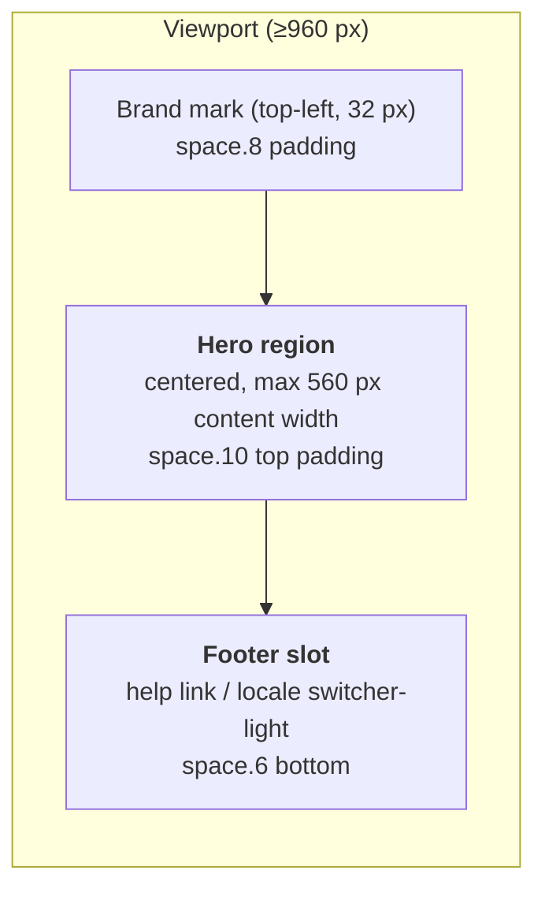
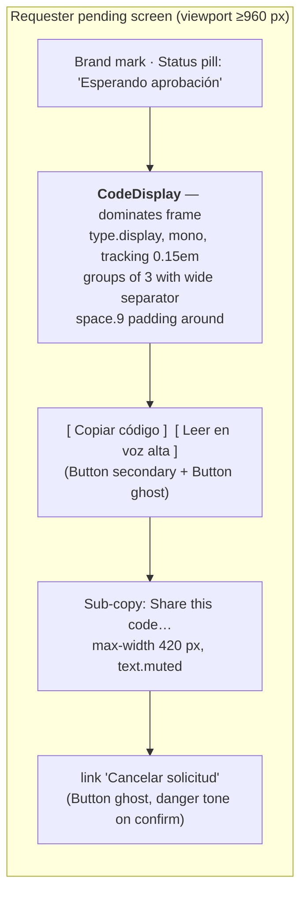
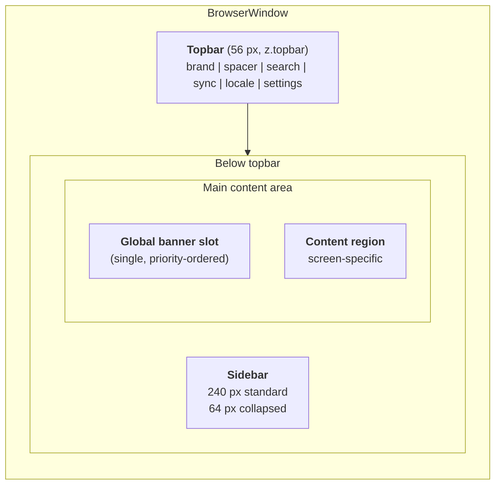
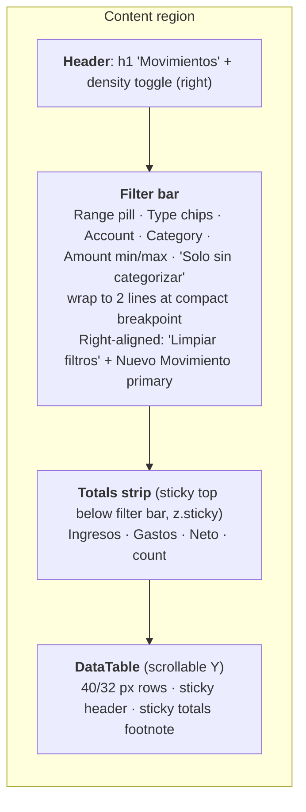
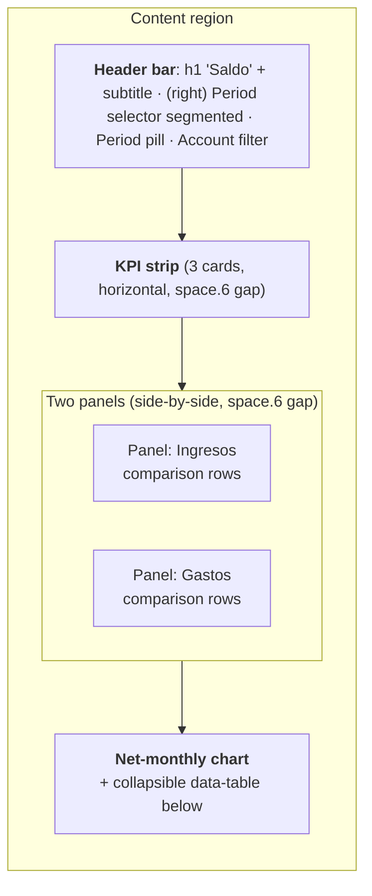
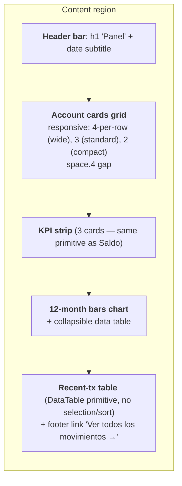

# Screen Visuals v0.1

> **Status:** Draft v0.1 · **Owner:** Mouse (UI Designer) · **Date:** 2026-04-19
> **Depends on:** [design-principles.md](./design-principles.md) · [tokens.md](./tokens.md) · [components-v1.md](./components-v1.md)
> **Translates:** all 6 Wave-1 UX specs from layout regions + interactive roles → visual structure.

Per-screen visual specs. Each entry identifies layout regions, primitive composition, and screen-specific visual treatments. **No pixel-perfect mockups** — structure, not skins.

---

## 1. First-Run / Folder Setup — UX-001

> Spec: [ux-001-first-run-setup.md](../ux/specs/ux-001-first-run-setup.md)

**Overall treatment:** single-column, centered layout. No sidebar, no topbar beyond a minimal brand mark. Each step fills the viewport; no back button chrome (step progression is linear — the state machine handles it).

### Layout regions



### Per-state treatment

| State (UX-001 §5) | Layout | Notes |
|---|---|---|
| `welcome` | Brand + EmptyState-like hero (h1 `type.display`, subtitle, single `large primary` Button + `link` Button) | No icon above h1 in v1 (Principle P6 defers illustrations) |
| `folder-picker` | Hero: h2 + helper copy + folder picker control (Button `secondary` "Browse…" + path display below on selection) | Live helper text cites the OneDrive-for-Business / SharePoint constraint |
| `folder-rejected-personal` | Hero with `danger` Banner inline (tone=danger, dismissible=false), body copy below, single `secondary` Button "Pick a different folder" | **The rejection itself is the primary surface.** The Banner sits above the retry button. Sub-copy linking to "Why?" is a `link` Button. |
| `folder-rejected-unsynced` | Same shape; `warning` tone instead of `danger` (less severe — path is valid but not synced) | |
| `branch-admin` | Hero: h2 "You'll be this treasury's first admin" + 3-line explainer (`type.body`, `text.secondary`) + Button `primary` Continue | |
| `branch-join` | Same shape; copy cites `{NGO name}` from escrow; single `primary` CTA "Request enrollment" | Routes to UX-002 |
| `branch-damaged` | `critical` Banner at top of hero + explainer + Button `secondary` "Restore from snapshot" → UX-009. NO primary "Continue". | P8 — danger tone mandatory |
| `posture-checklist` (R20) | h2 + scroll container (max-height 60vh, internal scroll) with 4 checklist items; primary Continue disabled until scrolled-to-end AND all checked | Scroll indicator ("1 of 4 scrolled") as caption; `overflow-y: auto` with a gradient-mask bottom to hint more content |
| `device-name` | h3 + TextField (label, required, pre-filled OS hostname) + helper copy + primary Continue | |
| `provisioning` | h2 "Setting up your treasury…" + linear progress indicator (indeterminate, animated per `motion.duration.base`) + caption. **No cancel button.** | Respects reduced-motion: replaces animation with *"Cargando…"* static text |
| `provisioning-failed` | `danger` Banner + explainer + retry Button `primary` | |
| `success-admin` | Hero: success-toned h1 "Your treasury is ready" + folder path shown (mono, `type.body`, `text.muted`) + two Buttons (primary "Record first transaction", secondary "Go to dashboard") | No confetti (Principle P1). A single `success.default` CheckCircle2 icon 32 px above the h1 is the only celebration. |

### Personal-OneDrive rejection panel (E1) — detail

```
┌─────────────────────────────────────────────────────────┐
│                                                         │
│   [icon: AlertOctagon 24px in danger.default]           │
│   OneDrive Personal aún no es compatible                │   ← h3
│   Soporte previsto para v1.x. Elige una carpeta dentro  │   ← body (text.secondary)
│   de OneDrive para empresas o SharePoint.               │
│                                                         │
│   [ link "¿Por qué?" ]                                  │
│                                                         │
│                      [ Elegir otra carpeta ]            │   ← primary Button
│                                                         │
└─────────────────────────────────────────────────────────┘
```

Uses Banner primitive tone=`danger`, dismissible=false, inside the hero region. **No override affordance** — AC2 of UX-001 forbids one.

### Primary-action placement (global for UX-001)

Always **one primary action per step**, at the bottom of the hero, right-aligned if paired with a secondary, otherwise centered. Never floated to a fixed corner.

---

## 2. Device Enrollment — UX-002

> Spec: [ux-002-device-enrollment.md](../ux/specs/ux-002-device-enrollment.md)

### Requester side — pending screen

**The `CodeDisplay` is the visual focal point.** Everything else is supporting.



**CodeDisplay treatment:**
- Renders inside a `surface.raised` card with `shadow.raised` and `radius.lg`, padding `space.9`.
- Code text `type.display` (28 px) at 700 weight, `letter-spacing: 0.15em`.
- Character grouping uses a visible gap of `1.5ch` between triplets (not a dash — a dash reads as a literal character).
- Subtle `border.default` frame around the card so the code "sits" visually.
- Takes up roughly 40% of viewport height, centered.

### Admin side — approval modal

Dialog primitive `size=medium`, `preventApproveKeyboardAdjacency=true`.

```
┌────────────────────────────────────────────────────────┐
│ Solicitud de enrolamiento                          [✕] │
├────────────────────────────────────────────────────────┤
│                                                        │
│  Juan (juan@ngo.org)                                   │
│  Dispositivo: "Juan — Laptop"                          │   ← text.body
│  Solicitado: hace 4 minutos                            │
│                                                        │
│  ┌────────────────────────────────────┐               │
│  │       A B C - 1 2 3                │  ← CodeDisplay (same component)
│  └────────────────────────────────────┘               │
│                                                        │
│  ⚠ Aprueba solo si tú contactaste a esta persona —    │   ← Banner inline, warning tone
│    no si fue ella quien te pidió aprobación.          │      (dismissible=false, inline variant)
│                                                        │
├────────────────────────────────────────────────────────┤
│                                                        │
│  [ Rechazar ]       [ Preguntar luego ]     [ Aprobar ]│
│   ↑ destructive       ↑ ghost                 ↑ primary│
│   (Ctrl+Shift+R)      (Esc)                   (Ctrl+Enter required)
└────────────────────────────────────────────────────────┘
```

**Visual enforcement of non-adjacency:**
- Reject (destructive) and Approve (primary) occupy **opposite ends** of the footer. "Ask me later" (ghost) sits between them.
- A `space.6` (24 px) spacer on each side of "Ask me later" increases fat-finger distance.
- Approve button requires `Ctrl+Enter` or click; Enter alone does nothing (keyboard fat-finger defense).

**UPN tooltip** (per UX-002 §11 Q6 — tooltip recommended): hover / focus on the UPN line reveals `Tooltip` (positions bottom, `z.tooltip`, max-width 280 px) with copy: *"La identidad mostrada proviene del archivo compartido. No es un ancla de confianza — compara el código aparte."* **Flag Switch — final copy.**

---

## 3. App Shell & Navigation — UX-006

> Spec: [ux-006-app-shell-and-navigation.md](../ux/specs/ux-006-app-shell-and-navigation.md)

### Layout



- **Topbar:** bottom 1px `border.default` hairline. Standard height 56, compact 48. Uses `space.5` horizontal padding.
- **Sidebar:** left 1px `border.default` hairline. Internal `space.3` vertical padding; each item has `space.2` padding-y × `space.4` padding-x.
- **Content area:** `space.7` horizontal + top padding at `breakpoint.standard`; `space.5` at `breakpoint.compact`. Max content width **1440 px** at `breakpoint.wide` (content stays readable on ultrawide — excess becomes left/right gutter).
- **Banner slot:** sits directly below topbar, above content. When a banner is present, content region shifts down by the banner's height (no overlap). `z.banner` ensures banner renders above sticky content but below topbar.

### Nav rail vs. topbar split — rationale

- **Primary route switching lives in the sidebar.** Desktop-native pattern (VS Code, Outlook).
- **Globals live in the topbar.** Locale switcher, sync indicator, settings — things that are not routes.
- **Why not tabs?** Treasury isn't document-oriented; users don't open 5 ledgers side-by-side. Tabs would be noise.

### Global banner stacking behaviour — visual treatment (UX-006 5 states)

Per UX-006 §7 E9, the banner slot is single — one banner at a time, priority-ordered. **Visual treatment per state:**

| State | Banner shown? | Banner tone | Sidebar | Content |
|---|---|---|---|---|
| `locked` | Full viewport takeover (not a banner) | — | Hidden | Hidden |
| `normal` | No | — | Normal | Normal |
| `syncing` | No (sync indicator in topbar is enough) | — | Normal | Normal |
| `offline` | Yes | `info`, dismissible=false | Normal | Normal (but offline-related affordances on current screen update per their own spec) |
| `error-banner` (recoverable) | Yes | `danger`, dismissible=true | Normal | Normal |
| `error-banner` (blocking, crypto integrity) | Yes | `critical`, dismissible=false | **Disabled** except Settings (per AC6) | Read-only |
| `update-available` (UX-020 future) | Yes | `info`, dismissible=true | Normal | Normal |

**Priority ordering** when multiple eligible banners exist: `critical > danger > offline > update-available > info`. Lower-priority banners are queued, not shown, while a higher banner is active.

**Banner height** is content-dependent (flex for Spanish). Content region uses CSS grid with a dynamic first-row; no fixed offset.

### Locale switcher placement

Topbar, between sync-indicator and settings icon. `segmented` variant of LocaleSwitcher primitive. **NOT** duplicated anywhere else in v1 (Settings will host a redundant Select later — v1.1).

### Sidebar item list (visual order)

1. **Panel** (icon: `LayoutDashboard`)
2. **Movimientos** (icon: `ArrowLeftRight`)
3. **Saldo** (icon: `Scale`)
4. **Cuentas** (icon: `Wallet`)
5. **Categorías** (icon: `Tag` — yes, Tag for categories; the category/tag iconography is deliberately differentiated — Categorías use `Tag`, Etiquetas use `Bookmark`)
6. **Etiquetas** (icon: `Bookmark`)
7. `divider` (hairline, `space.2` vertical)
8. **Importación** (icon: `Download`)
9. **Exportar** (icon: `Upload`) — **disabled in M1** with tooltip "v1.1"

### Responsive behaviour

- At `breakpoint.compact` (< 1280): sidebar auto-collapses to 64 px rail. Item labels become tooltips on hover/focus.
- At `breakpoint.wide` (≥ 1600): sidebar stays at 240 px; content area caps at 1440 px; excess goes to left/right gutter (no stretching).
- Text-zoom 200%: topbar compresses — search icon + locale switcher collapse into `⋯` overflow menu (`z.dropdown`). Settings and sync-indicator remain visible.

---

## 4. Movements — UX-003

> Spec: [ux-003-movements-screen.md](../ux/specs/ux-003-movements-screen.md)

### Layout



### Per-state treatment

| State (UX-003 §5) | Treatment |
|---|---|
| `range-not-selected` | Filter bar dimmed (opacity 0.55, non-interactive visually). Totals strip hidden. Table region replaced by centered **EmptyState** primitive: no icon, h3 "Elige un rango de fechas", subtitle, and the **DateRangePicker in open state** (popover rendered inline instead of floating) directly below. Initial focus on first preset chip. |
| `range-loading` | Filter bar dimmed. Skeleton `row` × ~8, sticky header visible but inert. Inline caption "Cargando movimientos para {range}…" above skeleton. |
| `range-loaded` | Full interactive state. Range pill visible in filter bar with `✕` clear affordance. |
| `range-loaded-empty-range` | Filter bar active (user can widen). Table region replaced by EmptyState: h3 "No hay movimientos en {range}", subtitle, Button primary "Ampliar rango" + Button secondary "Registrar movimiento en este periodo". |
| `range-loaded-empty-filters` | Same shape; copy "No hay resultados con los filtros actuales" + Button primary "Limpiar filtros". |
| `range-error` | Table region: `danger` Banner (inline) + Retry button. Filter bar + range pill remain — user never loses the range on a query failure. |
| `db-empty` | Filter bar hidden (no range to pick — there's nothing to range over). EmptyState fills table region: h3 "Aún no has registrado ningún movimiento", subtitle, primary "Registrar primer movimiento", secondary "Importar desde extracto". |
| `row-decrypt-failed` (CE-003) | Affected rows render per DataTable §13 "decrypt-failed" row state: neutral bg, `⚠` in Type column (warning tone), placeholder copy in Observations. Other rows unchanged. **Footnote** appears **below the totals strip** (not in a toast): `type.caption` in `warning.default`, copy *"N movimientos no pudieron leerse. Ver detalles."* with inline `link` Button → UX-009. |
| `new-activity-available` | Banner (info, dismissible, inline at top of table region, above header row) with action *"Actualizar"*. Does NOT auto-merge. |
| `import-just-landed` | Same position as new-activity banner; info tone; single action "Ampliar rango". |
| `device-revoked` | Global banner slot shows UX-006 revoked banner. Nuevo Movimiento button gets `disabled` state with tooltip per UX-003 E10. |

### List density

**Default: standard (40 px rows).** Density toggle in filter bar (right side, before `Nuevo Movimiento`): icon-only Button (Lucide `ListFilter` / `List`) with tooltip "Densidad". Click cycles standard ↔ compact. Persisted per-device in user-prefs.

### Column layout (visual weights)

| Col | Width | Align | Treatment |
|---|---|---|---|
| ☐ Selection | 40 px fixed | center | checkbox primitive |
| Type arrow | 32 px fixed | center | Lucide `ArrowUpRight` (income) / `ArrowDownRight` (expense), `success.default` / `danger.default` — paired with amount sign for P3 |
| Date | 112 px min | start | `type.body`, `text.primary`, `Intl`-formatted |
| Account | 160 px min | start | account Pill primitive |
| Observations | flex-grow | start | `type.body`, truncate with tooltip |
| Category | 140 px min | start | text or `Sin categorizar` Badge |
| Subcategory | 120 px min | start | text or `—` (muted) |
| Tags | 140 px min | start | tag Pill chips, overflow `+N` badge |
| Amount | 136 px fixed | end | `type.body-strong`, `tabular-nums`, sign prefix + tone colour |

At `breakpoint.compact`: Tags column hidden first; Subcategory second. Observations truncates harder.

### Date-range picker placement

Triggered from the **range pill** in the filter bar (leftmost position after clear filters). Popover anchors below the pill. In `range-not-selected`, the picker renders **inline** (not floating) inside the EmptyState — no popover chrome, just the preset chips + custom-range inputs directly on the canvas.

### Per-row footnote treatment for CE-003

- **In-row:** `⚠` in Type column, placeholder copy in Observations, other cells `—` (muted).
- **Below table:** warning footnote in `text.muted`/`warning.default` with "Ver detalles" link.
- **Totals strip:** affected row excluded from Ingresos/Gastos/Neto totals; the Count includes affected rows with an annotation (e.g., `24 movimientos (1 no legible)`).

---

## 5. Saldo — UX-004

> Spec: [ux-004-saldo-screen.md](../ux/specs/ux-004-saldo-screen.md)

### Layout



At `breakpoint.compact`: Ingresos / Gastos panels stack vertically.

### Chart style

- **Net monthly comparison chart** (Bar chart §14.1): 12 columns × 2 adjacent bars (prior-year muted at 60% opacity, current-year accent at 100%). Muted tone = `text.muted` luminosity-matched; current = `accent.default` / in dark theme `accent.default` (light purple) + for contrast a cross-hatched pattern overlay on prior-year bars (Principle P3: pattern + colour, not colour alone).
- Legend below chart: two Badge primitives with matching pattern + colour.
- Chart max-height 320 px; responsive width.
- Missing-data months render as empty column with dashed baseline tick (caption `Intl`-localized month label still shown).

### Comparison row visual

```
┌────────────────────────────────────────────────────────────────────┐
│ Cuotas socios                       2.400 €  ▮▮▮▮▮▮▮▮▯▯          │  ← prior (muted, 60%)
│                                     2.880 €  ▮▮▮▮▮▮▮▮▮▮▮▮         │  ← current (accent, 100%)
│                                                          ↑ +20%   │  ← delta Pill (success tone, up arrow)
└────────────────────────────────────────────────────────────────────┘
```

- Bar fills at row-level (inline, 60% of row width reserved for bars).
- Prior and current bars stacked (not adjacent) — visual "before → after" reads top-to-bottom.
- Delta pill right-aligned; tone determined by direction (success=up, danger=down, neutral=flat `|Δ| < 3%`).
- Projection tooltip (`Tooltip` primitive, `z.tooltip`) on delta pill when partial-period active, showing the projection math.

### Negative-balance treatment (net KPI card)

When Neto < 0:
- KPI value: `danger.default` colour, minus prefix (`−`), `type.body-strong`.
- Small `AlertCircle` icon 16 px in danger tone to the left of value (P3, P8 — icon + colour + sign).
- Card background tone: no change (no red-flooded cards; this is P1 calm).
- Caption below value: plain text (no extra alarm copy).

### Banner placement for partial-decrypt

`danger`-toned Banner, inline, **between header bar and KPI strip** (top of content, below header). Single action "Ver detalles" → UX-009. `role="alert"` on first mount.

---

## 6. Panel / Dashboard — UX-005

> Spec: [ux-005-panel-screen.md](../ux/specs/ux-005-panel-screen.md)

### Layout



### Overview card (account card) treatment

Each account card:

```
┌──────────────────────────────────┐
│ [icon]  Unicaja                  │  ← short name, type.h3
│         24 movimientos           │  ← count, type.caption, text.muted
│                                  │
│   12.430,50 €                    │  ← balance, type.h2, bold, tabular-nums
│                                  │
│   ─╲    ╱─╲                      │  ← sparkline (56 px tall)
│        ─  ─╲                     │
└──────────────────────────────────┘
```

- Card: `surface.primary`, `shadow.card`, `radius.lg`, `space.5` padding.
- Account icon: 24 px Lucide `Wallet` (or account-specific if future) tinted with account.color at full opacity; no fill background.
- Account color appears ONLY as a 3px accent strip at the top of the card (`border.top` in account.color). Keeps P1 calm.
- Hover: `shadow.raised` lift + subtle `surface.secondary` tint.
- Balance colour: default `text.primary`. When negative: `danger.default` + minus prefix + small `AlertCircle` 14 px as described §5 above. **Read-only** — no click through in M1 (UX-005 §10 deferral).
- Sparkline fills bottom 56 px; `accent.default` line 1.5 px + 16% fill under line.
- Partial-sparkline state: sparkline region replaced by `type.caption` in `text.muted`, *"Tendencia disponible cuando haya 3 meses de datos"*.

### KPI strip

Three KPI cards, same visual primitive as Saldo. `space.6` gap. At `breakpoint.compact`: stack vertically.

### 12-month bars chart

Bar chart §14.1 — income (`success.default` green) and expense (`danger.default` red) bars adjacent per month.
- Legend below chart.
- Collapsible data-table toggle button below legend: `ghost` Button, icon `ChevronDown` / `ChevronUp`, label "Ver tabla de datos" / "Ocultar tabla".

### Read-only emphasis (PR7)

**No inline edit affordance anywhere.** Visually:
- Recent-tx rows have **no hover highlight** (unlike Movements). Using `cursor: default`, not `cursor: pointer`.
- No row-level action menu (`⋯` icon absent).
- No selection checkbox column.
- No status/pending badge (AC2).
- Footer link `Ver todos los movimientos →` is the only navigation out of the table.

### Small-multiples / sparkline

Sparkline per account card (same visual across cards) is the small-multiples treatment. Deliberately identical axis / scale within one card, but **not** normalized across cards (treasurers compare trend shape, not magnitude — magnitude is the balance number above).

### Header subtitle date format

Verbose: ES *"19 de abril de 2026 · Vista general del mes"*, EN *"April 19, 2026 · Monthly overview"*. `Intl.DateTimeFormat(locale, { dateStyle: 'long' })`. `text.muted`.

### Empty-state treatments

| State | Treatment |
|---|---|
| `empty-no-accounts` | Account-card grid replaced by single EmptyState primitive; rest of screen hidden. |
| `empty-accounts-no-tx` | Account cards render with €0 balance and hidden sparkline; KPI strip shows all zeros with current-month label; chart renders with "Sin datos todavía" overlay caption; recent-tx table replaced by mini EmptyState. |
| `empty-no-tx-this-month` | KPI cards render with 0 value + sublabel "Sin movimientos en {mes}"; chart still shows prior-months data; recent-tx shows latest 8 regardless of date (spec PR6). |

---

## Cross-screen consistency notes

- **Screen title** is always `type.h1` at the top-left of the content region, with `space.7` top padding.
- **Sticky elements** (UX-003 totals, data-table headers) use `z.sticky`.
- **Global banners** stack above every screen's content per UX-006 §7 E9; screens render banner slot + content as two rows in CSS grid — screens never position their own banners outside the shell slot.
- **Every screen handles `device-revoked`** by inheriting UX-006's banner; primary CTAs disable with tooltip per their own spec.

---

## Changelog

| Date | Version | Notes |
|---|---|---|
| 2026-04-19 | v0.1 | Initial screen visual specs for all 6 Wave-1 screens. Anchors to tokens + components primitives. No pixel-perfect mockups. |
