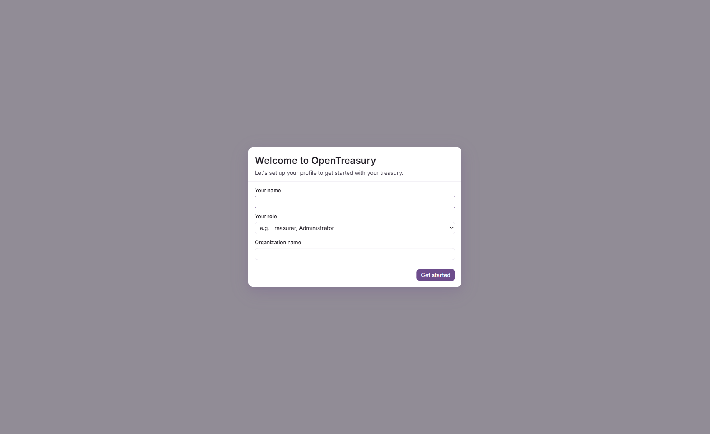
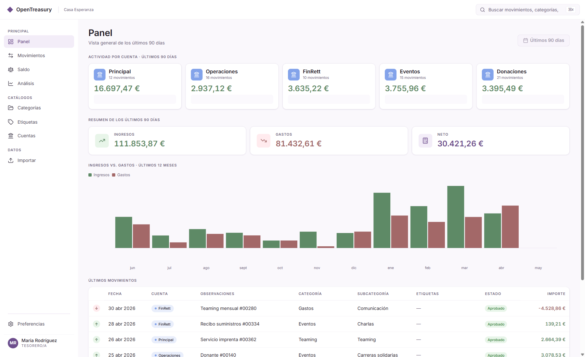
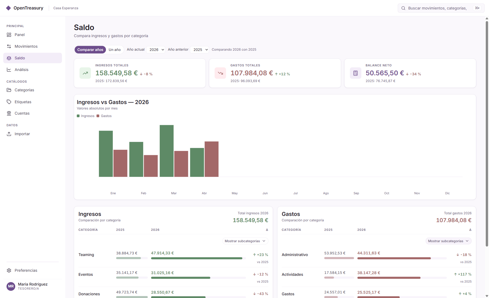
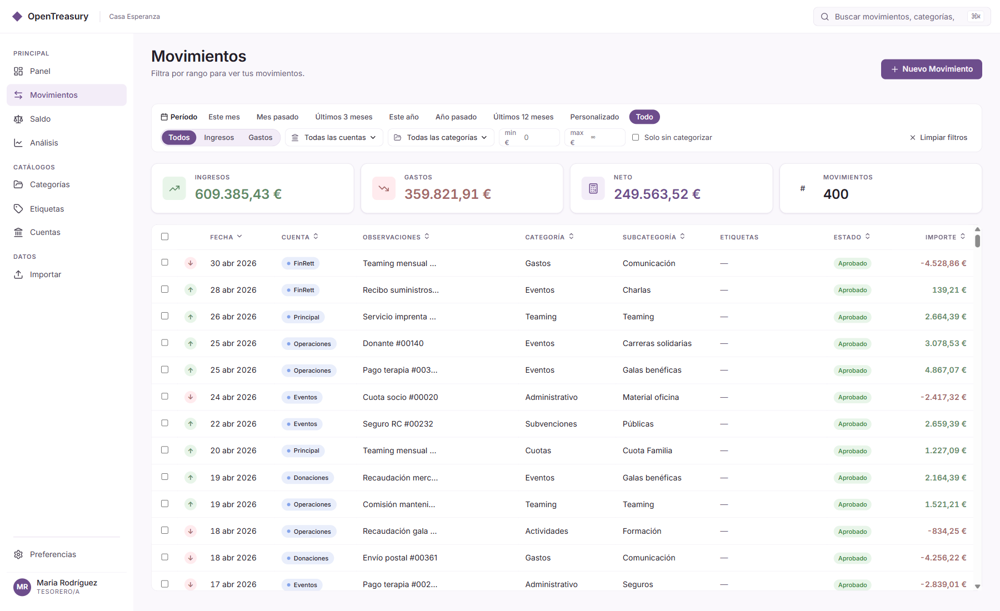
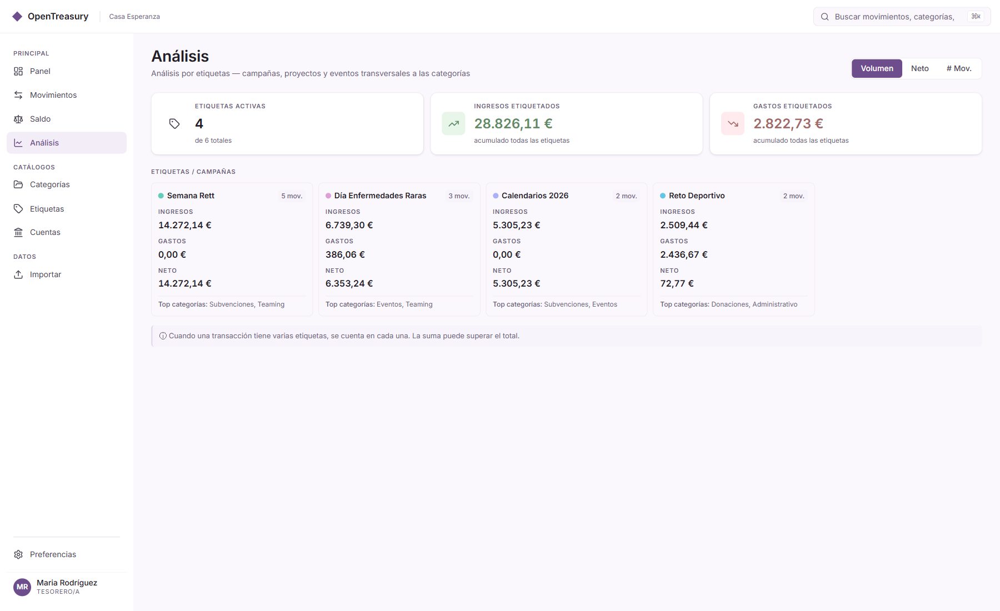
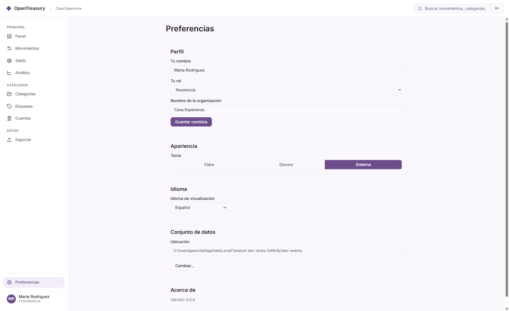

🇬🇧 [English version: user-guide.md](./user-guide.md)

# OpenTreasury Desktop — Guía de Usuario

> **Para tesoreros, auditores y miembros del equipo que usan OpenTreasury Desktop.**
>
> **Versión:** Prueba (v0.1) · **Última actualización:** Junio 2026

---

## Descripción general

¡Bienvenido a OpenTreasury Desktop! Esta guía te acompañará durante tu primera sesión y te mostrará cómo utilizar la aplicación en tu trabajo de tesorería mensual. Aprenderás a registrar transacciones, revisar tus saldos por categorías, verificar la actividad de tu cuenta y mantener tus datos seguros.

**A quién va dirigida esta guía:** Tesoreros, auditores y coordinadores que trabajan con registros financieros en tu ONG. No necesitas ser un experto en tecnología: lo explicaremos todo en términos sencillos.

**Qué harás:** Sigue el ejemplo de **María Rodríguez**, tesorera de **Casa Esperanza** (una ONG ficticia), que usa la aplicación por primera vez. Te mostraremos las pantallas, botones y flujos que verás cada día.

**Nota sobre idiomas:** Esta guía está en español, y la aplicación también ofrece versión en inglés. Puedes cambiar de idioma cuando quieras desde Configuración. Todos los ejemplos de pantallas en esta guía están en español porque Casa Esperanza es una organización basada en España.

**¿Necesitas ayuda con instalación o configuración del equipo?** Consulta la [guía de implantación en prueba](./trial-deployment.md) para temas de administración como carpetas compartidas, configuración de OneDrive y la regla de único escritor. Esta guía se enfoca en cómo usar la aplicación una vez instalada.

---

## Tabla de contenidos

1. [Primeros pasos: Tu espacio de trabajo cifrado](#primeros-pasos-tu-espacio-de-trabajo-cifrado)
2. [Primer lanzamiento: Configuración de perfil](#primer-lanzamiento-configuración-de-perfil)
3. [Panel: Tu resumen de 90 días](#panel-tu-resumen-de-90-días)
4. [Agregar una transacción](#agregar-una-transacción)
5. [Saldo: Tus saldos por categoría](#saldo-tus-saldos-por-categoría)
6. [Movimientos: Lista de transacciones y filtros](#movimientos-lista-de-transacciones-y-filtros)
7. [Análisis: Tendencias y desgloses por categoría](#análisis-tendencias-y-desgloses-por-categoría)
8. [Exportar: CSV y Excel filtrados](#exportar-csv-y-excel-filtrados)
9. [Configuración: Carpeta de datos y modo de solo lectura](#configuración-carpeta-de-datos-y-modo-de-solo-lectura)
10. [Copia de seguridad de tus datos](#copia-de-seguridad-de-tus-datos)

---

## Primeros pasos: Tu espacio de trabajo cifrado

La primera vez que abres OpenTreasury Desktop, la aplicación te guía por tres pantallas breves antes de mostrarte el panel: **elegir una carpeta**, **anotar un código de recuperación de 12 palabras** y **confirmar algunas de esas palabras**. Después de eso, listo — la aplicación se desbloquea sola en silencio cada día.

Esta sección explica esas pantallas para la **primera persona** que crea un espacio de trabajo nuevo. Si te estás uniendo a un espacio de trabajo que otra persona ya ha creado (por ejemplo, otro miembro de la junta lo configuró y te ha pasado el código), salta a [Unirse a un espacio de trabajo desde un segundo equipo](#unirse-a-un-espacio-de-trabajo-desde-un-segundo-equipo).

> ⚠️ **Anota las 12 palabras en papel. Guarda ese papel en un lugar seguro.**  
> El equipo de OpenTreasury **no puede recuperarlas por ti.** Si todas las personas con el código de recuperación lo pierden, el espacio de trabajo no podrá abrirse de nuevo — por diseño. No hay puerta trasera.

### Paso 1 — Elige dónde viven tus datos

La primera pantalla se titula **"¿Dónde debe OpenTreasury guardar tus datos?"**. Haz clic en **Elegir carpeta…** y selecciona una carpeta de tu ordenador.

Algunas recomendaciones:

- **Si vas a compartir el espacio de trabajo con otros miembros de la junta o usarlo desde más de un ordenador**, elige una carpeta dentro de **OneDrive**, **SharePoint**, **Dropbox** o **Google Drive**. El proveedor en la nube sincronizará esa carpeta con todos los demás equipos que inicien sesión — así es como un segundo miembro de la junta ve las mismas transacciones que tú.
- **Si solo tú vas a usar este espacio de trabajo**, una carpeta local normal (por ejemplo, `Documentos\OpenTreasury`) está bien.
- La carpeta puede estar vacía (nuevo espacio de trabajo) o contener ya uno de una instalación anterior.

Haz clic en **Continuar** una vez seleccionada la carpeta.

> **Consejo:** Una carpeta sincronizada (OneDrive/Dropbox/etc.) es lo que permite que un segundo equipo vea el mismo espacio de trabajo. Cada equipo mantiene su propia copia de los datos — el proveedor en la nube simplemente los mantiene sincronizados.

### Paso 2 — Tu código de recuperación de 12 palabras

La siguiente pantalla se titula **"Tus datos, cifrados y compartidos de forma segura."**. Muestra **12 palabras en inglés** en una cuadrícula numerada (del 1 al 12).

Estas 12 palabras son tu **código de recuperación**. Son la única forma de abrir este espacio de trabajo si:

- Inicias sesión con otra cuenta de Windows.
- Cambias a un ordenador nuevo.
- Tu ordenador se pierde, se lo roban o lo restablecen.
- Otro miembro de la junta quiere unirse al espacio de trabajo desde su propio equipo.

#### Qué hacer, exactamente

1. **Anota las 12 palabras en papel, en orden.** Numéralas del 1 al 12. El orden importa — "palabra 3 y luego palabra 4" no es lo mismo que "palabra 4 y luego palabra 3".
2. **Guarda el papel en un lugar seguro** — el mismo sitio donde guardarías una copia del pasaporte, un testamento o la llave de una caja fuerte. No pegado al portátil. No en la misma mochila que el portátil.
3. **Si compartes el espacio de trabajo con otros miembros de la junta, comparte con ellos las mismas 12 palabras** por un canal de confianza (en persona, mensaje cifrado, sobre cerrado). Las necesitarán para unirse desde su propio equipo.
4. La aplicación también ofrece los botones **Imprimir** y **Guardar como PDF**. Si usas cualquiera de ellos, trata la impresión o el PDF igual que el papel — son la llave de tu tesorería.
5. Cuando las hayas anotado, haz clic en **Lo he anotado**.

> ⚠️ **Anota estas 12 palabras. El equipo de OpenTreasury no puede recuperarlas por ti.**  
> Cualquiera que tenga las 12 palabras puede abrir el espacio de trabajo. Cualquiera que las pierda, y no tenga a quién pedírselas, no podrá. Ese es el compromiso que mantiene tu tesorería privada frente a proveedores en la nube y ladrones.

### Paso 3 — Confirma algunas palabras

La siguiente pantalla se titula **"Confirma tu código de recuperación"**. Te pide que escribas **3 de las 12 palabras** en posiciones concretas (por ejemplo, "palabra 2", "palabra 7", "palabra 11").

Esto **no es un examen**. Es la aplicación asegurándose de que realmente has anotado las palabras antes de salir de esta pantalla. Si no puedes rellenarlas, vuelve atrás, mira tu papel e inténtalo de nuevo.

Una vez que introduzcas las tres palabras correctamente y hagas clic en **Continuar**, la aplicación configura tu espacio de trabajo cifrado. Verás una pantalla breve de confirmación **"Tu espacio de trabajo está cifrado."** y luego continuarás a la **Configuración de perfil** descrita en la siguiente sección.

### El día a día después de la configuración

Una vez que el espacio de trabajo está configurado, **no necesitas introducir las 12 palabras cada día**. Cuando inicies sesión en Windows y abras OpenTreasury, la aplicación se desbloquea en silencio en segundo plano — como cualquier otra aplicación.

Solo te pedirán el código de recuperación de 12 palabras de nuevo si:

- Inicias sesión con otra cuenta de Windows en el mismo ordenador.
- Instalas OpenTreasury en un ordenador nuevo.
- Se reinstala Windows o se restablece tu perfil de usuario.

En todos esos casos, introduces las 12 palabras una vez, y la aplicación volverá al desbloqueo silencioso a partir de entonces.

### Unirse a un espacio de trabajo desde un segundo equipo

Si otro miembro de la junta ya ha configurado el espacio de trabajo y te ha pasado las 12 palabras, unirse es sencillo:

1. **En el nuevo ordenador**, instala OpenTreasury Desktop de la forma habitual.
2. Abre la aplicación. En la pantalla **"¿Dónde debe OpenTreasury guardar tus datos?"**, elige la **misma carpeta compartida** que usa el primer equipo (por ejemplo, la misma carpeta de OneDrive a la que ambos tenéis acceso).
3. La aplicación detecta un espacio de trabajo existente y muestra la pantalla **"Unirse a un espacio de trabajo existente"**.
4. En **Código de recuperación (12 palabras)**, escribe las 12 palabras exactamente como te las pasaron, en orden, separadas por espacios.
5. Cuando te lo pida, dale un nombre amigable a este equipo (por ejemplo, "Portátil de Pablo"). Esto solo ayuda a distinguir los equipos después.
6. Haz clic en **Unirse**.

Tras unos instantes verás **"Ya estás dentro."** y continuarás al panel. A partir de ahora, ambos equipos ven las mismas transacciones, y las ediciones hechas en un equipo se sincronizan con el otro a través de la carpeta compartida. Cada equipo se desbloquea en silencio después de la primera vez.

### Si pierdes el acceso

| Qué ha pasado | Qué hacer |
|---|---|
| **Aún tienes el papel con las 12 palabras, pero perdiste el ordenador o tienes uno nuevo.** | Instala OpenTreasury en el nuevo ordenador. Apúntalo a la carpeta compartida del espacio de trabajo (o restaura la carpeta desde la copia de tu proveedor en la nube). Introduce las 12 palabras una vez en la pantalla de **Unirse**. Estás dentro otra vez. |
| **Has olvidado o perdido el papel de las 12 palabras, pero otro miembro de la junta aún lo tiene.** | Pídeselo. El código de recuperación se comparte entre toda la junta — cualquiera que lo tenga puede dárselo a cualquiera que lo necesite. |
| **Todas las personas con el código de recuperación lo han perdido.** | El espacio de trabajo es **irrecuperable**. Por diseño — no hay puerta trasera ni línea de soporte que pueda restablecerlo. Si tienes una exportación manual anterior, restaura desde ahí. Si no, tendrás que empezar un espacio de trabajo nuevo. |

Por eso anotar las palabras en papel y guardar ese papel en un lugar seguro es lo más importante que haces durante la configuración.

### Qué protege el cifrado (y qué no)

**El cifrado te protege frente a:**

- Alguien que te robe el portátil. Sin el código de recuperación o tu contraseña de Windows, no pueden leer los datos de la tesorería.
- Una brecha en el proveedor en la nube (OneDrive, Dropbox, Google Drive). Los archivos en la carpeta compartida están cifrados — inútiles sin las 12 palabras.
- Otra persona que use el mismo ordenador con una cuenta de Windows **distinta**. No puede abrir tu espacio de trabajo desde su cuenta.

**El cifrado NO te protege frente a:**

- Alguien que use tu ordenador mientras tú estás con la sesión de Windows iniciada. Para ellos, la aplicación parece desbloqueada. **Bloquea la pantalla cuando te alejes.**
- Malware ejecutándose en tu ordenador mientras lo estás usando.
- Cualquier persona a la que le des las 12 palabras. El código de recuperación es la llave del espacio de trabajo — compártelo como compartirías las llaves de una caja fuerte.

**¿Y si alguien edita los archivos directamente?**

Tus archivos del espacio de trabajo también incorporan **evidencia de manipulación**. Si los archivos de eventos cifrados se alteran fuera de la aplicación — editados, reordenados o truncados por algo que no sea OpenTreasury — el siguiente desbloqueo detecta el cambio, se niega a abrir los datos alterados y te dirige a la recuperación en lugar de cargar silenciosamente registros modificados. Esto funciona automáticamente; no hay ningún ajuste que activar.

Sé honesto contigo mismo sobre lo que esto significa y lo que no: es **evidente** a la manipulación, no a prueba de manipulación. Detecta de forma fiable los cambios externos a datos que la aplicación ya ha sellado; no hace que los archivos sean físicamente inmutables, y por sí solo no puede demostrar un historial completo ante un regulador. (Consulta [SPEC-028 §8](../specs/028-audit-and-evidence.md) para el modelo de amenaza preciso y sus límites.)

Si quieres una explicación más profunda del modelo de seguridad, consulta [SPEC-026 — Cifrado en reposo](../specs/026-encryption-at-rest.md) (para los técnicamente curiosos — el cuerpo de esta guía es la versión amigable).

---

## Primer lanzamiento: Configuración de perfil

Cuando abres OpenTreasury Desktop por primera vez, verás una **pantalla de configuración de perfil**. Aquí es donde le indicas a la aplicación quién eres y para qué organización trabajas.

  
_**Figura 1:** El modal de configuración de perfil aparece en tu primer lanzamiento. Ingresa tu nombre, elige tu rol e indica el nombre de tu ONG._

### Qué rellenar

1. **Tu nombre** — Introduce tu nombre completo como deseas que aparezca en la aplicación (por ejemplo, "María Rodríguez").
2. **Tu rol** — Elige uno de los siguientes en el menú desplegable:
   - **Tesorero/a** — Registras y apruebas transacciones.
   - **Observador** — Revises datos pero no agregas ni cambias transacciones.
   - **Auditor** — Revisas y exportas datos para cumplimiento o reportes.
3. **Nombre de la ONG** — Escribe el nombre de tu organización (por ejemplo, "Casa Esperanza").

Una vez que hayas rellenado estos campos, haz clic en **Continuar**. La aplicación guarda tu perfil y abre el panel principal.

> **Nota:** Tu perfil se guarda en tu laptop, no en la carpeta de datos compartida. Esto significa que cada miembro del equipo configura su propio perfil en su propio ordenador. Las transacciones que registras (que sí se comparten) mostrarán tu nombre en los detalles, para que tus compañeros sepan quién las registró.

### Cambiar tu perfil más tarde

Si necesitas actualizar tu nombre o rol (por ejemplo, si cambias de Observador a Tesorero/a), puedes hacerlo en **Configuración** → **Perfil** (planeado para v1). Para la prueba, contacta con tu administrador para restablecer tu perfil si es necesario.

---

## Panel: Tu resumen de 90 días

Después de configurar tu perfil, llegarás al **Panel** (también llamado **Panel** en algunas pantallas). Este es tu base: muestra un resumen rápido de la actividad financiera de tu ONG en los últimos **90 días**.

  
_**Figura 2:** El Panel muestra el nombre de tu ONG en la barra superior ("Casa Esperanza") y tarjetas de actividad de cada cuenta durante los últimos 90 días._

### Qué ves

- **Barra superior:** El nombre de tu ONG aparece en la cabecera (por ejemplo, "Casa Esperanza"), junto con la fecha actual y un selector de idioma/tema.
- **Resumen de KPI:** Un banner en la parte superior muestra tu **ingreso**, **gastos** y **saldo neto** de los últimos 90 días. Esto te da una vista rápida de si estás en positivo o negativo durante este período.
- **Tarjetas de actividad de cuenta:** Debajo de los KPI, verás una tarjeta por cada cuenta (por ejemplo, "CaixaBank – Operaciones", "BBVA – Restringida"). Cada tarjeta muestra:
   - El nombre de la cuenta y el banco.
   - Cuántos ingresos y gastos pasaron por esa cuenta en los últimos 90 días.
   - El saldo neto (ingresos menos gastos).
   - El número de transacciones registradas para esa cuenta.

### ¿Por qué 90 días?

La mayoría de las ONG tienen volúmenes bajos de transacciones: una ventana de 30 días a menudo muestra poca actividad, lo que dificulta ver patrones. Una **ventana móvil de 90 días** te ofrece mejor visibilidad sin el problema del cambio de mes (donde todo se reinicia el día 1 y te deja con paneles vacíos a mitad de mes).

> **Consejo:** Si una cuenta muestra "0 transacciones" y saldos cero, significa que no hay actividad en los últimos 90 días. Esto es normal para cuentas estacionales o cuentas nuevas que acabas de crear.

### ¿Qué sigue?

Desde el Panel, puedes:
- Hacer clic en **Movimientos** en la barra lateral para ver tu lista completa de transacciones.
- Hacer clic en **Saldo** para revisar tu desglose por categorías.
- Hacer clic en **Análisis** para ver tendencias y patrones de gasto.
- Hacer clic en **Nuevo Movimiento** (el botón "+", normalmente en la esquina superior o inferior derecha) para agregar una transacción.

---

## Agregar una transacción

Registrar una transacción es una de las tareas más comunes que harás. Así es cómo funciona.

### Paso 1: Abre el modal "Agregar transacción"

Desde cualquier pantalla, haz clic en el botón **Nuevo Movimiento** (normalmente un ícono "+" en la barra de herramientas o un botón etiquetado "Agregar transacción"). Se abre una ventana modal con un formulario.

> **Modo de solo lectura:** Si ves el botón "Nuevo Movimiento" deshabilitado (atenuado), estás en **modo de solo lectura**. Esto significa que otro miembro de tu equipo es el escritor actual. Consulta la sección [Configuración](#configuración-carpeta-de-datos-y-modo-de-solo-lectura) para aprender cómo cambiar escritores.

### Paso 2: Completa los detalles de la transacción

El formulario solicita:

1. **Fecha** — La fecha en que ocurrió la transacción (por defecto: hoy). Haz clic en el selector de fecha para elegir una fecha diferente.
2. **Descripción** — Una breve nota sobre la transacción (por ejemplo, "Alquiler de oficina – Mayo 2026", "Donación de Fundación ABC").
3. **Cuenta** — Qué cuenta bancaria o de efectivo afecta esta transacción. Elige del menú desplegable (por ejemplo, "CaixaBank – Operaciones").
4. **Categoría** — Qué tipo de transacción es:
   - **Categorías de ingreso:** Donaciones, Subvenciones, Cuotas, etc.
   - **Categorías de gastos:** Casa, Servicios, Salarios, Suministros, etc.
5. **Importe** — El monto de la transacción en euros (o tu moneda local). Ingresa el número sin símbolo de moneda (por ejemplo, "1200.50" para €1.200,50).
6. **Tipo** — Elige **Ingreso** o **Gasto**. Esto determina si el monto se suma o se resta de tu saldo.

### Paso 3: Guarda la transacción

Haz clic en **Guardar**. El modal se cierra y la transacción aparece en tu lista de **Movimientos** y actualiza tus saldos **Saldo** inmediatamente.

> **Subcategorías (opcional):** Algunas categorías tienen subcategorías. Por ejemplo, **Salarios** podría tener subcategorías como "Salario base", "Seguridad social", "Bonificación". Si tu categoría tiene subcategorías, aparece un menú desplegable adicional. Elige el que corresponda o déjalo como "General" si no estás seguro.

### Ejemplo: María registra el alquiler de oficina

María de Casa Esperanza quiere registrar el pago del alquiler de mayo:

1. Hace clic en **Nuevo Movimiento**.
2. Completa:
   - **Fecha:** 1 de mayo de 2026
   - **Descripción:** "Alquiler de oficina – Mayo 2026"
   - **Cuenta:** "CaixaBank – Operaciones"
   - **Categoría:** "Casa" → subcategoría "Alquiler"
   - **Importe:** 800
   - **Tipo:** Gasto
3. Hace clic en **Guardar**.

La transacción de alquiler ahora aparece en su lista de Movimientos y su pantalla Saldo muestra €800 en la categoría "Casa › Alquiler".

---

## Saldo: Tus saldos por categoría

La pantalla **Saldo** es donde ves tus ingresos y gastos desglosados por **categoría** y **subcategoría**. Piénsalo como tu vista de presupuesto: muestra de dónde viene tu dinero y hacia dónde va.

  
_**Figura 3:** La pantalla Saldo con categorías contraídas. Puedes ver el ingreso total, gastos totales y saldo neto en la parte superior._

### Qué ves

- **Barra de resumen superior:** Ingreso total, gastos totales y saldo neto para el período seleccionado (por defecto: mes actual).
- **Dos secciones:**
   - **Ingresos:** Todas las categorías de ingreso (Donaciones, Subvenciones, etc.) con sus totales.
   - **Gastos:** Todas las categorías de gasto (Casa, Servicios, Salarios, etc.) con sus totales.
- **Filas de categoría:** Cada categoría muestra su monto total y un pequeño gráfico de barras indicando su proporción del total.

### Expandir subcategorías

La mayoría de las categorías tienen subcategorías. Por ejemplo, **Casa** (Vivienda) podría incluir:
- Alquiler
- Servicios públicos
- Mantenimiento

Para ver el desglose de subcategorías, haz clic en el **ícono de expansión** (normalmente un "▼" o chevron) junto al nombre de la categoría. La fila se expande para mostrar cada subcategoría con su propio monto y barra.

  
_**Figura 4:** La misma pantalla Saldo con subcategorías de ingresos y gastos expandidas. Ahora ves exactamente hacia dónde fue cada euro._

### Cambiar el período de tiempo

Por defecto, la pantalla Saldo muestra el **mes actual**. Puedes cambiar esto usando el selector de rango de fechas en la parte superior:

- **Fichas predefinidas:** "Este mes", "Últimos 30 días", "Últimos 90 días", "Lo que va del año"
- **Rango personalizado:** Haz clic en "Personalizado" y elige una fecha de inicio/fin.

Los totales y desgloses de categorías se actualizan inmediatamente para coincidir con tu selección.

> **Consejo:** Usa "Últimos 90 días" si deseas una vista móvil que coincida con tu Panel. Usa "Este mes" si estás preparando un informe mensual para tu junta o auditor.

### Profundizar en transacciones

Si deseas ver las transacciones individuales que componen un total de categoría, haz clic en la fila de la categoría. Esto te lleva a la pantalla **Movimientos** con un filtro aplicado para esa categoría.

Por ejemplo, hacer clic en **Salarios** en la pantalla Saldo te lleva a Movimientos filtrado para mostrar solo transacciones de salarios. Esta es una forma rápida de verificar detalles o revisar entrada a entrada.

---

## Movimientos: Lista de transacciones y filtros

La pantalla **Movimientos** es tu lista completa de transacciones. Cada transacción que registras (o tus compañeros registran) aparece aquí, ordenada por fecha (la más reciente primero).

  
_**Figura 5:** La pantalla Movimientos muestra una lista filtrable y clasificable de todas las transacciones. Puedes buscar por cuenta, categoría o rango de fechas._

### Qué ves

- **Barra de búsqueda:** Escribe una palabra clave (por ejemplo, "alquiler", "donación", "CaixaBank") para filtrar transacciones por descripción, cuenta o categoría.
- **Fichas de filtro:** Filtros rápidos para cuenta, categoría y rango de fechas. Haz clic en una ficha para abrir un menú desplegable y elegir tus filtros.
- **Tabla de transacciones:** Las columnas incluyen:
   - **Fecha:** Cuándo ocurrió la transacción.
   - **Descripción:** Tu nota sobre la transacción.
   - **Cuenta:** Qué cuenta fue afectada.
   - **Categoría:** La categoría y subcategoría (si la hay).
   - **Importe:** El monto en euros, codificado por color (verde para ingresos, rojo para gastos).
- **Franja de totales:** En la parte inferior, verás el ingreso total, gasto total, saldo neto y recuento de transacciones para el filtro actual.

### Filtrar transacciones

Usa las fichas de filtro para reducir tu vista:

1. **Por cuenta:** Haz clic en la ficha "Cuenta" y elige una o más cuentas (por ejemplo, "CaixaBank – Operaciones"). La lista se actualiza para mostrar solo transacciones de esas cuentas.
2. **Por categoría:** Haz clic en la ficha "Categoría" y elige una o más categorías (por ejemplo, "Salarios", "Casa"). Útil para revisar todos los gastos en una categoría específica.
3. **Por rango de fechas:** Haz clic en la ficha "Rango de fechas" y elige una predefinida (por ejemplo, "Este mes", "Últimos 90 días") o un rango personalizado de inicio/fin.

Puedes combinar filtros. Por ejemplo, filtra por **Cuenta = CaixaBank** + **Categoría = Donaciones** + **Rango de fechas = Últimos 90 días** para ver todas las donaciones recibidas en tu cuenta CaixaBank durante los últimos 90 días.

> **Limpiar filtros:** Para restablecer todos los filtros y ver la lista completa de transacciones nuevamente, haz clic en el botón "Limpiar" o "Restablecer" (normalmente junto a las fichas de filtro).

### Ver detalles de transacciones

Haz clic en cualquier fila de la tabla para abrir un **panel de detalles** (o modal) con información completa sobre esa transacción:
- Fecha, descripción, cuenta, categoría, subcategoría
- Monto y tipo (ingreso/gasto)
- Quién la registró (tu nombre o el de un compañero)
- Cuándo se registró (marca de tiempo)

Desde el panel de detalles, puedes:
- **Editar** la transacción (cambiar la descripción, categoría o monto). Solo disponible si eres el escritor.
- **Eliminar** la transacción (planeado para v1; no disponible en la prueba).
- **Dividir** la transacción en múltiples categorías (ver abajo).

### Dividir una transacción

A veces una sola transacción cubre múltiples categorías. Por ejemplo, un pago de €1.000 podría incluir:
- €800 para alquiler (Casa › Alquiler)
- €200 para servicios públicos (Casa › Servicios públicos)

Para dividir una transacción:

1. Abre el panel de detalles de la transacción.
2. Haz clic en **Dividir**.
3. Aparece un formulario donde puedes asignar porciones del monto total a diferentes categorías.
4. Ingresa el monto para cada categoría (la aplicación asegura que la división suma el monto original).
5. Haz clic en **Guardar**.

La transacción ahora aparece como múltiples filas en tu lista de Movimientos, cada una con su propia categoría. La transacción original se reemplaza por los movimientos divididos.

> **Limitación de prueba:** La división de transacciones está disponible en la prueba, pero no puedes deshacer una división. Si cometes un error, tendrás que eliminar las transacciones divididas y reingresar la original. La funcionalidad de deshacer está planeada para v1.

---

## Análisis: Tendencias y desgloses por categoría

La pantalla **Análisis** te muestra resúmenes visuales de tu actividad financiera. Úsala para detectar patrones de gasto, comparar ingresos vs. gastos a lo largo del tiempo y ver qué categorías consumen más recursos.

  
_**Figura 6:** La pantalla Análisis muestra un gráfico de rosquilla de tus categorías de gastos y un gráfico de barras comparando ingresos vs. gastos a lo largo del tiempo._

### Qué ves

- **Gráfico de rosquilla:** Un visual estilo gráfico de pastel mostrando tus categorías de gasto como sectores. Cuanto mayor sea el sector, más hayas gastado en esa categoría. Pasa el cursor sobre un sector para ver el monto exacto y el porcentaje.
- **Gráfico de barras (o gráfico divergente):** Un gráfico de barras lado a lado o divergente mostrando ingresos y gastos por categoría. Esto te ayuda a comparar qué categorías generan más dinero (lado de ingresos) vs. cuál cuesta más (lado de gastos).
- **Gráfico de tendencia (planeado para v1):** Un gráfico de línea o área mostrando ingresos, gastos y saldo neto a lo largo del tiempo (por ejemplo, mes a mes durante el último año). Esto te ayuda a detectar patrones estacionales o picos únicos.

### Cómo usar Análisis

1. **Revisa mensualmente:** Al final de cada mes, revisa tu Análisis para ver si tu gasto se alinea con tu presupuesto. ¿Estás gastando más de la cuenta en "Suministros"? ¿Las donaciones son inferiores a lo esperado?
2. **Prepárate para asambleas:** Exporta una captura o imprime la pantalla Análisis para compartir con tu junta o auditores. Los visuales hacen fácil explicar hacia dónde va el dinero.
3. **Profundiza:** Haz clic en un sector del gráfico de rosquilla (o una barra del gráfico de barras) para filtrar la pantalla Movimientos por esa categoría. Esto te lleva directamente a la lista de transacciones para investigación adicional.

> **Consejo:** Usa el selector de rango de fechas en la parte superior de la pantalla Análisis para cambiar el período de tiempo. Por ejemplo, configúralo a "Últimos 90 días" para coincidir con tu vista de Panel, o "Este año" para un resumen anual.

---

## Exportar: CSV y Excel filtrados

La pantalla **Exportar** te permite guardar una porción filtrada de tus movimientos como un archivo **CSV** (para hojas de cálculo, tu gestoría u otras herramientas) o un archivo **Excel** (`.xlsx`). Ábrela desde la entrada **Exportar** en la barra de navegación.

### Qué puedes exportar

Exportar reutiliza los mismos filtros que ya conoces de Movimientos:

- **Rango de fechas** (obligatorio) — por ejemplo, de enero a junio de 2026.
- **Cuenta** — por ejemplo, solo la cuenta de CaixaBank.
- **Categoría y subcategoría** — por ejemplo, solo "Donaciones".
- **Etiqueta / búsqueda de texto** — por ejemplo, movimientos etiquetados o que coinciden con una palabra.

> **Debes acotar la exportación.** Para evitar volcar accidentalmente todo el conjunto de datos, OpenTreasury exige un **rango de fechas más al menos un filtro adicional** (cuenta, categoría, subcategoría o etiqueta) antes de que el botón **Exportar** se active. Una exportación completa y sin filtrar no está permitida a propósito.

### Un ejemplo práctico

Supón que quieres enviar a tu junta las donaciones recibidas a través de CaixaBank en el primer semestre de 2026:

1. Abre **Exportar** desde la barra de navegación.
2. Fija el **rango de fechas** en **1 ene 2026 – 30 jun 2026**.
3. Añade el filtro **Cuenta** y elige **CaixaBank**.
4. Añade el filtro **Categoría** y elige **Donaciones**.
5. Elige **CSV** o **Excel**.
6. Haz clic en **Exportar**. Aparece un paso de confirmación (ver más abajo).
7. Elige dónde guardar el archivo. El nombre del archivo y la forma en que se escriben las fechas y los números siguen tu configuración actual de idioma y formato.

### El paso de confirmación

Como una exportación saca datos **fuera** del espacio de trabajo cifrado, la aplicación te pide confirmar de forma deliberada: escribe la palabra **`EXPORTAR`** (o **`EXPORT`** en inglés) para autorizarla. Es una salvaguarda, no una contraseña — solo se asegura de que la exportación sea intencionada. Tus datos nunca salen de la aplicación en forma legible hasta que completas este paso.

Algunas cosas que la aplicación hace por ti automáticamente:

- **Los archivos CSV usan `;` (punto y coma)** como separador de columnas, que es lo que espera el Excel en español/europeo.
- **Las fechas, los números y el nombre del archivo se formatean según tu configuración regional** (consulta los ajustes de "Idioma y formato" más abajo).
- **No puedes guardar la exportación dentro de la carpeta de tu espacio de trabajo.** Esa carpeta es solo para los archivos de eventos cifrados, así que la aplicación bloquea ese destino y te pide elegir otro (por ejemplo, tu carpeta Documentos o el Escritorio).

> **Consejo:** El CSV es mejor cuando alguien necesita importar los datos a otro programa; el Excel es mejor cuando alguien solo quiere abrirlos y leerlos.

---

## Configuración: Carpeta de datos y modo de solo lectura

La pantalla **Configuración** es donde controlas dónde se almacenan tus datos, cambias entre modos de solo lectura y escritura, y cambias preferencias de la aplicación como idioma y tema.

  
_**Figura 7:** La pantalla Configuración muestra tu ruta de carpeta de datos actual y un interruptor de modo de solo lectura. La barra superior muestra un distintivo de "Solo lectura" cuando está activo._

### Ubicación de carpeta de datos

La fila **Carpeta de datos** muestra dónde se almacenan tus datos de transacciones. Esta carpeta contiene archivos de eventos cifrados: un archivo `events-{deviceId}.ndjson` por dispositivo (por ejemplo, `events-laptop-maria.ndjson`), más un archivo compartido `events.key` que contiene la clave de cifrado (envuelta para almacenamiento seguro).

- **Ruta actual:** Verás algo como `C:\Users\maria\OneDrive - Casa Esperanza\Treasury`. Esta es la carpeta que elegiste durante la configuración (o que cambiaste después).
- **Botón de cambio:** Haz clic en **Cambiar** para elegir una carpeta diferente. Se abre un selector de carpetas. Navega a tu nueva ubicación, haz clic en Aceptar, y la aplicación se reinicia con la nueva carpeta.

> **Importante:** Si cambias tu carpeta de datos, estás cambiando a un conjunto de datos diferente. Cualquier transacción en tu carpeta antigua no aparecerá en la nueva carpeta a menos que copies la carpeta de espacio de trabajo completa (todos los archivos `events-*.ndjson` y `events.key`). Para la mayoría de las ONG, estableces esto una vez durante la configuración y no lo cambias nuevamente. Consulta la [guía de implantación en prueba](./trial-deployment.md) para detalles sobre carpetas compartidas y configuración de OneDrive.

### Modo de solo lectura

El interruptor **Modo de solo lectura** controla si puedes agregar o editar transacciones.

- **Interruptor APAGADO (por defecto para el escritor):** Puedes agregar, editar y eliminar transacciones. El botón "Nuevo Movimiento" está habilitado.
- **Interruptor ENCENDIDO (por defecto para observadores):** Puedes ver transacciones, filtrar, buscar y exportar, pero **no puedes agregar ni cambiar** nada. El botón "Nuevo Movimiento" aparece atenuado y un distintivo "Solo lectura" aparece en la barra superior.

**Cuándo usar esto:**

En la prueba, solo **una persona a la vez** debería escribir en el conjunto de datos. Todos los demás deberían estar en modo de solo lectura. Aquí está el flujo:

1. **María (tesorera)** inicia el mes. Apaga el modo de solo lectura en su laptop. Ahora es la escritora.
2. **Pablo (auditor)** abre la aplicación en su laptop. Ve la misma carpeta de datos, pero la aplicación lo pone automáticamente en modo de solo lectura (porque María es la escritora). Puede revisar transacciones pero no agregar ni editar.
3. **A mitad de mes, María se va de vacaciones.** Antes de partir, enciende el modo de solo lectura en su Configuración. Ahora María no puede escribir.
4. **Pablo necesita registrar una transacción urgente.** Va a Configuración en su laptop y apaga el modo de solo lectura. Ahora Pablo es el escritor.
5. **Cuando María regresa,** ella permanece en modo de solo lectura (o coordinan para cambiar roles nuevamente).

> **Por qué importa esto:** Si dos personas intentan escribir al mismo tiempo, obtendrán archivos de conflicto y arriesgarán pérdida de datos. La regla de único escritor previene esto. Para detalles completos sobre cómo gestionar la regla de único escritor, consulta la [guía de implantación en prueba](./trial-deployment.md), Parte 3.

### Qué significa el distintivo "Solo lectura"

Si ves un distintivo **Solo lectura** en la barra superior (junto a tu nombre de ONG), significa:
- Estás en modo de solo lectura.
- Puedes ver, filtrar, buscar y exportar transacciones.
- **No puedes** agregar, editar o eliminar transacciones.
- El botón "Nuevo Movimiento" está deshabilitado.

Para convertirte en el escritor, ve a Configuración y apaga el interruptor de solo lectura (y asegúrate de que el escritor actual lo haya encendido primero).

### Idioma y formato

La pantalla Configuración agrupa tus opciones de idioma y de formato de presentación en una única tarjeta **"Idioma y formato"**, con una fila para cada una:

- **Idioma:** Cambia entre **Español** e **English**. La aplicación actualiza inmediatamente todos los menús, botones y etiquetas. Tus datos (descripciones de transacciones, nombres de cuentas, etc.) permanecen en cualquier idioma en que los hayas ingresado.
- **Formato de fecha:** Elige cómo se muestran y escriben las fechas — por ejemplo **DD/MM/AAAA** (europeo) o **MM/DD/AAAA**. Esto también controla cómo aparecen las fechas en los archivos exportados.
- **Formato de número:** Elige el separador decimal (coma o punto) usado para mostrar y exportar los importes.

El selector de **Tema** (**Sistema**, **Claro** u **Oscuro**) está justo encima, en la parte superior de la pantalla Configuración. Tu elección se guarda localmente en tu laptop.

---

## Copia de seguridad de tus datos

Tus datos de transacciones se almacenan como un conjunto de archivos cifrados en la carpeta de datos que elegiste durante la configuración:
- Un archivo **`events-{deviceId}.ndjson`** por dispositivo (por ejemplo, `events-laptop-maria.ndjson`), que contiene las transacciones registradas en ese dispositivo, cifradas en reposo.
- Un archivo compartido **`events.key`** que contiene la clave de cifrado envuelta.

Todas las transacciones, cuentas, categorías y etiquetas se almacenan cifradas en estos archivos.

### Dónde encontrar tu archivo de datos

1. Abre **Configuración**.
2. Mira la fila **Carpeta de datos**. Verás una ruta como:
   - `C:\Users\maria\OneDrive - Casa Esperanza\Treasury`
3. Abre esa carpeta en Explorador de archivos (Windows) o Finder (Mac).
4. Verás archivos llamados **`events-{deviceId}.ndjson`** (uno por dispositivo, por ejemplo, `events-laptop-maria.ndjson`), y un archivo llamado **`events.key`**.

Juntos, estos archivos conforman todo tu conjunto de datos.

### Cómo hacer copia de seguridad de tus datos

**Opción 1: Copia de seguridad automática de OneDrive (recomendada)**

Si tu carpeta de datos está en **OneDrive para Empresas** o **SharePoint**, tus datos ya están respaldados automáticamente:
- OneDrive sincroniza todos los archivos del espacio de trabajo (los archivos `events-*.ndjson` y `events.key`) a la nube cada vez que cambian.
- Tú (y tus compañeros) pueden acceder al mismo espacio de trabajo desde cualquier laptop.
- OneDrive mantiene histórico de versiones, así que si algo sale mal, puedes restaurar versiones anteriores de los archivos.

**No se requiere trabajo adicional.** Solo asegúrate de que OneDrive está sincronizando correctamente (verifica el ícono de OneDrive en tu bandeja de sistema).

**Opción 2: Copia manual (para carpetas locales o seguridad adicional)**

Si tu carpeta de datos está en tu disco duro local (no OneDrive), o si deseas una copia de seguridad adicional:

1. Navega a tu carpeta de datos (ver arriba).
2. **Copia la carpeta de espacio de trabajo completa** a una ubicación segura:
   - Una unidad USB externa
   - Una carpeta diferente en tu ordenador (por ejemplo, `Documentos\Copias de seguridad de tesorería`)
   - Un servicio de almacenamiento en la nube como Dropbox o Google Drive (si tu organización lo permite)
3. Incluye todos los archivos `events-*.ndjson` y el archivo `events.key`.
4. Renombra la copia de la carpeta con una fecha (por ejemplo, `Treasury-backup-2026-05-31`) para que sepas cuándo la hiciste.
5. Repite esto semanalmente o mensualmente, según la tolerancia al riesgo de tu ONG.

> **Consejo:** Si estás en OneDrive, también puedes descargar una copia de la carpeta de espacio de trabajo completa desde la interfaz web de OneDrive. Inicia sesión en [onedrive.com](https://onedrive.com), navega a tu carpeta de tesorería, selecciona todos los archivos y carpetas, y elige "Descargar". Esto te da una copia sin conexión en tu laptop.

### Restaurar desde una copia de seguridad

Si pierdes tus datos (por ejemplo, eliminas accidentalmente archivos del espacio de trabajo, o tu laptop se bloquea):

1. Ve a tu ubicación de copia de seguridad (unidad USB, histórico de versiones de OneDrive, etc.).
2. Copia la carpeta de espacio de trabajo de copia de seguridad completa en tu ubicación de datos.
3. Asegúrate de que todos los archivos `events-*.ndjson` y el archivo `events.key` estén presentes.
4. Reinicia OpenTreasury Desktop. La aplicación cargará los datos restaurados.

> **Histórico de versiones de OneDrive:** Si estás en OneDrive y no hiciste una copia de seguridad manual, puedes restaurar versiones anteriores de los archivos del espacio de trabajo. Haz clic derecho en cualquier archivo `events-*.ndjson` o `events.key` en Explorador de archivos, elige "Histórico de versiones", y elige una fecha anterior al problema. OneDrive mantiene versiones durante 30 días (o más, según la configuración de tu organización).

### ¿Qué sucede si desinstalo la aplicación?

Si desinstalo OpenTreasury Desktop:
- **Tu archivo de datos está seguro.** Vive en tu carpeta de datos (por ejemplo, OneDrive), no en el directorio de instalación de la aplicación.
- **Tu perfil está seguro.** Se guarda en tu carpeta de perfil de usuario (Windows: `%APPDATA%\opentreasury-desktop`), separado de la instalación.
- **Puedes reinstalar** la aplicación en cualquier momento e indicarle la misma carpeta de datos. Todas tus transacciones reaparecerán.

**Excepción:** Si elegiste una carpeta de datos dentro de `%APPDATA%` u otra carpeta del sistema, desinstalar _podría_ eliminarla (según la configuración de tu desinstalador). Por eso recomendamos usar OneDrive o una carpeta en tu árbol de Documentos u OneDrive.

### Cifrado y seguridad

Tu espacio de trabajo está cifrado en reposo usando **XChaCha20-Poly1305**, un cifrado estándar de la industria Cifrado autenticado con datos asociados (AEAD). Cada transacción se cifra individualmente antes de escribirse en los archivos `events-{deviceId}.ndjson`. La clave de cifrado (`events.key`) se envuelve para almacenamiento seguro: protegida silenciosamente por el almacén de claves del sistema operativo en el uso diario, y recuperable mediante un código de recuperación BIP39 de 12 palabras si es necesario (el mismo código usado para la inscripción del equipo). Esto significa:

- Incluso si alguien accede a tu OneDrive o carpeta compartida, los archivos de eventos son texto cifrado y no se pueden leer sin la clave de cifrado.
- Solo los usuarios que conocen el código de recuperación pueden desbloquear el espacio de trabajo y leer los datos cifrados.
- Cada miembro del equipo se inscribe ingresando el código de recuperación; una vez inscrito, su dispositivo almacena la clave de forma segura en el almacén de claves del SO (Administrador de credenciales de Windows, Llavero de macOS o Servicio secreto de Linux).

Mantén tu código de recuperación en un lugar seguro — es tu clave para el espacio de trabajo y para incorporar nuevos miembros del equipo.

Para detalles técnicos completos sobre el diseño del cifrado, la jerarquía de claves y el modelo de amenaza, consulta la [especificación de Cifrado en reposo](../specs/026-encryption-at-rest.md).

---

## Próximos pasos

¡Felicitaciones! Ahora sabes cómo:
- Configurar tu perfil en el primer lanzamiento
- Leer el Panel para ver tu resumen de actividad de 90 días
- Agregar una transacción (y dividirla si es necesario)
- Revisar tus saldos por categoría en Saldo
- Filtrar y buscar tu lista de transacciones en Movimientos
- Detectar patrones de gasto en Análisis
- Exportar una porción filtrada de tus movimientos a CSV o Excel
- Cambiar entre modos de escritor y solo lectura en Configuración
- Hacer copia de seguridad de tus datos para evitar pérdidas

### Sigue aprendiendo

- **Guía de implantación en prueba:** Si estás configurando la aplicación para tu equipo o resolviendo problemas de carpetas compartidas, consulta la [guía de implantación en prueba](./trial-deployment.md).
- **Ayuda en la aplicación:** Haz clic en el ícono "?" (normalmente en la esquina superior derecha) para acceder a la ayuda contextual para la pantalla actual.
- **Hoja de ruta y características:** ¿Quieres saber qué viene en v1? Consulta el proyecto [README](../../README.md) y la [hoja de ruta](../product/roadmap-v1.md) en la carpeta `docs/product/`.

### Obtener ayuda

Si tienes problemas o preguntas:

1. **Revisa las preguntas frecuentes** en la [guía de implantación en prueba](./trial-deployment.md), Parte 7. Los problemas comunes (modo de solo lectura, archivos de conflicto, sincronización de OneDrive) se cubren allí.
2. **Pregunta a tu coordinador de prueba.** El contacto de prueba de tu ONG puede escalar problemas al equipo de OpenTreasury.
3. **Envíanos un correo electrónico:** [support@opentreasury.org](mailto:support@opentreasury.org) (o el correo electrónico de soporte de tu organización).
4. **Envía comentarios:** Usa el botón de comentarios en la aplicación (planeado para v1) o envíanos un correo electrónico con tus sugerencias.

Estamos agradecidos de que estés probando OpenTreasury Desktop. Tu comentario nos ayuda a construir una herramienta mejor para ONG como la tuya.

---

**Historial de versión:**
- **v0.1 (Junio 2026):** Lanzamiento de prueba inicial. Cubre configuración de perfil, Panel, Saldo, Movimientos, Análisis, Configuración y copia de seguridad de datos.

**Registro de cambios:**
- 2026-06-01: Primera versión publicada.
