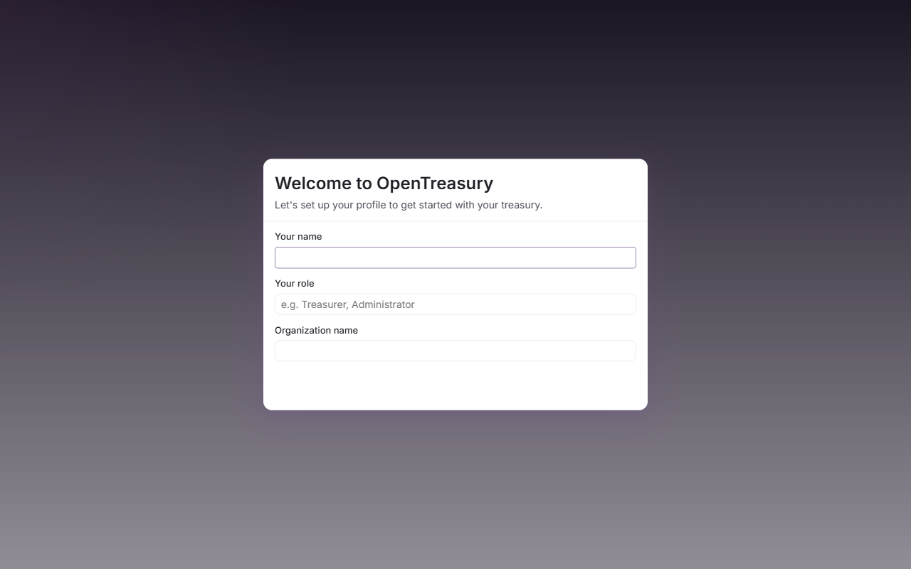
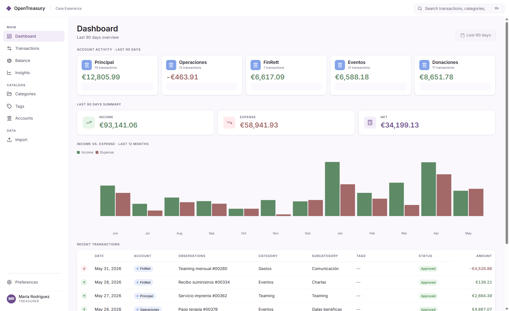
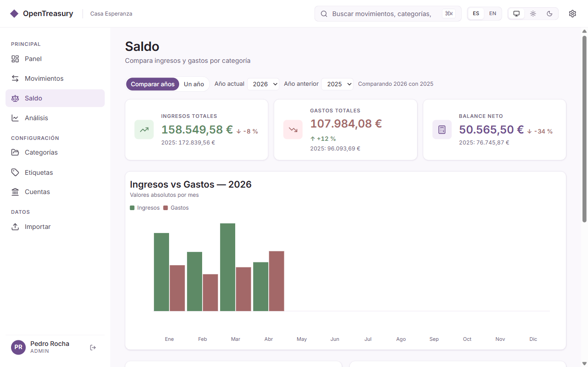
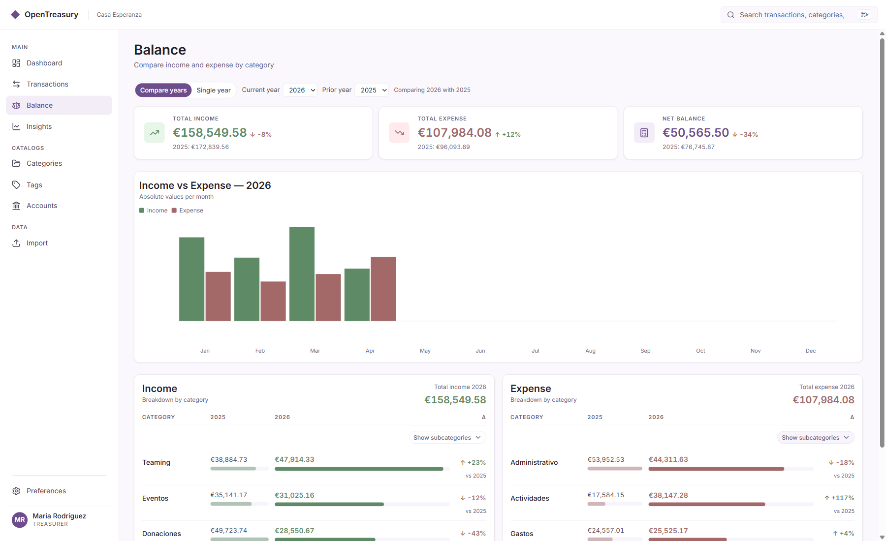
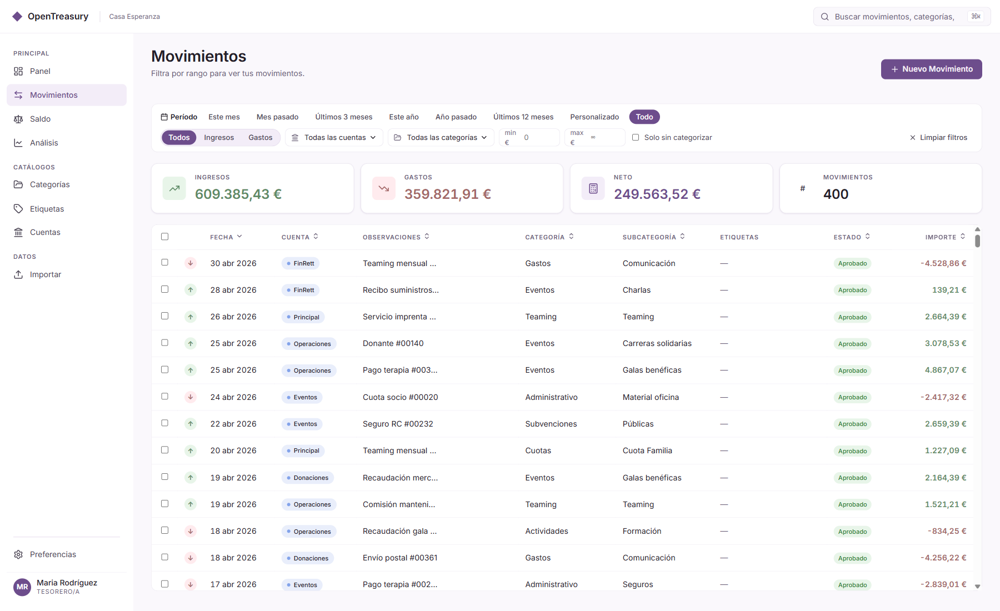
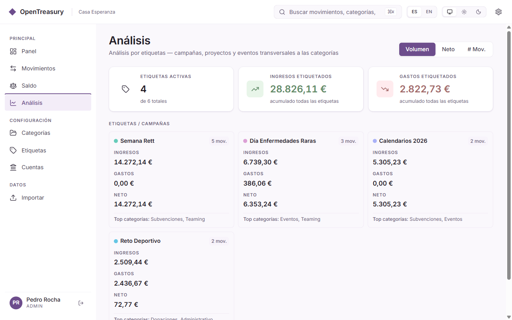
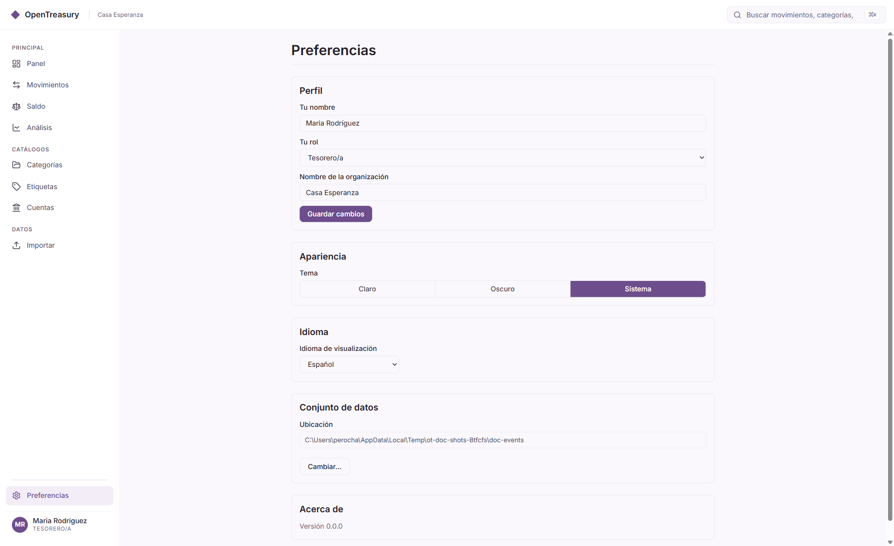

🇪🇸 [Versión en español: user-guide.es.md](./user-guide.es.md)

# OpenTreasury Desktop — End-User Guide

> **For NGO treasurers, auditors, and team members using OpenTreasury Desktop.**
>
> **Version:** Trial (v0.1) · **Last updated:** June 2026

---

## Overview

Welcome to OpenTreasury Desktop! This guide will walk you through your first session and show you how to use the app for your monthly treasury work. You'll learn how to record transactions, review your balances and categories, check your account activity, and keep your data safe.

**Who this guide is for:** Treasurers, auditors, and coordinators who work with financial records for your NGO. You don't need to be a tech expert—we'll explain everything in plain terms.

**What you'll do:** Follow along as **Maria Rodríguez**, a treasurer at **Casa Esperanza** (a fictional NGO), uses the app for the first time. We'll show you screens, buttons, and workflows you'll see every day.

**Language note:** This guide is in English, but the app supports **Spanish** and **English**. You can switch languages anytime in Settings. All screenshots in this guide are in Spanish because Casa Esperanza is a Spanish-based organization.

**Need help with installation or team setup?** See the [trial deployment guide](./trial-deployment.md) for admin topics like shared folders, OneDrive setup, and the one-writer rule. This guide focuses on using the app once it's installed.

---

## Table of Contents

1. [Getting Started: Your Encrypted Workspace](#getting-started-your-encrypted-workspace)
2. [First Launch: Profile Setup](#first-launch-profile-setup)
3. [Dashboard: Your 90-Day Overview](#dashboard-your-90-day-overview)
4. [Adding a Transaction](#adding-a-transaction)
5. [Saldo: Your Category Balances](#saldo-your-category-balances)
6. [Movements: Transaction List and Filtering](#movements-transaction-list-and-filtering)
7. [Insights: Trends and Category Breakdowns](#insights-trends-and-category-breakdowns)
8. [Export: Filtered CSV and Excel](#export-filtered-csv-and-excel)
9. [Settings: Data Folder and Read-Only Mode](#settings-data-folder-and-read-only-mode)
10. [Backing Up Your Data](#backing-up-your-data)

---

## Getting Started: Your Encrypted Workspace

The very first time you open OpenTreasury Desktop, the app walks you through three short screens before you ever see the dashboard: **choose a folder**, **write down a 12-word recovery code**, and **confirm a few of those words**. After that, you're done — the app unlocks itself silently every day from then on.

This section explains those screens for the **first person** setting up a new treasury workspace. If you're joining a workspace someone else already created (for example, another board member set it up and shared a code with you), skip ahead to [Joining a Workspace from a Second Device](#joining-a-workspace-from-a-second-device).

> ⚠️ **Write down the 12 words on paper. Keep that paper safe.**  
> The OpenTreasury team **cannot recover them for you.** If everyone with the recovery code loses it, the workspace cannot be opened again — by design. There is no backdoor.

### Step 1 — Choose where your data lives

The first screen is titled **"Where should OpenTreasury store your data?"**. Click **Choose Folder…** and pick a folder on your computer.

A few rules of thumb:

- **If you'll share the workspace with other board members or use it from more than one computer**, pick a folder inside **OneDrive**, **SharePoint**, **Dropbox**, or **Google Drive**. The cloud provider will sync that folder to every other device that signs in — that's how a second board member sees the same transactions you do.
- **If only you will ever use this workspace**, a normal local folder (e.g., `Documents\OpenTreasury`) is fine.
- The folder can be empty (new workspace) or already contain a workspace from a previous install.

Click **Continue** once the folder is selected.

> **Tip:** A synced folder (OneDrive/Dropbox/etc.) is what lets a second device see the same workspace. Each device still keeps its own copy of the data — the cloud provider just keeps them in sync.

### Step 2 — Your 12-word recovery code

The next screen is titled **"Your data, encrypted and shared securely."**. It shows **12 English words** in a numbered grid (1 through 12).

These 12 words are your **recovery code**. They are the only way to open this workspace if:

- You sign in to a different Windows account.
- You move to a new computer.
- Your computer is lost, stolen, or reset.
- Another board member wants to join the workspace from their own computer.

#### What to do, exactly

1. **Write the 12 words on paper, in order.** Number them 1 to 12. The order matters — "word 3 then word 4" is not the same as "word 4 then word 3".
2. **Store the paper somewhere safe** — the same place you'd keep a passport copy, a will, or a safe-deposit key. Not taped to the laptop. Not in the same bag as the laptop.
3. **If you share the workspace with other board members, share the same 12 words with them** through a channel you trust (in person, encrypted message, sealed envelope). They will need them to join from their own device.
4. The app also offers **Print** and **Save as PDF** buttons. If you use either, treat the printout or PDF the same way you'd treat the paper — it's the key to your treasury.
5. When you've written them down, click **I've written it down**.

> ⚠️ **Write down these 12 words. The OpenTreasury team cannot recover them for you.**  
> Anyone who has the 12 words can open the workspace. Anyone who loses them, and has no one else to ask, cannot. That's the trade-off that keeps your treasury private from cloud providers and thieves.

### Step 3 — Confirm a few of the words

The next screen is titled **"Confirm your recovery code"**. It asks you to type **3 of the 12 words** at specific positions (for example, "word 2", "word 7", "word 11").

This is **not a test**. It's the app making sure you actually wrote the words down before you walk away from this screen. If you can't fill them in, go back, look at your paper, and try again.

Once you enter the three words correctly and click **Continue**, the app sets up your encrypted workspace. You'll see a brief **"Your workspace is encrypted."** confirmation screen, then continue to the **Profile Setup** screen described in the next section.

### Day-to-day after setup

Once the workspace is set up, you **don't need to enter the 12 words every day**. When you sign in to Windows and open OpenTreasury, the app unlocks silently in the background — just like any other app.

You will only be asked for the 12-word recovery code again if:

- You sign in with a different Windows account on the same computer.
- You install OpenTreasury on a new computer.
- Windows is reinstalled, or your user profile is reset.

In all those cases, enter the 12 words once, and the app will go back to silent unlock from then on.

### Joining a workspace from a second device

If another board member has already set up the workspace and shared the 12 words with you, joining is straightforward:

1. **On the new computer**, install OpenTreasury Desktop the normal way.
2. Open the app. On the **"Where should OpenTreasury store your data?"** screen, choose the **same shared folder** the first device uses (for example, the same OneDrive folder both of you have access to).
3. The app detects an existing workspace and shows the **"Join an existing workspace"** screen.
4. In **Recovery code (12 words)**, type the 12 words exactly as they were given to you, in order, separated by spaces.
5. Give this computer a friendly name when prompted (e.g., "Pablo's laptop"). This just helps you tell devices apart later.
6. Click **Join**.

After a moment, you'll see **"You're in."** and continue to the dashboard. From now on, both devices see the same transactions, and edits made on one device sync to the other through the shared folder. Each device unlocks silently after the first time.

### If you lose access

| What happened | What to do |
|---|---|
| **You still have the 12-word paper, but lost the computer or got a new one.** | Install OpenTreasury on the new computer. Point it at the shared workspace folder (or restore the folder from your cloud provider's backup). Enter the 12 words once on the **Join** screen. You're back in. |
| **You forgot or lost the 12-word paper, but another board member still has it.** | Ask them. The recovery code is shared across the whole board — anyone who has it can give it to anyone who needs it. |
| **Everyone with the recovery code has lost it.** | The workspace is **unrecoverable**. This is by design — there is no backdoor and no support line that can reset it. If you have a manual export from before, restore from that. Otherwise, you'll need to start a new workspace. |

This is why writing the words on paper, and keeping that paper somewhere safe, is the single most important thing you do during setup.

### What encryption protects (and what it doesn't)

**Encryption protects you from:**

- Someone who steals your laptop. Without the recovery code or your Windows password, they cannot read your treasury data.
- The cloud provider (OneDrive, Dropbox, Google Drive) being compromised. The files in the shared folder are scrambled — useless without the 12 words.
- Another person who uses the same computer under a **different** Windows account. They can't open your workspace from their account.

**Encryption does NOT protect against:**

- Someone using your computer while you are signed in to Windows. To them, the app looks unlocked. **Lock your screen when you step away.**
- Malware running on your computer while you're using it.
- Anyone you give the 12 words to. The recovery code is the keys to the workspace — share it like you'd share keys to a safe.

**What about someone editing the files directly?**

Your workspace files also carry **tamper-evidence**. If the encrypted event files are altered outside the app — edited, reordered, or truncated by something other than OpenTreasury — the next unlock detects the change, refuses to open the changed data, and routes you to recovery instead of silently loading altered records. This runs automatically; there's no setting to turn on.

Be honest with yourself about what this does and doesn't mean: it is tamper-**evident**, not tamper-**proof**. It reliably _detects_ outside changes to data that the app has already sealed; it does not make the files physically unchangeable, and it cannot, on its own, prove a complete history to a regulator. (See [SPEC-028 §8](../specs/028-audit-and-evidence.md) for the precise threat model and its limits.)

If you'd like a deeper write-up of the security model, see [SPEC-026 — Encryption at Rest](../specs/026-encryption-at-rest.md) (for the technically curious — the body of this guide is the friendly version).

---

## First Launch: Profile Setup

When you open OpenTreasury Desktop for the first time, you'll see a **profile setup screen**. This is where you tell the app who you are and what organization you work for.

  
_**Figure 1:** The profile setup modal appears on your first launch. Enter your name, pick your role, and type your NGO name._

### What to fill in

1. **Your name** — Enter your full name as you'd like it to appear in the app (e.g., "Maria Rodríguez").
2. **Your role** — Choose from the dropdown:
   - **Treasurer** — You record and approve transactions.
   - **Viewer** — You review data but don't add or change transactions.
   - **Auditor** — You review and export data for compliance or reporting.
3. **NGO name** — Type the name of your organization (e.g., "Casa Esperanza").

Once you've filled in these fields, click **Continue**. The app saves your profile and opens the main dashboard.

> **Note:** Your profile is saved on your laptop, not in the shared data folder. This means each team member sets their own profile on their own computer. The transactions you record (which _are_ shared) will show your name in the transaction details, so your teammates know who entered each one.

### Changing your profile later

If you need to update your name or role (for example, if you switch from Viewer to Treasurer), you can do so in **Settings** → **Profile** (planned for v1). For the trial, contact your admin to reset your profile if needed.

---

## Dashboard: Your 90-Day Overview

After setting up your profile, you'll land on the **Dashboard** (also called the **Panel** in some screens). This is your home base—it shows a quick summary of your NGO's financial activity over the last **90 days**.

  
_**Figure 2:** The Dashboard shows your NGO name in the top bar ("Casa Esperanza") and activity cards for each account over the last 90 days._

### What you see

- **Top bar:** Your NGO name appears in the header (e.g., "Casa Esperanza"), along with the current date and a language/theme switcher.
- **KPI summary:** A banner at the top shows your **income**, **expenses**, and **net balance** for the last 90 days. This gives you a snapshot of whether you're in the black or red for the current period.
- **Account cards:** Below the KPIs, you'll see one card per account (e.g., "CaixaBank – Operations", "BBVA – Restricted"). Each card shows:
  - The account name and bank.
  - The **current balance**: the opening balance configured in Configuración → Cuentas plus every movement recorded for that account. Negative balances are shown in red.
  - The net flow (income minus expense) of the last 90 days, with an arrow showing whether money came in or went out.
  - The number of transactions recorded for that account in the last 90 days.

### Why 90 days?

Most NGOs have low transaction volumes—a 30-day window often shows little activity, making it hard to see patterns. A **90-day rolling window** gives you better visibility without the calendar-month cliff (where everything resets on the 1st of the month and leaves you with empty dashboards mid-month).

> **Tip:** If an account shows "0 transactions", it means no activity in the last 90 days. Its current balance is still shown. This is normal for seasonal accounts or new accounts you've just created.

### What's next?

From the Dashboard, you can:
- Click **Movements** in the sidebar to see your full transaction list.
- Click **Saldo** to review your category-by-category breakdown.
- Click **Insights** to see trends and spending patterns.
- Click **New Transaction** (the "+" button, usually in the top-right or bottom-right) to add a transaction.

---

## Adding a Transaction

Recording a transaction is one of the most common tasks you'll do. Here's how it works.

### Step 1: Open the "Add Transaction" modal

From any screen, click the **New Transaction** button (usually a "+" icon in the toolbar or a button labeled "Add Transaction"). A modal window opens with a form.

> **Read-only mode:** If you see a greyed-out "New Transaction" button, you're in **read-only mode**. This means someone else on your team is the current writer. See the [Settings](#settings-data-folder-and-read-only-mode) section to learn how to switch writers.

### Step 2: Fill in the transaction details

The form asks for:

1. **Date** — The date the transaction occurred (default: today). Click the date picker to choose a different date.
2. **Description** — A short note about the transaction (e.g., "Office rent – May 2026", "Donation from Fundación ABC").
3. **Account** — Which bank account or cash account this transaction affects. Pick from the dropdown (e.g., "CaixaBank – Operations").
4. **Category** — What type of transaction this is:
   - **Income categories:** Donaciones (Donations), Subvenciones (Grants), Cuotas (Membership fees), etc.
   - **Expense categories:** Casa (Housing/Rent), Servicios (Utilities), Salarios (Salaries), Suministros (Supplies), etc.
5. **Amount** — The transaction amount in euros (or your local currency). Enter the number without the currency symbol (e.g., "1200.50" for €1,200.50).
6. **Type** — Choose **Income** or **Expense**. This determines whether the amount is added to or subtracted from your balance.

### Step 3: Save the transaction

Click **Save** (or "Guardar" in Spanish). The modal closes, and the transaction appears in your **Movements** list and updates your **Saldo** balances immediately.

> **Subcategories (optional):** Some categories have subcategories. For example, **Salarios** (Salaries) might have subcategories like "Base salary", "Social security", "Bonuses". If your category has subcategories, an additional dropdown appears. Pick the one that fits, or leave it as "General" if you're not sure.

### Example: Maria records office rent

Maria at Casa Esperanza wants to record her May rent payment:

1. She clicks **New Transaction**.
2. She fills in:
   - **Date:** May 1, 2026
   - **Description:** "Office rent – May 2026"
   - **Account:** "CaixaBank – Operations"
   - **Category:** "Casa" → subcategory "Alquiler" (Rent)
   - **Amount:** 800
   - **Type:** Expense
3. She clicks **Save**.

The rent transaction now appears in her Movements list, and her Saldo screen shows €800 in the "Casa › Alquiler" category.

---

## Saldo: Your Category Balances

The **Saldo** screen is where you see your income and expenses broken down by **category** and **subcategory**. Think of it as your budget view—it shows you where your money is coming from and where it's going.

  
_**Figure 3:** The Saldo screen with categories collapsed. You can see total income, total expenses, and net balance at the top._

### What you see

- **Top summary bar:** Total income, total expenses, and net balance for the selected period (default: current month).
- **Two sections:**
  - **Ingresos (Income):** All income categories (Donaciones, Subvenciones, etc.) with their totals.
  - **Gastos (Expenses):** All expense categories (Casa, Servicios, Salarios, etc.) with their totals.
- **Category rows:** Each category shows its total amount and a small bar chart indicating its proportion of the total.

### Expanding subcategories

Most categories have subcategories. For example, **Casa** (Housing) might include:
- Alquiler (Rent)
- Servicios públicos (Utilities)
- Mantenimiento (Maintenance)

To see the subcategory breakdown, click the **expand icon** (usually a "▼" or chevron) next to the category name. The row expands to show each subcategory with its own amount and bar.

  
_**Figure 4:** The same Saldo screen with both income and expense subcategories expanded. Now you can see exactly where each euro went._

### Changing the time period

By default, the Saldo screen shows the **current month**. You can change this using the date range picker at the top:

- **Preset chips:** "This month", "Last 30 days", "Last 90 days", "Year to date"
- **Custom range:** Click "Custom" and pick a from/to date.

The totals and category breakdowns update immediately to match your selection.

> **Tip:** Use "Last 90 days" if you want to see a rolling view that matches your Dashboard. Use "This month" if you're preparing a monthly report for your board or auditor.

### Drilling into transactions

If you want to see the individual transactions that make up a category total, click the category row. This takes you to the **Movements** screen with a filter applied for that category.

For example, clicking **Salarios** in the Saldo screen takes you to Movements filtered to show only salary transactions. This is a quick way to verify details or spot-check entries.

---

## Movements: Transaction List and Filtering

The **Movements** screen is your full transaction list. Every transaction you (or your teammates) record appears here, sorted by date (newest first).

  
_**Figure 5:** The Movements screen shows a filterable, sortable list of all transactions. You can search by account, category, or date range._

### What you see

- **Search bar:** Type a keyword (e.g., "rent", "donation", "CaixaBank") to filter transactions by description, account, or category.
- **Filter chips:** Quick filters for account, category, and date range. Click a chip to open a dropdown and pick your filters.
- **Transaction table:** Columns include:
  - **Date:** When the transaction occurred.
  - **Description:** Your note about the transaction.
  - **Account:** Which account was affected.
  - **Category:** The category and subcategory (if any).
  - **Amount:** The euro amount, color-coded (green for income, red for expense).
- **Totals strip:** At the bottom, you'll see the total income, total expense, net balance, and transaction count for the current filter.

### Filtering transactions

Use the filter chips to narrow down your view:

1. **By account:** Click the "Account" chip and pick one or more accounts (e.g., "CaixaBank – Operations"). The list updates to show only transactions from those accounts.
2. **By category:** Click the "Category" chip and pick one or more categories (e.g., "Salarios", "Casa"). Useful for reviewing all expenses in a specific category.
3. **By date range:** Click the "Date range" chip and choose a preset (e.g., "This month", "Last 90 days") or a custom from/to range.

You can combine filters. For example, filter by **Account = CaixaBank** + **Category = Donaciones** + **Date range = Last 90 days** to see all donations received in your CaixaBank account over the last 90 days.

> **Clear filters:** To reset all filters and see the full transaction list again, click the "Clear" or "Reset" button (usually next to the filter chips).

### Viewing transaction details

Click any row in the table to open a **detail panel** (or modal) with full information about that transaction:
- Date, description, account, category, subcategory
- Amount and type (income/expense)
- Who recorded it (your name or a teammate's name)
- When it was recorded (timestamp)

From the detail panel, you can:
- **Edit** the transaction (change the description, category, or amount). Only available if you're the writer.
- **Delete** the transaction (planned for v1; not available in the trial).
- **Split** the transaction into multiple categories (see below).

### Splitting a transaction

Sometimes a single transaction covers multiple categories. For example, a €1,000 payment might include:
- €800 for rent (Casa › Alquiler)
- €200 for utilities (Casa › Servicios públicos)

To split a transaction:

1. Open the transaction detail panel.
2. Click **Split** (or "Dividir" in Spanish).
3. A form appears where you can allocate portions of the total amount to different categories.
4. Enter the amount for each category (the app ensures the split adds up to the original total).
5. Click **Save**.

The transaction now appears as multiple rows in your Movements list, each with its own category. The original transaction is replaced by the split entries.

> **Trial limitation:** Transaction splitting is available in the trial, but you cannot undo a split. If you make a mistake, you'll need to delete the split transactions and re-enter the original. Undo functionality is planned for v1.

---

## Insights: Trends and Category Breakdowns

The **Insights** screen shows you visual summaries of your financial activity. Use this to spot spending patterns, compare income vs. expenses over time, and see which categories consume the most resources.

  
_**Figure 6:** The Insights screen shows a donut chart of your expense categories and a bar chart comparing income vs. expenses over time._

### What you see

- **Donut chart:** A pie-chart-style visual showing your expense categories as slices. The bigger the slice, the more you've spent in that category. Hover over a slice to see the exact amount and percentage.
- **Bar chart (or diverging chart):** A side-by-side or diverging bar chart showing income and expenses by category. This helps you compare which categories bring in the most money (income side) vs. which cost the most (expense side).
- **Trend chart (planned for v1):** A line or area chart showing income, expenses, and net balance over time (e.g., month by month for the last year). This helps you spot seasonal patterns or one-time spikes.

### How to use Insights

1. **Review monthly:** At the end of each month, check your Insights to see if your spending aligns with your budget. Are you overspending in "Suministros" (Supplies)? Are donations lower than expected?
2. **Prepare for board meetings:** Export a screenshot or print the Insights screen to share with your board or auditors. The visuals make it easy to explain where funds are going.
3. **Drill down:** Click a slice in the donut chart (or a bar in the bar chart) to filter the Movements screen by that category. This takes you straight to the transaction list for further investigation.

> **Tip:** Use the date range picker at the top of the Insights screen to change the time period. For example, set it to "Last 90 days" to match your Dashboard view, or "This year" for an annual summary.

---

## Export: Filtered CSV and Excel

The **Export** screen lets you save a filtered slice of your movements as a **CSV** file (for spreadsheets, accountants, or other tools) or an **Excel** (`.xlsx`) file. Open it from the **Export** entry in the navigation bar.

### What you can export

Export reuses the same filters you already know from Movements:

- **Date range** (required) — e.g. January to June 2026.
- **Account** — e.g. only the CaixaBank account.
- **Category and subcategory** — e.g. only "Donations".
- **Label / text search** — e.g. movements tagged or matching a word.

> **You must narrow the export.** To avoid accidentally dumping the whole dataset, OpenTreasury requires a **date range plus at least one more filter** (account, category, subcategory, or label) before the **Export** button turns on. A full, unfiltered export is intentionally not allowed.

### A worked example

Say you want to send your board the donations received through CaixaBank in the first half of 2026:

1. Open **Export** from the navigation bar.
2. Set the **date range** to **1 Jan 2026 – 30 Jun 2026**.
3. Add the **Account** filter and pick **CaixaBank**.
4. Add the **Category** filter and pick **Donations**.
5. Choose **CSV** or **Excel**.
6. Click **Export**. A confirmation step appears (see below).
7. Pick where to save the file. The filename and the way dates and numbers are written follow your current language and format settings.

### The confirmation step

Because an export takes data **out** of the encrypted workspace, the app asks you to confirm deliberately: type the word **`EXPORT`** (or **`EXPORTAR`** in Spanish) to authorize it. This is a safety gate, not a password — it just makes sure an export is intentional. Your data never leaves the app in readable form until you complete this step.

A few things the app does for you automatically:

- **CSV files use `;` (semicolon)** as the column separator, which is what Spanish/European Excel expects.
- **Dates, numbers, and the filename are formatted for your locale** (see the "Language & format" settings below).
- **You cannot save the export inside your workspace folder.** That folder is only for the encrypted event files, so the app blocks that destination and asks you to choose another (for example, your Documents folder or Desktop).

> **Tip:** CSV is best when someone needs to import the data into another program; Excel is best when someone just wants to open and read it.

---

## Settings: Data Folder and Read-Only Mode

The **Settings** screen is where you control where your data is stored, switch between read-only and write modes, and change app preferences like language and theme.

  
_**Figure 7:** The Settings screen shows your current data folder path and a read-only mode toggle. The top bar displays a "Read-only" badge when active._

### Data folder location

The **Data folder** row shows where your transaction data is stored. This folder contains encrypted event files: one `events-{deviceId}.ndjson` file per device (e.g., `events-laptop-maria.ndjson`), plus a shared `events.key` file that holds the encryption key (wrapped for secure storage).

- **Current path:** You'll see something like `C:\Users\maria\OneDrive - Casa Esperanza\Treasury`. This is the folder you picked during setup (or changed later).
- **Change button:** Click **Change** to pick a different folder. A folder picker opens. Navigate to your new location, click OK, and the app restarts with the new folder.

> **Important:** If you change your data folder, you're switching to a different dataset. Any transactions in your old folder won't appear in the new folder unless you copy the entire workspace folder (all `events-*.ndjson` files and `events.key`). For most NGOs, you set this once during setup and don't change it again. See the [trial deployment guide](./trial-deployment.md) for details on shared folders and OneDrive setup.

### Read-only mode

The **Read-only mode** toggle controls whether you can add or edit transactions.

- **Toggle OFF (default for the writer):** You can add, edit, and delete transactions. The "New Transaction" button is enabled.
- **Toggle ON (default for viewers):** You can view transactions, filter, search, and export, but you **cannot add or change** anything. The "New Transaction" button is greyed out, and a "Read-only" badge appears in the top bar.

**When to use this:**

In the trial, only **one person at a time** should write to the dataset. Everyone else should be in read-only mode. Here's the workflow:

1. **Maria (treasurer)** starts the month. She turns read-only mode OFF on her laptop. She's now the writer.
2. **Pablo (auditor)** opens the app on his laptop. He sees the same data folder, but the app automatically puts him in read-only mode (because Maria is the writer). He can review transactions but not add or edit.
3. **Mid-month, Maria goes on vacation.** Before she leaves, she turns read-only mode ON in her Settings. Now Maria can't write.
4. **Pablo needs to record an urgent transaction.** He goes to Settings on his laptop and turns read-only mode OFF. Now Pablo is the writer.
5. **When Maria returns,** she stays in read-only mode (or they coordinate to switch roles again).

> **Why this matters:** If two people try to write at the same time, you'll get conflict files and risk data loss. The one-writer rule prevents this. For full details on managing the one-writer rule, see the [trial deployment guide](./trial-deployment.md), Part 3.

### What the "Read-only" badge means

If you see a **Read-only** badge in the top bar (next to your NGO name), it means:
- You're in read-only mode.
- You can view, filter, search, and export transactions.
- You **cannot** add, edit, or delete transactions.
- The "New Transaction" button is disabled.

To become the writer, go to Settings and turn the read-only toggle OFF (and make sure the current writer has turned theirs ON first).

### Language & format

The Settings screen groups your language and display-format choices into a single **"Language & format"** card, with one row each:

- **Language:** Switch between **Español** and **English**. The app immediately updates all menus, buttons, and labels. Your data (transaction descriptions, account names, etc.) stays in whatever language you entered it.
- **Date format:** Choose how dates are shown and written — for example **DD/MM/YYYY** (European) or **MM/DD/YYYY**. This also controls how dates appear in exported files.
- **Number format:** Choose the decimal separator (comma or point) used to display and export amounts.

The **Theme** picker (**System**, **Light**, or **Dark**) lives just above, at the top of the Settings screen. Your choice is saved locally on your laptop.

---

## Backing Up Your Data

Your transaction data is stored as a set of encrypted files in the data folder you chose during setup:
- One **`events-{deviceId}.ndjson`** file per device (e.g., `events-laptop-maria.ndjson`), containing the transactions recorded on that device, encrypted at rest.
- One shared **`events.key`** file containing the wrapped encryption key.

All transactions, accounts, categories, and tags are stored encrypted across these files.

### Where to find your data file

1. Open **Settings**.
2. Look at the **Data folder** row. You'll see a path like:
   - `C:\Users\maria\OneDrive - Casa Esperanza\Treasury`
3. Open that folder in File Explorer (Windows) or Finder (Mac).
4. You'll see files named **`events-{deviceId}.ndjson`** (one per device, e.g., `events-laptop-maria.ndjson`), and a file named **`events.key`**.

Together, these files make up your entire dataset.

### How to back up your data

**Option 1: Automatic OneDrive backup (recommended)**

If your data folder is in **OneDrive for Business** or **SharePoint**, your data is already backed up automatically:
- OneDrive syncs all workspace files (the `events-*.ndjson` files and `events.key`) to the cloud every time they change.
- You (and your teammates) can access the same workspace from any laptop.
- OneDrive keeps version history, so if something goes wrong, you can restore older versions of the files.

**No extra work needed.** Just make sure OneDrive is syncing properly (check the OneDrive icon in your system tray).

**Option 2: Manual copy (for local folders or extra safety)**

If your data folder is on your local hard drive (not OneDrive), or if you want an extra backup:

1. Navigate to your data folder (see above).
2. **Copy the entire workspace folder** to a safe location:
   - An external USB drive
   - A different folder on your computer (e.g., `Documents\Treasury Backups`)
   - A cloud storage service like Dropbox or Google Drive (if your organization allows it)
3. Include all `events-*.ndjson` files and the `events.key` file.
4. Rename the folder copy with a date (e.g., `Treasury-backup-2026-05-31`) so you know when you made it.
5. Repeat this weekly or monthly, depending on your NGO's risk tolerance.

> **Tip:** If you're in OneDrive, you can also download a copy of the entire workspace folder from the OneDrive web interface. Log in to [onedrive.com](https://onedrive.com), navigate to your Treasury folder, select all files and folders, and choose "Download". This gives you an offline backup on your laptop.

### Restoring from a backup

If you lose your data (e.g., you accidentally delete workspace files, or your laptop crashes):

1. Go to your backup location (USB drive, OneDrive version history, etc.).
2. Copy the entire backup workspace folder back into your data location.
3. Make sure all `events-*.ndjson` files and the `events.key` file are present.
4. Restart OpenTreasury Desktop. The app will load the restored data.

> **OneDrive version history:** If you're in OneDrive and you didn't make a manual backup, you can restore previous versions of the workspace files. Right-click any `events-*.ndjson` or `events.key` file in File Explorer, choose "Version history", and pick a date before the problem occurred. OneDrive keeps versions for 30 days (or longer, depending on your organization's settings).

### What happens if you uninstall the app?

If you uninstall OpenTreasury Desktop:
- **Your data file is safe.** It lives in your data folder (e.g., OneDrive), not in the app's install directory.
- **Your profile is safe.** It's stored in your user profile folder (Windows: `%APPDATA%\opentreasury-desktop`), separate from the install.
- **You can reinstall** the app anytime and point it at the same data folder. All your transactions will reappear.

**Exception:** If you chose a data folder inside `%APPDATA%` or another system folder, uninstalling _might_ delete it (depending on your uninstaller settings). This is why we recommend using OneDrive or a folder in your Documents or OneDrive tree.

### Encryption and security

Your workspace is encrypted at rest using **XChaCha20-Poly1305**, an industry-standard Authenticated Encryption with Associated Data (AEAD) cipher. Each transaction is encrypted individually before being written to the `events-{deviceId}.ndjson` files. The encryption key (`events.key`) is wrapped for secure storage: silently protected by your operating system's keystore on daily use, and recoverable via a 12-word BIP39 recovery code if needed (the same code used for team enrollment). This means:

- Even if someone accesses your OneDrive or shared folder, the event files are ciphertext and unreadable without the encryption key.
- Only users who know the recovery code can unlock the workspace and read the encrypted data.
- Each team member enrolls by entering the recovery code; once enrolled, their device stores the key securely in the OS keystore (Windows Credential Manager, macOS Keychain, or Linux Secret Service).

Keep your recovery code in a safe place — it's your key to the workspace and to onboarding new team members.

For full technical details on the encryption design, key hierarchy, and threat model, see the [Encryption at Rest specification](../specs/026-encryption-at-rest.md).

---

## Next Steps

Congratulations! You now know how to:
- Set up your profile on first launch
- Read the Dashboard to see your 90-day activity snapshot
- Add a transaction (and split it if needed)
- Review your category balances in Saldo
- Filter and search your transaction list in Movements
- Spot spending patterns in Insights
- Export a filtered slice of your movements to CSV or Excel
- Switch between writer and read-only modes in Settings
- Back up your data to prevent loss

### Keep learning

- **Trial deployment guide:** If you're setting up the app for your team or troubleshooting shared folder issues, see the [trial deployment guide](./trial-deployment.md).
- **In-app help:** Click the "?" icon (usually in the top-right) to access context-sensitive help for the current screen.
- **Roadmap and features:** Want to know what's coming in v1? See the project [README](../../README.md) and the [roadmap](../product/roadmap-v1.md) in the `docs/product/` folder.

### Getting help

If you run into problems or have questions:

1. **Check the FAQ** in the [trial deployment guide](./trial-deployment.md), Part 7. Common issues (read-only mode, conflict files, OneDrive sync) are covered there.
2. **Ask your trial coordinator.** Your NGO's trial contact can escalate issues to the OpenTreasury team.
3. **Email us:** [support@opentreasury.org](mailto:support@opentreasury.org) (or your organization's support email).
4. **Submit feedback:** Use the in-app feedback button (planned for v1) or email us with your suggestions.

We're grateful you're trying OpenTreasury Desktop. Your feedback helps us build a better tool for NGOs like yours.

---

**Version history:**
- **v0.1 (June 2026):** Initial trial release. Covers profile setup, Dashboard, Saldo, Movements, Insights, Settings, and data backup.

**Changelog:**
- 2026-06-01: First version published.
