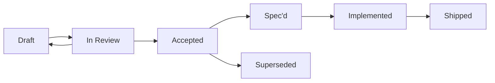

# OpenTreasury Desktop — PRD Plan

> **Status:** Draft v0.1 · **Owner:** Link (PM) · **Last updated:** 2026-04-19
> **Depends on:** [`vision.md`](./vision.md), [`roadmap-v1.md`](./roadmap-v1.md)

---

## 0. Purpose

This document is the **PRD index**. It answers: *what PRDs exist, who owns them, what milestone they target, and where we are.* One entry per planned PRD. The three drafts for the M1 prototype screens are live; the rest are reservations with expected scope summaries.

PRDs live at `docs/product/prds/{prd-id}-{slug}.md`.

---

## 0.1 Assumptions

Product-level assumptions that every PRD inherits. Changing one of these is a cross-cutting decision that requires updating this section and every affected PRD.

- **No pending/draft/future-dated transactions.** Transactions are imported from bank and PayPal statements (CSV import ships M2) or entered manually; either way they are **always confirmed / settled**. The product has **no** pending / draft / provisional / future-dated state. Balance, dashboard, and totals always reflect the full confirmed set in scope. (Resolved 2026-04-19 by Pedro.)
- **i18n is foundational, not a late feature.** The i18n framework ships in **M0**; every user-facing surface is localised from the moment it is introduced. v1 ships **Spanish (primary, pilot) and English (pilot-ready)**. Both locales are v1.0 ship-blockers. (Resolved 2026-04-19 by Pedro.)
- **v1 storage is OneDrive for Business / SharePoint only.** OneDrive Personal (consumer accounts) is explicitly deferred to **v1.x**. Folder-picker UX, validation rules, and all storage integration work target Business/SharePoint. (Resolved 2026-04-19 by Pedro.)
- **Pilot NGO is Rett Spain.** Pedro is primary contact; pilot runs in Spanish. Internal alpha dogfooder is **Pedro**. (Resolved 2026-04-19.)

---

## 1. PRD Lifecycle



- **Draft** — Link writing; open for async comments.
- **In Review** — tagged reviewers: Pedro always; Switch if security-touching; Niobe for UX-heavy PRDs; Neo if it re-opens stack assumptions.
- **Accepted** — green-light for spec work to start (Neo + domain agent).
- **Spec'd** — paired `docs/specs/{NNN}-{slug}.md` is Accepted; implementation PRs can open.
- **Implemented** — code on `main` behind the feature if behind a flag, or unflagged.
- **Shipped** — released in a signed build.
- **Superseded** — replaced by another PRD; header points forward.

---

## 2. PRD Index

### M0 — Foundations

| PRD ID | Title | Status | Milestone | Author | Reviewers | Paired spec |
|---|---|---|---|---|---|---|
| PRD-009 | **i18n Foundations** (framework + ES/EN string-table bootstrap) | Planned | **M0** | Link | Pedro, Niobe, Neo | TBD |

> **Note (re-scope 2026-04-19):** PRD-009 was originally "i18n EN + locale switcher" targeted at M3. Following Pedro's resolution of vision Q6, i18n is a **foundational concern** rather than a late feature. PRD-009 is re-scoped as an **infrastructure PRD** covering: i18n framework selection, string-table layout, locale switcher shell, CI "missing key" lint rule. Per-feature string coverage remains the responsibility of each feature PRD (PRD-001/002/003 etc.) — this PRD owns the plumbing, not the content.

### M1 — Single-user happy path

| PRD ID | Title | Status | Milestone | Author | Reviewers | Paired spec |
|---|---|---|---|---|---|---|
| [PRD-001](./prds/prd-001-movements.md) | Movements / Transaction list | **Draft** | M1 | Link | Pedro, Niobe, Mouse, Switch | `docs/specs/001-movements.md` (planned) |
| [PRD-002](./prds/prd-002-saldo.md) | Saldo / Balance view | **Draft** | M1 | Link | Pedro, Niobe, Mouse | `docs/specs/002-saldo.md` (planned) |
| [PRD-003](./prds/prd-003-panel.md) | Panel / Dashboard | **Draft** | M1 | Link | Pedro, Niobe, Mouse | `docs/specs/003-panel.md` (planned) |
| PRD-010 | Accounts CRUD | Planned | M1 | Link | Pedro, Niobe | TBD |
| PRD-011 | Categories & subcategories | Planned | M1 | Link | Pedro, Niobe | TBD |
| PRD-012 | Tags | Planned | M1 | Link | Pedro, Niobe | TBD |

### M2 — Multi-device shared folder

| PRD ID | Title | Status | Milestone | Author | Reviewers | Paired spec |
|---|---|---|---|---|---|---|
| PRD-004 | Device enrollment + revocation | Planned | M2 | Link + Switch co-author | Pedro, Switch (**final say**), Niobe | `docs/specs/004-enrollment.md` (planned) |
| PRD-005 | Audit log viewer | Planned | M2 | Link | Pedro, Switch, Niobe | TBD |
| PRD-006 | CSV import | Planned | M2 | Link | Pedro, Switch (R17), Niobe | TBD |
| PRD-007 | First-run security wizard | Planned | M2 | Link + Switch co-author | Pedro, Switch (**final say**), Niobe | TBD |
| PRD-015 | Snapshots & restore | Planned | M2 | Link + Switch co-author | Pedro, Switch, Neo | TBD |

### M3 — v1 feature parity

| PRD ID | Title | Status | Milestone | Author | Reviewers | Paired spec |
|---|---|---|---|---|---|---|
| PRD-008 | CSV export | Superseded by PRD-027 | M3 | Link | Pedro, Switch (R17 export), Niobe | TBD |
| PRD-013 | Global search | Planned | M3 | Link | Pedro, Niobe | TBD |
| PRD-014 | Dark mode | Planned | M3 | Link | Pedro, Mouse, Niobe | TBD |

### M4 — v1.x polish

| PRD ID | Title | Status | Milestone | Author | Reviewers | Paired spec |
|---|---|---|---|---|---|---|
| PRD-016 | PDF report export | Planned | M4 | Link | Pedro, Niobe | TBD |
| PRD-017 | Excel export | Planned | M4 | Link | Pedro, Switch (R17), Niobe | TBD |
| PRD-018 | Reports module | Planned | M4 | Link | Pedro, Niobe | TBD |
| PRD-019 | Bulk categorize/tag | Planned | M4 | Link | Pedro, Niobe | TBD |
| PRD-020 | Recurring transactions | Planned | M4 | Link | Pedro, Niobe | TBD |
| PRD-021 | Multi-account reconciliation | Planned | M4 | Link | Pedro, Niobe | TBD |
| PRD-022 | Attachments (receipts) | Planned | M4 | Link | Pedro, Switch, Niobe | TBD |
| PRD-027 | Export (CSV/XLSX) | **Shipped** (v0.1.0-trial.3.14) | M4 | Link | Pedro, Switch, Neo | [SPEC-027](../specs/027-export.md) |
| PRD-030 | Financial Report | **Spec'd (Draft)** | M4 | Link | Pedro, Niobe, Switch, Neo | [SPEC-030](../specs/030-financial-report.md) |

> **Note (Reports — PRD-016 / PRD-018 → PRD-030):** PRD-016 ("PDF report export") and PRD-018 ("Reports module") are folded into **PRD-030 "Financial Report"**, the first concrete report Pedro asked for (replicating the RSE Financial Report 2024 annual statement). **SPEC-030** is the paired spec (Draft). PRD-016/PRD-018 are retained as historical reservations; PRD-030 is authoritative for the Financial Report scope. The PRD-030 body is a reservation pending Link's write-up — SPEC-030 leads with 10 Open Questions for Pedro.

> **Note (Export — PRD-008 vs PRD-027):** PRD-008 ("CSV export", M3) and PRD-027 ("Export (CSV/XLSX)", M4) describe the **same** user-facing feature. The work shipped early under **PRD-027 / SPEC-027** in `v0.1.0-trial.3.14` (filtered CSV **and** Excel export). **PRD-027 is authoritative**; PRD-008 is retained only as a historical reservation and marked superseded.

### Out of v1 (never scheduled unless triggered — see [roadmap §5](./roadmap-v1.md#5-out-of-v1-deferred--explicit-triggers))

| Feature | Reserved ID | Trigger |
|---|---|---|
| Budgets / forecasts | PRD-100+ | Post-v1 user interviews |
| Multi-currency | PRD-100+ | Pilot NGO operates in >1 currency |
| Bank API feeds (PSD2) | PRD-100+ | ≥5 NGOs asking |
| Mobile app / web companion | PRD-100+ | Community contributor |

---

## 3. Authoring Rules

1. **Every PRD has a milestone.** If we can't name it, the PRD doesn't exist yet.
2. **Every PRD has traceability.** PRDs reference vision sections, ADR conditions (C1–C15), security requirements (R1–R20), and crypto-spec sections where applicable. No orphan requirements.
3. **PRDs do not design UI.** Mouse owns visual design. PRDs do not write detailed user flows. Niobe owns UX.
4. **PRDs do not propose implementation.** Neo / Morpheus / Trinity own specs. PRDs describe the **user outcome** and the **testable requirements**; specs describe **how**.
5. **PRD open questions are aimed at Pedro.** Team-internal uncertainty goes to team-chat; PRD questions are decisions Pedro must make.
6. **One PRD, one coherent product unit.** Don't split trivially; don't bundle unrelated features.
7. **A PRD in "Planned" has no body yet** — just a reservation in this index. Promote to Draft when scheduling the work.

---

## 4. Review Etiquette

- All PRD reviews happen on the PR that introduces or updates the PRD.
- **Switch's sign-off is required** (non-negotiable) for any PRD touching: encryption, keys, audit log, escrow, IPC boundaries, logging, CSV parsing, PII handling.
- **Niobe's sign-off is required** for any PRD producing user-visible screens, workflows, empty states, or error copy.
- **Mouse's sign-off is required** for any PRD introducing new visual components beyond the existing prototype vocabulary.
- Pedro is the approval authority for moving Draft → Accepted. **Pedro cannot approve a PRD without Switch's prior sign-off** on security-touching PRDs.

---

## 5. PRD Template

When promoting a Planned PRD to Draft, use the following section structure (see PRD-001/002/003 for live examples):

```
# PRD-NNN — {Feature}
> Status · Owner · Last updated · Target milestone · Depends on

1. Summary            (1–2 sentences)
2. User problem       (who, pain, evidence)
3. User scenarios     (3–5 short stories)
4. Product requirements  (numbered, testable: PR1, PR2, …)
5. Scope — in / out   (explicit lists)
6. Success metrics    (each tied to a PR)
7. Dependencies       (ADR conditions, R-series, crypto-spec, other PRDs — every dependency resolves to a doc path)
8. UX handoff notes   (what Niobe needs to spec — do not spec it)
9. Open questions     (3–5 for Pedro)
10. Status history
```

This is **inspired by** `docs/specs/_template.md` but intentionally simpler — PRDs are broader than specs.

---

## 6. Status History

| Date | Status | By | Notes |
|---|---|---|---|
| 2026-04-19 | Draft v0.1 | Link | Initial index: 22 PRD reservations (3 drafted: PRD-001/002/003). |
| 2026-04-19 | Draft v0.2 | Link | Added Assumptions §0.1 (no pending concept; i18n foundational; v1 = OneDrive Business/SharePoint only; pilot = Rett Spain / dogfooder = Pedro). Re-scoped PRD-009 from M3 "i18n EN" to M0 **i18n Foundations** (infrastructure). |

---

*End of PRD Plan v0.1 — next: Pedro reviews the three M1 drafts, Link authors remaining M1 PRDs (Accounts, Categories, Tags) per plan.*
