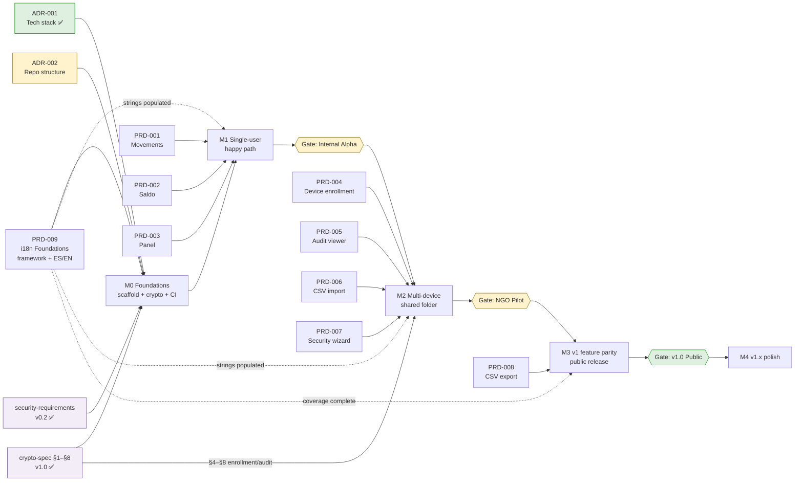

# OpenTreasury Desktop — Roadmap v1

> **Status:** Draft v0.1 · **Owner:** Link (PM) · **Last updated:** 2026-04-19
> **Depends on:** [`vision.md`](./vision.md), [ADR-001](../architecture/adr-001-tech-stack.md) (Accepted), [ADR-002](../architecture/adr-002-repo-structure.md) (Proposed), [`crypto-spec.md`](../security/crypto-spec.md) v1.0, [`security-requirements-v0.1.md`](../security/security-requirements-v0.1.md) v0.2
> **See also:** [`prd-plan.md`](./prd-plan.md) — per-feature PRD index

---

## 0. TL;DR

Five milestones. **M0 Foundations → M1 Single-user happy path → M2 Multi-device shared folder → M3 v1 feature parity → M4 v1.x polish.** Three gates (Internal Alpha after M1, NGO Pilot after M2, v1.0 Public after M3). No time estimates — T-shirt sizes only. Every milestone scope column says explicitly what is **IN** and what is **OUT** so we don't drift.

The big bet is ordering: **M1 ships value on a single device before we attempt the hardest problem (multi-device merge + escrow) in M2.** That lets the team dogfood solo, shakes out the event-sourcing core, and de-risks the crypto integration before we invite a real NGO.

---

## 1. Release Philosophy & Gates

Three user-facing gates, each with entry criteria. "Done" for a gate = **every** criterion green.

| Gate | After milestone | Audience | Entry criteria |
|---|---|---|---|
| **Internal Alpha** | M1 | Team only (Pedro + squad) | All M1 exit criteria met. **Named dogfooder is Pedro**, who runs the app on real NGO-like data for ≥1 week; zero data-loss incidents; sharp edges documented as bugs. Zero P0 bugs open. |
| **NGO Pilot** | M2 | 1 real NGO (invited) | All M2 exit criteria met. **Named pilot NGO is Rett Spain** (Pedro is primary contact; no external blocker — can start as soon as M2 ships). **Pilot uses Spanish locale; English is tested but not required for pilot.** First-run security wizard (R20) ships. AR9/AR10 install-time warnings documented with screenshots. Pilot NGO has a signed-off backup plan. A named Pedro-approved escalation contact exists. |
| **v1.0 Public** | M3 | General availability (GitHub Releases) | All M3 exit criteria met. ≥2 NGOs running on the pilot build for ≥30 days with zero data-loss incidents. **Both ES and EN are ship-blockers** (i18n is foundational — see M0). Install guide (incl. SmartScreen walkthrough per AR9) published. CONTRIBUTING.md + CODE_OF_CONDUCT.md in place. |

**Non-goals at each gate:**
- Alpha is NOT a "feature-complete" gate — it is "the core loop actually works end-to-end on one machine".
- NGO Pilot is NOT a public release — it is "one NGO, held by the hand".
- v1.0 is NOT "perfect" — it is "safe enough for self-service install by a non-technical treasurer".

---

## 2. Milestones

### M0 — Foundations

- **Theme:** Scaffolding, crypto module, CI.
- **Outcome (user-facing):** Nothing yet. This is plumbing.
- **Size:** **S** (structural, no features).
- **Entry criteria:** ADR-001 Accepted ✅, ADR-002 reviewed + accepted, crypto-spec v1.0 published ✅.

**Scope — IN**
- `app/` scaffolding per ADR-002 §4 (main / preload / renderer / shared / core / crypto / storage / read-model).
- `src/crypto/` implemented against crypto-spec §1–§3 (C1–C5, C8). Pure functions, 100% unit-tested under plain Node.
- `src/storage/` with both `onedrive-folder.ts` (fs-based) and `memory.ts` (in-memory) adapters.
- **Folder-picker targets OneDrive for Business / SharePoint only.** Personal OneDrive (consumer accounts) is explicitly NOT supported in v1 — validation rejects Personal OneDrive paths with a clear "unsupported in v1 — Business/SharePoint only" message. Personal OneDrive support is deferred to v1.x (see §5).
- **i18n framework selected and integrated.** Every renderer surface from M1 onward goes through the i18n layer — no hardcoded user-facing strings. String-table skeletons bootstrapped for **English** and **Spanish** (empty values allowed in M0; populated as features are built). CI has a "missing key" lint from M1 onward.
- `src/shared/events/` and `src/shared/ipc-contracts/` Zod schemas for the M1 event set.
- Electron hardening (C7) in one place — every `BrowserWindow` goes through a hardened helper.
- CI: lint, typecheck, test, `electronegativity` check, `npm audit` gate, secret scan (R14).
- Signed Ed25519 update payload pipeline (R13.1) — even in M0; publishing not live yet but the mechanism exists.

**Scope — OUT**
- Any renderer feature code. No Movements. No Saldo. No Panel.
- UI design system — Mouse's work lands in M1.
- Installer signing (AR9/AR10 — deferred).
- Snapshots, audit log, escrow flows — those are M2 (with the caveat that the crypto primitives they rely on ship here).

**Exit criteria (testable)**
- `npm test` runs green, including property tests for AEAD round-trip, tamper detection, AAD binding (C2).
- CI job asserts no `import` of `electron` or `node:fs` under `src/crypto/**` or `src/core/**`.
- A scripted smoke test launches the Electron shell, opens a window, closes cleanly, and verifies `contextIsolation`/`sandbox`/CSP at runtime.
- Switch signs off that `src/crypto/` matches crypto-spec §1–§3.

**Risks**
- 🟡 The ADR-002 "single-package vs workspaces" open question (Q1/Q2/Q4) must land before scaffolding begins. If Pedro deadlocks here, M0 slips.
- 🟡 Electron hardening regressions are easy to introduce — CI gate is the only defense.

---

### M1 — Single-user happy path

- **Theme:** A treasurer on **one machine** can record, categorize, and review transactions. First-setup only; no multi-device yet.
- **Outcome (user-facing):** *"I installed it, pointed it at a local folder, and I'm tracking donations."*
- **Size:** **L**.
- **Entry criteria:** M0 exit criteria met. PRD-001, PRD-002, PRD-003 reviewed + Accepted. UX specs for the three screens Accepted. Design tokens + component specs from Mouse ready.

**Scope — IN**
- **Three prototype screens wired to the event-sourced core:** Movements ([PRD-001](./prds/prd-001-movements.md)), Saldo ([PRD-002](./prds/prd-002-saldo.md)), Panel ([PRD-003](./prds/prd-003-panel.md)).
- **Accounts** — CRUD (multiple bank accounts, PayPal-style).
- **Categories & subcategories** — CRUD, typed (income/expense).
- **Tags** — CRUD, coloured.
- **Transactions** — create, edit, delete (as tombstone event), uncategorized-only flag, bulk selection UI (bulk *actions* are v1.x). All transactions are **confirmed** from the moment they're created (bank/PayPal statement import ships M2, PRD-006; manual entry in M1). No pending/draft state.
- **First-setup flow (solo)** — pick a folder (local OR OneDrive — treated the same at M1), app creates `escrow.json` with the current device as sole admin, generates DEK v1. Enrollment/revocation deferred to M2.
- **Local SQLite read model** — rebuild-from-events on start.
- **Search** — in-app (over decrypted descriptions + subcategories + tags).

**Scope — OUT**
- Multi-device enrollment / revocation / DEK rotation — **M2.**
- OneDrive-specific sync handling, conflict indicators, "last synced" UX — **M2.**
- CSV import — deferred to M2 (first real NGO needs this; team can type data in for alpha).
- CSV/PDF/Excel export — M3 (CSV) and M4 (PDF/Excel).
- Audit log UI — M2 (the **data** must be written from M1; the **viewer** is M2).
- **All three prototype screens (Movements / Saldo / Panel) ship with both ES and EN strings populated** — per Q6 resolution, i18n is foundational. The i18n *framework* ships in M0; M1 populates ES + EN strings for every surface it introduces.
- Dark mode — M3.
- Snapshots — M2.

**Exit criteria (testable)**
- A user can complete the "core treasury loop" end-to-end: create account → enter one tx by hand → categorize → tag → see it on Panel, Movements, Saldo.
- Transaction list **starts empty** (team decision 2026-04-19) and only loads on date-range selection.
- Every mutation produces an encrypted event file (C1–C3, C11) AND an audit entry (C10) — even though the audit viewer is M2.
- At 1,000 events: Panel loads ≤500ms from cold start; Movements filter ≤100ms on a typical query.
- One squad member has dogfooded the app on real data for ≥1 week with zero data loss.

**Risks**
- 🔴 **Event-sourcing ergonomics.** First real feature on the event-sourced core will expose friction. Budget for one ADR addendum.
- 🟡 **Empty-state UX discipline.** Three screens × three empty states (no folder / folder but no data / filter returns nothing) — easy to under-spec. Niobe owns.
- 🟡 **Prototype drift.** The prototype screens were built against mock data. Wiring them to real events will expose shape mismatches. Contract: PRDs define product behaviour; Niobe resolves prototype↔spec conflicts.

---

### M2 — Multi-device shared folder

- **Theme:** The zero-infrastructure promise lands. Two treasurers on two laptops editing the same NGO's data.
- **Outcome (user-facing):** *"I invited my co-treasurer. She installed it, I approved her device, and now we're both working from the same folder."*
- **Size:** **L**.
- **Entry criteria:** M1 exit criteria met. Security wizard (R20) UX spec Accepted. Snapshot + audit-viewer PRDs drafted and Accepted.

**Scope — IN**
- **Device enrollment flow** per crypto-spec §5 (pending entry, 6-char visual code, admin-online approval).
- **Device revocation + DEK rotation** per crypto-spec §6 (C9).
- **Audit log viewer** — read-only, filterable, export-on-request as decrypted JSON bundle (R8).
- **Snapshots** — minimum daily on active days, retention per R19.
- **First-run security wizard** (R20) — MFA reminder, disk-encryption reminder, folder-sharing warning.
- **OneDrive folder picker + validation** — detect local-only vs synced, warn about unsupported filesystems, handle path-length edge cases.
- **"Last synced" indicator** — reads OneDrive client metadata where available; falls back to most-recent foreign-event timestamp.
- **Foreign-event detection** — file-watcher picks up events written by other devices, rebuilds read model incrementally.
- **CSV import** — bank statements with column mapping + deduplication (the first pilot NGO will need this).
- **Install guide with AR9 SmartScreen walkthrough + AR10 macOS source-build note.**
- **Localisation at ship:** device enrollment, first-run onboarding, security wizard copy, audit-viewer UI, and all admin surfaces introduced in M2 ship fully localized (ES + EN) — i18n is not a post-M2 cleanup pass.

**Scope — OUT**
- CSV export — M3.
- PDF/Excel export — M4.
- Reports module — M4.
- Attachments / receipts — M4.
- Recurring transactions — M4.
- macOS binary distribution — **never in v1** (AR10). Source-build only.
- Any telemetry — **never** (R2, Principle 8 privacy).

**Exit criteria (testable)**
- End-to-end test: Alice onboards, creates dataset. Bob installs, requests enrollment. Alice approves via visual-code compare. Bob reads the same data. Alice revokes Bob. Bob's next write fails; Bob's old cached data is not destroyed (AR2, explicit).
- **Conflict test:** Alice and Bob both record a transaction while offline, sync separately, no merge conflict is surfaced to users, both events land, read model converges.
- Audit chain verified on every app start (C10). A tampered chain is refused with clear recovery UX.
- Snapshot → restore round-trip succeeds; audit chain continuous post-restore (R19).
- One pilot NGO is live.

**Risks**
- 🔴 **OneDrive large-event-count behaviour.** ADR-001 §8 flagged the 10k-event spike as still open (Neo-owned). Must complete BEFORE NGO Pilot ships.
- 🔴 **Admin-offline deadlock.** Enrollment requires admin online. If the pilot NGO's admin is on holiday, the co-treasurer is stuck. Niobe must spec a clear "what to do while you wait" UX; Switch must confirm no shortcut.
- 🟡 **Visual-code compare friction.** NGO treasurers may find the 6-char out-of-band compare step surprising. UX wizard copy is load-bearing.
- 🟡 **File-watcher reliability on OneDrive synced folders.** `chokidar` + OneDrive has known edge cases. Budget for a fallback poll.

---

### M3 — v1 feature parity

- **Theme:** Round out the **v1 Must** rows of the vision feature map. Ship publicly.
- **Outcome (user-facing):** *"This replaces the cloud version for me."*
- **Size:** **M**.
- **Entry criteria:** M2 exit criteria met. At least 2 NGOs (pilot + 1 more) have run on M2 builds for ≥30 days combined with zero data-loss incidents.

**Scope — IN**
- **CSV export** — transactions + current filter set + summary (R17 output safety: Excel-injection quarantine).
- **Global search** across transactions, categories, tags (in-app, on decrypted read model).
- **Dark mode** — token-driven, design parity with prototype.
- **Status workflow polish** — (copy refinements only; the status model is confirmed-only per product decision — transactions come from bank/PayPal statements and are always confirmed).
- **Install guide v1** — web page + screenshots per OS.
- **CONTRIBUTING.md, CODE_OF_CONDUCT.md** — ADR-002 §3 deferred items.
- **Release notes template** per published version (feeds update-payload manifest, R13.1).
- **i18n completeness audit** — both ES and EN fully populated across every surface (i18n framework itself shipped in M0; M3 closes any remaining coverage gaps as a ship-blocker for v1.0).

**Scope — OUT**
- PDF reports — M4.
- Excel export — M4.
- Reports module — M4.
- Bulk categorize/tag *actions* (UI selection exists from M1) — M4.
- Recurring transactions — M4.
- Multi-account reconciliation — M4.
- Attachments — M4.

**Exit criteria (testable)**
- Feature-parity audit against vision §9 shows **100% of v1 Must** rows shipped.
- Install guide passes a "naïve treasurer" usability check (one non-technical tester completes install + first tx ≤10 min per vision §8 target).
- Zero P0/P1 bugs open for >14 days.
- GitHub Release published with signed update-payload manifest + checksums.

**Risks**
- 🟡 **i18n coverage rigor.** Easy to miss 10% of strings; ship with a "missing translation" lint rule in CI.
- 🟡 **CSV-export regression risk on R17** — we've held the Excel-injection line on *imports*; same discipline needed on *exports*.

---

### M4 — v1.x polish

- **Theme:** The "Should-have" rows of the vision feature map. Post-v1.
- **Outcome (user-facing):** *"Now it's pleasant to use at scale."*
- **Size:** **M** (aggregate — individual PRDs smaller).
- **Entry criteria:** v1.0 public for ≥30 days. User feedback triaged; the next wave of PRDs authored against real usage data.

**Scope — IN (candidate list, prioritized inside M4 by usage evidence)**
- PDF report export.
- Excel export.
- Reports module (custom periods, filter presets).
- Bulk categorize/tag actions.
- Recurring transactions (template + schedule).
- Multi-account reconciliation view.
- Attachments / receipts (encrypted in the same folder).

**Scope — OUT (still)**
- Budgets / forecasts — **Later**.
- Multi-currency — **Later**.
- Bank API feeds (PSD2) — **Later**.
- Mobile app — **Later**.
- Attachments → OCR / automatic categorization — **Later**.

**Exit criteria**
- Each sub-feature ships with PRD + spec + UX + design + security review, same discipline as M1–M3.
- No regressions to v1.0 core metrics (time-to-first-tx, sync-conflict rate, zero data-loss).

**Risks**
- 🟡 **Scope creep from "it's a small thing" requests.** PM discipline: if it has no PRD, it's not on the board.

---

## 3. Dependency Graph

**Reading the graph:**
- Green = Accepted. Yellow = Proposed / pending. Purple = Switch-owned security artifacts.
- Every PRD resolves to a milestone. Every milestone resolves to at least one ADR and one security artifact.
- Gates are blocking — you cannot ship past them until their entry criteria (§1) are met.

---

## 4. Feature → Milestone Mapping

Expanded from [vision §9](./vision.md#9-high-level-feature-map). Every row resolves to a PRD and a milestone. PRDs marked *(draft)* exist; others are planned in [`prd-plan.md`](./prd-plan.md).

| Feature | Milestone | PRD ID | Depends on | Notes |
|---|---|---|---|---|
| Accounts CRUD | M1 | PRD-010 (planned) | ADR-001, crypto-spec §2.1 | Simple entity; precedes transactions in UX but is part of the M1 package. |
| Transactions CRUD + list | M1 | **PRD-001** *(draft)* | ADR-001 C1–C3, C10, C11; R3, R5 | **Starts empty** (team decision). |
| Categories & subcategories | M1 | PRD-011 (planned) | ADR-001 | Required by Movements + Saldo. |
| Tags | M1 | PRD-012 (planned) | ADR-001 | Cross-cutting; one PRD covers CRUD + assignment UX. |
| Dashboard (Panel) | M1 | **PRD-003** *(draft)* | ADR-001; Accounts, Categories, Transactions | Aggregation is read-model projection. |
| Balance (Saldo / YoY) | M1 | **PRD-002** *(draft)* | ADR-001; Categories, Transactions | Period selector; projections. |
| Search (in-app global) | M3 | PRD-013 (planned) | Read-model indexes | Tx-list search is in PRD-001; *global* search is M3. |
| Dark mode | M3 | PRD-014 (planned) | Design tokens from Mouse | Token-driven. |
| **i18n framework + ES/EN string tables** | **M0** (framework) / **M1–M3** (coverage) | PRD-009 (**i18n Foundations**, re-scoped to M0) | — | Foundational per Q6 resolution: framework at M0, every feature ships localised from M1; EN+ES are v1.0 ship-blockers. |
| Audit log (local, viewer) | M2 | PRD-005 (planned) | crypto-spec §8; R8 | Data written from M1; viewer is M2. |
| **Device enrollment flow** | M2 | PRD-004 (planned) | crypto-spec §5; C9 | 6-char visual code; admin online. |
| **Device revocation + DEK rotation** | M2 | Part of PRD-004 | crypto-spec §6, §7 | AR2 accepted; documented. |
| **Snapshots** | M2 | PRD-015 (planned) | crypto-spec §2.1; R19 | Min daily on active days. |
| **First-run security wizard** | M2 | PRD-007 (planned) | R20 | Acknowledgment required. |
| **CSV import** | M2 | PRD-006 (planned) | R17 | Column mapping + dedup. |
| **CSV export** | M3 | PRD-008 (planned) | R17 Excel-injection safety | Filter-aware. |
| PDF export | M4 | PRD-016 (planned) | — | Reports module overlap. |
| Excel export | M4 | PRD-017 (planned) | R17 | Same injection discipline as CSV. |
| Reports module (custom periods) | M4 | PRD-018 (planned) | Read-model projections | — |
| Bulk categorize/tag actions | M4 | PRD-019 (planned) | Selection UI ships M1 | — |
| Recurring transactions | M4 | PRD-020 (planned) | Event-sourcing — template events | — |
| Multi-account reconciliation | M4 | PRD-021 (planned) | — | — |
| Attachments (receipts) | M4 | PRD-022 (planned) | crypto-spec §2.1; R17 | Encrypted alongside events. |
| Budgets / forecasts | **Later** | — | — | Not v1, not v1.x. |
| Multi-currency | **Later** | — | — | — |
| Bank API feeds (PSD2) | **Later** | — | — | — |
| Mobile companion | **Later** | — | — | — |
| **Entra ID / OAuth login** | ❌ N/A | — | — | Replaced by OneDrive folder ACL (vision Principle 2). |
| **RBAC** | ❌ N/A | — | — | Replaced by folder ACL + escrow admin. |
| **Cloud API / Cosmos DB / CI-to-Azure** | ❌ N/A | — | — | No server. |

---

## 5. Out of v1 (Deferred) — Explicit Triggers

Things we are not doing in v1, with the **trigger that would bring them back in**. If none of the triggers fire, we don't revisit.

| Feature | Why deferred | Trigger to reconsider |
|---|---|---|
| **PDF / Excel export** | M1–M3 focus on core loop + distribution. Export formats require their own design work and testing discipline. | ≥3 pilot NGOs report it as blocker for board reporting. (M4 anyway.) |
| **OneDrive Personal (consumer accounts)** | v1 targets **OneDrive for Business / SharePoint only** (per Q2 resolution). Personal OneDrive has different auth, different ACL semantics, and is not the pilot NGO's environment. | Pilot NGO feedback or ≥2 community requests for Personal-OneDrive storage after v1.0 ships. Targeted for **v1.x**. |
| **Reports module (custom periods)** | Saldo + Movements filters cover 80% of report needs. | Pilot feedback: "I need period-comparison reports I can save and rerun." (M4.) |
| **Bulk actions** | Selection UI ships M1; action wiring is deferred to avoid scope bloat. | First NGO tries to categorize 200 uncategorized imports one-by-one. (M4.) |
| **Recurring transactions** | Needs a template-event model; not on the M1 critical path. | First pilot has monthly rent auto-entry friction. (M4.) |
| **Attachments (receipts)** | Storage + encryption + size limits are their own spec. Also OneDrive quota consideration. | Pilot NGO's auditor requires receipt linkage for expenses >threshold. (M4.) |
| **Dark mode** | Tokens exist in prototype; rollout is token+CSS discipline, not architecture. | M3 scope is locked; ship alongside i18n. |
| **Multi-currency** | Non-trivial domain model; none of the target NGOs have requested it. | Pilot NGO operates in more than one currency. (Later.) |
| **Budgets / forecasts** | Pure value-add; no v1 user has asked. | Post-v1 user interviews. |
| **Bank API feeds (PSD2)** | CSV import is sufficient for monthly cadence. Bank APIs require per-country work + credential management. | ≥5 NGOs asking; a clear country-concentration emerges. |
| **Mobile app** | Out of "desktop" scope. | Community contributor proposes a read-only web companion. |
| **macOS binary distribution (AR10)** | No Apple Developer account. | Funded Apple Developer Program. |
| **EV Code-signing cert for Windows (AR9)** | No budget. | >100 installs OR ≥3 SmartScreen-blocker reports OR partner funding. |
| **Telemetry** | Privacy principle (vision §7 #6, R2). | **Never in v1.** Post-v1 only with opt-in UX and explicit PRD from Switch. |

---

## 6. Milestone Summary Table

| Milestone | Theme | Size | Gate after |
|---|---|---|---|
| **M0** | Foundations (scaffold, crypto, CI) | S | — |
| **M1** | Single-user happy path (3 screens + CRUD) | L | **Internal Alpha** |
| **M2** | Multi-device shared folder (enrollment, audit, snapshots, wizard, CSV import) | L | **NGO Pilot** |
| **M3** | v1 feature parity (CSV export, search, i18n, dark mode) | M | **v1.0 Public** |
| **M4** | v1.x polish (PDF, Excel, reports, bulk, recurring, reconciliation, attachments) | M | — |

---

## 7. Cross-Cutting Risks (Carried Across Milestones)

| # | Risk | Milestone it first bites | Mitigation |
|---|---|---|---|
| CR1 | OneDrive sync at 10k+ event files degrades | M2 | Spike test owned by Neo, required before NGO Pilot gate. Monthly snapshot bundling (crypto-spec §11 [SNAPSHOT-BUNDLE]) is the pressure valve. |
| CR2 | Admin-device loss leaves NGO stuck on enrollment | M2 | Documented nuclear path (burn-down-and-migrate, crypto-spec §9.2). R20 wizard warns; pilot NGO's backup plan includes admin-transfer drill. |
| CR3 | Event-sourcing learning curve slows contributor velocity | M1 | Spec-driven PRs keep contributors on rails; CONTRIBUTING.md (M3) documents the mental model. |
| CR4 | Prototype UX assumptions fail under real multi-user data | M1/M2 | Niobe owns the prototype↔spec reconciliation in parallel with PRD work. |
| CR5 | SmartScreen warning (AR9) kills pilot installs | M2 | Install guide screenshots the exact dialog; reads as expected behaviour. Revisit cost of EV cert if blocker. |
| CR6 | i18n completeness drift | M1–M3 (continuous) | Framework lands M0; "missing key" lint rule in CI from M1; 100%-coverage gate at M3 (v1.0 ship-blocker). |

---

## 8. Open Questions for Pedro

Numbered. Answering these unblocks planning for later PRDs and gate decisions.

1. ~~**Pilot NGO identity.**~~ **RESOLVED (2026-04-19):** Pilot NGO is **Rett Spain**; Pedro is primary contact; no external blocker (pilot can start as soon as M2 ships). Pilot runs in **Spanish locale**.
2. ~~**Alpha dogfooder.**~~ **RESOLVED (2026-04-19):** Alpha dogfooder is **Pedro**. Success criterion: runs the app on real NGO-like data for ≥1 week; zero data-loss incidents; sharp edges logged as bugs.
3. **M4 prioritization signal.** Do you want M4 PRDs authored against *Pedro-defined* priority, or driven purely by v1.0 user evidence? I recommend the latter, but defer to you.
4. ~~**Localisation timing.**~~ **RESOLVED (2026-04-19):** i18n is **foundational (M0)**, not M3. Both **Spanish and English from day 0**; every feature ships localised; ES+EN are v1.0 ship-blockers.
5. **Explicit "no" on v1 telemetry.** Per R2, v1 ships zero telemetry. Any opt-in setup-step metric (e.g., time-to-first-tx in §8 of vision) requires its own PRD + Switch sign-off; confirm you want me to hold that line through v1.0.

---

## 9. Status History

| Date | Status | By | Notes |
|---|---|---|---|
| 2026-04-19 | Draft v0.1 | Link | Initial roadmap: 5 milestones, 3 gates, feature-mapping table for vision §9, PRD IDs reserved for planned features. |

---

*End of Roadmap v1 Draft — next: Pedro reviews, Link writes PRDs per `prd-plan.md`.*
