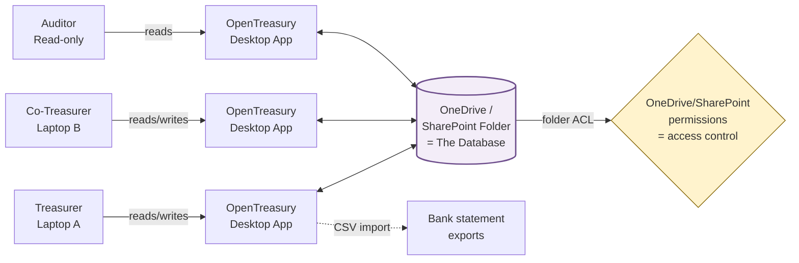

# OpenTreasury Desktop — Product Vision

> **Status:** Draft v0.1 · **Owner:** Link (PM) · **Last updated:** 2026-04-19

---

## 1. Vision Statement

**OpenTreasury Desktop is a zero-infrastructure treasury app for small NGOs — a Windows/macOS/Linux desktop application that turns a shared OneDrive or SharePoint folder into a fully-functional, multi-user treasury ledger. No Azure. No database to run. No IT department required.**

---

## 2. Target User

**Primary persona: the NGO Treasurer**

- Volunteer or part-time treasurer of a small-to-mid NGO (5–50 members, <€500k annual flow).
- Already pays for **Microsoft 365** (OneDrive / SharePoint / Teams) — it's the de facto collaboration tool in the non-profit sector.
- Shares treasury work with **1–3 trusted collaborators** (president, secretary, auditor).
- Is **not a developer**. Cannot provision cloud resources, run containers, manage Entra tenants, or debug CORS.
- Wants: download → open → start recording donations and expenses → share with the board.
- Pain threshold for setup: **≤ 10 minutes**, **zero terminal commands**, **zero cloud bills**.

**Secondary persona: the Board Member / Auditor**
- Needs read access to balances, category breakdowns, and period reports.
- Access granted by dropping them into the OneDrive folder — no separate login to manage.

---

## 3. Problem Statement

The cloud version of OpenTreasury (`rett-europe/opentreasury`) is architecturally excellent — Angular 19, FastAPI, Cosmos DB, Entra ID — but that stack is **a showstopper for the 90% of NGOs that are not technical**. They face:

- **Deployment cost:** Azure subscription, resource groups, Bicep, KeyVault, Cosmos, App Service — weeks of setup, recurring monthly cost.
- **Auth complexity:** Entra ID tenant, app registrations, redirect URIs, role assignments.
- **Operational burden:** Who patches the API? Who rotates keys? Who pays the bill when the volunteer treasurer leaves?
- **Data sovereignty anxiety:** "Where is our donor data? Who else can see it?"

Meanwhile, every one of these NGOs **already has OneDrive or SharePoint**, pays for it, trusts it, backs it up, and knows how to share a folder. **That is our substrate.**

---

## 4. Core Value Propositions

1. **Zero-setup treasury.** Install the app, point it at a OneDrive/SharePoint folder, start working. No accounts to create, no cloud to provision.
2. **Your existing permissions are the permissions.** Whoever has access to the folder has access to the ledger. Remove them from the folder, they lose access. No separate user system to maintain.
3. **Your data, your file, your control.** The database is a file (or set of files) inside a folder you already own. Back it up, copy it, archive it, fork it — it's yours.
4. **Feature parity with the cloud version** for the core treasury workflow: transactions, categories, tags, accounts, balances, reports, import/export.
5. **Offline-capable by default.** OneDrive syncs in the background; the app works even when the network doesn't.

---

## 5. Scope — In (v1)

Version 1 ships the **core NGO treasury loop**:

- **Accounts** — multiple bank accounts (incl. PayPal-style), balances, account creation/edit.
- **Transactions (Movimientos)** — income/expense entries with date, amount, description, account, category, subcategory, tags, status (pending/approved).
- **Categories & subcategories** — hierarchical, typed (income vs expense), user-editable.
- **Tags** — cross-cutting labels (e.g., "Gala 2026", "Raras") with color.
- **Dashboard (Panel)** — per-account balances, monthly income/expense KPIs, 12-month bar chart, recent transactions, sparklines.
- **Balance view (Saldo)** — year-over-year comparison by category, net trend, projections.
- **Transaction list** — filterable by account, type, category, month, amount range, text search; **starts empty until a date range is selected** (team decision 2026-04-19).
- **Import** — CSV bank statement ingestion with column mapping and deduplication.
- **Export** — CSV / PDF / Excel export of transactions and reports.
- **Storage on OneDrive/SharePoint** — pick a folder at first launch; app reads/writes its data file(s) there.
- **Multi-user via folder sharing** — two treasurers working from the same folder on different machines both see the same ledger (with honest conflict handling — see Risks).
- **Spanish + English UI** — prototype is in Spanish; i18n from day one.

---

## 6. Scope — Out / Deferred

We are **explicitly not** doing these in v1 (and some are never):

| Not doing | Why |
|---|---|
| Custom authentication / user accounts | OneDrive folder permissions ARE the auth layer. |
| Role-Based Access Control (RBAC) | Folder ACLs from OneDrive/SharePoint cover this. No app-level roles. |
| Multi-tenant cloud SaaS | This is a desktop app. Tenancy = your folder. |
| Hosted backend / API server | No server to run. The app is the backend. |
| Cosmos DB / Postgres / any network database | The "database" is a file in the shared folder. |
| Real-time collaborative editing (Google Docs-style) | OneDrive sync + optimistic concurrency is good enough for 2–3 concurrent treasurers. Hard realtime is out of scope. |
| Mobile app (iOS/Android) | Desktop only. A responsive web companion is a "nice-to-have later". |
| Bank API integrations (PSD2, Plaid, etc.) | v1 is import-based. Live bank feeds are a later bet. |
| Payroll, invoicing, full accounting compliance | We are a **treasury** app, not an ERP. Stay focused. |
| Automatic tax filing | Country-specific; out of scope. |
| Audit log service / SIEM integration | Desktop audit trail lives in the data file. |

---

## 7. Key Product Principles

These are the **tie-breakers** for every future decision. When in doubt, apply these in order:

1. **OneDrive is the database.** If a feature needs a server to work, it doesn't belong in v1. If syncing a folder between two laptops breaks it, redesign it.
2. **Permissions = folder permissions.** We do not invent a user/role system. If OneDrive says you can read the folder, the app trusts that.
3. **Spec before code.** Every non-trivial feature ships with a spec in `docs/specs/{feature}.md` — reviewed before implementation. Mirrors the cloud repo's spec-driven cadence.
4. **Feature parity through adaptation, not translation.** We mirror *what* the cloud version does, but we reimagine *how* for a file-based, desktop, offline-first world. Don't port code — port the user outcome.
5. **Offline-capable by default.** The app must be fully usable with zero connectivity. OneDrive syncs when it's ready; we don't block on it.
6. **Secure by default, Switch has final say.** Financial data encrypted at rest in the data file. Switch (Security Engineer) has non-negotiable final say on the crypto/storage/threat-model decisions (team decision 2026-04-19).
7. **Boring technology wins.** We're shipping to volunteer treasurers, not distributed-systems engineers. Every dependency is a tax they pay. Prefer mature, well-understood tech.

---

## 8. Success Metrics

All metrics below are **observable without any cloud telemetry** — either self-reported, measured locally, or derived from GitHub/download signals. This is a privacy-respecting app; we don't phone home.

| Metric | Target (v1 + 3 months) | How measured |
|---|---|---|
| **Time-to-first-transaction** | ≤ 10 minutes from download to first tx recorded | User interviews, opt-in local timing on first-run wizard |
| **Setup success rate** | ≥ 90% of installs reach "folder linked + account created" | Opt-in anonymous telemetry of setup steps (off by default) |
| **Active NGO deployments** | ≥ 10 NGOs using it for real data | Community reports, GitHub stars, Discussions activity |
| **Data-loss incidents** | **Zero** (this is a hard floor, not a target) | Issue tracker; any loss = P0 |
| **Sync-conflict resolution rate** | ≥ 95% resolved automatically without user intervention | Local conflict log; issue reports |
| **Feature parity coverage** | ≥ 80% of cloud v1 core features shipped | Feature map audit (section 9) |
| **Contributor velocity** | Merged PRs / month trending up | GitHub insights |

We deliberately **do not** track DAU/MAU/retention — we have no telemetry pipeline, and NGO treasurers work seasonally (year-end, tax deadlines). Those metrics would mislead.

---

## 9. High-Level Feature Map

Mapped against the cloud repo's feature modules (`frontend/src/app/features/`: accounts, balance, categories, dashboard, export, import, reports, tags, transactions) plus infra/auth modules.

| Feature | Cloud version | v1 (Must) | v1.x (Should) | Later (Nice) | N/A (Desktop) |
|---|---|---|---|---|---|
| Accounts CRUD | ✅ | ✅ | | | |
| Transactions CRUD | ✅ | ✅ | | | |
| Categories / subcategories | ✅ | ✅ | | | |
| Tags | ✅ | ✅ | | | |
| Dashboard (Panel) | ✅ | ✅ | | | |
| Balance (Saldo / YoY) | ✅ | ✅ | | | |
| Transaction list w/ filters | ✅ | ✅ | | | |
| CSV import (bank statements) | ✅ | ✅ | | | |
| Export — CSV | ✅ | ✅ | | | |
| Export — PDF reports | ✅ | | ✅ | | |
| Export — Excel | ✅ | | ✅ | | |
| Reports module (custom periods) | ✅ | | ✅ | | |
| Multi-account reconciliation | ✅ | | ✅ | | |
| Transaction status workflow (pending → approved) | ✅ | ✅ | | | |
| Bulk categorize / tag | ✅ | | ✅ | | |
| Recurring transactions | partial | | ✅ | | |
| Budgets / forecasts | partial | | | ✅ | |
| Attachments (receipts) | ✅ | | ✅ | | |
| Multi-currency | partial | | | ✅ | |
| Search (global) | ✅ | ✅ | | | |
| Audit log | ✅ | ✅ (local) | | | |
| i18n (ES + EN) | partial | ✅ | | | |
| Dark mode | ✅ | ✅ | | | |
| **Entra ID / OAuth login** | ✅ | | | | ❌ Folder ACL replaces |
| **RBAC (admin/editor/viewer)** | ✅ | | | | ❌ Folder ACL replaces |
| **Cloud API (FastAPI)** | ✅ | | | | ❌ No server |
| **Cosmos DB** | ✅ | | | | ❌ File-based store |
| **Multi-tenant isolation** | ✅ | | | | ❌ Tenant = folder |
| **CI/CD to Azure** | ✅ | | | | ❌ Ship installers |
| Bank API integrations (PSD2) | ❌ | | | ✅ | |
| Mobile app | ❌ | | | ✅ (companion) | |

---

## 10. System Context (high level)



**Key observations from this diagram:**
- The app is **pure client**. No server box exists in our architecture.
- **OneDrive is both the transport and the access control**. Pedro's "no RBAC" decision lives in that yellow PERM box.
- Conflicts are resolved **inside the app** when OneDrive delivers diverging versions — that is the hardest technical problem, flagged in Risks.

---

## 11. Spec-Driven Development — How It Plugs In

This team operates **spec-first**, mirroring the cloud repo's `docs/specs/` discipline.

| Concern | Where it lives | Who writes it | When |
|---|---|---|---|
| Product vision (this doc) | `docs/product/vision.md` | Link (PM) | Before any PRDs |
| Feature PRDs | `docs/product/prds/{feature}.md` | Link (PM), reviewed by team | Before feature specs |
| Feature specs | `docs/specs/{feature}.md` | Neo (Lead) + domain agent | Before implementation |
| UX specs | `docs/ux/{feature}.md` | Niobe (UX) | Alongside feature spec |
| Architecture decisions | `docs/architecture/adr-NNNN-{title}.md` | Neo (Lead) | When a reversible decision needs to be locked in |
| Security specs / threat models | `docs/security/{feature}.md` | Switch (Security, **final say**) | Before implementation of anything touching data, storage, or trust boundaries |
| Team decisions (non-technical) | `.squad/decisions.md` | Squad coordinator | Ongoing |

**Cadence:**
1. Link writes a PRD → team reviews → Pedro approves.
2. Neo + domain agents write the technical spec referencing the PRD → Switch reviews security → Niobe writes UX → Mouse designs UI → team reviews → Pedro approves.
3. Only after spec approval does code get written. No "let me just prototype it" in production branches.
4. Specs are **living documents** — updated as we learn, with ADRs for reversals.

---

## 12. Repo Structure — What We Mirror from the Cloud Repo

The cloud repo layout we should adapt:

```
opentreasury-desktop/
├── .github/           # (exists) workflows, issue templates, agents
├── .squad/            # (exists) team state
├── docs/
│   ├── product/       # vision, PRDs                        ← PM
│   │   └── prds/
│   ├── specs/         # feature technical specs             ← Lead + devs
│   ├── architecture/  # ADRs, diagrams                      ← Lead
│   ├── ux/            # UX flows, wireframes                ← UX
│   ├── security/      # threat models, crypto specs         ← Security (final say)
│   └── guides/        # contributor + user docs             ← DevRel-ish
├── app/               # Electron main + renderer (structure TBD by Neo)
├── prototype/         # (exists) current HTML/React prototype — reference only
├── scripts/           # build, release, sign
├── installers/        # platform installer configs
└── tests/             # unit, integration, e2e
```

**What we deliberately do NOT mirror:**
- `api/` — no backend.
- `infra/`, `deploy-template/`, `.bicep` — no cloud infrastructure.
- Angular project scaffolding — tech stack is TBD (Q for Pedro).

---

## 13. Risks & Honest Trade-offs

Flagging these for the team (resolutions are **not** my call — they belong to Neo, Switch, and Pedro):

| Risk | Severity | Owner for resolution |
|---|---|---|
| **OneDrive as database → concurrency & conflict risk.** Two treasurers editing offline, OneDrive merges, one wins. Data loss or duplicates possible. | 🔴 High | Neo (architecture) — must design a conflict-resilient data format (event log? CRDT? file-per-transaction?) |
| **OneDrive sync latency.** A treasurer may not see another's recent entry for seconds to minutes. | 🟡 Medium | Neo + Niobe (UX around "last synced" indicator) |
| **File corruption / OneDrive ate our database.** It happens. | 🔴 High | Neo (append-only + snapshot strategy) + Switch (encryption impact) |
| **Encryption at rest vs. OneDrive indexing.** If we encrypt the data file, OneDrive won't help users search it in the web UI — but unencrypted donor data in a shared folder is a privacy risk. | 🔴 High | **Switch (final say)** |
| **SharePoint vs OneDrive Personal vs OneDrive Business** — subtly different APIs, sync behaviors, URL schemes. | 🟡 Medium | Neo |
| **Tech stack drift.** Electron + React vs Electron + Angular vs Tauri — each has real trade-offs for installer size, performance, security. | 🟡 Medium | Neo → Pedro decides |
| **Feature parity scope creep.** "Just one more cloud feature" kills v1. | 🟡 Medium | Link (PM) — say "not now" |
| **Audit log in a file the user can edit.** Tamper-evidence is hard without a server. | 🟡 Medium | Switch |

None of these risks are blockers for *writing the vision*. All of them **must be resolved in specs before implementation** of the affected feature.

---

## 14. Open Questions for Pedro

Numbered for easy reply. These block the next step (PRDs + tech stack ADR).

1. **Tech stack beyond Electron** — do you have a preference (React vs Angular vs Svelte vs Vue for renderer; TypeScript default yes?), or should Neo propose options with trade-offs? *Recommended: let Neo propose 2–3 options, you pick.*
2. **Storage scope** — do we support *both* OneDrive Personal AND SharePoint/OneDrive Business in v1, or pick one (e.g., OneDrive Business since NGOs are on M365) and defer the other? This materially affects complexity.
3. **Data file format** — is it acceptable for the "database" to be a **folder of JSON files** (one per transaction, append-only) rather than a single SQLite/JSON blob? This dramatically reduces merge conflicts on OneDrive. Neo will have a strong opinion — do you want to weigh in now or defer?
4. **Encryption at rest** — are donor names/amounts considered sensitive enough to require encryption in the shared folder, knowing it breaks OneDrive search and adds a key-management problem? **Switch will have final say; your input on the business requirement is needed.**
5. **Target OS coverage for v1** — Windows only (where most NGO treasurers live), or Windows + macOS + Linux from day one? Installers, signing certs, and CI cost scale with this.
6. **Language coverage** — prototype is Spanish. Is v1 **Spanish + English**, or Spanish-only with i18n scaffolding for later?
7. **Prototype as v1 UI baseline** — should Mouse/Niobe treat the existing `prototype/` as the v1 UX contract (refine, don't reinvent), or is it a sketch we can depart from? *Recommended: treat as contract, deviations require UX spec.*
8. **Repo structure approval** — does the proposed layout in section 12 work, or do you want adjustments before we scaffold it?

---

## Appendix A — What "Feature Parity" Means Here

Feature parity is a **user-outcome parity**, not a code parity.

- A cloud user and a desktop user should both be able to: record a transaction, categorize it, see this month's balance, compare years, import a CSV, export a PDF.
- The *mechanism* differs: cloud hits an API; desktop reads/writes a file.
- We are NOT obligated to ship cloud-specific features (Entra login, tenant management, multi-org) — those are solved by the desktop model.

## Appendix B — Why This Will Work

- M365 is the NGO sector's default. We meet users where they are.
- Files in folders is the **universally understood mental model** of "my data".
- The cloud version has proven the product direction; we are de-risking distribution, not product-market fit.
- Spec-driven discipline from day one means v1 ships cleanly instead of becoming a pile of prototypes.

---

*End of Vision v0.1 — next: Pedro answers section 14, Link writes first PRDs, Neo writes tech stack ADR.*
