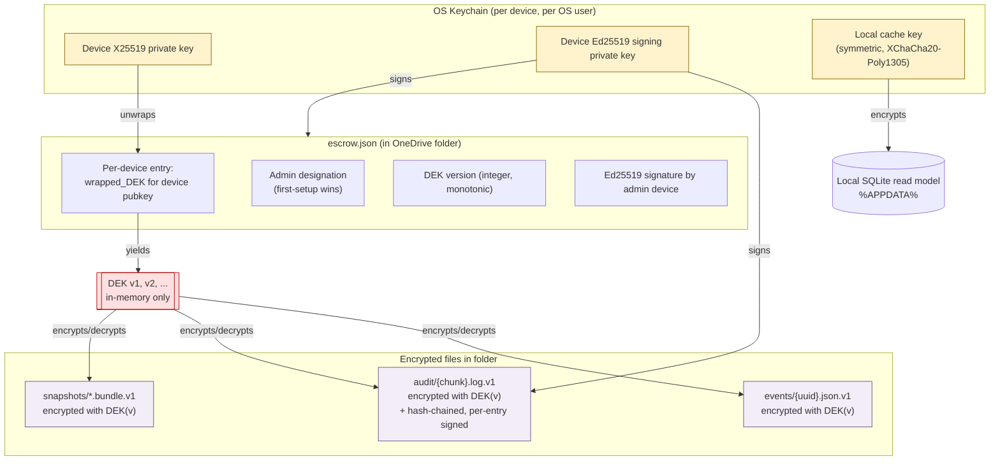
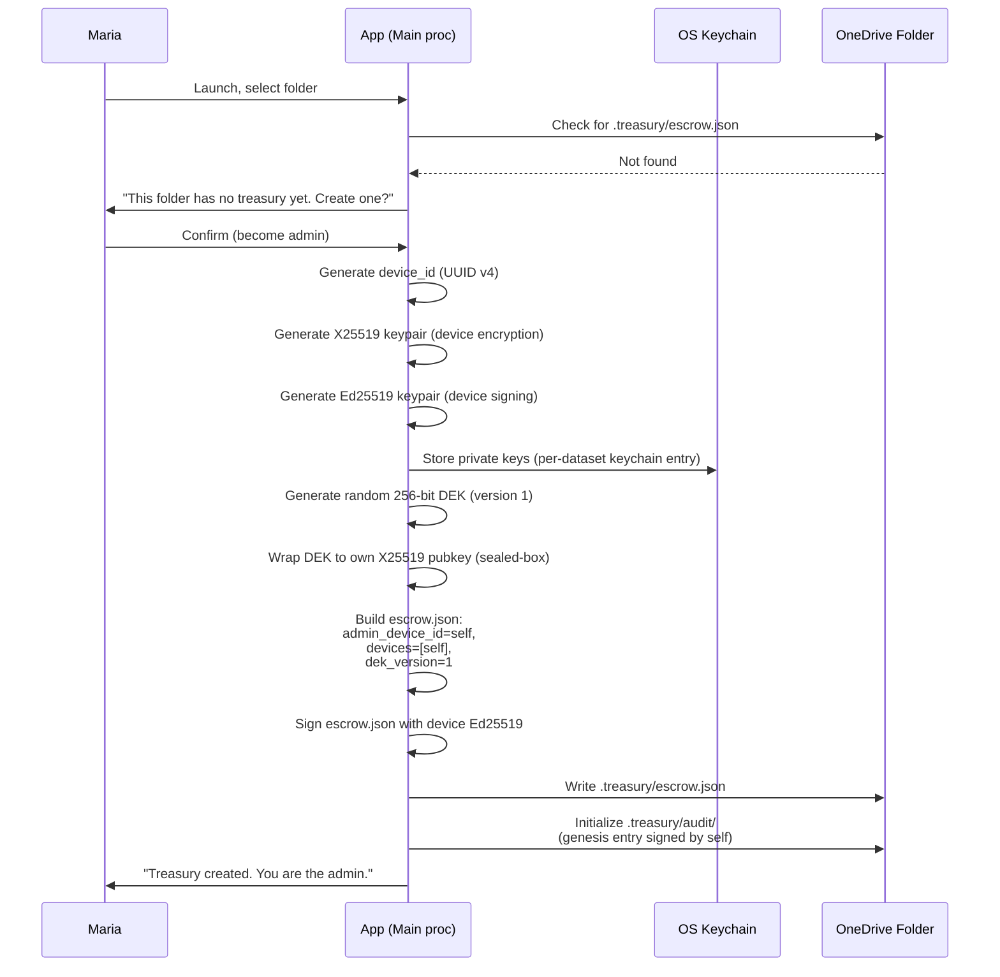
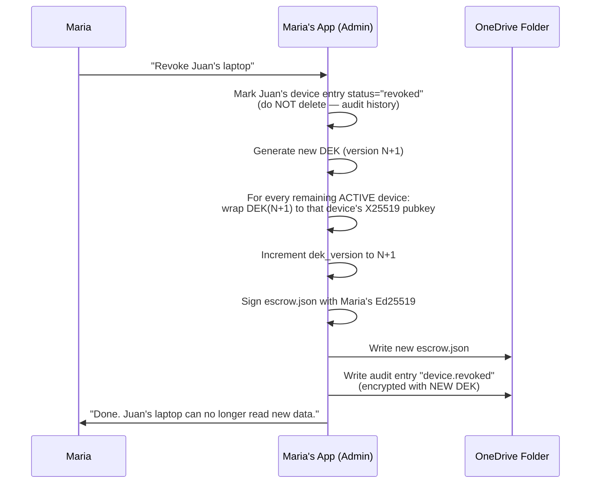

# OpenTreasury Desktop — Crypto & Key Management Spec

> **Status:** v1.0 (Accepted) · **Owner:** Switch (Security Engineer, final say) · **Last updated:** 2026-04-19
> **Scope:** The exact, implementable specification for cryptography and key management in OpenTreasury Desktop v1. This document is the authoritative reference ADR-001 depends on and that Neo/Morpheus/Trinity must implement against.
> **Authority:** Per team decision 2026-04-19, Switch has non-negotiable final say. This spec IS the rule. Deviations require an ADR and Switch approval.

---

## 0. How to read this document

- **Normative** (MUST / MUST NOT / SHALL) — hard requirements. Violating any is a P0.
- **Recommended** (SHOULD) — deviation requires a documented rationale and Switch sign-off.
- **Informational** — context and rationale.

Every encrypted artifact carries a **version byte** and **algorithm id**; this spec version is `v1`.

---

## 1. Primitives

### 1.1 Authenticated encryption (AEAD) for file payloads

| Aspect | Choice | Rationale |
|---|---|---|
| **Algorithm** | **XChaCha20-Poly1305** | 192-bit random nonces are safe (no counter discipline required across multiple devices writing concurrently to OneDrive). Fast in pure JS/WebAssembly. First-class in libsodium. |
| **Fallback (not preferred)** | AES-256-GCM | Acceptable only where XChaCha20-Poly1305 is unavailable. Requires strict nonce discipline — we do not need that complexity. |
| **Library** | `libsodium` via **`sodium-native`** (N-API binding) for main process | Audited (Cure53, NCC, Trail of Bits). Maintained. Ships prebuilt binaries. Idiomatic Node API. |
| **Pure-JS fallback** | `@noble/ciphers` (XChaCha20-Poly1305) | Used only for test environments or if `sodium-native` binding fails to load. Audited (Trail of Bits, Cure53). |
| **FORBIDDEN** | AES-CBC, AES-CTR without MAC, DIY constructions, `crypto-js`, any library without a public audit. | Non-negotiable. |

### 1.2 Key agreement & wrapping

| Aspect | Choice |
|---|---|
| **Device keypair** | X25519 (Curve25519 ECDH) |
| **DEK wrapping** | libsodium `crypto_box_seal` (anonymous sealed-box: X25519 + XChaCha20-Poly1305) for at-rest wrapping of the DEK to each device public key |
| **Library** | `sodium-native` (same as 1.1) |

**Why sealed-box (not authenticated box):** the escrow file already carries an explicit Ed25519 signature over the whole escrow entry (see §3). Sealed-box gives us confidentiality of the wrapped DEK to the target device; authenticity of *which admin authorized the wrap* is covered by the separate Ed25519 signature on the escrow entry. Do not combine these responsibilities into one primitive.

### 1.3 Signatures (audit log, escrow integrity)

| Aspect | Choice |
|---|---|
| **Algorithm** | Ed25519 |
| **Library** | `sodium-native` (`crypto_sign_*`) |
| **Key material** | Each device has an Ed25519 signing keypair, distinct from its X25519 encryption keypair. Derived at device provisioning from the same seed via libsodium's standard conversion? — **NO.** Two independent keypairs, generated separately. Simpler auditability, no cross-protocol attack surface. |

### 1.4 Hashing

| Use | Algorithm | Library |
|---|---|---|
| Audit log chain, content hashes | BLAKE2b-256 | `sodium-native` (`crypto_generichash`) |
| Device fingerprint (for escrow display) | BLAKE2b-128 of device public key, hex-encoded | `sodium-native` |

**No SHA-1. No MD5.** SHA-256 is acceptable if BLAKE2b isn't ergonomic in a specific code path, but default to BLAKE2b.

### 1.5 Key derivation (NOT from passphrase)

**v1 does not use a passphrase-derived key.** Device private keys are generated with a CSPRNG (`crypto.randomBytes` backed by the OS entropy source) and stored in the OS keychain. There is no Argon2id / PBKDF2 in the v1 design. (Neo's ADR-001 mentions Argon2id as a possibility; this spec supersedes that — we chose the OS-keychain route.)

**Implication:** device keypair survival is tied to the OS user profile and the keychain. A reinstalled OS = a new device from our perspective, requiring re-enrollment. This is correct.

---

## 2. Key Hierarchy



**Three tiers:**

| Tier | Key | Location | Lifetime | Scope |
|---|---|---|---|---|
| **Tier 1 — Device keys** | X25519 + Ed25519 private keys | OS keychain (DPAPI / macOS Keychain / libsecret). Never leaves in plaintext. | Lifetime of the device enrollment | Per device |
| **Tier 2 — DEK (Data Encryption Key)** | Symmetric 256-bit key | In memory only (main process) after unwrapping. Persisted only as wrapped entries in `escrow.json`. | Until rotated (revocation, suspected leak, on-demand) | Per NGO dataset |
| **Tier 3 — Per-file encryption** | DEK(v) with per-file random 192-bit nonce | N/A (derived at encrypt time) | Per file | Per encrypted file |

**Rules:**

1. The DEK MUST NOT be written to disk in cleartext on the device. It lives in main-process memory only.
2. The DEK MUST NOT be transmitted over IPC to the renderer. The renderer never sees cryptographic keys.
3. Device private keys MUST be stored using the OS keychain via a maintained cross-platform library. **Chosen:** `@napi-rs/keyring` (successor to `keytar`, maintained, napi-rs based, Windows/macOS/Linux). `keytar` itself is deprecated and FORBIDDEN.
4. Local cache (SQLite read model) MUST be encrypted with a separate symmetric key (`CACHEKEY` in the diagram), also stored in the OS keychain. Never reuse the DEK for local cache.
5. On uninstall / "wipe local data", the app MUST delete all keychain entries belonging to this dataset and zero the cache file before unlink.

### 2.1 Per-file encryption mechanics

Every encrypted file on OneDrive uses this envelope:

```
┌──────────────────────────────────────────────────────────────┐
│ MAGIC: "OTRV"  (4 bytes, ASCII)                              │
│ VERSION: 0x01  (1 byte)                                      │
│ ALG_ID: 0x01   (1 byte — 0x01 = XChaCha20-Poly1305)          │
│ DEK_VERSION: uint32 BE (4 bytes)                             │
│ NONCE: 24 bytes (random, XChaCha20-Poly1305)                 │
│ AAD_LEN: uint16 BE (2 bytes)                                 │
│ AAD: UTF-8 JSON (AAD_LEN bytes, see below)                   │
│ CIPHERTEXT || TAG (rest of file)                             │
└──────────────────────────────────────────────────────────────┘
```

**AAD (Associated Authenticated Data) — bound to every encrypted file:**

```json
{
  "record_type": "event" | "escrow" | "audit" | "snapshot" | "meta",
  "record_id":   "<ULID or chunk id>",
  "dataset_id":  "<UUID v4 — identifies this NGO dataset>",
  "dek_version": <integer>
}
```

**Why bind these:** prevents ciphertext-substitution (replacing an event with an older event of the same type), cross-dataset replay (pasting a file from another NGO's folder), and cross-version replay (old DEK-v1 file replayed as DEK-v2 content).

**Nonces:** 192-bit random nonces from `crypto.randomBytes` (CSPRNG). Collision probability at 2^32 files per key is ~2^-128 — effectively zero. No counter required.

**Tag:** 16 bytes (Poly1305 auth tag), appended to ciphertext by the library.

---

## 3. Escrow File Format

Path: `{dataset-root}/.treasury/escrow.json` — **encrypted** with DEK? **NO.** The escrow file cannot be encrypted with the DEK it wraps (chicken and egg). The escrow file is stored as **plaintext JSON** (integrity-protected via Ed25519 signatures), but contains only:
- Public keys (non-secret by definition)
- Wrapped DEKs (ciphertext, protected by sealed-box)
- Metadata (device names, timestamps, user identities as UPNs)

Metadata in escrow.json IS visible to anyone with folder read access. See §10 for metadata surface analysis.

### 3.1 JSON Schema

```json
{
  "$schema": "https://json-schema.org/draft/2020-12/schema",
  "$id": "https://opentreasury.dev/schemas/escrow-v1.json",
  "type": "object",
  "required": ["version", "dataset_id", "created_at", "admin_device_id",
               "dek_version", "devices", "signature"],
  "properties": {
    "version": { "const": 1 },
    "dataset_id": { "type": "string", "format": "uuid",
                    "description": "Stable UUID v4 for this NGO dataset; set once at first-setup, NEVER changes." },
    "created_at": { "type": "string", "format": "date-time" },
    "admin_device_id": { "type": "string",
                         "description": "device_id of the current admin device. First-setup wins. Admin can be transferred (see §3.3)." },
    "dek_version": { "type": "integer", "minimum": 1,
                     "description": "Monotonically increasing. Incremented on every DEK rotation." },
    "devices": {
      "type": "array",
      "items": { "$ref": "#/$defs/device_entry" }
    },
    "pending_enrollments": {
      "type": "array",
      "items": { "$ref": "#/$defs/pending_enrollment" },
      "description": "Devices that have requested enrollment but not yet been approved by admin."
    },
    "signature": {
      "type": "object",
      "required": ["signed_by_device_id", "alg", "value"],
      "properties": {
        "signed_by_device_id": { "type": "string" },
        "alg": { "const": "ed25519" },
        "value": { "type": "string",
                   "description": "Base64 Ed25519 signature over the canonical-JSON-encoded document with `signature` field omitted." }
      }
    }
  },
  "$defs": {
    "device_entry": {
      "type": "object",
      "required": ["device_id", "user_identity", "device_pubkey_x25519",
                   "device_pubkey_ed25519", "device_name", "added_at",
                   "added_by_device_id", "status", "wrapped_deks"],
      "properties": {
        "device_id": { "type": "string", "format": "uuid",
                       "description": "Stable UUID v4 generated on device. NEVER reused." },
        "user_identity": { "type": "string",
                           "description": "MS account UPN (e.g., maria@ngo.org). Display only; NOT a trust anchor." },
        "device_pubkey_x25519": { "type": "string",
                                  "description": "Base64 X25519 public key for DEK wrapping." },
        "device_pubkey_ed25519": { "type": "string",
                                   "description": "Base64 Ed25519 public key for signature verification." },
        "device_name": { "type": "string", "maxLength": 64,
                         "description": "User-assigned (e.g., 'Maria - laptop')." },
        "added_at": { "type": "string", "format": "date-time" },
        "added_by_device_id": { "type": "string",
                                "description": "device_id of the admin that approved this device. For first-setup, equals its own device_id." },
        "status": { "enum": ["active", "revoked"],
                    "description": "Revoked entries are kept (never deleted) for audit history." },
        "revoked_at": { "type": "string", "format": "date-time" },
        "revoked_by_device_id": { "type": "string" },
        "wrapped_deks": {
          "type": "array",
          "description": "One entry per DEK version this device can still decrypt. Admin controls whether to include historical versions (default: yes, for continuity).",
          "items": {
            "type": "object",
            "required": ["dek_version", "wrapped_dek"],
            "properties": {
              "dek_version": { "type": "integer", "minimum": 1 },
              "wrapped_dek": { "type": "string",
                               "description": "Base64 sealed-box ciphertext of the DEK(v) encrypted to this device's X25519 pubkey." }
            }
          }
        }
      }
    },
    "pending_enrollment": {
      "type": "object",
      "required": ["device_id", "user_identity", "device_pubkey_x25519",
                   "device_pubkey_ed25519", "device_name", "requested_at",
                   "enrollment_code"],
      "properties": {
        "device_id": { "type": "string", "format": "uuid" },
        "user_identity": { "type": "string" },
        "device_pubkey_x25519": { "type": "string" },
        "device_pubkey_ed25519": { "type": "string" },
        "device_name": { "type": "string" },
        "requested_at": { "type": "string", "format": "date-time" },
        "enrollment_code": { "type": "string",
                             "description": "6-character human-readable code (e.g., BASE32 truncated to 6 chars from BLAKE2b(device_pubkey_x25519)). Shown on requesting device; admin compares visually before approving." }
      }
    }
  }
}
```

### 3.2 Canonical JSON for signing

To make signatures deterministic, the escrow file MUST be canonicalized before hashing/signing:
- Keys sorted lexicographically at every level.
- No insignificant whitespace.
- UTF-8.
- `signature` field omitted during signing; appended after.

Implementation: `json-canonicalize` (RFC 8785 JCS) or an equivalent library. If not available, a documented custom canonicalizer with round-trip tests.

### 3.3 Admin designation rules

1. **First-setup wins.** The first device to write `escrow.json` into an empty folder becomes admin. Its `device_id` goes into `admin_device_id`.
2. **Admin can be transferred.** The current admin can write a new escrow version with a different `admin_device_id` (must be an `active` device). This is a signed operation; logged.
3. **Only one admin at a time.** v1 does not support co-admins. (Revisit in v1.x if requested.)
4. **Orphaned-admin recovery (admin device is lost):** if the admin's device is gone and no transfer was done, the dataset is **unrecoverable for new enrollments/revocations** but existing active devices retain read/write access. Recovery procedure: one active device performs a **burn-down-and-migrate** (§9). This is a nuclear option and is documented as such.

---

## 4. First-Setup Flow

**Scenario:** Maria installs OpenTreasury Desktop for the first time and points it at an empty OneDrive folder (or one without an `escrow.json`).



**State after flow:**
- Keychain contains Maria's device X25519 + Ed25519 private keys (+ local cache key).
- Folder contains `escrow.json` (plaintext JSON, Ed25519-signed) with one device entry and `dek_version=1`.
- Folder contains `audit/` with a genesis entry (`{type: "dataset.created", actor: maria_device_id, ...}`) encrypted with DEK v1.

---

## 5. Device Enrollment Flow

**Scenario:** Juan is added to the OneDrive folder by Maria. Juan installs the app, points at the folder, and needs the DEK wrapped to his device.

```mermaid
sequenceDiagram
    participant J as Juan
    participant JAPP as Juan's App
    participant FOLDER as OneDrive Folder
    participant MAPP as Maria's App (Admin)
    participant M as Maria

    J->>JAPP: Launch, select folder
    JAPP->>FOLDER: Read escrow.json
    FOLDER-->>JAPP: escrow exists; Juan's device not in it
    JAPP->>JAPP: Generate device_id, X25519 kp, Ed25519 kp
    JAPP->>JAPP: Store private keys in keychain
    JAPP->>JAPP: Compute 6-char enrollment_code = BLAKE2b(X25519 pubkey)[0..6]
    JAPP->>J: Show "Enrollment pending. Code: XXX-YYY. Ask admin to approve."
    JAPP->>FOLDER: Write pending_enrollments entry (signed with Juan's Ed25519 key)

    Note over FOLDER: OneDrive syncs pending_enrollments to Maria

    MAPP->>FOLDER: (Polls or file-watcher detects escrow.json change)
    FOLDER-->>MAPP: New pending enrollment for Juan
    MAPP->>M: "Juan's device is requesting enrollment. Code: XXX-YYY.<br/>Approve? Reject?"
    M->>J: (Out-of-band, phone/Teams) "What code do you see?"
    J->>M: "XXX-YYY"
    M->>M: Codes match
    M->>MAPP: Approve
    MAPP->>MAPP: Wrap DEK v1 to Juan's X25519 pubkey (sealed-box)
    MAPP->>MAPP: Build new escrow.json:<br/>devices += Juan (active),<br/>pending_enrollments -= Juan
    MAPP->>MAPP: Sign escrow.json with Maria's Ed25519
    MAPP->>FOLDER: Write escrow.json (new version)
    MAPP->>FOLDER: Write audit entry "device.enrolled"

    Note over FOLDER: OneDrive syncs new escrow to Juan

    JAPP->>FOLDER: (Polls) Re-read escrow.json
    JAPP->>JAPP: Find own device_id → wrapped DEK
    JAPP->>JAPP: Unwrap DEK with own X25519 private key
    JAPP->>J: "Enrolled. Welcome to <NGO>'s treasury."
```

**Key properties:**
- The enrollment code is a **visual fingerprint** of Juan's public key. Maria compares it out-of-band (voice, in-person) to defend against a malicious actor swapping Juan's pubkey in the folder before approval.
- Admin MUST be online (app running) to approve. There is no offline-approval mechanism in v1. (If Maria is unavailable, Juan waits. This is correct.)
- Approval writes a new `escrow.json`. OneDrive sync delivers it to all devices. No out-of-band channel carries keys.

---

## 6. Device Revocation Flow

**Scenario:** Juan's laptop is stolen. Maria (admin) revokes Juan's device.



**What this does:**
- ✅ **New files** (written after revocation) are encrypted with DEK(N+1). Juan's laptop cannot decrypt them — it only holds the unwrapped DEK(N), which is no longer used for new writes.
- ✅ The escrow file no longer wraps DEK(N+1) to Juan's device pubkey. Even if Juan's laptop reads the new escrow, it gets no new key.
- ✅ The revoked entry is retained (not deleted) so audit history remains queryable.

**What this does NOT do:**
- ❌ It does **NOT** re-encrypt historical files. Files encrypted with DEK(1)..DEK(N) remain decryptable with those keys. Juan's laptop already has DEK(N) unwrapped and in its possession (he decrypted it in the past).
- ❌ It does **NOT** remove any cached plaintext from Juan's laptop. His local cache is his to copy.
- ❌ It does **NOT** prevent Juan from reading files that were synced to his laptop before revocation (he can read them offline with DEK(N)).
- ❌ It does **NOT** prevent Juan's laptop from continuing to read files that reach OneDrive from OTHER devices still writing with DEK(N) during sync lag (narrow window; mitigated by immediate write-all-new-data-with-new-DEK).

**This is AR2 (accepted risk):** revoked members retain access to data they already decrypted. The only full defense is a server that gates reads — incompatible with the product.

**If this is not acceptable for a specific incident** (e.g., suspected OneDrive-side compromise), use **burn-down-and-migrate** (§9).

### 6.1 DEK history: do we keep wrapping old DEKs for new/remaining devices?

**YES, by default.** Every active device's `wrapped_deks` array contains ALL DEK versions (1..N). Otherwise historical data becomes unreadable after a rotation, which is operationally unacceptable (you need last year's transactions for the annual report).

**Exception:** if a burn-down-and-migrate is performed, old DEKs are intentionally abandoned.

---

## 7. DEK Rotation Flow

**Triggers:**

| Trigger | Type | Priority |
|---|---|---|
| Device revocation | Mandatory, automatic | Immediate |
| Suspected DEK leak | Mandatory, admin-initiated | Immediate |
| Scheduled rotation | Optional, admin-configurable | Not in v1 default |
| On-demand by admin | Optional | User-driven |

**Procedure (general, independent of trigger):**

1. Admin device generates fresh 256-bit DEK (call it DEK(N+1)).
2. Admin device wraps DEK(N+1) to every `active` device's X25519 pubkey.
3. Admin device increments `dek_version` in `escrow.json`, appends the new wrapped-DEK entries to each active device's `wrapped_deks` array.
4. Admin signs new `escrow.json`.
5. Admin writes new `escrow.json` to folder.
6. Admin writes an audit entry `dek.rotated` (encrypted with DEK(N+1)).
7. From this moment forward, all **new** file writes use DEK(N+1).

**In-flight files / sync-lag behavior:**
- Other devices may not yet have the new escrow file at the moment of rotation.
- Those devices continue writing with DEK(N) until their next escrow sync. This is acceptable — DEK(N) is still held by all active devices, so those files remain readable by everyone active.
- No file is ever re-encrypted in place. DEK(N) files stay as DEK(N) files; new files use DEK(N+1). The `dek_version` in each file's AAD disambiguates.

**Audit log under rotation:**
- Audit log entries are appended as they happen. An entry written just before rotation is DEK(N); an entry just after is DEK(N+1). Both are on the chain; both are readable by all active devices.
- The audit log chain (hash-chain) is UNBROKEN across rotations — the chain is per-dataset, independent of DEK.

---

## 8. Audit Log Crypto

### 8.1 Structure

Audit log lives at `{dataset-root}/.treasury/audit/` as a sequence of encrypted chunk files:
```
audit/
  2026-04.chunk.v1   (all April 2026 entries, encrypted)
  2026-05.chunk.v1
  ...
  current.chunk.v1   (the currently-appending chunk)
```

Each chunk contains a JSON-lines sequence (after decryption), where each line is one audit entry.

### 8.2 Entry format (after decryption)

```json
{
  "seq": 14287,
  "timestamp": "2026-04-19T16:03:22.145Z",
  "dataset_id": "…",
  "actor_device_id": "…",
  "actor_user_identity": "maria@ngo.org",
  "action": "tx.created" | "tx.updated" | "tx.deleted" |
            "import.csv" | "export.csv" | "export.xlsx" |
            "device.enrolled" | "device.revoked" |
            "dek.rotated" | "admin.transferred" |
            "dataset.created" | "snapshot.taken" |
            "audit.anchor" | "audit.anchor.timestamped" | "audit.export",
  "target_ref": { "type": "event" | "device" | "export" | "anchor" | …, "id": "…" },
  "before_hash": "<BLAKE2b-256 hex of pre-state, or null>",
  "after_hash":  "<BLAKE2b-256 hex of post-state, or null>",
  "prev_entry_hash": "<BLAKE2b-256 hex of the previous entry's canonical-JSON>",
  "payload": { /* present on audit.anchor (§8.5) and audit.anchor.timestamped (§8.6) entries */ },
  "signature": {
    "alg": "ed25519",
    "signing_device_id": "…",
    "value": "<base64 signature over canonical-JSON of this entry with signature field omitted>"
  }
}
```

**Rules:**
1. `seq` is monotonic per dataset, never reused, never gaps.
2. `prev_entry_hash` links every entry to the prior one. Entry 1 (genesis) uses `prev_entry_hash = BLAKE2b("OTRV-AUDIT-GENESIS:" + dataset_id)` as an anchor.
3. Each entry is signed Ed25519 by the writing device. Signature verifies against the `device_pubkey_ed25519` in `escrow.json` for the device entry matching `signing_device_id` — **including revoked device entries**, so historical entries from a now-revoked device remain verifiable.
4. On dataset open, the app MUST verify the full chain. Any failure = refuse to open + present recovery UX (snapshot restore).
5. `payload` is OPTIONAL and present ONLY on `audit.anchor` (§8.5) and `audit.anchor.timestamped` (§8.6) entries. When absent it is OMITTED from the canonical JSON (not serialised as `null`), so non-anchor entries — including every pre-existing export entry — produce byte-identical canonical JSON, signatures, and `prev_entry_hash` links as before this field existed.

### 8.5 Event-log anchoring (SPEC-028 WI-2)

The encrypted multi-device event log (SPEC-026) is tamper-*resistant* but not tamper-*evident*
against a key-holder who can rewrite ciphertext. To close that gap WITHOUT signing every event, the
app periodically folds a **signed per-device frontier snapshot** of the event log into the audit
chain as an `audit.anchor` entry. One signed, hash-chained anchor makes the entire observed event
history up to that point tamper-evident.

**Why a per-device frontier vector (not a single global head):** the merged, ULID-ordered timeline is
NOT append-only — a late peer event inserts mid-stream when its file syncs in. But each device's OWN
`events-<deviceId>.ndjson` file IS strictly append-only. So the anchor records, per device, a frontier
`{ device_id, file_name, line_count, last_event_id, device_head_hash }` plus a global
`event_log_root`. Per-device heads are therefore incrementally maintainable (no full re-read on every
anchor — scales to 100k+ events).

**`device_head_hash`** is a domain-separated chained BLAKE2b-256 fold over the first `line_count`
**raw on-disk NDJSON lines** (each line's bytes including its terminating `\n`):
`h₀ = BLAKE2b("OTRV-EVTLOG-DEVHEAD:v1:" + device_id)`, `hᵢ = BLAKE2b(hᵢ₋₁ ‖ rawLineᵢ)`. Because it is
chained, the incremental head and a from-scratch recompute over any prefix are byte-identical.

**`event_log_root`** = `BLAKE2b("OTRV-EVTLOG-ROOT:v1:" ‖ canonicalJSON(frontiers sorted by device_id))`
— order-independent across devices — and is mirrored into the anchor entry's `after_hash`.

**Signed payload (`payload` on an `audit.anchor` entry):**
```json
{
  "anchor_version": 1,
  "hash_alg": "blake2b-256",
  "dataset_id": "…",
  "observed_at": "2026-04-19T16:03:22.145Z",
  "event_log_root": "<hex>",
  "device_frontiers": [
    { "device_id": "…", "file_name": "events-…​.ndjson",
      "line_count": 1234, "last_event_id": "<ULID>", "device_head_hash": "<hex>" }
  ],
  "audit_chain_prev_hash": "<this entry's prev_entry_hash, captured atomically>"
}
```
The payload lives on the entry, so it is covered by the entry's Ed25519 signature.
`audit_chain_prev_hash` MUST equal the entry's `prev_entry_hash` and `event_log_root` MUST equal the
entry's `after_hash`; both are bound inside the audit append critical section.

**Triggers (SPEC-028 OQ2, RESOLVED):** on workspace unlock, on workspace lock (awaited, bounded,
before the master key is wiped), and after every **N = 1000 LOCAL appends** OR **T = 15 min** of local
write activity. Anchoring is strictly best-effort and runs OFF the write path — it MUST NEVER block,
delay, or fail a data write.

**Verification (recompute):** for each anchored frontier, re-read the device file and recompute the
head over its first `line_count` raw lines; the device verifies iff the file exists, has ≥ `line_count`
complete lines, the line at `line_count - 1` has `id === last_event_id`, and the recomputed head equals
`device_head_hash`. Extra lines AFTER the anchored prefix are NOT a failure — they are reported as a
"not yet anchored" delta (expected for late peer events). The recomputed `event_log_root` must equal
both `payload.event_log_root` and the entry's `after_hash`.

**NORMATIVE — anchored event files MUST NOT be rewritten in place.** `device_head_hash` is computed
over the raw on-disk bytes, so ANY in-place mutation of an `events-<deviceId>.ndjson` file that has
been covered by a signed anchor (re-encryption, key rotation re-encoding, compaction, normalisation,
or whitespace changes) will break verification and is FORBIDDEN. A process that must change those bytes
(e.g. DEK rotation that re-encrypts event files) MUST instead **re-anchor** afterwards: write the new
file bytes append-only / as a new file, then fold a fresh frontier snapshot into the audit chain. Never
mutate-then-keep-the-old-anchor. The snapshot pass that builds an anchor is taken over a STABLE read
(size/mtime re-checked; retried if a file changes mid-hash) and refuses to sign if a non-canonical
conflict copy (e.g. `events-… (1).ndjson`) or a malformed interior line is present.

### 8.6 Trusted timestamping of the anchor root (SPEC-028 WI-5, Tier 2)

An `audit.anchor` (§8.5) makes the observed history tamper-*evident*, but a key-holder can still
rebuild a consistent history and **backdate** it — nothing ties an anchor to a time the user cannot
fake. WI-5 binds an anchor's `event_log_root` to an **external RFC-3161 trusted timestamp** and
records it as a **separate, signed, hash-chained `audit.anchor.timestamped` entry**. The original
anchor entry is **never mutated** (it is already signed and chained; mutating it would break
verification). "Re-anchor, don't rewrite" — the same migration rule as the anchor itself.

**What is timestamped.** The TSA signs a `messageImprint = SHA-256(canonicalJSON(anchorEntry))` — a
*standard*-OID digest over the exact stored anchor entry (including its Ed25519 signature). Because
the anchor entry embeds `event_log_root` and its chain position, the timestamp binds all three. A
random nonce is sent in the `TimeStampReq` and required to echo back in the `TSTInfo`.

**Receipt payload (`payload` on an `audit.anchor.timestamped` entry):**
```json
{
  "timestamp_version": 1,
  "provider_kind": "rfc3161",
  "provider_id": "freetsa",
  "anchor_seq": 14287,
  "anchor_entry_hash": "<BLAKE2b-256 hex canonicalHash of the anchor entry>",
  "event_log_root": "<hex; == the anchor entry's after_hash>",
  "imprint_alg": "sha256",
  "message_imprint": "<hex SHA-256 over canonicalJSON(anchorEntry)>",
  "tsa_nonce": "<hex random nonce sent in the TimeStampReq>",
  "tsa_token": "<base64 DER RFC-3161 TimeStampToken (CMS SignedData)>",
  "tsa_gen_time": "2026-04-19T16:05:10.000Z",
  "tsa_serial_number": "<hex>",
  "tsa_policy_oid": "1.2.3.4"
}
```
The receipt entry carries `action: 'audit.anchor.timestamped'`, `result: 'succeeded'`,
`target_ref: { type: 'anchor', id: <new ULID> }`, `before_hash: null`, and
**`after_hash = message_imprint`** (binding the signed-over digest into the chained entry). The
payload lives on the entry, so it is covered by the entry's Ed25519 signature.

**`after_hash` is action-specific:** for `audit.anchor` it equals `event_log_root`; for
`audit.anchor.timestamped` it equals `message_imprint`. The anchored *state* is always described by
`payload.event_log_root`, never by a receipt's `after_hash`.

**Pending is derived, never a flag.** An anchor is "pending external timestamp" iff no
`audit.anchor.timestamped` entry references it. The advisory retry queue holds only error/backoff
metadata and is fully recomputable from the chain, so a lost queue file is harmless.

**Provider abstraction.** A `TimestampProvider` interface (`{ id, kind, requestTimestamp(imprint)
→ Promise<{ok,tokenDer} | {ok:false,error}> }`) hides the transport. v1 ships an
`Rfc3161HttpProvider` (POST `application/timestamp-query` → `application/timestamp-reply`, bounded
`AbortController` timeout) defaulting to **freeTSA.org** with its CA bundled as the trust root
(OQ4, §12 of the spec). A transparency-log / public-anchor provider can implement the same interface
later. The provider **never throws** — it returns a typed error.

> **Normative caveat (OQ4b).** freeTSA.org is the functional, out-of-box **default only**.
> Production / audit-grade / regulatory deployments **SHOULD** configure a **qualified (e.g. eIDAS) or
> commercial TSA** behind the same `TimestampProvider` abstraction — consistent with the §8
> honest-limitation / legal-review posture. The bundled freeTSA root is **pinned by SHA-256
> fingerprint** (`A6:37:9E:7C:…:1D:18:AA:BC`) with provenance and a guard test in
> `core/audit/timestamp/roots.ts`, so a cert swap fails the build rather than silently widening trust.

**Never blocks writes.** All TSA I/O is best-effort, single-flight, and off the write path
(`runTimestampOnce` drains the queue and never throws). Triggers mirror the anchor scheduler: on
unlock (after hydrate), after each new anchor, and on a periodic timer while items remain. A TSA that
is unreachable, slow/hung, or returns a malformed/untrusted token leaves the anchor "pending" and is
retried later — it NEVER blocks, delays, or fails a data write, unlock, or lock.

**Verification (`verifyTimestampReceipt`).** Given the receipt payload, the referenced anchor entry
(located by `anchor_seq` in the chain), the bundled trust roots, and `now`:
1. The audit chain's own Ed25519 + `prev_entry_hash` checks (existing `verifyChain`) already detect a
   mutated receipt entry.
2. **Join:** `anchor_seq` resolves to an `audit.anchor` whose `canonicalHash` equals
   `anchor_entry_hash` and whose `after_hash` equals `event_log_root`.
3. **Imprint bind:** recompute `SHA-256(canonicalJSON(anchorEntry)) === message_imprint`.
4. **Token (RFC-3161/CMS):** status `granted`/`grantedWithMods`; exactly one `SignerInfo`;
   `eContentType === id-ct-TSTInfo`; signed-attrs `content-type` + `message-digest === hash(eContent)`;
   TSA signature verifies over `DER(signedAttrs)` (re-tagged to SET-OF); signer leaf chains to a
   **bundled trust anchor** by real issuer-signature checks; the leaf carries the **critical
   `id-kp-timeStamping` EKU**; every cert is valid **at `genTime` (not `now`)**; `genTime` is not
   implausibly in the future; `messageImprint` and `nonce` match what we submitted.
5. **Output:** `{ status:'verified', trustedTime: genTime, … }` or a typed failure. `trustedTime` is
   the re-derived `genTime`, NOT the advisory `tsa_gen_time` stored in the payload.

   *Revocation (v1 policy):* the offline verifier does **no** live CRL/OCSP; trust is limited to the
   bundled anchors plus validity-at-`genTime`. Bundled-CRL support is future work.

**Honest limitation (must stay in copy + verification report).** A trusted timestamp proves the
anchored `event_log_root` existed *no later than* `genTime` — it **constrains backdating** of state
captured *before* a timestamped anchor. It does **not** stop a key-holder fabricating a fresh,
internally consistent history *going forward*, and it does not make the log tamper-proof. The honest
claim remains **"tamper-evident + externally timestamped, NOT tamper-proof."**

### 8.3 Visibility

**Confirmed (per Pedro, 2026-04-19):** **All authenticated members (all `active` devices in escrow) can read the audit log.** There is no admin-only mode in v1.

**Rationale:** transparency is a governance property for NGO treasurers — the auditor/president needs to see who did what. Hiding it behind an admin role creates a power asymmetry the product doesn't want.

**Export:** audit log export is a user-invoked operation that produces a **decrypted JSON bundle** (pretty-printed JSON lines, one entry per line, verifiable offline with an accompanying PEM-encoded device public-key manifest). This is opt-in; not automatic.

### 8.4 Tamper resistance

- **Chain break** (missing `seq`, broken `prev_entry_hash`): dataset refuses to open. Admin guided to snapshot recovery.
- **Bad signature on an entry**: same as chain break.
- **Wholesale deletion of the audit folder**: detectable (missing directory); snapshot restore required. This is AR7 (insider can delete but not silently edit).

---

## 9. Incident Response Playbook

**Defaults (per Pedro, 2026-04-19):** rotate-and-continue is the default. Burn-down-and-migrate is documented as the nuclear option, reserved for suspected OneDrive-side compromise.

### 9.1 Rotate-and-continue (default for most incidents)

Procedure: §7 DEK rotation, plus specific actions per scenario.

### 9.2 Burn-down-and-migrate (nuclear)

Procedure:
1. Create a **new** empty folder at a different path (e.g., a fresh SharePoint site).
2. On a trusted admin device, do a §4 First-Setup in the new folder — new `dataset_id`, new DEK, new device identities.
3. **Manually re-enter (or selectively export + re-import) data** from the old dataset. The old dataset is assumed compromised; nothing from it is automatically migrated because it may carry injected events.
4. Announce to all members; they follow §5 Device Enrollment against the new folder.
5. Once the new folder is operational, revoke folder ACL on the old folder at the OneDrive level.

**Why "manual re-entry":** if OneDrive itself is compromised, any bytes we copy may be tampered. Hashes we compute from tampered bytes are worthless. Only human-verified re-entry breaks the chain of trust.

**When to burn down:** suspected OneDrive-side compromise, admin device loss without prior transfer, suspected dataset-id or audit-chain tampering, evidence of covert key extraction.

### 9.3 Scenario → response mapping

| Scenario | Response | Notes |
|---|---|---|
| **Lost device** (stolen, factory-reset, hard-drive failure) | Rotate-and-continue (§6) | AR2 applies. Admin revokes device in escrow. |
| **Departing volunteer** (normal offboarding) | Rotate-and-continue | Same as above. Audit entry `device.revoked` with reason. |
| **Suspected DEK leak on device** (malware, sideloaded app, forensic extraction) | Rotate-and-continue, escalate to burn-down if DEK leak is confirmed to an outside party with folder access | DEK rotation cuts off new data; historical is accepted-risk. |
| **Suspected OneDrive-side compromise** (attacker has folder-level write, not a specific member's credentials) | **Burn-down-and-migrate** | Rotate alone cannot help — attacker can see the new escrow and new DEK metadata as it's written. |
| **Admin device lost without transfer** | **Burn-down-and-migrate** | No recovery path — new admin must bootstrap a fresh dataset. |
| **Audit chain break detected** | Refuse to open. Admin restores last known-good snapshot (§19 of security reqs). If snapshot also broken: burn-down. | |
| **`escrow.json` signature invalid** | Refuse to open with a clear error. Admin must repair from a trusted copy (e.g., local snapshot) or burn-down. | |

---

## 10. Metadata Surface

**What's visible in the OneDrive folder to anyone with folder read access but NO decryption keys:**

| Item | Visible? | Contains secrets? | Ruling |
|---|---|---|---|
| Folder name (chosen by user) | Yes | Depends on user naming. App does not add PII. | Acceptable. User responsibility. |
| `.treasury/escrow.json` filename | Yes | No | Acceptable. |
| `escrow.json` contents: `version`, `dataset_id`, `created_at`, `dek_version`, `admin_device_id`, device list with `device_id`, `user_identity` (MS UPN), `device_name`, `device_pubkey_*`, `added_at`, `status`, wrapped-DEK blobs, signatures | Yes | **UPN (email) is PII — minor leak** | **Acceptable with caveat.** The UPN is already known to anyone with folder access (they must be in the folder ACL to read the folder — they ALREADY see who else is in it via OneDrive UI). No incremental leak. |
| `events/YYYY/MM/{ulid}.json.v1` filenames | Yes | Timestamps + ULID (no PII) | **Acceptable.** Filenames are ULID-based; no names, no amounts. |
| Directory structure (`events/2026/04/`) | Yes | Coarse-grained activity pattern (this NGO was active in April 2026) | **Acceptable.** Negligible compared to the fact that a treasury folder exists. |
| File sizes | Yes | Rough granularity of record size | **Acceptable.** All records are small JSON + AEAD overhead; near-uniform. |
| File modification timestamps | Yes | Activity pattern | **Acceptable.** |
| `audit/` folder structure | Yes | Monthly chunking reveals treasury-active months | **Acceptable.** |
| `snapshots/` folder contents | Yes | Encrypted; size indicates dataset scale | **Acceptable.** |

**My ruling:** the metadata surface is acceptable. The only semi-PII leak is member UPNs in `escrow.json`, which is already known to folder-ACL-members via OneDrive's own sharing UI. We gain nothing by obscuring it and lose a lot (no human-readable device names for admin UX, no recovery diagnostics).

**What we DO NOT leak:**
- Donor names, phones, emails
- Transaction amounts
- Bank account numbers
- Category names
- Transaction descriptions / notes / tags

All of the above are inside encrypted payloads with `record_type` binding.

---

## 11. Implementation Checklist (what Morpheus/Trinity will be measured against)

Every item is a yes/no gate. Failing any blocks merge to `main`.

1. **[AEAD-LIB]** All file encryption uses `sodium-native` (XChaCha20-Poly1305). No other crypto library performs encryption.
2. **[NO-DIY]** Zero occurrences of homebrew encryption, custom KDFs, or custom MAC constructions. CI grep gate on `crypto-js`, `createCipheriv.*cbc`, `createCipheriv.*ctr`.
3. **[ENVELOPE]** Every encrypted file on disk starts with magic `OTRV`, version byte, algorithm byte, DEK version, nonce, AAD length, AAD, ciphertext+tag — in that order. Parser rejects any other layout.
4. **[AAD-BINDING]** AAD on every file contains `record_type`, `record_id`, `dataset_id`, `dek_version`. Decrypt fails loudly when AAD mismatches (test covers swap + replay).
5. **[NONCE]** Nonces are 24 bytes from `crypto.randomBytes` on every encryption. No counters, no nonce reuse. Test seeds RNG and asserts different nonces.
6. **[KEYCHAIN]** Device private keys (X25519 and Ed25519) stored via `@napi-rs/keyring`. No fallback to disk storage under any code path. `keytar` is not in the dependency tree.
7. **[DEK-MEMORY]** DEK is held in main-process memory only. Zeroed on app quit. Never sent over IPC. Never logged. Lint rule against `log(…DEK…)`.
8. **[RENDERER-ISO]** Renderer process cannot obtain any key material, any cleartext DEK, or any device private key. IPC surface reviewed per R12 (security reqs).
9. **[ESCROW-SIG]** `escrow.json` is Ed25519-signed by the writing device; signature verified on every read. Unsigned or bad-sig escrow = refuse to open.
10. **[AUDIT-CHAIN]** Audit log chain verified at dataset open. Broken chain = refuse to open + surface recovery UX.
11. **[AUDIT-SIG]** Every audit entry Ed25519-signed by actor device. Signature verified against `escrow.json` device pubkey (including revoked entries for historical reads).
12. **[ROTATION]** DEK rotation implements §7 exactly: wrap new DEK to all active devices, keep historical wraps, increment `dek_version`, emit audit entry. End-to-end test: rotate, then verify old and new files both decrypt on all active devices, and revoked device cannot decrypt new files.
13. **[ENROLLMENT]** Device enrollment uses the pending-entry + visual-code flow (§5). Admin must be online to approve. No auto-approval code path exists.
14. **[METADATA]** Filenames use ULIDs. No filename contains PII or amounts. CI grep gate on common PII tokens in generated filenames.
15. **[WIPE]** "Wipe local data" removes keychain entries for this dataset AND zeros + unlinks local cache files. Test verifies post-wipe keychain query returns empty.

---

## 12. References

- Security requirements: `docs/security/security-requirements-v0.1.md` (v0.2+)
- Tech stack decision: `docs/architecture/adr-001-tech-stack.md`
- libsodium: https://libsodium.gitbook.io/
- `sodium-native`: https://github.com/sodium-friends/sodium-native
- `@napi-rs/keyring`: https://github.com/Brooooooklyn/keyring-node
- RFC 8785 — JSON Canonicalization Scheme (JCS)
- NIST SP 800-38D (AES-GCM nonce discipline) — relevant if we ever fall back

---

*End of Crypto Spec v1.0. Neo / Morpheus / Trinity: this is the bar.*
