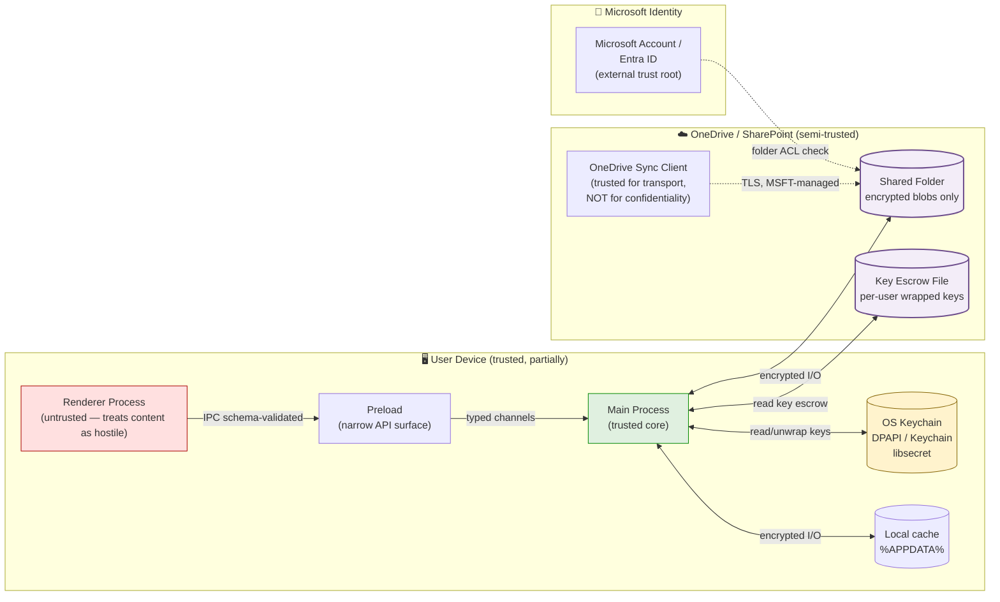

# OpenTreasury Desktop — Security Requirements & Threat Model v0.1

> **Status:** Draft v0.1 · **Owner:** Switch (Security Engineer, final say) · **Last updated:** 2026-04-19
> **Scope:** Constraints that any v1 architecture, tech stack, and data format MUST satisfy.
> **Authority:** Per team decision 2026-04-19, Switch has non-negotiable final say on security. This document sets the rules. Neo picks the tools within these rules.

---

## 0. TL;DR — The Non-Negotiables

If you only read this section, read this. Any ADR, spec, or PR violating these is rejected.

1. **Encryption at rest is MANDATORY.** The OneDrive folder MUST NOT contain plaintext PII or financial records. AEAD only. No exceptions.
2. **No roll-your-own crypto.** Audited library (libsodium via `sodium-native`, Node's `crypto` WebCrypto subtle, or `@noble/*`). If a reviewer cannot name the library's auditors, it is rejected.
3. **Electron hardening is non-negotiable.** `contextIsolation: true`, `nodeIntegration: false`, `sandbox: true`, strict CSP, no `remote` module, no `webSecurity: false`, no `allowRunningInsecureContent`. Any PR loosening these requires Switch approval and an ADR.
4. **Zero secrets in git.** Pre-commit hook + CI scan. A single leaked key is a P0.
5. **Signed installers and signed auto-updates only.** Unsigned update = no install.
6. **PII NEVER in logs.** Names, emails, phones, amounts, account numbers — redacted at source, not "filtered later".
7. **Identity = Microsoft account (OneDrive).** No custom auth. Folder ACL is the authorization boundary. This is a product constraint we accept and harden against.
8. **Append-only audit log with chain integrity.** Treasury data is financial. Every mutation is a signed, hashed, linked record. No in-place edits.

---

## 1. Assets to Protect

| # | Asset | Sensitivity | Lives in | Notes |
|---|---|---|---|---|
| A1 | **Donor/member PII** — names, emails, phone numbers | 🔴 High (GDPR personal data) | Transaction descriptions, member list (if any) | Pedro confirmed this is in-scope data |
| A2 | **Financial records** — amounts, accounts, categories, dates | 🔴 High (financial confidentiality; fraud surface) | Transaction records | Includes NGO bank account numbers |
| A3 | **Audit trail** — who did what, when | 🟠 High (tamper-evidence required) | Append-only log in the folder | If this can be edited silently, the app has zero accountability |
| A4 | **Encryption keys / key-wrapping material** | 🔴 Critical | OS keychain + a key-escrow file in the folder | Compromise = full data compromise |
| A5 | **Application binaries / updates** | 🟠 High | Installer + update channel | Unsigned updates = RCE on treasurer laptops |
| A6 | **User device session state** | 🟡 Medium | Local app data (`%APPDATA%`, `~/Library/Application Support`) | Cached keys, last-opened folder path |
| A7 | **CSV imports (bank statements)** | 🔴 High | Transient → merged into A2 | Treated as A2 once imported; source files are user's responsibility |
| A8 | **Backups / snapshots** | 🔴 High | Same folder or user-chosen location | Inherit encryption policy of A1/A2/A3 |

**Classification rule:** If a record contains any of {name, email, phone, account number, amount tied to a person}, it is PII+Financial and gets the strongest protection tier (AEAD-encrypted, access logged, never plaintext on disk, never in logs).

---

## 2. Trust Boundaries

**Trust assumptions (explicit, auditable):**

- **Renderer process is HOSTILE.** Any HTML/JS rendered there may be tampered. No crypto keys, no filesystem, no Node APIs reach the renderer.
- **Main process is trusted.** All crypto, all filesystem writes, all key handling happens here.
- **OneDrive transport is trusted for integrity and availability, NOT for confidentiality.** Microsoft engineers, subpoenas, sync-client bugs, and misconfigured sharing links are within threat scope. Therefore everything in the folder is ciphertext.
- **OS keychain is trusted** (DPAPI on Windows, Keychain on macOS, libsecret/kwallet on Linux). If the keychain is compromised, the device is compromised, and that's out of our defensive scope.
- **Microsoft account is the identity root.** If an NGO member's MS account is taken over, that member's access is compromised. We accept this (see §7).

---

## 3. Threat Model (STRIDE)

| # | Threat | Category | Asset | Likelihood | Impact | Mitigation → Req |
|---|---|---|---|---|---|---|
| T1 | Phishing / credential theft of a member's MS account | Spoofing, EoP | A1, A2, A3 | 🟠 High | 🔴 High | MFA guidance (docs); encrypted-at-rest means account compromise ≠ key compromise unless escrow entry is also taken → R3, R4, R7 |
| T2 | NGO laptop stolen or lost | InfoDisc | A1, A2, A4, A6 | 🟡 Medium | 🔴 High | Full-disk encryption guidance; app-level AEAD; keys in OS keychain (bound to user profile) → R3, R6 |
| T3 | Malicious insider with folder access | InfoDisc, Tampering, Repudiation | A1, A2, A3 | 🟡 Medium | 🔴 High | Every mutation signed by actor; append-only log detects tampering; key revocation via re-escrow → R5, R7, R8 |
| T4 | Accidental oversharing (public link, wrong person added) | InfoDisc | A1, A2 | 🟠 High | 🔴 High | Encryption at rest: new recipient has bytes but no key unless added to escrow → R3, R7; first-run warning about link-sharing |
| T5 | OneDrive sync-client bug / race (duplicate, partial, corrupt file) | Tampering, DoS | A2, A3 | 🟡 Medium | 🟠 High | Per-record file format + AEAD auth-tag detects corruption; snapshots → R5, R8 |
| T6 | MITM during sync | Tampering, InfoDisc | A1, A2 | 🟢 Low (MSFT TLS) | 🔴 High | Out-of-scope for us; documented. AEAD on payload is defense-in-depth → R3 |
| T7 | npm supply-chain attack (malicious dep, typosquat, compromised maintainer) | Tampering, EoP | A5, A1, A2 | 🟠 High (industry baseline) | 🔴 Critical | Lockfile + CI audit + minimal deps + signed installer → R9, R10 |
| T8 | Remote code execution via renderer (XSS-equivalent in treasurer-entered data) | EoP | All | 🟡 Medium | 🔴 Critical | `contextIsolation`, `sandbox`, CSP, no remote module, no `eval`, untrusted data never HTML-interpolated → R11 |
| T9 | IPC abuse — renderer calls privileged main-process methods with crafted args | EoP, Tampering | A2, A4 | 🟡 Medium | 🔴 High | Schema validation on every IPC message; allowlist channels; no dynamic dispatch → R12 |
| T10 | Malicious / tampered auto-update | EoP, RCE | A5 | 🟢 Low (if signed) / 🔴 Critical (if not) | 🔴 Critical | Signed updates only; public key pinned; HTTPS update channel; staged rollout → R13 |
| T11 | Secrets leaked in git history (signing cert, update server token) | InfoDisc | A5 | 🟠 High (common) | 🔴 Critical | Pre-commit + CI scanning; secrets only in OS keychain / CI vault → R14 |
| T12 | PII leaked via log files or crash reports | InfoDisc | A1 | 🟠 High | 🟠 High | Structured logger with PII-redaction allowlist; no free-form logging of record fields → R15 |
| T13 | Tampered audit log entries (insider silently edits history) | Tampering, Repudiation | A3 | 🟡 Medium | 🔴 High | Append-only; each entry Ed25519-signed by author; hash-chained to previous → R5, R8 |
| T14 | Former member's access not fully revoked (still has local cache + old key) | InfoDisc | A1, A2 | 🟠 High | 🟠 High | Key rotation on membership change; old ciphertext accepted as "historical" but new data uses new key → R4 |
| T15 | Key-escrow file tampering (removing someone's access, or adding an attacker) | Tampering, EoP | A4 | 🟡 Medium | 🔴 High | Escrow file entries signed by an "admin" key; changes logged in audit trail → R4, R8 |
| T16 | Encryption-at-rest key accidentally committed or exported unencrypted | InfoDisc | A4 | 🟡 Medium | 🔴 Critical | Keys never leave OS keychain in cleartext; export flows require passphrase-wrap → R4, R14 |

**Out of scope (accepted):** Nation-state attacker with device root, Microsoft infrastructure compromise, side-channel attacks on OS keychain, physical coercion of a keyholder.

---

## 4. Security Requirements (numbered, testable, mapped)

Each requirement cites the threat(s) it mitigates. Every requirement MUST have a test or verification method before v1 ships.

### R1 — Data classification enforcement
**Threats:** T1, T4, T12
Every record type MUST be classified (PII, Financial, Metadata-only). The code MUST NOT write PII or Financial fields to any location except AEAD-encrypted blobs in the shared folder or the (itself-encrypted) local cache.
**Verification:** Static analysis rule + code review checklist. A sampled ciphertext file MUST contain no searchable plaintext substrings of seeded test PII.

### R2 — Minimum data collection
**Threats:** T1, T4
The app MUST NOT collect PII beyond what's required for the treasury workflow. No analytics, no crash reports with user data, no cloud telemetry. "Secondary" PII fields (e.g., address, IBAN) MUST be optional and off by default in UI forms.
**Verification:** Data-field inventory doc, reviewed per feature spec.

### R3 — Encryption at rest (AEAD, non-negotiable)
**Threats:** T1, T2, T4, T6
All files written to the OneDrive/SharePoint folder containing PII or Financial data MUST be encrypted with an AEAD cipher:
- **Approved algorithms:** `XChaCha20-Poly1305` (preferred for 24-byte nonces, random-nonce-safe) or `AES-256-GCM` (acceptable with carefully managed nonce discipline).
- **Forbidden:** AES-CBC, AES-CTR without MAC, any home-grown construction, anything not in an audited library.
- **Scope of encryption:** Full file payload. Filenames MAY leak coarse-grained metadata (record type, date bucket) but MUST NOT leak PII or amounts. Filenames MUST be opaque (e.g., ULID or hashed) — not `donation-john-smith-2026-04-19.json`.
- **Nonce discipline:** Never reuse a (key, nonce) pair. XChaCha20-Poly1305 with random 192-bit nonces is the safe default. AES-GCM requires either a counter or a random 96-bit nonce with rotation at ≤ 2^32 messages per key.
- **Associated data (AAD):** MUST bind each record to its record type and record ID to prevent ciphertext substitution attacks.
**Verification:** Unit tests that tampered/swapped ciphertexts fail to decrypt; manual inspection of produced files; chosen-ciphertext test from a peer reviewer.

### R4 — Key management (recommended: per-user keys with escrow file) ⭐
**Threats:** T1, T3, T14, T15, T16

This is the hardest requirement. Here is the recommended approach, with alternatives explicitly rejected or deferred.

**Recommended approach: "Shared-folder escrow with per-user wrapping"**

Concept:
1. One **Data Encryption Key (DEK)** per dataset (the NGO's treasury). The DEK encrypts records (R3).
2. The DEK is stored **wrapped** once per authorized user in a **key-escrow file** in the same OneDrive folder (e.g., `.treasury/keys.json`).
3. Each user has a **local keypair** (Curve25519/X25519) generated at first launch and stored in the **OS keychain** (DPAPI / macOS Keychain / libsecret). The keypair never leaves the machine in plaintext.
4. The escrow file contains, per user: `{ user_id (MS account UPN or stable SID), public_key, wrapped_DEK, signature }`.
5. To read data: user's local private key unwraps their DEK entry → decrypts records.
6. **Adding a member:** an existing member adds a new entry to the escrow file by wrapping the DEK to the new member's published public key. The new member MUST publish their public key via a small bootstrap file in the folder (`.treasury/pubkeys/{user_id}.pub`).
7. **Removing a member (revocation):** generate a new DEK, re-encrypt future records with it, write a new escrow file omitting the removed user. **Historical records stay readable with the old DEK** (rotation-aware). The removed member had access to historical data — that is an accepted risk (§7 AR2).
8. **Escrow file integrity:** every change is signed by the author's private key and logged in the audit trail (R8). Tampering is detectable.
9. **Admin bootstrap:** the first member designates themselves admin by creating the initial escrow file. The admin role is an **escrow-edit signing privilege**, not an app-level role. It lives in the escrow file itself.

Key rotation policy:
- **Mandatory rotation:** on member removal, on suspected key compromise, on explicit user request.
- **Time-based rotation:** not required in v1 (complexity cost too high for a small NGO). Re-evaluate in v1.x.
- **DEK scope:** one DEK per NGO dataset. If a future feature needs finer granularity, an ADR is required.

Why this approach:
- Works with OneDrive folder sharing as the authorization layer (requirement from Pedro).
- No central server, no custom auth.
- Revocation is actually possible (rare among file-based systems).
- Per-user keys mean no shared secret to leak; each keypair is bound to a device.

Alternatives considered and their status:

| Option | Status | Why |
|---|---|---|
| (a) Shared passphrase everyone knows (derived with Argon2id to a key) | ❌ Rejected for v1 | No revocation. Once someone knows it, rotation requires re-keying everything and telling everyone a new passphrase out-of-band. Usability claim is a mirage: passphrases get written down, shared via Teams chat, and never rotated. |
| (b) Per-user key wrapped by a shared secret | ❌ Rejected | Still has the shared-secret distribution problem. Recommended approach (c) is strictly better. |
| (c) Key escrow file with per-user public keys (**chosen**) | ✅ Recommended | See above. |
| (d) Microsoft Graph-based key derivation | ❌ Rejected for v1 | Requires an app registration, an Entra scope, an OAuth flow — violates "no custom auth" product constraint and adds setup friction that Pedro explicitly wants to avoid. Revisit in v2 if an "NGO Pro" tier ever appears. |
| (e) Hardware-token-wrapped DEK | ❌ Deferred | Not realistic for volunteer treasurers on loaner laptops in v1. |

**Verification:** End-to-end test: User A onboards, writes data, adds User B to escrow; User B reads data; User A revokes User B; new data written by A is unreadable by B; B's old cached data is not retroactively destroyed (accepted, documented).

### R5 — Integrity & tamper detection
**Threats:** T3, T5, T13
- AEAD auth-tags (from R3) detect any bit-flip or truncation of encrypted records.
- The audit log (R8) is **append-only** and **hash-chained**: each entry contains the hash of the previous entry. A silent deletion or reordering breaks the chain and is detected at load time.
- On load, the app MUST verify the chain and refuse to open a dataset whose audit chain is broken, surfacing a clear recovery path (snapshot restore).

**Verification:** Property tests with random mutations; a mutated record file MUST be rejected with a clear error.

### R6 — Local cache protection
**Threats:** T2, T6
Any local cache of decrypted data (for offline use) MUST be encrypted with a key stored in the OS keychain (DPAPI / Keychain / libsecret). Cache MUST be user-scoped (user profile directory, no system-wide paths). On logout/uninstall, the app MUST provide a one-click "wipe local data" that zeroes cache files and removes keychain entries.
**Verification:** Inspection of `%APPDATA%` / `~/Library/Application Support` shows no plaintext PII or financial fields.

### R7 — Authorization boundary = OneDrive folder ACL
**Threats:** T1, T4, T14
The app trusts the OneDrive folder ACL as the authorization boundary. The app MUST NOT invent an in-app role system that contradicts this. However:
- Onboarding a new member to crypto access (R4) is a **separate explicit action** by an existing member, not implicit from folder ACL. Adding someone to the folder does NOT automatically give them decryption keys — they must also be added to the escrow file. This is by design: it prevents accidental oversharing (T4) from becoming automatic data disclosure.
- The app MUST warn at first run: "Folder ACL controls who can *connect*; crypto membership controls who can *read*. Keep them in sync."

**Verification:** Threat-test scenario: a user with folder read-access but no escrow entry sees only ciphertext and an appropriate "no access" UX.

### R8 — Append-only audit log with author signatures
**Threats:** T3, T13
Every mutation (create, update, delete, import, export, escrow change) MUST produce an audit entry containing: timestamp (UTC), actor user_id, action type, target record id, before/after hashes (NOT values), previous-entry hash, Ed25519 signature by the actor's private key.
- "Delete" is a logical tombstone, never a physical delete.
- The audit log file is itself encrypted per R3.
- Signature verification failure OR chain break = load-time error.

**Verification:** End-to-end test where an attacker with folder write access removes an audit entry; app refuses to load dataset and points at last known-good snapshot.

### R9 — Dependency policy
**Threats:** T7
- `package-lock.json` is required and committed.
- `npm audit` in CI; high/critical vulnerabilities block merge.
- A dependency allowlist reviewed by Switch for anything that: does crypto, does IPC, parses untrusted input, or has native code.
- **No native dependencies without Switch review.** Native modules expand the attack surface and complicate signing.
- Prefer maintained packages with >1 active maintainer, recent releases, and security policy.
- **Forbidden patterns:** `preinstall`/`postinstall` scripts in direct deps without review; packages with fewer than 90 days of history.

**Verification:** CI job; Switch review of dependency diffs on each PR touching `package.json`.

### R10 — Build reproducibility and provenance
**Threats:** T7, T10
- CI builds installers from a pinned commit on a clean runner.
- SBOM generated per build.
- Build artifacts attested (e.g., GitHub Actions artifact attestations, SLSA level 1 minimum, target level 3 for v1.x).

**Verification:** SBOM diff review; attestation verified on install (stretch goal for v1).

### R11 — Electron hardening (non-negotiable)
**Threats:** T8
Every `BrowserWindow` and `webContents` in the app MUST have:
- `contextIsolation: true`
- `nodeIntegration: false`
- `nodeIntegrationInSubFrames: false`
- `nodeIntegrationInWorker: false`
- `sandbox: true`
- `webSecurity: true`
- `allowRunningInsecureContent: false`
- `experimentalFeatures: false`
- No use of `@electron/remote` or the legacy `remote` module.
- A strict Content Security Policy:
  - `default-src 'self'`
  - `script-src 'self'` (no `unsafe-inline`, no `unsafe-eval`, no CDN)
  - `style-src 'self' 'unsafe-inline'` (only if framework absolutely requires; revisit)
  - `img-src 'self' data:`
  - `connect-src 'self'` (plus allowlisted update server origin and MS Graph if ever used)
  - `frame-ancestors 'none'`
  - `base-uri 'none'`
  - `object-src 'none'`
- URL navigation allowlist: renderer may only navigate to `file://` for app assets. External links MUST open in the system browser via `shell.openExternal` after URL allowlist validation.
- All external links validated against an allowlist (https only, no `javascript:`, no `file:`).

**Verification:** Automated check (e.g., `electronegativity`) in CI; manual audit per Electron release upgrade.

### R12 — IPC discipline
**Threats:** T9
- Renderer ↔ main IPC goes through the preload script using `contextBridge.exposeInMainWorld` with a **narrow, explicit API surface**.
- No generic "execute this on the main process" channel. No dynamic method dispatch from renderer.
- Every IPC message MUST be schema-validated at the boundary (Zod/Valibot/Ajv). Schema violations are logged (without PII) and rejected.
- No raw `eval`, no `Function()` constructor from strings, no unvalidated `require()`.
- Privileged operations (key access, filesystem writes outside the data folder) MUST have explicit channels and MUST NOT accept renderer-supplied paths — main process computes paths.

**Verification:** Audit of `preload.ts`; fuzz test each IPC channel with malformed inputs.

### R13 — Signed updates only
**Threats:** T10
- Installers signed: Authenticode on Windows (EV cert strongly preferred for SmartScreen trust), notarized on macOS (Apple Developer ID + notary service), detached signature + published public key on Linux.
- Auto-update mechanism (`electron-updater` or equivalent) MUST verify signatures with a pinned public key embedded in the binary.
- Update manifest served over HTTPS with certificate pinning or at minimum an additional signature layer.
- A failed signature verification MUST abort the update with a visible error. Silent fallback is forbidden.

**Verification:** Tampered update binary rejected by auto-updater in a release-candidate test.

### R14 — Secrets never in source
**Threats:** T11, T16
- Pre-commit hook scanning (`gitleaks` or `trufflehog`).
- CI secret scan on every PR; high-confidence findings block merge.
- Signing certs, update-server tokens, and any other secrets live only in CI vault / OS keychain.
- No `.env` files committed. `.env.example` documents variables without values.
- Code-signing keys accessed only via CI with short-lived credentials; no developer laptop holds a signing cert.

**Verification:** CI job; periodic audit of git history with a detector.

### R15 — Logging & PII redaction
**Threats:** T12
- Structured logger (e.g., `pino`). Log records are JSON with an explicit schema.
- **Allowlist redaction:** the logger by default strips any field whose name matches a PII pattern (`email`, `phone`, `name`, `amount`, `iban`, `account`, `description`, `note`, `tag`, `category_value`). Developers MUST explicitly opt in to logging these and that opt-in is code-reviewed.
- No free-form `console.log(obj)` where `obj` may contain record data. Lint rule in CI.
- Log rotation with bounded disk use; logs encrypted if persisted (same key as local cache, R6).
- Crash reports (if any, opt-in only) strip user data.

**Verification:** Unit tests that logging a tagged-PII payload produces `[REDACTED]`; review of log files for seeded PII.

### R16 — Cryptographic agility & versioning
**Threats:** Cross-cutting, future-proofing
- Every encrypted file carries a version byte and algorithm id.
- Key-escrow file carries a schema version.
- Upgrading the crypto scheme (e.g., migrating away from AES-GCM to XChaCha20) is possible without a full re-encryption migration in one step (mixed-version tolerance for a bounded grace period).

**Verification:** Unit tests across versions; upgrade path documented.

### R17 — Input validation for imports
**Threats:** T8, cross-cutting
- CSV imports (bank statements) parsed with a hardened parser (no formula injection — e.g., cells starting with `=`, `+`, `-`, `@` quarantined for Excel-export safety).
- File size caps; row count caps; per-field length caps.
- Imported rows stored via the same encrypted record path as user-entered data.

**Verification:** Fuzz test CSV parser; known CSV-injection payloads from OWASP corpus.

### R18 — Safe handling of shared folder paths
**Threats:** T8, T9
- User-selected folder path stored; all I/O confined to that subtree.
- Path-traversal defense: resolve and validate every path stays within the chosen root.
- Symlinks in the shared folder followed only if target is still within the root.

**Verification:** Path-traversal fuzz test.

### R19 — Snapshots & recovery
**Threats:** T5, T13
- Periodic encrypted snapshots of the full dataset written to a subfolder (e.g., `.treasury/snapshots/{utc-iso}.bin`).
- Snapshot cadence configurable; minimum daily on active days.
- Restore flow requires audit log continuity verification post-restore.
- Snapshot retention bounded (e.g., last 30 days + weekly for 12 weeks).

**Verification:** Corrupt the live dataset, restore from snapshot, audit chain intact.

### R20 — First-run security posture wizard
**Threats:** Cross-cutting UX
At first run and on each major setup change, the app MUST display and require acknowledgment of:
- "Your MS account MUST have MFA enabled." (link to MS docs)
- "Device disk encryption (BitLocker / FileVault) is strongly recommended."
- "Never share the folder via public link."
- "Adding someone to the folder does NOT give them access — you must also add them to the treasury."

**Verification:** UI test; first-run cannot be skipped without acknowledgment.

---

## 5. Constraints on Neo's Stack Proposals (checklist)

Neo's tech stack ADR MUST satisfy every item. If any is "no" or "unknown", the ADR is rejected.

| # | Constraint | Why | Must-answer in ADR |
|---|---|---|---|
| C1 | Electron (or equivalent with at least the same hardening surface) — Tauri is acceptable if it meets all renderer isolation, CSP, and IPC validation properties | R11, R12 | How do `contextIsolation`, `sandbox`, CSP equivalents work in the chosen runtime? |
| C2 | Audited AEAD crypto library is available and idiomatic to use | R3 | Which library (libsodium / WebCrypto / `@noble/*`), which auditor, last audit date? |
| C3 | Ed25519 signing available for audit log and escrow signatures | R4, R8 | Same library or compatible? |
| C4 | OS keychain access via a maintained cross-platform library (`keytar` deprecated — use `@napi-rs/keyring` or similar) | R4, R6 | Which library, supported platforms, native-dep implications (R9)? |
| C5 | Schema-validated IPC layer (Zod / Valibot / Ajv or equivalent) | R12 | Which, and how enforced? |
| C6 | Packaging supports code signing on Windows (Authenticode), macOS (notarization), Linux (sig/checksum) | R13 | `electron-builder` / `electron-forge` / Tauri bundler — which? |
| C7 | Signed auto-update with pinned public key | R13 | `electron-updater` / `update.rs` / custom — which? |
| C8 | Reproducible CI builds with lockfile | R9, R10 | CI provider, pinning strategy |
| C9 | Lint/format/type-check gates in CI | R11–R18 | Toolchain and rules |
| C10 | Minimal native-module footprint | R9 | List native deps up front |
| C11 | Renderer framework MUST support strict CSP (no inline scripts, no `eval`) | R11 | React / Vue / Svelte / Solid — cite their CSP compatibility |
| C12 | The chosen data format MUST be compatible with per-record encrypted files (for R3, R5, R8) — a single monolithic SQLite blob is acceptable only if sealed end-to-end with AEAD and if concurrency conflicts are resolvable (discuss with Switch) | R3, R5 | File layout proposal |
| C13 | Offline-first is compatible with encryption (keys available from keychain without network) | R6 | Confirm |
| C14 | No "evaluate untrusted code" features (plugin systems, template engines with code execution) in v1 | R8, R11 | Confirm |
| C15 | Telemetry / analytics libraries — **none** in v1 | R2 | Confirm no libs like Sentry, PostHog, etc. without explicit Switch sign-off and PII filtering |

---

## 6. Accepted Risks (v1)

These are risks we consciously accept because mitigating them would violate the product constraints or disproportionately hurt usability. They are documented so they don't resurface as "we forgot".

| # | Accepted Risk | Rationale | Revisit when |
|---|---|---|---|
| AR1 | **Identity = MS account.** If an NGO member's Microsoft account is compromised, the attacker can read that member's escrow entry AND access the folder. Encryption at rest mitigates external folder leaks but not a compromised legitimate member. | Inherent to "no custom auth" product constraint. MFA guidance in R20. | If we ever add a second auth factor; if MS account fraud becomes a reported incident. |
| AR2 | **Revoked members retain access to historical data they already decrypted.** Key rotation protects future data only. | True of every symmetric-crypto system without a server that can gate reads. | Never fully solvable without a server; accepted permanently. |
| AR3 | **OneDrive search does not work across encrypted content.** In-app search does. | Direct consequence of R3. Product constraint. | If OneDrive ever supports client-side-encrypted search (unlikely soon). |
| AR4 | **Microsoft can see filenames and folder metadata.** Ciphertext is confidential; the existence of a file and its approximate size/timestamp is not. | Folder-level concealment would require hosting our own sync. Out of scope. | v2+ if an enterprise NGO variant is ever pursued. |
| AR5 | **Physical theft of an unlocked, logged-in laptop = full access.** The OS keychain unlocks automatically for the logged-in user. | Device security is the user's responsibility. R20 warns about disk encryption. | If we add a per-session app passphrase feature (considered in v1.x). |
| AR6 | **No hardware-token support in v1.** | Not realistic for volunteer-run NGOs. | v1.x if demand emerges. |
| AR7 | **Audit log can be verified but not prevented from deletion by a folder-write-capable attacker.** An insider who deletes the log file entirely is detectable (missing file) but the evidence is gone. | Snapshots (R19) give recovery; detection is the defense. A server would be the only full mitigation. | Permanent given file-based model. |
| AR8 | **CSV import files the user chooses are their own responsibility.** We don't re-encrypt the source CSV the user downloaded. | Out of scope; guidance in docs. | Documented, not revisited. |

---

## 7. Open Questions for Pedro (block sign-off on this doc)

Numbered for easy reply. Switch needs these to finalize v1.

1. **Admin model in the escrow file (R4) — who bootstraps?** The first member to set up the folder becomes admin. Is that acceptable, or do you want the admin role to be explicit (e.g., a name in the escrow file the founder types in) so it can be rotated? And how many admins are allowed simultaneously — 1, N, or all-members-are-admins-with-logging?
2. **Audit log visibility — who can read it?** The audit log contains actor names and actions. Is it visible to all members (transparency), visible to admins only (privacy), or exportable on request? This affects encryption scope for A3.
3. **Encryption scope — are there fields we WANT to leave searchable to OneDrive?** E.g., coarse date buckets, category names without PII. My default is "encrypt everything that touches PII or money"; say now if you want a partial-encryption carve-out (I will push back — AR3 is the price; I'm asking to confirm you accept it).
4. **Device-trust model — do we support one member using the app on multiple devices?** If yes, the same user has multiple keypairs, each needing an escrow entry. This changes escrow-file size and onboarding UX. My default is yes, one escrow entry per device per user.
5. **Incident response expectation — if a device is suspected compromised, what's the user's recovery path?** Proposed: "Remove that user from escrow → rotate DEK → re-publish. Old cached data on the compromised device remains readable to the attacker (AR2)." Is that acceptable, or do you want a 'burn it all down' story (new dataset, migration)?
6. **Update channel — are you willing to pay for an EV code-signing cert on Windows (~$300–500/yr)?** Without EV, Windows SmartScreen will warn NGO users on every install until reputation is built. This is a real UX cliff for non-technical treasurers. If not, we accept the warning and document it, but it will hurt adoption.

---

## 8. Review & Sign-off

- [ ] Neo — confirm Stack ADR (ADR-001) satisfies every item in §5 (Constraints).
- [ ] Link — confirm product vision is compatible with §6 (Accepted Risks), especially AR1–AR3.
- [ ] Niobe — confirm §7 UX warnings and R20 first-run wizard fit the UX flow.
- [ ] Pedro — answer §7 (Open Questions) and approve the recommended R4 key-management approach.
- [ ] Switch — final sign-off once the above land.

---

*End of Security Requirements v0.1 — next: Pedro answers §7, Neo's ADR-001 is reviewed against §5, v0.2 locks in.*
