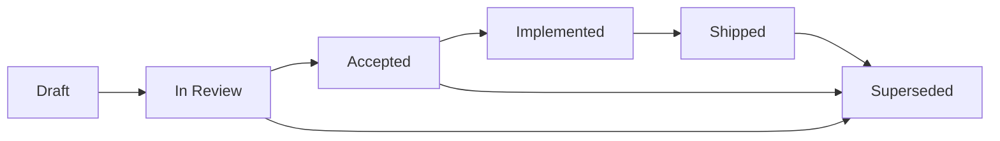

# Feature Specs — Spec-Driven Development

> **Owner:** Neo (Lead) · Domain agents co-author per feature.
> **Status:** folder scaffolded, specs arrive per feature.
> **Template:** [`_template.md`](./_template.md).

This folder is the **heart of Spec-Driven Development** for OpenTreasury Desktop.
Every non-trivial feature ships with a spec **written before code** and reviewed by the team.

## Why SDD?

The cloud repo (`rett-europe/opentreasury`) demonstrated that spec-first work produces
code reviewable against an agreed artifact instead of a moving target. We keep that
discipline here. Product Vision §7 Principle 3: *"Spec before code."*

## Spec index

One row per spec. **Status** is the spec document's own (point-in-time) lifecycle marker — these
spec files are historical records and are not rewritten. **Shipped** reflects the actual released
state per [`CHANGELOG.md`](../../CHANGELOG.md), which is authoritative for "what ships."

| Spec | Title | Status (in doc) | Shipped |
|---|---|---|---|
| [SPEC-023](./023-split-transactions.md) | Split Transactions | Draft | ✅ Shipped (splits in Movements/Add Transaction) |
| [SPEC-025](./025-edit-rules.md) | Status-Based Transaction Edit Rules | Draft | ✅ Shipped (v0.1.0-trial.3.7) |
| [SPEC-026](./026-encryption-at-rest.md) | Encryption at Rest (v2) | Proposed | ✅ Shipped (v0.1.0-trial.3.8) |
| [SPEC-027](./027-export.md) | Export (CSV / XLSX) | Accepted | ✅ Shipped (v0.1.0-trial.3.14) |
| [SPEC-028](./028-audit-and-evidence.md) | Audit & Evidence | Draft | ◐ Foundation only — tamper-evident chain + external timestamping shipped (v0.1.0-trial.3.15, Tiers 0–2). **Audit & Evidence viewer not yet shipped.** |
| [SPEC-029](./029-invoice-attachments.md) | Invoice Attachments for Transactions | Draft | ✗ Not shipped (spec only) |

Supporting design specs (not numbered feature specs): [Dataset Compatibility & Validation](./dataset-compatibility-validation.md) and its [Error Code Catalogue](./error-codes.md).

## File naming

- **Pattern:** `NNN-{kebab-case-feature}.md`
- **NNN:** zero-padded 3-digit monotonic ID, shared across filename and the spec's own `SPEC-NNN` id.
- **Examples:** `001-accounts.md`, `002-transactions.md`, `003-csv-import.md`.
- Reserve `_template.md` (underscore prefix) for the canonical template — not a numbered spec.

## Lifecycle

| Status | Meaning | Required reviewers |
|---|---|---|
| **Draft** | Author is writing; open for early async comments. | None required. |
| **In Review** | Ready for formal review. | Neo (architecture); Switch (if security-touching — R3, R4, R5, R6, R8, R11–R15, R18, R19); Link (product alignment); Niobe/Mouse for UX/design fidelity. |
| **Accepted** | Green light to implement. PR referencing this spec may open. | Pedro signs off on product scope changes. |
| **Implemented** | Code merged to `main`; spec updated with commit SHAs. | Implementer marks status. |
| **Shipped** | Released in a tagged version. | Release owner marks status. |
| **Superseded** | Replaced by a later spec; header points forward. | Author of replacement spec. |

**Rule:** no implementation PR merges against a spec in `Draft` or `In Review` status.

## Traceability — required in every spec

Every spec MUST contain a `## Traceability` section listing:

- **PRD** — `docs/product/prds/{feature}.md` (the product-intent source).
- **ADRs** — at minimum [ADR-001](../architecture/adr-001-tech-stack.md) and
  [ADR-002](../architecture/adr-002-repo-structure.md). Cite any other ADRs the
  implementation must satisfy.
- **ADR-001 conditions (C1–C15)** — explicit IDs the implementation must satisfy.
- **Security requirements (R1–R20)** — explicit IDs from
  [`security-requirements-v0.1.md`](../security/security-requirements-v0.1.md) the
  implementation must satisfy.
- **Crypto-spec sections** — explicit §-numbers from
  [`crypto-spec.md`](../security/crypto-spec.md) if the feature touches encrypted artifacts.
- **Paired artifacts** — `docs/ux/NNN-...md` and `docs/design/NNN-...md` if applicable.

## Review checklist (for reviewers)

- [ ] Spec follows `_template.md` structure.
- [ ] Traceability section is populated and accurate.
- [ ] Security considerations explicit — not "we'll figure it out".
- [ ] Test plan is concrete (unit + integration + e2e scope).
- [ ] Acceptance criteria are testable.
- [ ] Electron process boundaries respected (renderer never touches fs/crypto/keys).
- [ ] IPC surface additions are listed and schema-validated (C13).
- [ ] Any new events are defined in `src/shared/events/` with Zod schemas.

## Related folders

- [`docs/product/prds/`](../product/) — product intent (Link).
- [`docs/ux/`](../ux/) — user flows + interaction (Niobe).
- [`docs/design/`](../design/) — visual design + tokens (Mouse).
- [`docs/architecture/`](../architecture/) — ADRs (Neo).
- [`docs/security/`](../security/) — crypto + threat models (Switch, final say).
