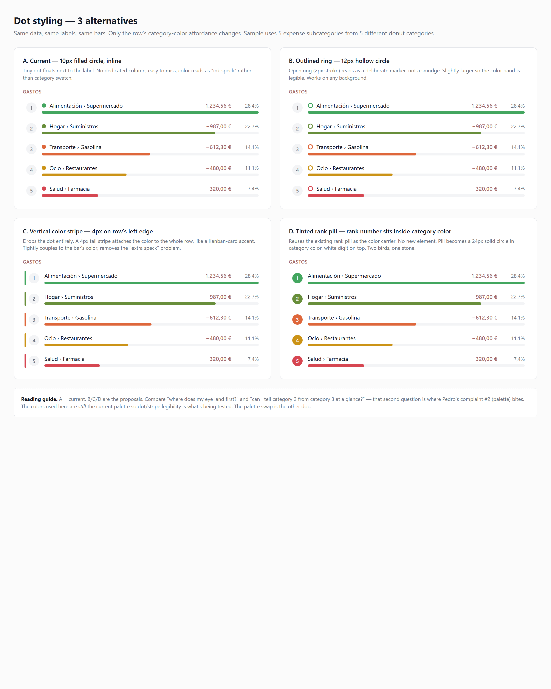
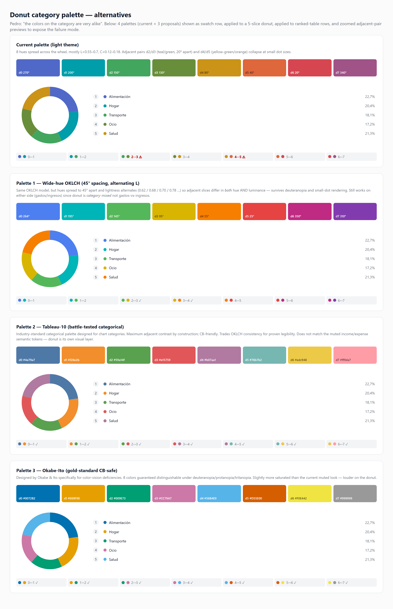

# Insights subcategory tables — dot styling & category palette options

> **Status:** awaiting Pedro selection. Per the design-gate directive (.squad/decisions.md, 2026-04-28), no production CSS/component/token changes ship until a choice is approved here.
>
> **PR under review:** [#142](https://github.com/rett-europe/opentreasury-desktop/pull/142) — ranked subcategory tables. Layout approved. Two polish blockers:
>
> 1. *"the dots in each subcategory don't look good"*
> 2. *"the colors on the category are very alike"*

This doc proposes alternatives for both. Each section: **diagnosis → mockups → recommendation**. Mockups are rendered HTML in `dots-options/` and `colors-options/`; PNG previews are inlined below. Open the `index.html` files for pixel-perfect inspection (zoom freely, hover rows, etc.).

---

## A. The Dot problem

### What's there today

Component: `app/src/renderer/components/SubcategoryRankedTable/SubcategoryRankedTable.{tsx,css}`. Each row's label looks like:

```
[rank pill] [10×10 filled circle in category color] [Category › Subcategory text]
```

The dot is `width: 10px; height: 10px; border-radius: 50%`, sits inline with the label, gap of `var(--space-2)` (8px), no dedicated column. The row's bar fill below already uses the same category color, so the dot is duplicating an affordance that's already on the row.

### Why it doesn't look good

- **No anchor.** The dot floats freely between the rank pill and the label text. Without a column structure, your eye reads it as a visual smudge before parsing it as a swatch.
- **Too small to read color reliably.** At 10px on muted oklch hues (current palette is L=0.55–0.7, C=0.12–0.18), categories that are close in hue collapse into "blob".
- **Redundant with the bar.** The bar fill on row 2 (the magnitude bar) already carries the category color at much higher legibility. The dot adds noise without adding signal.
- **Misaligned with the rest of the visual language.** Movements rows, Saldo subrows, and the donut chart never use a small inline dot — they use either a typed badge or the bar itself.

### Mockups (3 alternatives + current for reference)

Source: [`dots-options/index.html`](./dots-options/index.html) — open in the browser for the live version.



| Option | What changes | Pros | Cons |
| --- | --- | --- | --- |
| **A. Current** (10px filled circle, inline) | — | minimal change; familiar | reads as smudge; redundant with bar |
| **B. Outlined ring** (12px hollow circle, 2px stroke) | dot becomes a ring instead of a fill | reads as deliberate marker, not a speck; works on any background; tiny diff to ship | still inline, still redundant with the bar |
| **C. Vertical color stripe** (4px tall stripe on row's left edge) | dot removed, row gets a left-edge accent bar | tightly couples color to whole row, like a Kanban-card accent; looks intentional and modern; no extra speck | introduces a new visual primitive; stripe + bar still redundant |
| **D. Tinted rank pill** (rank number sits inside category-colored circle) | dot is removed; the existing rank pill becomes the color carrier | **no new element** — the rank pill is already there; one glyph carries both rank and category; matches the "type-arrow" badge pattern used in Movements; eliminates redundancy | rank-pill background is now category-colored — slight cognitive shift ("I expected gray pills"); needs WCAG-AA white-on-color check across the palette |

### Recommendation: **D — Tinted rank pill**

Reasoning (3 sentences):
> The rank pill already occupies a fixed column and is sized for a glyph (24×24px), so reusing it as the color carrier removes an entire UI element instead of replacing one. It also matches the Movements `ot-type-arrow--income/--expense` pattern where a circular colored chip carries semantic meaning, keeping the visual language consistent across the app. The only constraint is contrast — the white rank digit needs WCAG-AA against every category color, which Palette 1 and Palette 3 both satisfy by construction (see palette section); Palette 2 will need a darker text on the yellow swatch.

---

## B. The Category Color problem

### Tokens today

Defined in `app/src/renderer/components/DonutChart/DonutChart.css`:

```css
:root, :root[data-theme='light'] {
  --color-donut-0: oklch(0.55 0.15 270); /* purple */
  --color-donut-1: oklch(0.6  0.18 200); /* blue */
  --color-donut-2: oklch(0.65 0.14 150); /* teal */
  --color-donut-3: oklch(0.6  0.12 130); /* green */
  --color-donut-4: oklch(0.7  0.14  80); /* yellow-green */
  --color-donut-5: oklch(0.65 0.16  40); /* orange */
  --color-donut-6: oklch(0.6  0.18  20); /* red-orange */
  --color-donut-7: oklch(0.55 0.12 340); /* pink */
  --color-donut-otras: oklch(0.6 0.02 260); /* neutral gray */
}
```

A dark-theme variant exists with mirrored lightness. Used by `DonutChart.tsx` (slice strokes), `InsightsDetailScreen.tsx` (legend swatches & ranked-table colorMap), and now `SubcategoryRankedTable.tsx`.

### Why categories look alike

Plot the 8 hues on the OKLCH wheel: 270° → 200° → 150° → 130° → 80° → 40° → 20° → 340°. Two pairs are **only 20° apart in hue** with near-identical lightness and chroma:

- **d2 (teal, 150°) ↔ d3 (green, 130°)** — both L≈0.6, C≈0.13. At 10px dot size: indistinguishable.
- **d4 (yellow-green, 80°) ↔ d5 (orange, 40°)** — different chromas but both warm, both bright. Better than d2/d3 but still confusable for users with deuteranopia.

All other neighbours are 30°+ apart with luminance variation, so they're fine. The fix doesn't need a complete teardown — only those two adjacencies need to break.

### Mockups (current + 3 alternative palettes)

Source: [`colors-options/index.html`](./colors-options/index.html) — full-fidelity demo with swatch row, applied donut, ranked-table rows, and a zoomed adjacent-pair strip per palette.



| Palette | Approach | Pros | Cons |
| --- | --- | --- | --- |
| **0. Current** | OKLCH, 8 hues clustered, uniform L | matches muted income/expense semantic look | d2↔d3 and d4↔d5 collide at small dot size |
| **1. Wide-hue OKLCH (45° spacing, alternating L)** | same OKLCH model; redistribute hues to 45° apart and alternate L (0.62 / 0.68 / 0.70 / 0.78 …) | minimal-disruption fix — same color space, same muted feel; adjacent slices differ in **both** hue AND luminance, so it survives deuteranopia and small-dot rendering | still custom-tuned; no industry track record |
| **2. Tableau-10** | industry-standard categorical palette (`#4e79a7 #f28e2b #59a14f #e15759 #b07aa1 #76b7b2 #edc948 #ff9da7`) | battle-tested for charts; maximum adjacent contrast by construction; CB-friendly | breaks the OKLCH consistency with semantic tokens; louder/more saturated than the muted v0.3 income/expense look |
| **3. Okabe-Ito** | gold-standard CB-safe palette, 8 colors guaranteed distinguishable under deuteranopia/protanopia/tritanopia | strongest accessibility guarantees; widely cited in scientific viz | most saturated of the three; the yellow (d6 #F0E442) is loud; also breaks OKLCH consistency |

#### Color-blindness sanity check

The "zoomed adjacent-pair strip" at the bottom of each palette panel in `colors-options/preview.png` is the cheap test: read each pair as two side-by-side dots. The current palette flags `2↔3` and `4↔5` with ⚠. Palettes 1, 2, and 3 all pass with ✓. (For a full deuteranopia simulation, open the HTML and apply a browser CB filter or run the swatch hex codes through Coblis.)

#### Constraint check

- **Gastos vs ingresos sides** — the donut is *category-mixed* (a category can have both expense and income subcategories), so the palette intentionally does NOT live inside the gastos/ingresos semantic-color axis. All three proposals preserve that. The semantic income/expense tokens (`--color-income-default`, `--color-expense-default`) stay untouched.
- **Reuse design tokens** — none of the existing tokens cover the donut palette. New `--color-donut-*` tokens are unavoidable; we keep their **names and count** identical, only their values change. No call sites need updating.
- **Dark theme** — each proposal needs a dark-mode counterpart with bumped L. Cheap to derive; not shown in the mockup but specified at decision time.

### Recommendation: **Palette 1 — Wide-hue OKLCH (45° spacing, alternating L)**

Reasoning (3 sentences):
> Palette 1 is the smallest viable change — same OKLCH color space, same muted aesthetic that v0.3 chose for income/expense, just hues redistributed to 45° apart and lightness alternated so adjacent slices break in both hue and luminance. It fixes the only two real collisions (d2↔d3 and d4↔d5) without making the donut visually louder or breaking the relationship between categorical color and the rest of the system. Palette 2 (Tableau-10) is the safer fallback if Pedro feels the donut should "pop more"; Palette 3 (Okabe-Ito) is the right choice only if accessibility audits become a hard requirement, since its yellow is loud against the otherwise muted UI.

---

## Combined recommendation

> **Dot option D + Palette 1.**
>
> D removes the dot entirely by promoting the rank pill into the color carrier — one fewer element, one stronger signal, consistent with the Movements badge pattern. Palette 1 is the smallest hue/lightness rebalance that fixes the two adjacent-hue collisions while preserving the v0.3 muted aesthetic. Together they ship as: token redefinition in `DonutChart.css` (8 values × 2 themes) + ~10 lines of CSS in `SubcategoryRankedTable.css` (drop `.ot-subcategory-ranked__pill`, restyle `.ot-subcategory-ranked__rank` to accept a category-color background with white text + WCAG-AA fallback to dark text on light swatches) + the dot `<span>` removed from the JSX. Tests update to assert on the rank-pill style instead of the dot. Donut visual diff is small (no slice loses identity) so the existing `DonutChart.test.tsx` palette-cycle assertion still holds.

---

## Files in this proposal

- `docs/ux/dots-options/index.html` — interactive 4-panel dot comparison (open in browser)
- `docs/ux/dots-options/preview.png` — full-page render at 2× DPI
- `docs/ux/colors-options/index.html` — interactive 4-palette comparison with donut + rows + adjacent-pair strip
- `docs/ux/colors-options/preview.png` — full-page render at 2× DPI
- `docs/ux/dots-and-colors-options.md` — this doc

No production code, CSS, or token files are modified.
