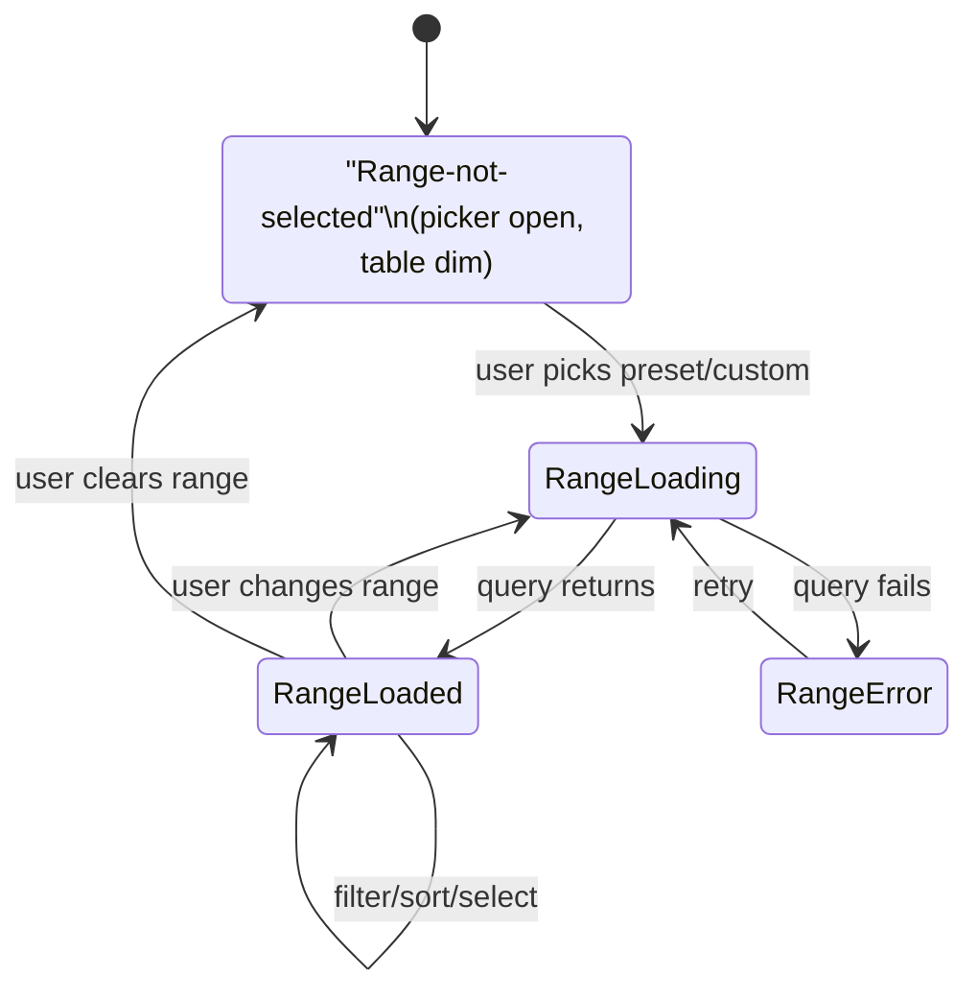

# Flow 003 — Movements Screen with Date-Range Gate

> **Status:** Skeleton v0.1 · **Owner:** Niobe (UX) · **Date:** 2026-04-19
> **Type:** Flow skeleton — establishes shape; full spec follows in Wave 1 (UX-003).
> **Traceability:** decisions.md 2026-04-19 "Transaction list starts empty"; vision §5; [prototype-analysis G5](../prototype-analysis-v1.md#g5--movements-auto-loads-everything-violates-pedros-starts-empty-rule), [UX-R4](../prototype-analysis-v1.md#ux-r4--date-range-gate-on-movements-feels-slow-instead-of-snappy); prototype `movimientos.jsx`.

> **Product rule (non-negotiable):** the Movements screen MUST NOT auto-load data. The user MUST select a date range (preset or custom) before any transactions render. The prototype violates this; v1 corrects it.

---

## 1. Actors

- **Maria** — enrolled treasurer viewing transaction history.
- **The app** — renders Movements screen with date-range-aware query layer.
- **The local read model** (derived SQLite cache per ADR-001 Option A) — fulfills range queries.

---

## 2. Preconditions

- Maria is enrolled and the DEK is unwrapped (flow-001 or flow-002 complete).
- At least one transaction event exists in the event log *(if zero transactions exist globally → empty-DB branch, see §5)*.

---

## 3. Happy Path — Range → Load → Work the List

| # | User sees | User does | System does |
|---|---|---|---|
| 1 | Maria is on another screen (e.g., Panel). Sidebar shows "Movimientos". | Clicks "Movimientos" | Navigates to Movements. **Does NOT issue a data query yet.** |
| 2 | Movements screen mounts in "range-not-selected" empty state: page header `Movimientos` + subtitle "Select a date range to see your transactions" + a **date-range picker opened by default** (no extra click required) with preset chips at top: `This month` (Abril 2026) · `Last month` · `This quarter` · `YTD 2026` · `Last 12 months` · `Custom…`. Below the presets: the full filter bar and the table area are disabled / dimmed, with a plain "Pick a range above to begin" placeholder where the table would be. | Clicks a preset (most likely `This month`) | Query engine receives `{from, to}`; issues range query against read model; shows a small inline progress marker "Loading transactions for April 2026…" |
| 3 | Range is now visible as a **pill in the filter bar**: `📅 Abril 2026 ×` (the × opens the picker to change; clicking it opens preset chips again). Table renders with transactions in range; summary strip shows Ingresos / Gastos / Neto for the filtered range; row count shows "{N} movimientos" in the subtitle. | scans, scrolls, filters further by account/category/etc. | Live re-filters in-memory over the already-loaded range; no re-query |
| 4 | (as prototype today — type chips, account / category / month dropdown within-range, min/max amount, uncategorizedOnly, clear-filters) | interacts with filters | |
| 5 | Table: per-row checkbox → multi-select → bulk actions (`Categorizar`, `Etiquetar`) — same shape as prototype. Row status badge: Pendiente / Aprobado. | selects rows; clicks a bulk action | Opens the bulk-action flow (detailed in UX-006 / UX-014) |
| 6 | Export button above table | clicks Export | Exports the *currently filtered* set (UX-017) |
| 7 | "Nuevo Movimiento" primary button | clicks it | Opens new-transaction entry (UX-006); on save, the new row appears immediately in the current range view if the tx date falls within it; otherwise a toast: "Transaction saved (Apr 3) — outside your current range. [Expand range to include]" |

### 3.1 Mermaid — state machine

### 3.2 Success criteria

- Zero transactions render on page open. Ever.
- Most-common path (pick `This month`) is **one click** from arrival on the screen.
- Time from preset click to rendered list under 300ms for ranges with ≤1000 events (read-model local query).
- The current range is always visible and editable at the top of the filter bar.

---

## 4. Presets (product decisions pending Link's PRD-002)

Proposed preset set for v1 (6 presets, all month/year scoped to "now"):
1. `This month` — default "most common" preset
2. `Last month`
3. `This quarter`
4. `Year to date`
5. `Last 12 months`
6. `Custom…` — opens a two-calendar picker

**Not offered in v1:** "All time" (dangerous — violates "nothing loads until you ask" if the user clicks it casually; defer to an advanced option). **Open Link question:** is "Last 30 days" more intuitive than "Last month" for treasurers?

---

## 5. Key Edge Cases / Error Paths

- **E1 — Empty database (brand-new NGO, zero transactions globally).** Don't force a range selection that will be empty anyway. Alternative empty state: "You haven't recorded any transactions yet. [Record your first transaction] [Import from CSV]". Cross-reference UX-010 empty-state catalog.
- **E2 — Range selection returns zero transactions.** Keep the range pill visible; table area shows "No transactions in {range}. Try a different range or [Record a transaction] for this period." (Distinct from the prototype's "no results for current FILTERS" state — this is "no results in RANGE".)
- **E3 — Range is huge and would load >5000 events.** Show a confirm: "This range includes ~7,800 transactions. Load anyway? (It may take a few seconds.) [Load] [Pick a smaller range]". Open question (perf): threshold value for this guard.
- **E4 — Range spans DEK rotation boundaries (multiple DEK versions).** Invisible to the user; the query layer decrypts each event with its file's DEK version. No UX signal.
- **E5 — Decryption failure on one event in range.** Row shows "⚠ One transaction from this range couldn't be read. [Show details]". Show-details routes to UX-009 error catalog — preserves user's current range and filters.
- **E6 — OneDrive sync adds new transactions after Maria loaded her range.** Live-watch the events folder; small banner above the table: "3 new transactions were added to this range since you opened this view. [Refresh]". Does NOT auto-merge (would be disorienting).
- **E7 — Maria changes the range while the previous query is still in flight.** Cancel previous, run new.
- **E8 — Date picker shows invalid custom range** (to < from). Form validation prevents submit.
- **E9 — Locale-specific date format in custom picker.** Respect ES/EN format for display; internally use ISO (feeds into i18n UX-022).
- **E10 — Device just revoked — can't decrypt new events.** Banner: "Your device has been revoked by an admin. You can view cached data but won't receive new transactions." Cross-reference UX-009.

---

## 6. Accessibility Notes

- **Range picker opened by default** on screen mount — focus lands on the first preset chip (not the custom picker), so a keyboard user hits Enter and loads `This month` in two key presses from the sidebar nav.
- **Presets** form a keyboard-navigable group (Left/Right arrows move between chips; Enter selects; Tab moves out of the group).
- **Range pill** is keyboard-focusable; Enter reopens the picker; `Del/Backspace` on focus clears the range (returns to range-not-selected).
- **Table** is a proper `<table>` with `<th scope="col">`; sort triggers are buttons inside headers with `aria-sort`; row checkboxes have labels ("Select transaction from {date}: {description}"). Bulk-select header checkbox has `aria-label="Select all in view"`.
- **Loading state** announces politely ("Loading transactions for {range}"). Result count announces on completion.
- **Empty-range state** announces plainly without alarm.
- **Error states** (E5, E10) use `role="alert"` at first announcement, `role="status"` on subsequent changes.
- **Keyboard shortcut `/` or `Ctrl+F`** focuses the topbar search (doesn't clobber Movements' in-range state); `Ctrl+N` opens new transaction (confirmed in UX-006).

---

## 7. Open Questions

1. **Default preset on arrival** — `This month`, `Last 30 days`, or "no default, user must click"? (Recommendation: no default auto-loads; user clicks once.) Pedro's "starts empty" rule favors no auto-load; we interpret it as "no query until a click", not "no preset".
2. **Panel's Recent Transactions widget** — does IT respect Maria's last Movements range? (Recommendation: NO. Panel always shows latest-8 absolute, regardless of Movements state.) — Link confirm.
3. **Persist last-used range** across sessions so reopening the app defaults the picker's selection (but still one-click to load)? (Recommendation: yes — remember, don't auto-load.) — Link.
4. **Range vs. month dropdown** — prototype has a month-within-filters dropdown. Remove it (range pill owns temporal scope) or keep it as a sub-filter to narrow within the loaded range? (Recommendation: remove; month dropdown duplicates the range pill's job and adds confusion.)
5. **Large-range guard threshold** (E3) — 1000? 5000? — performance-driven; Neo/Morpheus to measure.
6. **Range on URL / deep-linking** — not needed for Electron single-window v1 but worth considering for future. (Defer.)
7. **Default range when coming from Panel's "Ver todos los movimientos →" link** — Panel says "Abril 2026 · vista general del mes"; the hand-off should pre-select `This month`. This IS an auto-load triggered by a user click on Panel (acceptable — click is the intent), but the rule technically says "user must select a range on the screen". Treat Panel's link as providing the range selection input. (Recommendation: allow; the click on Panel satisfies "user selected".) Pedro confirm.
8. **Quarterly vs monthly-month-picker** — treasurers often want "Q1 2026" — do we show quarter presets by default, or only in custom? (Recommendation: `This quarter` preset is enough; custom covers all else.) — Link.

---

*End of flow-003 skeleton. Full UX-003 spec to be written in Wave 1 per ux-spec-plan.md.*
