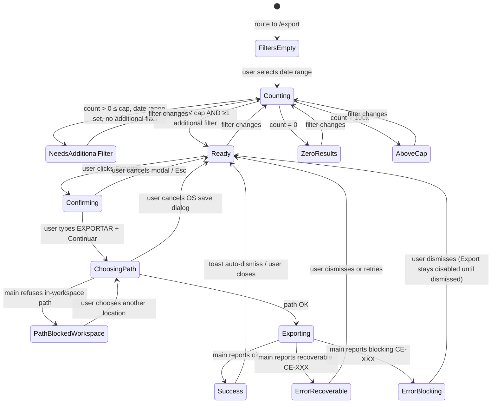

# SPEC-027 (UX) — Export (CSV / XLSX)

> **Status:** In Review · **Owner:** Niobe · **Last updated:** 2026-05-31
> **Reviewers:** Neo (architecture), Switch (security), Link (product)
> **Paired feature spec:** [`docs/specs/027-export.md`](../../specs/027-export.md)
> **Paired Design:** Pending — Mouse (visual polish; design notes in `.squad/decisions/inbox/mouse-export-ui.md`)
> **Security input:** [`.squad/decisions/inbox/switch-export-security.md`](../../../.squad/decisions/inbox/switch-export-security.md)

---

## 1. Summary

María has just hung up the phone with the board treasurer who wants "the
Q1 numbers". She has roughly thirty seconds before her next call. She clicks
**Exportar** in the sidebar, picks *This quarter*, clicks **Exportar**
again, types `EXPORTAR` in the confirmation modal, picks her Documents
folder in the save dialog, and emails the resulting `.xlsx` file to the
board. No spec to read, no jargon, no panic. The screen starts empty and
guides her through one decision at a time.

This UX spec covers the entry points, happy path, every empty/loading/error
state, edge cases (encrypted-folder guard, save-dialog cancellation, mid-
export failure), accessibility, ES + EN copy, and a state diagram. The
canonical functional/security behaviour lives in the paired feature spec.

## 2. Entry Points

| # | Trigger | Behaviour |
|---|---|---|
| 1 | Click **Exportar** in the sidebar (UX-006 §73 sidebar slot, between `Importación` and any future `Configuración`) | Route swap → `/export`. Sidebar item gets active state (`.ot-shell__nav-item--active`). |
| 2 | Direct URL / deep link `/export` | Same as #1. State is "filters-empty" — list-starts-empty rule. |
| 3 | Keyboard shortcut | **Not in v1.** Reserved `Ctrl+Shift+E` if added later (Mouse §1.1). |
| 4 | Re-entry after a previous export | Same as #1. Filters reset by default (OQ11 in feature spec); the screen does *not* remember the previous session's filter set. |

The sidebar item uses the Lucide `Download` icon (24 px); ES label
`Exportar` (8 chars), EN label `Export` (6 chars) — both fit the sidebar's
Spanish-floor minimum width (UX-006 §9 audit).

## 3. Happy-Path Walkthrough

Screen ID: **`EXP-1` (Export screen)**.

| # | Step | Screen state | Visible copy |
|---|---|---|---|
| 1 | María clicks `Exportar` in the sidebar | `EXP-1.filters-empty` | Page title *"Exportar Movimientos"*; subtitle *"Exporta transacciones a CSV o Excel (.xlsx). Los datos se descifrarán antes de exportar."*; date-range picker prompts *"Selecciona un rango de fechas para comenzar."* |
| 2 | She picks *Este trimestre* preset | `EXP-1.counting` (briefly) → `EXP-1.needs-additional-filter` | Count preview: *"Contando movimientos…"* → *"248 movimientos coinciden con estos filtros."* + info banner: *"Selecciona al menos un filtro adicional (cuenta, categoría, subcategoría o etiqueta) para continuar."* Export button disabled. |
| 3 | She narrows by account `Unicaja` and label `Proyecto EU-2025` | `EXP-1.counting` → `EXP-1.ready` | *"32 movimientos coinciden con estos filtros."* Info banner disappears. Export button enabled. |
| 4 | She picks **Excel (.xlsx)** in the format card group (CSV is default) | `EXP-1.ready` (no state change) | — |
| 5 | She clicks **Exportar** | `EXP-1.confirming` (modal **EXP-2**) | Modal **EXP-2** appears — see §3.1 below. |
| 6 | She types `EXPORTAR` in the modal's input and clicks **Continuar** | `EXP-1.choosing-path` (native OS dialog) | OS `Guardar como` dialog opens with default folder = Documents and default filename = `OpenTreasury-Movimientos-2026-01-01_2026-03-31.xlsx` (ES locale) or `OpenTreasury-Movements-2026-01-01_2026-03-31.xlsx` (EN locale). |
| 7 | She accepts the default location, clicks **Guardar** | `EXP-1.exporting` | Primary button shows spinner + *"Exportando…"*; filter and format sections dim; an `aria-live="polite"` progress region announces *"Exportando 124 de 248 movimientos…"* (updated ≤ 1×/200 ms). |
| 8 | Export completes | `EXP-1.success` | Toast: *"32 movimientos exportados a OpenTreasury-Movimientos-2026-01-01_2026-03-31.xlsx."* + **Mostrar en carpeta** affordance. Auto-dismiss in 5 s. Form remains, filters intact, Export button re-enabled for another export. |

### 3.1 Confirmation modal (`EXP-2`)

Screen ID: **`EXP-2` (pre-export confirmation modal)**.

- Title: *"Vas a exportar una copia descifrada"* / *"You are about to export a decrypted copy"*.
- Body (bulleted, plain language, no jargon — Switch §2.2):
  - *"El archivo NO estará cifrado."* / *"The file will NOT be encrypted."*
  - *"Cualquier persona con acceso al archivo podrá leer todas las transacciones que exportes."* / *"Anyone with access to the file can read every transaction you export."*
  - *"Si lo guardas en una carpeta sincronizada (OneDrive, Dropbox, iCloud), también se copiará a la nube."* / *"If you save it to a synced folder (OneDrive, Dropbox, iCloud), it will also be copied to the cloud."*
  - *"Trátalo como dinero en efectivo: tú eres responsable de a dónde va."* / *"Treat it like cash: you are responsible for where it goes."*
- Typed confirmation: input labelled *"Escribe `EXPORTAR` para continuar"* /
  *"Type `EXPORT` to continue"*. The literal word is **locale-dependent**;
  see Copy in §7.
- Primary button **Continuar** / **Continue** — disabled until the typed
  string matches exactly (case-insensitive, trimmed). On click → opens the
  native save dialog (step 6 above).
- Secondary button **Cancelar** / **Cancel** — closes modal, returns to
  `EXP-1.ready`. No audit entry. Focus returns to the original **Exportar**
  button.
- Esc closes the modal (same as Cancel).
- Final copy ratified by Switch via the `crypto-error-copy-catalog` process
  (OQ7 in feature spec).

## 4. Empty / Loading / Error States

Eleven enumerated states. The first column matches the IDs used by the
state diagram in §5.

| State ID | Trigger | Visual treatment | Interactive? | Copy key root |
|---|---|---|---|---|
| `filters-empty` | Route enters `/export` | Date-range picker empty; all chips empty; preview area shows the *"Selecciona un rango…"* prompt; Export disabled with reason tooltip *"Selecciona un rango de fechas."* | Yes (filters + format) | `ux.export.empty` |
| `counting` | Filter set changes | Preview area shows a small inline spinner + *"Contando movimientos…"* | Yes (further filter changes cancel and re-run) | `ux.export.counting` |
| `needs-additional-filter` | Date range selected but no account/category/subcategory/label active | Info banner `.ot-banner--info`: *"Selecciona al menos un filtro adicional (cuenta, categoría, subcategoría o etiqueta) para continuar."* Export disabled with reason tooltip *"Selecciona un filtro adicional."* | Yes (select additional filter) | `ux.export.needs-filter` |
| `ready` | Count returns N > 0 (≤ cap) AND at least one additional filter active | Preview: *"{n} movimientos coinciden…"*; Export enabled. If `n > 5 000` an info banner reads *"Este rango incluye {n} movimientos. La exportación puede tardar unos segundos."* | Yes | `ux.export.ready` |
| `zero-results` | Count returns 0 | Warning-subtle banner: *"No hay movimientos que coincidan con estos filtros."* Export disabled. | Yes (clear filters) | `ux.export.empty-results` |
| `above-cap` | Count > 100 000 | Warning-subtle banner: *"Demasiados movimientos ({n}). Acota los filtros para exportar como máximo 100 000."* Export disabled. | Yes (narrow filters) | `ux.export.above-cap` |
| `confirming` | User clicks **Exportar** | Modal **EXP-2** overlays the screen; background dimmed; focus trapped in modal. | Modal only | `ux.export.confirm.*` |
| `path-blocked-workspace` | Chosen path resolves inside the encrypted dataset root (FR14) | Refusal modal **EXP-3**: *"No puedes guardar aquí"* / *"You cannot save here"* with single primary button **Elegir otra ubicación** / **Choose another location** that re-triggers the save dialog. | Modal only | `ux.export.block.workspace` |
| `exporting` | User passes EXP-2 and OS dialog returns a valid path | Primary button → spinner + *"Exportando…"*; filter & format sections at `opacity: 0.5` and `pointer-events: none`; progress region announces row count every ≤ 200 ms; **safety net:** 30 s wall-clock timeout. | No (cancel-in-progress out of scope for v1) | `ux.export.exporting` |
| `success` | Main reports `{ ok: true, basename }` | `.ot-toast--success` (in-app): *"{n} movimientos exportados a {basename}."* with **Mostrar en carpeta** action (calls `shell.showItemInFolder` from main). Auto-dismiss in 5 s. Screen returns to `ready`. | Yes | `ux.export.success` |
| `error-recoverable` | Main reports a CE-XXX from a recoverable category (e.g., disk full, permission denied, user cancelled save dialog after confirming) | Banner above action buttons (`.ot-banner--danger`), CE-XXX-specific copy from the crypto-error catalog, dismissible `×`, **Reintentar** ghost button. Filter state intact. | Yes (retry) | `ux.export.error.recoverable` |
| `error-blocking` | Main reports a CE-XXX from the blocking category (decrypt failure / integrity break / signature failure) | Full-width red banner: *"No se pudo descifrar los movimientos. Inténtalo de nuevo o consulta a tu administrador."* Export button disabled until error dismissed. Diagnostic-bundle CTA visible. | Limited (dismiss + diagnostic export only) | `ux.export.error.blocking` |

State transitions are normative — see §5.

### 4.1 Empty-row behaviour vs zero-results

The `zero-results` state is **not** an error. If filters are too narrow the
user simply sees the warning and either widens filters or leaves the screen.
**No audit entry** is written for a zero-result export attempt because the
Export button is not enabled — there is no attempt.

### 4.2 Save-dialog cancellation

If the user cancels the native save dialog (clicks **Cancelar** in the OS
dialog after passing EXP-2), the screen returns to `ready` with the typed
confirmation cleared from EXP-2 (next attempt re-prompts). **No audit
entry** is written for save-dialog cancellation (the export never started).

## 5. State Diagram

## 6. Accessibility (WCAG 2.1 AA)

### 6.1 Keyboard navigation

**Tab order on `EXP-1`:**

1. Date-range picker (Enter opens preset list; arrow keys navigate presets; Space/Enter selects).
2. Account chip-multi-select (Tab into group, arrow keys within chips, Space toggles).
3. Category chip-multi-select.
4. Subcategory chip-multi-select (skipped in tab order when disabled).
5. Label chip-multi-select.
6. **Limpiar filtros** ghost button (only when visible).
7. Format radio group (arrow keys to change, Space to select).
8. **Cancelar** ghost button.
9. **Exportar** primary button.

**Shortcuts:**

- `Esc` on `EXP-1` → routes back to the previous screen (no audit entry).
- `Enter` on the format radio group does not submit (per WAI-ARIA radio
  pattern); only the **Exportar** button submits.
- `Esc` on modals → cancels and returns focus to the trigger.

**Tab order on `EXP-2` (confirmation modal):**

1. Typed-confirmation input.
2. **Cancelar**.
3. **Continuar** (initially disabled).
4. Modal close `×` (top-right). Focus is trapped inside the modal.

### 6.2 Screen reader

- Landmarks: `<main>` wraps `EXP-1`; `<form role="form">` wraps filter + format
  + actions for semantic grouping (no native submit).
- Filter section: `role="group"` + `aria-labelledby="filter-heading"` where
  the heading reads *"Filtros de exportación"* (visible).
- Format section: `role="radiogroup"` + `aria-labelledby="format-heading"`.
- Result-count preview: `aria-live="polite"` so the count is re-announced
  when filters change without stealing focus.
- **Needs-additional-filter hint:** The info banner (*"Selecciona al menos
  un filtro adicional…"*) uses an `aria-live="polite"` region so it is
  announced when rendered. The disabled Export button uses
  `aria-disabled="true"` (not native `disabled`) to remain focusable, with
  `aria-describedby` linking to the hint banner. A visible inline hint
  (not tooltip-only) ensures sighted keyboard users understand why Export
  is unavailable.
- Busy state: the primary button uses `aria-busy="true"` during
  `exporting`; the `aria-live="polite"` progress region announces row
  counts at most every 1 s to avoid screen-reader spam.
- Error banners: `role="alert"` so they are announced immediately when
  rendered.
- Confirmation modal: `role="dialog"`, `aria-modal="true"`,
  `aria-labelledby` on the title, `aria-describedby` on the body bullets.
  Focus moves to the typed-confirmation input on open and returns to the
  **Exportar** trigger on close.

### 6.3 Contrast & focus rings

- All text/background pairs validated against Mouse's `tokens.md`
  (Mouse §4.3).
- Focus rings: `outline: 2px solid var(--color-focus-ring)`,
  `outline-offset: 2px` on every interactive element. Radio cards have the
  ring on the **card**, not the underlying `<input>`.
- No colour-only indicators — the warning banners and error banners pair
  colour with an icon and explicit copy.

### 6.4 Reduced motion

- `@media (prefers-reduced-motion: reduce)` disables the spinner rotation
  on the **Exportar** busy state — the icon remains, no animation. Toast
  auto-dismiss timing is unchanged (it is not motion-sensitive).
- No slide-ins or fades anywhere else on the screen.

### 6.5 Light / dark / system theme

- All tokens are theme-aware (Mouse §4.4). No theme toggle on this screen;
  it inherits from the app shell (UX-006).

## 7. Copy (ES + EN)

| Key | ES | EN |
|---|---|---|
| `ux.export.nav.label` | "Exportar" | "Export" |
| `ux.export.title` | "Exportar Movimientos" | "Export Movements" |
| `ux.export.subtitle` | "Exporta transacciones a CSV o Excel (.xlsx). Los datos se descifrarán antes de exportar." | "Export transactions to CSV or Excel (.xlsx). Data will be decrypted before export." |
| `ux.export.empty.pick-range` | "Selecciona un rango de fechas para comenzar." | "Select a date range to begin." |
| `ux.export.counting` | "Contando movimientos…" | "Counting movements…" |
| `ux.export.ready` | "{n} movimientos coinciden con estos filtros." | "{n} movements match these filters." |
| `ux.export.empty-results` | "No hay movimientos que coincidan con estos filtros." | "No movements match these filters." |
| `ux.export.above-cap` | "Demasiados movimientos ({n}). Acota los filtros para exportar como máximo 100 000." | "Too many movements ({n}). Narrow the filters to export at most 100,000." |
| `ux.export.large-warning` | "Este rango incluye {n} movimientos. La exportación puede tardar unos segundos." | "This range includes {n} movements. The export may take a few seconds." |
| `ux.export.exporting` | "Exportando…" | "Exporting…" |
| `ux.export.progress` | "Exportando {done} de {total} movimientos…" | "Exporting {done} of {total} movements…" |
| `ux.export.success` | "{n} movimientos exportados a {basename}." | "{n} movements exported to {basename}." |
| `ux.export.success.show-in-folder` | "Mostrar en carpeta" | "Show in folder" |
| `ux.export.format.csv` | "CSV (valores separados por punto y coma)" | "CSV (semicolon-separated values)" |
| `ux.export.format.excel` | "Excel (.xlsx)" | "Excel (.xlsx)" |
| `ux.export.format.csv-helper` | "Compatible con Excel en español. Texto plano UTF-8." | "Compatible with Spanish Excel. Plain-text UTF-8." |
| `ux.export.format.excel-helper` | "Archivo nativo de Excel con formato automático de columnas." | "Native Excel file with automatic column formatting." |
| `ux.export.clear-filters` | "Limpiar filtros" | "Clear filters" |
| `ux.export.btn.cancel` | "Cancelar" | "Cancel" |
| `ux.export.btn.export` | "Exportar" | "Export" |
| `ux.export.confirm.title` | "Vas a exportar una copia descifrada" | "You are about to export a decrypted copy" |
| `ux.export.confirm.b1` | "El archivo NO estará cifrado." | "The file will NOT be encrypted." |
| `ux.export.confirm.b2` | "Cualquier persona con acceso al archivo podrá leer todas las transacciones que exportes." | "Anyone with access to the file can read every transaction you export." |
| `ux.export.confirm.b3` | "Si lo guardas en una carpeta sincronizada (OneDrive, Dropbox, iCloud), también se copiará a la nube." | "If you save it to a synced folder (OneDrive, Dropbox, iCloud), it will also be copied to the cloud." |
| `ux.export.confirm.b4` | "Trátalo como dinero en efectivo: tú eres responsable de a dónde va." | "Treat it like cash: you are responsible for where it goes." |
| `ux.export.confirm.typed` | "Escribe EXPORTAR para continuar" | "Type EXPORT to continue" |
| `ux.export.confirm.typed-word.es` | "EXPORTAR" | — |
| `ux.export.confirm.typed-word.en` | — | "EXPORT" |
| `ux.export.confirm.continue` | "Continuar" | "Continue" |
| `ux.export.needs-filter.banner` | "Selecciona al menos un filtro adicional (cuenta, categoría, subcategoría o etiqueta) para continuar." | "Select at least one additional filter (account, category, subcategory, or label) to continue." |
| `ux.export.needs-filter.tooltip` | "Selecciona un filtro adicional." | "Select an additional filter." |
| `ux.export.block.workspace.title` | "No puedes guardar aquí" | "You cannot save here" |
| `ux.export.block.workspace.body` | "No puedes guardar una copia descifrada dentro de la carpeta compartida del tesoro. Elige otra ubicación." | "You cannot save a decrypted copy inside the shared treasury folder. Choose another location." |
| `ux.export.block.workspace.choose` | "Elegir otra ubicación" | "Choose another location" |
| `ux.export.error.recoverable.title` | "No se pudo guardar el archivo" | "Could not save the file" |
| `ux.export.error.retry` | "Reintentar" | "Try again" |
| `ux.export.error.blocking` | "No se pudo descifrar los movimientos. Inténtalo de nuevo o consulta a tu administrador." | "Could not decrypt movements. Try again or contact your administrator." |
| `ux.export.error.diagnostic-cta` | "Exportar diagnóstico" | "Export diagnostic" |

**ICU plurals:** `{n} movimiento(s)` uses ICU MessageFormat plural forms in
the i18n catalog (per ADR-003). Same applies to `{n} movement(s)`.

**Placeholders:** `{n}`, `{done}`, `{total}`, `{basename}` are replaced at
runtime by main.

**Final copy:** the confirmation-modal copy (EXP-2) and CE-XXX error copy
are ratified by Switch through the `crypto-error-copy-catalog` process
(feature-spec OQ7).

## 8. Edge Cases

| # | Edge case | Behaviour |
|---|---|---|
| 1 | User selects subcategory filter, then removes its parent category | Subcategory chip group is cleared and disabled; count recomputes. |
| 2 | User opens the screen while a previous export is still running (e.g., navigated away mid-export and back) | Screen returns to `exporting` state with the current progress; concurrency cap holds (FR21). |
| 3 | User opens `/export` immediately after app launch, before the read model has finished projecting | Screen shows `EXP-1.filters-empty` chrome but the count preview reads *"Preparando datos…"* with a small spinner; filter chips display in their loading skeleton state. Once the read model is ready, behaves normally. |
| 4 | User picks `Custom…` date range and chooses an end date earlier than the start date | Date-range picker rejects inline with *"La fecha final debe ser posterior a la fecha inicial."* No count attempt. |
| 5 | User saves to a folder that subsequently disappears between save-dialog return and the first write (e.g., USB unplugged) | `exporting` → `error-recoverable` with CE-XXX (`EXPORT_DESTINATION_UNAVAILABLE`); audit entry already recorded (Switch §2.5). |
| 6 | OneDrive/SharePoint sync briefly blocks the destination directory | Same as #5; CE-XXX (`EXPORT_WRITE_BLOCKED`) with retry. |
| 7 | User has the file open in Excel and tries to overwrite it | OS-level error returned by `fs.rename`; CE-XXX (`EXPORT_FILE_LOCKED`) with a copy hint to close the file and retry. |
| 8 | User clicks `Cancelar` in the OS save dialog after passing EXP-2 | No audit entry; screen returns to `ready`; the typed-confirmation field in EXP-2 is cleared (next attempt re-prompts). |
| 9 | User switches the app locale while on the Export screen | Form, copy, ICU plurals, date-range preset labels, default filename, and the typed-confirmation word (`EXPORTAR`↔`EXPORT`) all swap instantly. Any in-flight `exporting` operation keeps the locale it started with. |
| 10 | Workspace gets locked (timeout / explicit lock) while on the screen | The screen routes away to the lock screen (per UX-006 §82 E1 locked state). No partial file remains because no export was in progress. |
| 11 | Workspace gets locked **during** an in-flight export | The export completes (main holds the MK reference for the duration of the streaming pipeline) and the success toast appears briefly on the locked screen before the lock chrome takes focus. (Switch to confirm via OQ in §10.) |
| 12 | User attempts to save inside the encrypted workspace folder | Attempt is hard-blocked; app refuses the path and re-opens the save dialog. User must choose another location; no export occurs inside the treasury folder. (OQ6 hardening.) |

## 9. Component Reuse

| UI element | Reuse source | Notes |
|---|---|---|
| Sidebar item | UX-006 app-shell sidebar | Same `.ot-shell__nav-item` markup |
| Date-range picker (presets + custom) | UX-003 §4 Movements toolbar | Same six presets |
| Chip-multi-select (accounts, categories, subcategories, labels) | `TagChipPicker` / generic `ChipMultiSelect` from `chip-multi-select` skill | Same component, same i18n keys |
| Card-style radio group (format) | UX-001 device-name pattern, adapted | Per Mouse §5.2 |
| Confirmation modal (EXP-2) | Compact-confirm modal pattern (existing) | Typed-confirmation extension is new but uses standard input |
| Refusal modal (EXP-3) | Same compact-confirm modal pattern | Severity = danger; single primary CTA "Choose another location" |
| Toast (success) | `.ot-toast--success` | Per Mouse §3.3 |
| Error banners | `.ot-banner--{danger,warning,info}` | Per UX-006 |
| Busy state (spinner on primary button + dimmed sections) | Transient-busy-state pattern + 30 s safety timeout | Per Mouse §3.3 |

**Zero new components.** Per Mouse §5.3, the entire Export experience
composes existing patterns.

## 10. Traceability

- **Paired feature spec:** [`docs/specs/027-export.md`](../../specs/027-export.md).
- **UX dependencies:**
  - [UX-006 app shell & navigation](ux-006-app-shell-and-navigation.md) —
    sidebar slot, locked / error global states inherited.
  - [UX-003 movements screen](ux-003-movements-screen.md) — date-range
    picker, chip-multi-select, count preview idiom.
  - [UX-004 saldo screen](ux-004-saldo-screen.md) — filter-bar idiom parity.
- **Design dependency:** `.squad/decisions/inbox/mouse-export-ui.md` —
  Mouse's UI design notes (component reuse map, tokens, layout).
- **Security dependency:** `.squad/decisions/inbox/switch-export-security.md`
  — gate-model decision, IPC discipline, audit, PII redaction.
- **Security requirements satisfied (UX-level):** R8 (audit-entry visibility
  via success/error feedback), R11 (no path strings in renderer state),
  R12 (no plaintext rows in renderer state), R15 (no PII in user-visible
  logs / toasts beyond `basename` and counts), R18 (encrypted-workspace
  warning, UNC-path confirmation), R20 (first-run posture wizard is not
  triggered by export; export is a post-unlock action).
- **Skills referenced:**
  `.squad/skills/date-range-query-extension/SKILL.md`,
  `.squad/skills/read-model-aggregation/SKILL.md`,
  `.squad/skills/search-over-readmodel/SKILL.md`.
- **Crypto-spec sections:** §1.1, §2, §2.1, §8.2, §8.3 (mirrored from the
  paired feature spec).

## 11. Out of Scope (v1)

- **Per-export saved filter presets** — revisit in v1.1 once we see if
  users repeat the same export.
- **Cancel-in-progress.** The 30 s wall-clock safety timeout is the only
  abort path in v1.
- **Preview rows in the renderer.** Pre-export preview would require either
  duplicating the Movements decrypted view inside Export, or creating a new
  decryption surface. Neither is shipping in v1.
- **Email / cloud-share integration ("Exportar y compartir por correo")** —
  out of scope. The user shares the file themselves.
- **PDF export** — separate spec, M3/M4 per `decisions.md` line 2178.
- **Bulk Export from row selection on Movements** — covered by the future
  bulk-actions spec (`decisions.md` line 2563); SPEC-027 does not replace it.
- **CSV export of search results (`?q=`-seeded export)** — out of scope;
  not planned (OQ13 in the feature spec: Pedro explicitly declined).

## 12. Open Questions

Mirrors §12 of the paired feature spec — see there for full list. UX-level
additions:

- **UX-A.** Should the success toast surface a "Compartir" button that
  opens the OS share sheet (Windows 11 share UI)? Default: **no** for v1
  (adds OS-coupling complexity).
- **UX-B.** Should the **Mostrar en carpeta** action open Explorer with the
  file pre-selected (`shell.showItemInFolder`) or just open the folder
  (`shell.openPath`)? Recommendation: **pre-select**, matches OS download
  conventions.
- **UX-C.** During `exporting`, should we show an indeterminate progress
  bar in the modal/banner (in addition to the spinner + announced count)?
  Niobe's recommendation: **add a determinate bar** when `total > 1 000`
  rows, no bar below that.

## 13. Status History

| Date | Status | By | Notes |
|---|---|---|---|
| 2026-05-15 | Draft | Niobe | Initial UX spec; 11 states, EXP-1/2/3 screen ids, 12 edge cases, ES+EN copy table, accessibility coverage, traceability to paired feature spec. |
| 2026-05-31 | In Review | Niobe | All 13 feature-spec OQs resolved by Pedro. OQ5: added `needs-additional-filter` state, updated happy path, state diagram, copy (ES+EN), a11y (aria-disabled + aria-live hint). OQ6: `path-warn-workspace`→`path-blocked-workspace` (hard refusal, single CTA "Choose another location"), updated edge-case #12, EXP-3 modal copy. OQ9: locale-aware filename prefix. OQ10: semicolon CSV copy. OQ12: in-app toast (no change). OQ13: ?q= out of scope (not planned). Moved Draft→In Review. |
