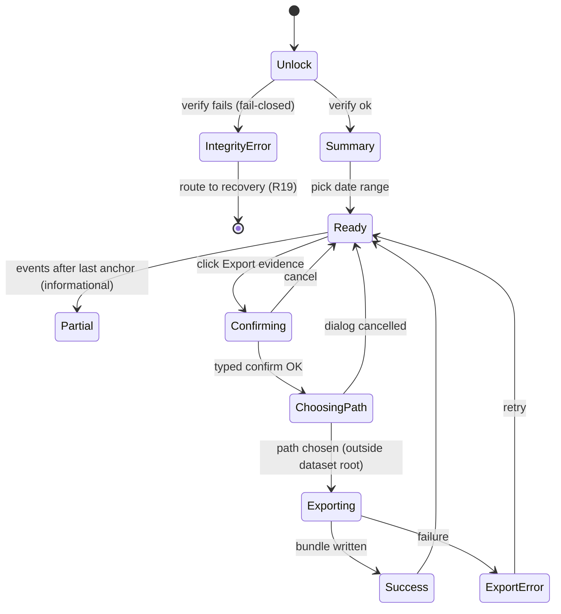

# SPEC-028 (UX) — Audit & Evidence Viewer

> **Status:** Draft · **Owner:** Niobe · **Last updated:** 2026-06-01
> **Reviewers:** Neo (architecture) — pending · Switch (security) — pending · Link (product) — pending
> **Paired feature spec:** [`docs/specs/028-audit-and-evidence.md`](../../specs/028-audit-and-evidence.md)
> **Paired Design:** Pending — Mouse (viewer table density, print/PDF layout, integrity-banner visuals)

---

## 1. Summary

The external auditor will be here at 10am. María opens **Auditoría** in the sidebar. A green banner
tells her the history is **verified** and **anchored through yesterday, externally timestamped**.
She sets the date range to last year, clicks **Exportar evidencia**, types `EXPORTAR`, picks a USB
drive, and hands over a self-contained evidence pack the auditor can verify on their own laptop —
no OpenTreasury needed. The screen never shows her a key, a file path, or a word of cryptography
she didn't ask for.

This UX spec covers the viewer's entry points, the happy path (read → filter → export evidence),
every empty/loading/error/tamper state, the **integrity banner** and **per-device "anchored
through"** indicators, the two provenance lanes (signed audit entries vs event-derived history),
accessibility, ES + EN copy, and a state diagram. Canonical functional/security behaviour lives in
the paired feature spec; the **honest-limitation copy** here is normative and must not be softened.

## 2. Entry Points

| # | Trigger | Behaviour |
|---|---|---|
| 1 | Click **Auditoría** / **Audit** in the sidebar (UX-006 §73 sidebar slot, near `Exportar`) | Route swap → `/audit`. Active state on the nav item. On entry the app shows the last verification result (from unlock); it does **not** re-run a full verify just for navigation. |
| 2 | Direct URL / deep link `/audit` | Same as #1. |
| 3 | Re-entry after an export | Same as #1; filters reset by default (no remembered filter set). |
| 4 | Routed here by the unlock integrity check (tamper detected) | Workspace did **not** open normally; the user lands on a blocking **integrity-error** view (§4) with a recovery CTA, not the normal viewer. |

The sidebar item uses the Lucide `ShieldCheck` icon (24 px); ES label `Auditoría` (9 chars), EN
label `Audit` (5 chars) — both fit the sidebar's Spanish-floor minimum width.

## 3. Happy-Path Walkthrough

Screen ID: **`AUD-1` (Audit & Evidence screen)**.

| # | Step | Screen state | Visible copy |
|---|---|---|---|
| 1 | María clicks `Auditoría` | `AUD-1.summary` | Page title *"Auditoría y evidencia"*; integrity banner (green) *"Verificado. Sin cambios sin sellar."*; per-device chips *"Este dispositivo · sellado hasta 31 may 2026 · sello externo ✓"*. |
| 2 | She picks date range *Año pasado* | `AUD-1.loading` → `AUD-1.ready` | Count line *"1.204 entradas en este periodo."* Two tabs: **Registro firmado** (signed audit entries) and **Historial de cambios** (event-derived). |
| 3 | She opens **Historial de cambios** and filters by account `Unicaja` | `AUD-1.ready` | Rows: date · actor · device · acción · cuenta/categoría. Old rows may show *"autor: desconocido (anterior al registro)"* honestly. |
| 4 | She clicks **Exportar evidencia** | `AUD-1.confirming` (modal **AUD-2**) | Confirmation modal (see §3.1). |
| 5 | She types `EXPORTAR` and clicks **Continuar** | `AUD-1.choosing-path` (native OS dialog) | OS save dialog; default folder = Documents; default filename `OpenTreasury-Evidencia-2025-01-01_2025-12-31.zip`. |
| 6 | She accepts the location and clicks **Guardar** | `AUD-1.exporting` | Spinner + *"Generando paquete de evidencia…"*; `aria-live` progress. |
| 7 | Export completes | `AUD-1.success` | Toast *"Paquete de evidencia generado: OpenTreasury-Evidencia-2025-01-01_2025-12-31.zip."* + **Mostrar en carpeta**. |

### 3.1 Evidence-export confirmation modal (`AUD-2`)

Screen ID: **`AUD-2`**. Reuses the SPEC-027 `EXP-2` choreography (typed confirmation, "treat like
cash" warning, encrypted-workspace guard).

- Title: *"Vas a exportar evidencia descifrada"* / *"You are about to export decrypted evidence."*
- Body (plain language, no jargon):
  - *"El paquete contiene datos descifrados (registro de auditoría e historial de cambios)."*
  - *"Cualquiera con el archivo puede leerlo. Trátalo como dinero en efectivo."*
  - *"El paquete incluye un informe de verificación; consérvalo junto al resto."*
- Confirm by typing `EXPORTAR` / `EXPORT`. Cancel returns to `AUD-1.ready`.

### 3.2 Evidence bundle contents (shown in the modal's "¿Qué incluye?" disclosure)

- Signed audit entries for the period (exports + anchors), pretty-printed JSON.
- Event-derived change history for the period.
- Device public-key manifest (so the auditor can verify signatures **offline**).
- A **verification report**: chain status, per-anchor external-timestamp status, and the
  plain-language **limitation statement** (§7).

## 4. Empty / Loading / Error / Tamper States

| State | Screen ID | Trigger | UI |
|---|---|---|---|
| First-use / no anchors yet | `AUD-1.no-anchors` | New workspace, nothing anchored | Neutral banner *"Aún no se ha sellado ningún historial. Se sellará automáticamente al bloquear o tras varios cambios."* History tab still readable. |
| Empty filter result | `AUD-1.empty-range` | Range has no entries | *"No hay entradas en este periodo."* Export disabled. |
| Loading | `AUD-1.loading` | Fetching view-models | Skeleton rows; `aria-busy`. |
| Not-yet-anchored tail | `AUD-1.partial` | Events exist after last anchor | Amber chip *"12 cambios recientes aún sin sellar."* — informational, **not** an error. |
| Timestamp pending (offline) | banner sub-state | Anchor written, TSA queued | Per-anchor chip *"sello externo pendiente (sin conexión)"*. |
| Timestamp failed | banner sub-state | TSA error | Chip *"sello externo falló — se reintentará"* + retry-on-next-online note. |
| **Tamper detected (blocking)** | `AUD-0.integrity-error` | Chain break / anchor mismatch at unlock | **Full-screen blocking** red view: *"No se pudo verificar la integridad del historial."* Explains a recovery path (restaurar desde una copia/instantánea — R19). The normal workspace does **not** open. No "continuar de todos modos". |
| Export failure | `AUD-1.export-error` | Bundle write failed | CE-XXX localized copy (crypto-error-copy-catalog); **Reintentar** re-enabled. |

## 5. State Diagram

## 6. Accessibility (WCAG 2.1 AA)

- **Integrity banner** uses an `aria-live="polite"` region; status is conveyed by **text + icon**,
  not colour alone (green check / amber dot / red cross all carry a text label).
- **Per-device chips** are a keyboard-navigable list; each chip's full status is in its accessible
  name (e.g. *"Portátil de María — sellado hasta 31 may 2026 — sello externo verificado"*).
- **Two-tab provenance** (Registro firmado / Historial de cambios) is a proper tablist; arrow-key
  navigation; the active tab is programmatically determinable.
- **History/audit tables** have row/column headers; the provenance lane is announced per row so a
  screen-reader user can tell a signed entry from event-derived history.
- **Confirmation modal** traps focus, is dismissible with `Esc`, returns focus to the trigger.
- **Export progress** announced via `aria-live` (≤ 1 update / 200 ms).
- **Integrity-error view** is reachable and operable by keyboard; the recovery CTA is the first
  focusable control.
- **Print view** (evidence preview) keeps legible contrast and does not rely on colour to convey
  verification status.

## 7. Copy (ES + EN) — including the normative limitation statement

| Key | ES | EN |
|---|---|---|
| Title | Auditoría y evidencia | Audit & evidence |
| Verified banner | Verificado. Sin cambios sin sellar. | Verified. No unsealed changes. |
| Per-device anchored | Sellado hasta {fecha} · sello externo ✓ | Anchored through {date} · externally timestamped ✓ |
| Unsealed tail | {n} cambios recientes aún sin sellar | {n} recent changes not yet anchored |
| Timestamp pending | Sello externo pendiente (sin conexión) | External timestamp pending (offline) |
| Tamper title | No se pudo verificar la integridad del historial | Could not verify history integrity |
| Tamper body | Restaura el área de trabajo desde una copia o instantánea de confianza. | Restore the workspace from a trusted copy or snapshot. |
| Export CTA | Exportar evidencia | Export evidence |
| Unknown actor | autor: desconocido (anterior al registro) | author: unknown (pre-coverage) |
| **Limitation (verification report + tooltip)** | **A prueba de manipulación y con sello de tiempo externo — no "a prueba de todo". Una persona con todas las claves del dispositivo aún podría reconstruir un historial; el sello de tiempo externo limita la antedatación. Consulta con asesoría legal antes de presentarlo como "grado auditoría".** | **Tamper-evident and externally timestamped — not "tamper-proof". Someone holding all device keys could still rebuild a history; the external timestamp limits backdating. Seek legal review before presenting this as "audit-grade".** |

The limitation statement is **normative** (feature spec FR13/AC13) and appears both in-app
(tooltip/disclosure near the integrity banner) and inside the exported verification report. It MUST
NOT be reworded to imply stronger guarantees.

## 8. Edge Cases

- **Anchor created mid-session while viewing.** The banner updates via `aria-live`; the open table
  does not jump — a subtle "actualizado" affordance lets the user refresh.
- **Multiple device files, one tampered.** Only that device's chip turns red ("no verificado"); the
  others stay green. The summary banner reflects the worst case.
- **Save path inside the dataset root.** Refused (encrypted-workspace guard, SPEC-027 FR14); the OS
  dialog reopens. No "guardar de todos modos".
- **Offline during export.** Bundle still generates (it's local); only the *external timestamp* on
  any newly-attempted anchor is queued — the export does not block on the network.
- **Very large period (100k+ entries).** History tab virtualizes rows; export streams; progress is
  announced. No full-plaintext residency (feature spec NFR1).
- **Clock skew.** The local `observed_at` is shown as informational; trust comes from the external
  timestamp, and the UI never claims local time as proof.

## 9. Component Reuse

- **Date-range picker** — reuse Movements/Export picker (UX-003 §4) with the same six presets.
- **Account/category filters** — reuse the Movements/Export chip multi-selects.
- **Confirmation modal `AUD-2`** — reuse `EXP-2` (SPEC-027 §3.1) styling and typed-confirm logic.
- **Save dialog / show-in-folder / atomic write** — reuse the SPEC-027 main-process export plumbing.
- **Toast / error copy** — reuse the toast component and `crypto-error-copy-catalog` codes.
- **Tables** — reuse the Movements table/virtualization patterns; add a provenance column.
- New, small: the **integrity banner** + **per-device chips** (Mouse to polish).

## 10. Traceability

- **Paired feature spec:** [`docs/specs/028-audit-and-evidence.md`](../../specs/028-audit-and-evidence.md)
- **Reuses:** [`docs/ux/specs/spec-027-export.md`](./spec-027-export.md) (confirmation, save dialog,
  guard), [`docs/ux/specs/ux-006-app-shell-and-navigation.md`](./ux-006-app-shell-and-navigation.md)
  (sidebar slot), [`docs/ux/specs/ux-003-movements-screen.md`](./ux-003-movements-screen.md)
  (date-range + filters + table).
- **Security requirements:** R8, R11, R12, R15, R19 (recovery routing on tamper).
- **Accessibility:** WCAG 2.1 AA (NFR4 in feature spec).
- **Cross-reference:** invoice-attachments (#293) — if attach/remove-invoice become audited ops,
  they surface in the **Historial de cambios** lane via the coverage ledger; no separate UI.

## 11. Out of Scope (v1)

- Editing or annotating audit/history entries (read-only by definition).
- In-app cryptographic *re-verification* of a third party's bundle (the auditor uses the manifest +
  their own tooling).
- Per-event signature display (Tier 3, deferred).
- A live "tamper alarm" outside the unlock-time verify (no background watcher in v1).
- PDF generation of the evidence pack beyond a print view (Open Question 5 in the feature spec).

## 12. Open Questions

1. Does the evidence bundle ship a human-readable PDF/print artifact, or JSON-lines + manifest only?
   (Mirrors feature-spec OQ5.)
2. Final sidebar placement/order of the **Auditoría** item relative to `Exportar` / `Configuración`.
   (Mouse / UX-006.)
3. Exact per-device chip density when many devices exist (collapse into a "ver dispositivos" popover
   beyond N?).
4. Whether the "not yet anchored" amber chip offers a manual **"Sellar ahora"** action in v1 or is
   purely informational.

## 13. Status History

| Date | Status | By | Notes |
|---|---|---|---|
| 2026-06-01 | Draft | Niobe | Initial UX draft paired with SPEC-028. Establishes the two-lane provenance viewer, per-device "anchored through" indicators, evidence-export reuse of the SPEC-027 choreography, the blocking tamper/integrity view, and the normative honest-limitation copy. |
