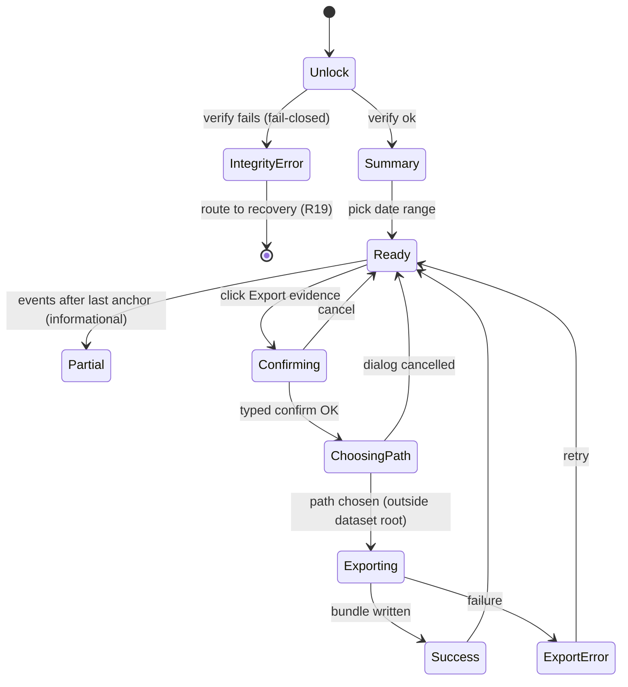

# SPEC-028 (UX) — Audit & Evidence Viewer

> **Status:** Accepted · **Owner:** Niobe · **Last updated:** 2026-06-13
> **Reviewers:** Neo (architecture) — pending · Switch (security) — pending · Link (product) — pending ·
> Mouse (design) — pending · **Acceptance:** Pedro (product owner)
> **Paired feature spec:** [`docs/specs/028-audit-and-evidence.md`](../../specs/028-audit-and-evidence.md)
> **Paired Design:** Pending — Mouse (viewer table density, print-view layout, integrity-banner visuals)
> **Decision record:** [`.squad/decisions/neo-028-anchor-dont-resign.md`](../../../.squad/decisions/neo-028-anchor-dont-resign.md)

---

## 1. Summary

The external auditor will be here at 10am. María opens **Auditoría** in the sidebar. A green banner
tells her the history is **verified** and **anchored through yesterday, externally timestamped**.
She sets the date range to last year, clicks **Exportar evidencia**, types `EXPORTAR`, picks a USB
drive, and hands over a self-contained evidence pack the auditor can verify on their own laptop —
no OpenTreasury needed. The screen never shows her a key, a file path, or a word of cryptography
she didn't ask for.

This UX spec covers the viewer's entry points, the happy path (read → filter → export evidence),
every empty/loading/error/tamper state, the **integrity banner** and **per-device "anchored
through"** indicators, the two provenance lanes (signed audit entries vs event-derived history),
accessibility, ES + EN copy, and a state diagram. Canonical functional/security behaviour lives in
the paired feature spec; the **honest-limitation copy** here is normative and must not be softened.

## 2. Entry Points

| # | Trigger | Behaviour |
|---|---|---|
| 1 | Click **Auditoría** / **Audit** in the sidebar (UX-006 §73 sidebar slot, adjacent to `Exportar`) | Route swap → `/audit`. Active state on the nav item. On entry the app shows the last verification result (from unlock); it does **not** re-run a full verify just for navigation. |
| 2 | Direct URL / deep link `/audit` | Same as #1. |
| 3 | Re-entry after an export | Same as #1; filters reset by default (no remembered filter set). |
| 4 | Routed here by the unlock integrity check (tamper detected) | Workspace did **not** open normally; the user lands on a blocking **integrity-error** view (§4) with a recovery CTA, not the normal viewer. |

**Sidebar placement (normative — resolves Open Question 2).** The item sits **between `Exportar` and
`Configuración`**, giving the order: `… · Exportar · Auditoría · Configuración`. It uses the Lucide
`ShieldCheck` icon (24 px). ES label `Auditoría` (9 chars), EN label `Audit` (5 chars); the 9-char
Spanish floor fits the sidebar's minimum item width (verified against the same slot that holds
`Configuración`, 13 chars, and `Movimientos`, 11 chars — `Auditoría` is shorter than both, so no
width regression). The `/audit` route is the only entry point; there is no top-bar or command-
palette shortcut in v1.

## 3. Happy-Path Walkthrough

Screen ID: **`AUD-1` (Audit & Evidence screen)**.

| # | Step | Screen state | Visible copy |
|---|---|---|---|
| 1 | María clicks `Auditoría` | `AUD-1.summary` | Page title *"Auditoría y evidencia"*; integrity banner (green) *"Verificado. Sin cambios sin sellar."*; per-device chips *"Este dispositivo · sellado hasta 31 may 2026 · sello externo ✓"*. |
| 2 | She picks date range *Año pasado* | `AUD-1.loading` → `AUD-1.ready` | Count line *"1.204 entradas en este periodo."* Two tabs: **Registro firmado** (signed audit entries) and **Historial de cambios** (event-derived). |
| 3 | She opens **Historial de cambios** and filters by account `Unicaja` | `AUD-1.ready` | Rows: date · actor · device · acción · cuenta/categoría. Old rows may show *"autor: desconocido (anterior al registro)"* honestly. |
| 4 | She clicks **Exportar evidencia** | `AUD-1.confirming` (modal **AUD-2**) | Confirmation modal (see §3.1). |
| 5 | She types `EXPORTAR` and clicks **Continuar** | `AUD-1.choosing-path` (native OS dialog) | OS save dialog; default folder = Documents; default filename `OpenTreasury-Evidencia-2025-01-01_2025-12-31.zip`. |
| 6 | She accepts the location and clicks **Guardar** | `AUD-1.exporting` | Spinner + *"Generando paquete de evidencia…"*; `aria-live` progress. |
| 7 | Export completes | `AUD-1.success` | Toast *"Paquete de evidencia generado: OpenTreasury-Evidencia-2025-01-01_2025-12-31.zip."* + **Mostrar en carpeta**. |

### 3.1 Evidence-export confirmation modal (`AUD-2`)

Screen ID: **`AUD-2`**. Reuses the SPEC-027 `EXP-2` choreography (typed confirmation, "treat like
cash" warning, encrypted-workspace guard).

- Title: *"Vas a exportar evidencia descifrada"* / *"You are about to export decrypted evidence."*
- Body (plain language, no jargon):
  - *"El paquete contiene datos descifrados (registro de auditoría e historial de cambios)."*
  - *"Cualquiera con el archivo puede leerlo. Trátalo como dinero en efectivo."*
  - *"El paquete incluye un informe de verificación; consérvalo junto al resto."*
- Confirm by typing `EXPORTAR` / `EXPORT`. Cancel returns to `AUD-1.ready`.

### 3.2 Evidence bundle contents & format (normative — resolves Open Question 1)

The bundle is a single `.zip` written outside the dataset root (SPEC-027 guard). Its **v1 artifact
set is fixed and normative**:

| Member | Format | Purpose |
|---|---|---|
| `audit-entries.jsonl` | JSON-lines (one signed audit entry per line, pretty-printed per crypto-spec §8.3) | Signed exports, anchors, and `audit.anchor.timestamped` receipts for the period. |
| `change-history.jsonl` | JSON-lines | Event-derived change history for the period (date · actor · device · action · account/category), with `unknown (pre-coverage)` rendered honestly. |
| `key-manifest.json` | JSON | Audit signing-key public-key manifest, so the auditor can verify signatures **offline**. Marked **self-asserted** unless corroborated by an external timestamp (feature spec §8, AC17). |
| `timestamp-receipts/` | RFC-3161 token files (Tier 2) | External timestamp receipts referenced by the verification report. |
| `verification-report.json` | JSON | Machine-readable chain status, per-anchor external-timestamp status, and the **limitation statement** (§7). |
| `verification-report.html` | **Print-friendly HTML** | Human-readable rendering of the report **plus** the change-history table, carrying a print stylesheet (`@media print`) so the auditor can print or "Save as PDF" from the browser. Satisfies the FR10 **print-friendly** requirement. |

**The FR10 "print-friendly" requirement is satisfied by the bundled `verification-report.html` print
view (a print stylesheet). True app-generated PDF is explicitly DEFERRED to a later increment** —
v1 ships no PDF encoder; the user reaches PDF, if needed, via their browser's print-to-PDF on the
HTML view. This keeps v1 free of a PDF toolchain while still handing the auditor something they can
file on paper.

The modal's **"¿Qué incluye?" / "What's included?"** disclosure lists exactly the rows above in
plain language (no file names): *signed audit entries · change history · public-key manifest ·
external timestamp receipts · a verification report you can print*.

### 3.3 Provenance lanes & how each is sourced (normative)

The viewer presents **two lanes that are never merged** (feature spec §5, FR10). Each is a separate
tab and is sourced over `audit:list` with a `stream` discriminator; the renderer only ever receives
Zod-validated, provenance-labelled view-models (FR12, AC10):

| Lane | Tab label (ES / EN) | Source | Provenance label | Attribution guarantee |
|---|---|---|---|---|
| Signed audit entries | **Registro firmado** / **Signed record** | `FileAuditLog` chain (exports, anchors, timestamp receipts) via `audit:list { stream: 'signed' }` | "audit-grade" | Signed + hash-chained. Proves **signing-key continuity**, not per-device identity (feature spec §8 / AC17). |
| Event-derived change history | **Historial de cambios** / **Change history** | The decrypted event log, projected in main via `audit:list { stream: 'history' }` | "recorded history" | Attribution is whatever the event carries — full for attributed events, `unknown (pre-coverage)` or flat for others (§3.4). |

A per-row badge states the lane so a screen-reader user (and a printed report) can always tell a
signed entry from event-derived history. The two lanes are **never** collapsed into a single
"audit-grade" stream.

### 3.4 Attribution honesty gap (normative — MUST NOT imply attribution it lacks)

The **Historial de cambios** lane is honest about what it does and does not know. It MUST NOT render
an actor or device it cannot source:

- **Pre-coverage events** (older mutation events written before the Tier-0 coverage ledger) lack
  actor/device entirely. They render as **`autor: desconocido — anterior al registro`** /
  **`author: unknown — pre-coverage`**. They are **never** refused and **never** back-filled with a
  guessed actor (feature spec FR2/AC2).
- **Flat events** (config `*Updated/*Archived/*Deleted`, `tx.note.*`, `tx.split` / `tx.split.removed`,
  `movement.imported`, `import.mapping.updated`) record *what* and *when* but, until the M2
  attribution work lands, not *who*. The viewer shows their action and target faithfully and leaves
  actor/device blank with the same honest `unknown` treatment — it does **not** infer an actor from
  the session or device currently unlocked.
- **Attributed events** (`tx.created`, `tx.updated`, `tx.deleted`, enveloped `*.created`) show the
  real actor/device from the event envelope.

The device column likewise shows a device only when the event carries one; otherwise it stays blank
with the same honest treatment. Overstating attribution would be a compliance liability — the
viewer's job here is to be *truthful about uncertainty*, not to look complete.

## 4. Empty / Loading / Error / Tamper States

| State | Screen ID | Trigger | UI |
|---|---|---|---|
| First-use / no anchors yet | `AUD-1.no-anchors` | New workspace, nothing anchored | Neutral banner *"Aún no se ha sellado ningún historial. Se sellará automáticamente al bloquear o tras varios cambios."* History tab still readable. |
| Empty filter result | `AUD-1.empty-range` | Range has no entries | *"No hay entradas en este periodo."* Export disabled. |
| Loading | `AUD-1.loading` | Fetching view-models | Skeleton rows; `aria-busy`. |
| Not-yet-anchored tail | `AUD-1.partial` | Events exist after last anchor | Amber chip *"12 cambios recientes aún sin sellar."* — informational, **not** an error. |
| Timestamp pending (offline) | banner sub-state | Anchor written, TSA queued | Per-anchor chip *"sello externo pendiente (sin conexión)"*. |
| Timestamp failed | banner sub-state | TSA error | Chip *"sello externo falló — se reintentará"* + retry-on-next-online note. |
| **Tamper detected (blocking)** | `AUD-0.integrity-error` | Chain break / anchor mismatch at unlock | **Full-screen blocking** red view: *"No se pudo verificar la integridad del historial."* Explains a recovery path (restaurar desde una copia/instantánea — R19). The normal workspace does **not** open. No "continuar de todos modos". |
| Export failure | `AUD-1.export-error` | Bundle write failed | CE-XXX localized copy (crypto-error-copy-catalog); **Reintentar** re-enabled. |

### 4.1 Integrity banner & per-device "anchored through" indicators (normative)

The summary header carries one **integrity banner** plus a row of **per-device chips**.

**Integrity banner** — exactly one state, conveyed by **text + icon** (never colour alone):

- **Verified** (green check): *"Verificado. Sin cambios sin sellar."* — chain verified at unlock and
  every known device file is anchored to its current head.
- **Verified, unsealed tail** (green check + amber dot): verified, but events exist after the last
  anchor; shows the amber unsealed-tail chip (below). Still a healthy state, **not** an error.
- **No anchors yet** (neutral): *"Aún no se ha sellado ningún historial…"* (`AUD-1.no-anchors`).
- **Integrity error** (red cross): only reachable as the blocking `AUD-0.integrity-error` view; the
  normal banner is never shown in this case.

**Per-device chips — density (normative — resolves Open Question 3).** Each chip shows one device's
anchored frontier, e.g. *"Este dispositivo · sellado hasta 31 may 2026 · sello externo ✓"*. Chips are
rendered **inline up to N = 3 devices**. With **4 or more** known device files, the first 2 chips
render inline and the remainder collapse behind a **"ver dispositivos (N) / view devices (N)"**
popover (a keyboard-operable disclosure listing every device with its full anchored-through and
timestamp status). The summary banner always reflects the **worst-case** device status regardless of
collapse. Rationale: 3 inline chips fit the summary header without wrapping on the baseline width;
beyond that the popover keeps the header scannable while preserving full per-device detail for the
auditor.

**"Not yet anchored" amber chip — informational only (normative — resolves Open Question 4).** The
amber chip *"{n} cambios recientes aún sin sellar"* is **purely informational in v1**. It carries
**no** manual **"Sellar ahora" / "Seal now"** action. Anchoring stays **automatic** — on unlock, on
lock, and on the N-appends / time-interval trigger (per
[`neo-028`](../../../.squad/decisions/neo-028-anchor-dont-resign.md): N = 1000 local appends or
T = 15 min). A manual "Sellar ahora" button is noted as a **possible later enhancement** (it would
need its own guardrails so the renderer cannot force history writes — see FR12 / §7 of the feature
spec), but it is **out of scope for v1**.

**Timestamp sub-states** on each anchor/device chip: *externally timestamped ✓* · *external timestamp
pending (offline/queued)* · *external timestamp failed — will retry*. These mirror feature-spec
FR13–FR15 and are derived at read time (no mutable flag on the anchor).

## 5. State Diagram

## 6. Accessibility (WCAG 2.1 AA)

- **Integrity banner** uses an `aria-live="polite"` region; status is conveyed by **text + icon**,
  not colour alone (green check / amber dot / red cross all carry a text label).
- **Per-device chips** are a keyboard-navigable list; each chip's full status is in its accessible
  name (e.g. *"Portátil de María — sellado hasta 31 may 2026 — sello externo verificado"*).
- **Two-tab provenance** (Registro firmado / Historial de cambios) is a proper tablist; arrow-key
  navigation; the active tab is programmatically determinable.
- **History/audit tables** have row/column headers; the provenance lane is announced per row so a
  screen-reader user can tell a signed entry from event-derived history.
- **Confirmation modal** traps focus, is dismissible with `Esc`, returns focus to the trigger.
- **Export progress** announced via `aria-live` (≤ 1 update / 200 ms).
- **Integrity-error view** is reachable and operable by keyboard; the recovery CTA is the first
  focusable control.
- **Print view** (evidence preview) keeps legible contrast and does not rely on colour to convey
  verification status.

## 7. Copy (ES + EN) — including the normative limitation statement

| Key | ES | EN |
|---|---|---|
| Title | Auditoría y evidencia | Audit & evidence |
| Verified banner | Verificado. Sin cambios sin sellar. | Verified. No unsealed changes. |
| Per-device anchored | Sellado hasta {fecha} · sello externo ✓ | Anchored through {date} · externally timestamped ✓ |
| Unsealed tail | {n} cambios recientes aún sin sellar | {n} recent changes not yet anchored |
| Timestamp pending | Sello externo pendiente (sin conexión) | External timestamp pending (offline) |
| Timestamp failed | Sello externo falló — se reintentará | External timestamp failed — will retry |
| No anchors yet | Aún no se ha sellado ningún historial. Se sellará automáticamente al bloquear o tras varios cambios. | No history has been sealed yet. It will be sealed automatically on lock or after several changes. |
| Sidebar label | Auditoría | Audit |
| View-devices popover | Ver dispositivos ({n}) | View devices ({n}) |
| Bundle disclosure | Incluye: registro firmado · historial de cambios · manifiesto de claves · sellos de tiempo externos · un informe de verificación que puedes imprimir. | Includes: signed record · change history · key manifest · external timestamps · a verification report you can print. |
| Tamper title | No se pudo verificar la integridad del historial | Could not verify history integrity |
| Tamper body | Restaura el área de trabajo desde una copia o instantánea de confianza. | Restore the workspace from a trusted copy or snapshot. |
| Export CTA | Exportar evidencia | Export evidence |
| Unknown actor (pre-coverage) | autor: desconocido — anterior al registro | author: unknown — pre-coverage |
| **Limitation (verification report + tooltip)** | **A prueba de manipulación y con sello de tiempo externo — no "a prueba de todo". Una persona con todas las claves del dispositivo aún podría reconstruir un historial; el sello de tiempo externo limita la antedatación. Consulta con asesoría legal antes de presentarlo como "grado auditoría".** | **Tamper-evident and externally timestamped — not "tamper-proof". Someone holding all device keys could still rebuild a history; the external timestamp limits backdating. Seek legal review before presenting this as "audit-grade".** |

The limitation statement is **normative** (feature spec FR13/AC13) and appears both in-app
(tooltip/disclosure near the integrity banner) and inside the exported verification report. It MUST
NOT be reworded to imply stronger guarantees.

## 8. Edge Cases

- **Anchor created mid-session while viewing.** The banner updates via `aria-live`; the open table
  does not jump — a subtle "actualizado" affordance lets the user refresh.
- **Multiple device files, one tampered.** If the tamper is in an **anchored prefix**, unlock
  **fails closed** (blocking `AUD-0.integrity-error`) — the workspace does not open; the
  integrity-error view and verification report localize the failure to that device's frontier
  ("no verificado") while the others show as verified. A change only in an **unanchored tail** is
  not tamper (it surfaces as the informational amber chip, not red).
- **Save path inside the dataset root.** Refused (encrypted-workspace guard, SPEC-027 FR14); the OS
  dialog reopens. No "guardar de todos modos".
- **Offline during export.** Bundle still generates (it's local); only the *external timestamp* on
  any newly-attempted anchor is queued — the export does not block on the network.
- **Very large period (100k+ entries).** History tab virtualizes rows; export streams; progress is
  announced. No full-plaintext residency (feature spec NFR1).
- **Clock skew.** The local `observed_at` is shown as informational; trust comes from the external
  timestamp, and the UI never claims local time as proof.

## 9. Component Reuse

- **Date-range picker** — reuse Movements/Export picker (UX-003 §4) with the same six presets.
- **Account/category filters** — reuse the Movements/Export chip multi-selects.
- **Confirmation modal `AUD-2`** — reuse `EXP-2` (SPEC-027 §3.1) styling and typed-confirm logic.
- **Save dialog / show-in-folder / atomic write** — reuse the SPEC-027 main-process export plumbing.
- **Toast / error copy** — reuse the toast component and `crypto-error-copy-catalog` codes.
- **Tables** — reuse the Movements table/virtualization patterns; add a provenance column.
- **Save dialog / show-in-folder / atomic write / typed-confirm / encrypted-workspace guard** —
  reuse the SPEC-027 export choreography wholesale for the evidence-bundle export (WI-6).
- New, small: the **integrity banner**, the **per-device chips + "ver dispositivos" popover**, and
  the **print-friendly `verification-report.html`** view (Mouse to polish).

## 10. Traceability

- **Paired feature spec:** [`docs/specs/028-audit-and-evidence.md`](../../specs/028-audit-and-evidence.md)
- **Reuses:** [`docs/ux/specs/spec-027-export.md`](./spec-027-export.md) (confirmation, save dialog,
  guard), [`docs/ux/specs/ux-006-app-shell-and-navigation.md`](./ux-006-app-shell-and-navigation.md)
  (sidebar slot), [`docs/ux/specs/ux-003-movements-screen.md`](./ux-003-movements-screen.md)
  (date-range + filters + table).
- **Security requirements:** R8, R11, R12, R15, R19 (recovery routing on tamper).
- **Accessibility:** WCAG 2.1 AA (NFR4 in feature spec).
- **Cross-reference:** invoice-attachments (#293) — if attach/remove-invoice become audited ops,
  they surface in the **Historial de cambios** lane via the coverage ledger; no separate UI.

## 11. Out of Scope (v1)

- Editing or annotating audit/history entries (read-only by definition).
- In-app cryptographic *re-verification* of a third party's bundle (the auditor uses the manifest +
  their own tooling).
- Per-event signature display (Tier 3, deferred).
- A live "tamper alarm" outside the unlock-time verify (no background watcher in v1).
- **App-generated PDF** of the evidence pack: v1 ships only the print-friendly
  `verification-report.html` (print stylesheet); true PDF generation is deferred to a later
  increment (resolved Open Question 1 — see §3.2).
- A manual **"Sellar ahora" / "Seal now"** action (anchoring is automatic in v1 — resolved Open
  Question 4, see §4.1).

## 12. Open Questions — Resolved

All four blocking open questions are resolved and folded into the body as normative decisions; the
recommendations below were applied and are flagged for Pedro's confirmation at acceptance (see the
PR's "Decisions needed from Pedro" section).

| # | Question | Resolution (normative location) |
|---|---|---|
| 1 | Evidence bundle artifact format (mirrors feature-spec OQ5) | **JSON-lines audit entries + change history + key manifest + external-timestamp receipts + verification report, PLUS a print-friendly `verification-report.html` (print stylesheet). True app-generated PDF deferred.** → §3.2 |
| 2 | Sidebar placement/order of `Auditoría` | **Order `… · Exportar · Auditoría · Configuración`; Lucide `ShieldCheck`; ES `Auditoría` (9 chars) fits the Spanish-floor width.** → §2 |
| 3 | Per-device chip density | **Inline up to N = 3 devices; ≥ 4 collapse the remainder into a "ver dispositivos" popover (first 2 inline).** → §4.1 |
| 4 | "Not yet anchored" amber chip — manual "Sellar ahora" in v1? | **Informational only in v1; anchoring stays automatic (unlock/lock/threshold per neo-028). "Sellar ahora" noted as a later enhancement.** → §4.1, §11 |

## 13. Build Breakdown (for the next session)

The viewer increment is two work items off the already-shipped backend (WI-1/WI-2/WI-3/WI-5 are
done — see feature-spec §11.1). The implementing session can start from here without re-litigating
UX:

| WI | Issue | Scope | Depends on |
|---|---|---|---|
| **WI-4** | #360 | **Audit & Evidence viewer (read-only):** the `/audit` route + sidebar entry; the two tabs (**Registro firmado** / **Historial de cambios**, §3.3); date-range + account/device filters (reusing UX-003/SPEC-027 controls); the integrity banner + per-device chips + popover (§4.1); all empty/loading/error states and the blocking `AUD-0.integrity-error` view; honest attribution rendering (§3.4); WCAG 2.1 AA (§6). | WI-3 (chain-verify-on-unlock, shipped) |
| **WI-6** | (new — bundle) | **Evidence-export bundle:** the `AUD-2` confirmation modal, the bundle contents/format (§3.2) incl. the print-friendly HTML view, and the `audit:exportBundle` flow — **reusing the SPEC-027 export choreography** (typed confirm, encrypted-workspace guard, save dialog in main, atomic temp→rename, audit-entry-first, rate limiting). Emits an `audit.export` entry. | WI-4 |

**Main-process / IPC boundary (FR12, AC10 — normative).** All decrypt, file reads, signature
verification, hashing and TSA I/O stay in **main**. The renderer receives **only Zod-validated
view-models** over the `audit:verify` / `audit:list` / `audit:exportBundle` / `audit:anchorStatus`
channels (feature-spec §7); it never receives plaintext paths, ciphertext, keys, or signing
material. Anchoring is triggered by main-process lifecycle only — there is no renderer-invokable
anchor channel, so the viewer cannot force a history write. The print-friendly HTML is **rendered in
main** (or from already-validated view-models) and written into the bundle; it is not a live
renderer surface with privileged data.

> **Note on WI numbering.** Feature-spec §11.1 currently lists WI-6 as the deferred Tier-3 per-event
> signing item (#359). This UX spec uses **WI-6 = evidence-export bundle** as the viewer-increment
> companion to WI-4; the next session should reconcile the issue/number with Neo when opening the
> bundle work item so the two tables agree.

## 14. Status History

| Date | Status | By | Notes |
|---|---|---|---|
| 2026-06-01 | Draft | Niobe | Initial UX draft paired with SPEC-028. Establishes the two-lane provenance viewer, per-device "anchored through" indicators, evidence-export reuse of the SPEC-027 choreography, the blocking tamper/integrity view, and the normative honest-limitation copy. |
| 2026-06-13 | In Review (ready for acceptance) | Niobe | Finalized for the viewer build. Resolved all four §12 open questions into normative decisions: (1) bundle = JSON-lines + manifest + verification report + **print-friendly HTML**, PDF deferred; (2) sidebar order `Exportar · Auditoría · Configuración`; (3) per-device chips inline up to **N = 3**, popover beyond; (4) amber unsealed-tail chip **informational only** (no manual "Sellar ahora"). Added the provenance-lane sourcing model (§3.3), the **attribution honesty gap** (§3.4, pre-coverage/flat events rendered honestly), the integrity-banner + per-device indicator spec (§4.1), and the **WI-4 / WI-6 build breakdown** with the main-process/IPC boundary (§13). Honest-limitation copy preserved verbatim. **Acceptance remains Pedro's call.** |
| 2026-06-13 | Accepted | Pedro (product owner) | Accepted by Pedro (product owner); all 4 UX open questions + 2 security ratifications (OQ4b freeTSA default / OQ1 bulk-anchoring) approved as recommended. Viewer build (WI-4/WI-6) cleared to start. |
