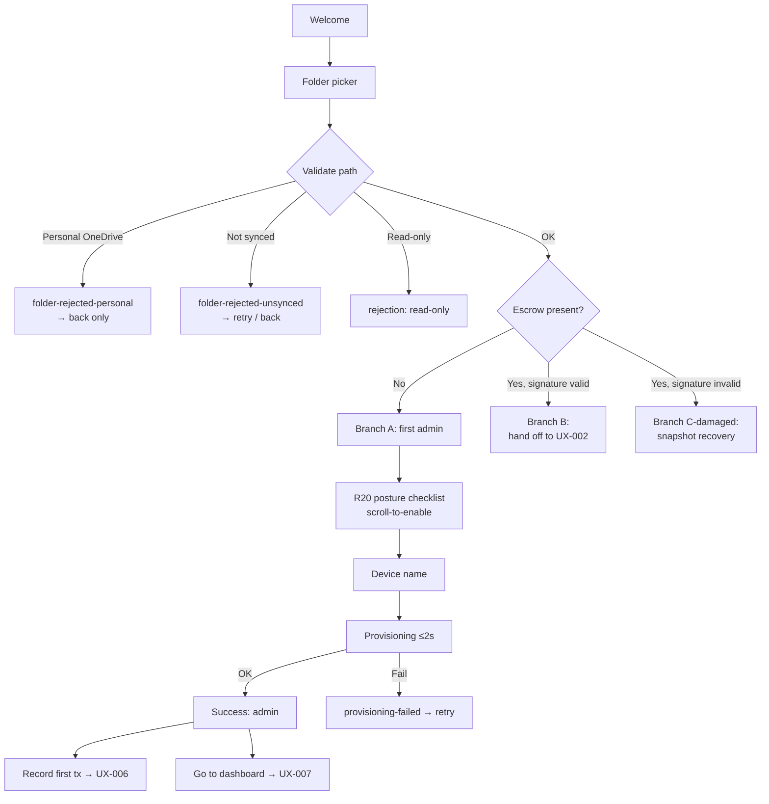

# UX-001 — First-Run / Folder Setup

> **Status:** Draft v0.1 · **Owner:** Niobe (Spec / UX Analyst) · **Date:** 2026-04-19
> **Paired PRD:** none (pre-ledger onboarding; supports every M1 PRD)
> **Paired flow skeleton:** [`../flows/flow-001-first-run-setup.md`](../flows/flow-001-first-run-setup.md)

**Traceability:** vision §2, §5, §7 Principle 5, §8 (≤10min metric) · ADR-001 C6/C7/C11 · security-requirements v0.2 **R20** (first-run posture), **R4** (per-device keys), **R11** (Electron hardening), **R12** (IPC schema), **R15** (PII redaction) · [crypto-spec §4](../../security/crypto-spec.md#4-first-setup-flow) (first-setup), §2 (key hierarchy), §3 (escrow) · prototype-analysis **G1** / **UX-R3** · decisions 2026-04-19 (OneDrive Business/SharePoint only; Personal deferred).

---

## 1. Summary

First-run establishes the treasury on disk: pick a OneDrive-for-Business / SharePoint folder, decide whether to become the first admin of a new treasury or request enrollment into an existing one, generate device keys, and either write the initial `escrow.json` (admin path) or hand off to UX-002 (enrollment path). OneDrive Personal is explicitly rejected with actionable copy pointing to v1.x.

## 2. User problem

A first-time treasurer needs to go from "I just installed this" to "I can record my first transaction" in under 10 minutes, without understanding crypto, without creating app accounts, and without being blocked by ambiguous storage choices.

## 3. Actors & preconditions

- **Treasurer** (Maria) — installing on a Windows laptop, signed into M365, has at least one OneDrive-for-Business or SharePoint location synced locally.
- **App** — Electron main process; renderer-only UI.
- **OS keychain** — DPAPI (Windows v1 per AR10).
- **OneDrive / SharePoint** — M365 tenant sync agent.

**Preconditions:** app installed (post-AR9 SmartScreen, covered by UX-019); no prior OpenTreasury state on device; user has read+write on an existing Business/SharePoint synced path OR can create one.

## 4. Happy path (Branch A — become first admin)

| # | User sees | User does | System does |
|---|---|---|---|
| 1 | Welcome screen: one-line product description, "Get started" primary, "How this works" link. | Click "Get started" | Route to step 2 |
| 2 | **Folder step.** Two choices: "Create new folder in…" / "Use existing folder". Helper text: *"Must be a folder that OneDrive-for-Business or SharePoint is syncing. Personal OneDrive is not supported in v1."* | Pick a path | Validate path (see §6) |
| 3 | Brief detection (<1s). | wait | Check for `.treasury/escrow.json` |
| 4 | **Branch decision.** Folder empty → "Become the first admin of this treasury" screen with plain-language explanation of what admin means. | Click "Continue" | Route to R20 checklist |
| 5 | **R20 security-posture checklist** (non-skippable, single screen, scroll-to-enable). Items: MFA on MS account, disk encryption recommended, never share via public link, folder-access ≠ treasury-access. | Check all, click "I understand" | Persist ack (attached to `dataset.created` audit entry per §5 step 8) |
| 6 | **Device name** input, pre-filled from OS hostname (e.g., "Maria — Laptop"). Copy: *"Admins see this when approving or revoking devices."* | Accept or edit, "Continue" | Persist pending device name |
| 7 | **Setting up your treasury…** progress <2s. No cancel. | wait | Generate X25519 + Ed25519 keypairs + local-cache key → OS keychain (per-dataset scope); generate DEK v1; wrap DEK to self; build + sign `escrow.json`; write `escrow.json` + genesis audit entry encrypted with DEK v1. **(crypto-spec §4)** |
| 8 | **Success.** "Your treasury is ready." Show folder path. CTAs: "Record first transaction" → UX-006 (future) / "Go to dashboard" → UX-007 (future). | Click either | Route |

**Branch B (join existing):** At step 3, `escrow.json` found → show "This treasury belongs to {NGO}. Your device hasn't been enrolled yet." → single CTA "Request enrollment" → hand off to **[UX-002](./ux-002-device-enrollment.md)** step 1.

**Branch C (resume):** Keychain entries already match the last-opened folder → skip 1–8, open directly to Panel. Full spec in UX-004 / UX-011; mentioned here for completeness.

## 5. States

| State | What's shown | Interactive? | Copy cue (ES / EN key) |
|---|---|---|---|
| `welcome` | Welcome + Get started | Yes | `ux.first-run.welcome.title` |
| `folder-picker` | Path selector + helper | Yes | `ux.first-run.folder.prompt` |
| `detecting` | Spinner (≤1s, replaced by next state) | No | `ux.first-run.detecting` |
| `folder-rejected-personal` | Explicit rejection card (see §6 E1) | Yes (back only) | `ux.first-run.folder.rejected-personal` |
| `folder-rejected-unsynced` | Rejection card, OneDrive not running (§6 E2) | Yes (retry / back) | `ux.first-run.folder.rejected-unsynced` |
| `branch-admin` | "Become first admin" explainer | Yes | `ux.first-run.branch.admin.title` |
| `branch-join` | "Treasury belongs to {NGO}" + Request enrollment | Yes | `ux.first-run.branch.join.title` |
| `branch-damaged` | Signature invalid → recovery CTA (§6 E4) | Yes | `ux.first-run.branch.damaged.title` |
| `posture-checklist` | R20 items, all required | Yes | `ux.first-run.posture.*` |
| `device-name` | Input + suggestion | Yes | `ux.first-run.device-name.label` |
| `provisioning` | Progress ≤2s, non-cancellable | No | `ux.first-run.provisioning` |
| `provisioning-failed` | Error + rollback message (§6 E5/E6/E7) | Yes (retry) | `ux.first-run.provisioning.error` |
| `success-admin` | ✅ treasury ready + two CTAs | Yes | `ux.first-run.success.admin.title` |

## 6. Edge cases & errors

| Trigger | User sees | Recovery |
|---|---|---|
| **E1.** Path is OneDrive **Personal** (consumer account) | Rejection card: "OneDrive Personal is not supported in v1. Please pick a folder inside OneDrive-for-Business or SharePoint. Support for Personal OneDrive is planned for v1.x." Link: "Why?" → short explainer. | Back to folder picker. NO override. |
| **E2.** Path is outside any OneDrive sync root (plain local) | Rejection: "This folder doesn't appear to be synced to OneDrive. Your treasury would only live on this laptop." Primary: "Pick a different folder". Secondary: **[Open Q1 to Pedro]** allow override? | Re-pick |
| **E3.** Path is read-only for this OS user | "You don't have write access to this folder." | Re-pick |
| **E4.** `escrow.json` present but **signature invalid** | "This treasury's escrow signature doesn't match a known admin. This can happen if the file was tampered with or copied incorrectly. Don't continue — contact the admin who created it." Secondary: "Restore from snapshot" → UX-009 recovery flow. **[Switch copy review required]** | Back / escalate |
| **E5.** OS keychain unavailable (DPAPI disabled / locked-down env) | "OpenTreasury needs access to your OS keychain to protect your treasury's keys. This usually works out of the box on Windows." Link: docs. | Retry / abort |
| **E6.** Disk full or write fails mid-provisioning | "Couldn't finish setting up. We cleaned up any partial files. Please free some space and try again." | Retry |
| **E7.** Folder has thousands of unrelated files at root | Non-blocking warning: "This folder contains a lot of non-treasury files. We recommend creating a `Treasury` subfolder." | Create subfolder / proceed |
| **E8.** OneDrive client not running / not signed in | Non-blocking warning at step 2: "OneDrive isn't running — sync won't work until you start it." | Proceed / defer |
| **E9.** Unsupported SharePoint variant detected (e.g., odd site-root path) | Best-effort proceed + banner "This folder type isn't fully tested; please report issues." | Proceed |

## 7. Accessibility

- Tab order: heading → primary content → primary CTA → secondary CTA → help link.
- First focus on each step lands on the heading (`tabindex="-1"`), announced by screen readers, then moves to the primary input/CTA.
- R20 checklist: each checkbox labelled; "Continue" disabled until all checked AND user has scrolled to the bottom (ARIA `aria-disabled` with rationale announced).
- Progress at step 7 announced via `role="status"`; never exceeds 2s (if it does, replace with static text per reduced-motion).
- All controls reachable via keyboard; `Esc` NEVER destroys first-run progress.
- Contrast AA for rejection cards — red/amber not the sole signal (icon + text).
- Respects OS reduced-motion and text-zoom (reflow, no truncation).

## 8. i18n notes

- **Day-0 ES + EN** per PRD day-0 i18n rule. No hardcoded strings.
- String-key root: `ux.first-run.*`. Sub-domains: `folder.*`, `posture.*`, `device-name.*`, `provisioning.*`, `success.*`, `errors.*`.
- **ES vs EN layout risks** (flag for Mouse): Spanish R20 copy runs ~20–30% longer than English — checklist item heights must accommodate wrapping without truncation.
- **Pluralization:** folder-validation messages reference file counts → use ICU plural forms (`{count, plural, one {1 file} other {# files}}`).
- **Locale-aware:** device-name suggestion uses OS locale for "Laptop"/"Portátil"; folder path rendered without locale coercion (raw OS path).
- **Locale switcher** lives in the app shell (UX-006 below); not shown inside first-run. OS language pre-selects at launch **[Open Q2 to Link]**.

## 9. Copy guidance

**Tone:** direct, non-technical, reassuring. Never "crypto", "keys", "escrow", "signature" in primary copy (those live only in error/help surfaces where Switch has ratified them).

| Key | ES | EN |
|---|---|---|
| `ux.first-run.welcome.title` | "Bienvenida a OpenTreasury" | "Welcome to OpenTreasury" |
| `ux.first-run.folder.prompt` | "Elige la carpeta donde vivirá tu tesorería" | "Pick the folder where your treasury will live" |
| `ux.first-run.folder.helper` | "Debe estar en OneDrive para empresas o SharePoint. OneDrive personal no es compatible en v1." | "Must be inside OneDrive for Business or SharePoint. Personal OneDrive isn't supported in v1." |
| `ux.first-run.folder.rejected-personal` | "OneDrive personal aún no es compatible. Soporte previsto para v1.x." | "Personal OneDrive isn't supported yet. Support planned for v1.x." |
| `ux.first-run.branch.admin.title` | "Serás el primer administrador de esta tesorería" | "You'll be this treasury's first admin" |
| `ux.first-run.success.admin.title` | "Tu tesorería está lista" | "Your treasury is ready" |

## 10. Out of scope

- Visual treatment of the folder picker, R20 checklist, and success screen → **Mouse**.
- Install-time guidance / SmartScreen acknowledgment → **UX-019**.
- Enrollment request flow (Branch B beyond the hand-off banner) → **UX-002**.
- Resume/re-link logic (Branch C) → **UX-004 / UX-011**.
- OneDrive-Personal support → **v1.x**, separate PRD.
- Crypto mechanics (keypair generation, sealed-box wrapping, signing) → **crypto-spec §2–§4**, never restated here.

## 11. Open questions

1. **E2 override — should users be allowed to proceed with a non-OneDrive folder in v1?** Recommendation: **no** — Business/SharePoint only, matches decisions 2026-04-19. → **Pedro**.
2. **Welcome-screen pre-selected language** — OS locale if ES/EN, else Spanish; or always Spanish until user flips in Settings? Recommendation: OS locale if ES/EN. → **Link** (confirm) / **Pedro** (ratify).
3. **NGO display name** — ask at step 6 explicitly, or derive from folder name with an Edit affordance in Settings? Recommendation: derive, editable later. → **Link**.
4. **R20 acknowledgment capture in audit** — attach as a sub-field to the `dataset.created` entry, or a separate `posture.acknowledged` entry? Recommendation: sub-field (cleaner chain). → **Switch**.
5. **Backup-admin soft prompt at success** — after step 8 offer "Set up a backup admin now?" to mitigate orphaned-admin risk (crypto-spec §3.3). Recommendation: soft prompt, "Do later" default. → **Link** (PRD) / **Pedro**.
6. **"Pick a different folder" at step 4** — preserve R20 acks on re-entry or reset? Recommendation: preserve. → **Pedro**.
7. **Crypto-error copy at E4** (damaged escrow / bad signature) — exact user-facing string must not leak internals but must be honest. Proposed ES: *"La firma de esta tesorería no coincide con un administrador conocido. No continúes: puede estar dañada o alterada."* → **Switch** to ratify before Draft → In Review. **RATIFIED 2026-04-19 by Switch — see [crypto-error-copy-catalog.md CE-001](../../security/crypto-error-copy-catalog.md#ce-001--treasury-cant-be-verified-escrow-missing--bad-signature--unknown-admin).** ADJUSTED: Niobe's proposed copy leaked both the failing layer ("firma") and the identity concept ("administrador conocido"). Ratified copy is opaque about mechanism while honest about outcome: ES *"No podemos verificar esta tesorería. Esta carpeta contiene una tesorería, pero no podemos confirmar que esté intacta. Puede haberse dañado al copiarse, o haberse alterado. No continúes. Contacta a quien administra esta tesorería."* — full strings + i18n keys in CE-001.

## 12. Acceptance criteria

- AC1 — Happy-path Branch A completes steps 1–8 in ≤5 min of wall-clock on typical hardware.
- AC2 — Folder rejected as **Personal OneDrive** shows `folder-rejected-personal` state with a visible "v1.x" reference; there is **no override**.
- AC3 — All 20 listed state IDs are reachable and keyboard-navigable.
- AC4 — E4 (bad escrow signature) never drops the user into a provisioning attempt.
- AC5 — No user-visible string on any screen is hardcoded; every string resolves through the i18n layer and exists in both `es` and `en` tables.
- AC6 — R20 "Continue" cannot be enabled by code until every checkbox is checked AND the scroll container has been scrolled to its end.
- AC7 — Provisioning step (7) is atomic: if any sub-step fails, the folder contains no `.treasury/` artifacts.
- AC8 — No plaintext DEK or device private key material is ever written outside the OS keychain (crypto-spec §2 rule 1).
- AC9 — Renderer never receives key material (C6).

## 13. Flow diagram

## 14. Traceability matrix

| Requirement | Source | Where in this spec |
|---|---|---|
| Treasury-first onboarding ≤10min | vision §8 | §4, AC1 |
| R20 first-run security posture | security-req R20 | §4 step 5, §5 `posture-checklist`, AC6 |
| First-setup wins / admin designation | crypto-spec §3.3, §4 | §4 step 7 |
| Device keys in OS keychain only | crypto-spec §2 rule 1 & 3 | §4 step 7, AC8 |
| Renderer isolation (no key material) | ADR-001 C6, R11 | §11 Q7 outcome, AC9 |
| ULID filenames (opaque) | ADR-001 C11 | §4 step 7 (audit genesis write) |
| Personal OneDrive rejected v1 | decisions 2026-04-19 | §6 E1, AC2 |
| Day-0 ES + EN i18n | decisions 2026-04-19 | §8, AC5 |
| Bad-escrow → snapshot recovery | UX-009 (neighbour), crypto-spec §8 | §6 E4, §11 Q7 |

## 15. Status history

| Date | Status | By | Notes |
|---|---|---|---|
| 2026-04-19 | Draft v0.1 | Niobe | Expanded from flow-001 skeleton. Batch 1 of Wave-1 UX specs. |
