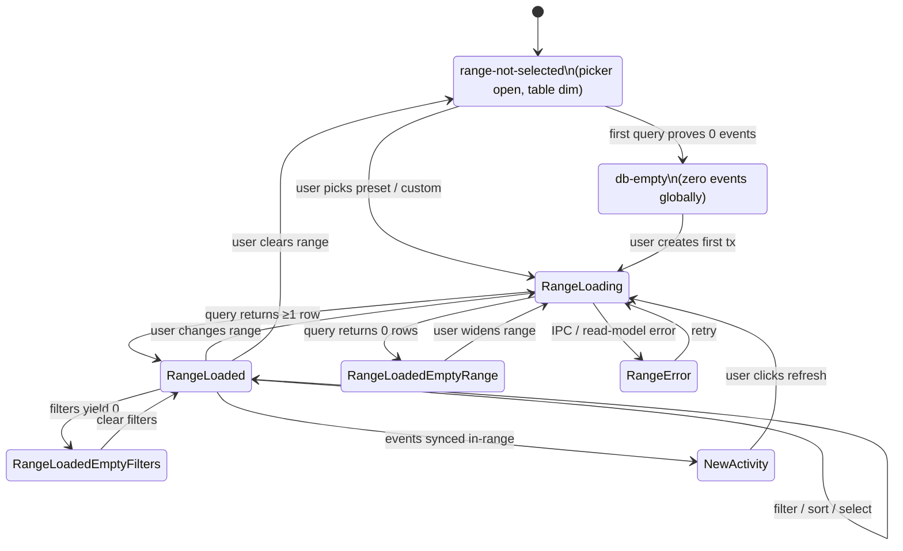

# UX-003 — Movements Screen

> **Status:** Draft v0.1 · **Owner:** Niobe (Spec / UX Analyst) · **Date:** 2026-04-19
> **Paired PRD:** [`docs/product/prds/prd-001-movements.md`](../../product/prds/prd-001-movements.md)
> **Paired flow:** [`../flows/flow-003-movements-date-range.md`](../flows/flow-003-movements-date-range.md)

**Traceability:** PRD-001 PR1–PR21 · vision §5, §7 Principles 2 & 5 · ADR-001 C1/C2/C3/C6/C7/C10/C11/C13 · security-requirements v0.2 R1/R3/R5/R8/R11/R12/R15 · [crypto-spec](../../security/crypto-spec.md) §2.1, §8 · prototype-analysis **G5**, **UX-R4**, **G6** · decisions 2026-04-19 (starts empty; no pending; day-0 i18n; OneDrive Business/SharePoint only) · [UX-006](./ux-006-app-shell-and-navigation.md) (global states: offline/syncing/locked/error-banner) · [UX-001](./ux-001-first-run-setup.md) (first-run hand-off to Panel).

---

## 1. Summary

The Movements screen is the treasurer's ledger: a filterable, searchable, selectable list of every confirmed transaction. **The screen renders empty on arrival** — the user MUST pick a date range (preset or custom) before any row loads. Once a range is picked, the familiar filter bar, totals strip, selection column, and create-transaction affordance become active. Statement-import (bank / PayPal CSV) lands rows here as already-confirmed; there is no pending state anywhere.

## 2. User problem

Treasurers drown in "all transactions ever" when a ledger auto-loads. Weekly and monthly reconciliation only needs a slice. The cloud app auto-loaded everything and treasurers repeatedly described feeling "lost in old data" (PRD-001 §2). This screen encodes the locked product rule: nothing renders until the user asks for a range.

## 3. Actors & preconditions

- **Treasurer** (Maria) — enrolled, DEK unwrapped, read model warm.
- **App renderer** — mounts Movements screen; no data query until a range is selected.
- **Main process** — serves range queries from the SQLite read model over schema-validated IPC (C13).

**Preconditions:** first-run complete (UX-001) OR enrollment approved (UX-002); app shell (UX-006) in `normal` global state OR `offline` / `syncing` (banner shows, screen remains usable); at least one `tx.created` event exists for any data to be visible — otherwise E1 empty-DB branch.

## 4. Happy path — weekly reconcile

| # | User sees | User does | System does |
|---|---|---|---|
| 1 | Sidebar highlights "Movimientos" | Click "Movimientos" | Navigate; **do NOT issue a data query**. Focus lands on page `<h1>`. |
| 2 | **Empty-on-open** state (§5 `range-not-selected`): page header, range picker pre-opened, 6 preset chips (`This month`, `Last month`, `This quarter`, `YTD 2026`, `Last 12 months`, `Custom…`), filter bar + table area dim / non-interactive, placeholder copy below presets | Tab lands on first preset chip | — |
| 3 | Preset chips keyboard-navigable (←/→) | Press `Enter` on `This month` | Emit range query `{from: 2026-04-01, to: 2026-04-30}`; flip to `range-loading` |
| 4 | Inline progress: *"Cargando movimientos para abril 2026…"* (≤300ms typical, §5 `range-loading`) | wait | IPC `tx:queryRange` returns; projected rows from read model |
| 5 | **Loaded state** (§5 `range-loaded`): range pill `📅 Abril 2026 ×` in filter bar; table with columns per §4.1; totals strip live; filter bar active; "Nuevo Movimiento" primary CTA enabled | scans list | — |
| 6 | Filter bar: type chips (Todos / Ingresos / Gastos) · account select · category select · amount min/max · "Solo sin categorizar" · search (topbar) | Flip type → Gastos; tick "Solo sin categorizar" | Re-filter the loaded range **in memory**, no re-query; totals strip updates live (≤100ms p95, PR14) |
| 7 | 4 uncategorized expenses visible; totals strip shows new Ingresos/Gastos/Neto/count; "Limpiar filtros" appears | Click a row's inline "Editar categoría" | Opens edit affordance (UX-006 shell-level modal contract) |
| 8 | After edit submit | — | Emits `tx.edited` event + audit entry (C10); read model reducer re-runs; row re-renders in-place with new category; totals strip updates |
| 9 | Satisfied | Navigate away | Screen unmounts; range state is NOT persisted across session (PRD-001 §9 Q2, recommendation: do not remember) |

### 4.1 Column structure (loaded state)

| Col | Field | Source | Notes |
|---|---|---|---|
| 1 | Selection checkbox | UI state | PR6 ships in M1; bulk *actions* deferred to M4 |
| 2 | Type arrow (↑ / ↓) | `tx.type` | Redundant with amount sign (a11y) |
| 3 | Date | `tx.date` | `Intl.DateTimeFormat` locale-aware |
| 4 | Account pill | `tx.account_id` → account | Pill colour from account, name = short |
| 5 | Observations | `tx.description` | Truncate with ellipsis at ~280px; full text in tooltip |
| 6 | Category | `tx.category_id` | `Sin categorizar` badge when null |
| 7 | Subcategory | `tx.subcategory` | `—` when null |
| 8 | Tags | `tx.tag_ids[]` | Chips; `—` when empty |
| 9 | Amount | `tx.amount` | Right-aligned, income/expense colour, `Intl.NumberFormat` currency EUR |

**Removed from prototype:** the `Estado` column (Pendiente / Aprobado badges). No status column, no status filter, no status badge, anywhere — per PRD-001 PR9.

### 4.2 Create transaction (Nuevo Movimiento)

Clicking the primary CTA opens a create-transaction form **covered by a separate spec (successor to the reassigned UX-006 slot — see ux-spec-plan §3 note)**. This spec's scope ends at "CTA opens the form"; post-submit the new row appears in the current range view when its date falls inside the range, otherwise a toast fires with an "Expand range to include" action (§6 E6). `Ctrl/Cmd+N` opens the same form from any screen (UX-006 Q1, pending Pedro).

### 4.3 Statement import (bank / PayPal)

The user initiates a statement import from the sidebar "Importación" route (**separate CSV-import wizard — PRD-006, UX-016, M2**). Rows committed by the wizard land in the event log as **confirmed** `tx.created` events (PRD-001 PR9, scenario S5). When the user returns to Movements, a banner fires: *"3 movimientos importados desde Unicaja (abril 2026). Amplía tu rango para verlos."* with an inline action. No pending queue, no "approve" step, no review mode. This spec calls out the hand-off; the wizard itself is **out of scope for UX-003** (see §11 Q1).

## 5. States

| State | What's shown | Interactive? | Copy key root |
|---|---|---|---|
| `range-not-selected` | Header + preset picker open + placeholder; filter bar + table dim | Presets only | `ux.movements.empty.pick-range` |
| `range-loading` | Previous state + inline spinner + *"Cargando…"* live region | No | `ux.movements.loading` |
| `range-loaded` | Range pill + filter bar + totals strip + table | Yes | `ux.movements.loaded.subtitle` |
| `range-loaded-empty-range` | Range pill + *"No hay movimientos en este periodo"* + Widen / Record CTAs (§6 E2) | Yes | `ux.movements.empty.in-range` |
| `range-loaded-empty-filters` | Range pill + *"No hay resultados con los filtros actuales"* + "Limpiar filtros" (§6 E3) | Yes | `ux.movements.empty.filters` |
| `range-error` | Range pill + inline error + Retry (§6 E4) | Retry | `ux.movements.error.query` |
| `db-empty` | *"Aún no has registrado ningún movimiento"* + "Registrar primer movimiento" / "Importar desde extracto" (§6 E1) | Yes | `ux.movements.empty.db` |
| `row-decrypt-failed` | Affected row rendered with ⚠ + neutral placeholder; other rows normal (§6 E5) | "Ver detalles" → UX-009 | `ux.movements.row.decrypt-failed` |
| `new-activity-available` | Banner above table: *"N nuevos movimientos en este rango. Actualizar"* (§6 E7) | Refresh | `ux.movements.new-activity` |
| `import-just-landed` | Banner above table: *"N movimientos importados. Amplía tu rango para verlos"* (§4.3) | Expand range | `ux.movements.import-banner` |
| `device-revoked` | Read-only banner (inherited from UX-006) — table remains but CTA disabled | Read | `ux.shell.banner.revoked` |

**Global states** (offline, syncing, locked, error-banner) render in the UX-006 shell banner slot and do NOT replace Movements' own state — they stack above it.

## 6. Edge cases & errors

| Trigger | User sees | Recovery |
|---|---|---|
| **E1.** Zero transactions globally (new NGO) | `db-empty`: *"Aún no has registrado ningún movimiento"* + primary "Registrar primer movimiento" + secondary "Importar desde extracto" | Create or import |
| **E2.** Range selected, zero rows match | `range-loaded-empty-range`: *"No hay movimientos en abril 2026"* + "Ampliar rango" (reopens picker) + "Registrar movimiento en este periodo" | Widen / record |
| **E3.** Range + filters yield zero rows | `range-loaded-empty-filters`: *"No hay resultados con los filtros actuales"* + "Limpiar filtros" (resets filters, keeps range — PR10) | Clear |
| **E4.** Range query fails (IPC error, read-model corrupt) | `range-error` with inline message + Retry; DOES NOT lose the selected range | Retry / re-pick |
| **E5.** Single-row decrypt failure in range | Affected row shows ⚠ placeholder; other rows normal; totals strip **excludes** the unreadable row and appends footnote *"1 movimiento no pudo leerse"* linking to UX-009 | Route to UX-009 |
| **E6.** New tx saved outside current range | Toast: *"Movimiento guardado (3 abr). Fuera de tu rango actual. Ampliar rango para incluirlo."* | Expand |
| **E7.** New events synced into current range after load | `new-activity-available` banner: *"{N} movimientos nuevos en este rango. Actualizar."* — does NOT auto-merge | Click Refresh |
| **E8.** Range spans >5000 events | Pre-query confirm modal: *"Este rango incluye ~{N} movimientos. ¿Cargar igualmente?"* + "Cargar" / "Elegir un rango menor" (threshold — §11 Q3, Neo) | Confirm / narrow |
| **E9.** Custom range `to < from` | Form validation at picker; submit disabled; inline ES/EN message | Correct |
| **E10.** Device just revoked | UX-006 banner; table remains from cache; Nuevo Movimiento CTA disabled with tooltip *"Tu dispositivo fue revocado por un administrador"*; no new queries possible | None in-screen |
| **E11.** Range change while previous query in flight | Cancel in-flight; run new | Automatic |
| **E12.** DEK-rotation boundary inside range | Invisible — main-proc decrypts each event with its own `dek_version` (crypto-spec §2.1). No UX signal. | — |
| **E13.** Edit/delete of a row whose event file is currently syncing | Allow (event sourcing — new event, no in-place write). Audit entry still produced. | None |
| **E14.** OneDrive sync paused / signed out | UX-006 offline banner + inline tip on Movements: *"No se descargarán movimientos nuevos mientras OneDrive esté pausado."* | Resume sync |

## 7. Accessibility

- **Tab order:** `<h1>` → range picker / pill → type chips → account filter → category filter → amount min → amount max → uncategorized checkbox → search (topbar, global) → totals strip (non-focusable, aria-live) → select-all checkbox → first row → "Nuevo Movimiento" primary CTA.
- **Range picker opened by default** on mount; initial focus on the first preset chip (arrow keys traverse chips; Enter selects; Tab exits group).
- **Range pill** keyboard-focusable; Enter reopens picker; `Backspace` clears and returns to `range-not-selected`.
- **Table** is a real `<table>` with `<th scope="col">`. Sort indicators are buttons with `aria-sort`. Row checkboxes labelled *"Seleccionar movimiento del {fecha}: {observaciones}"*. Select-all has `aria-label="Seleccionar todos en la vista"`.
- **Totals strip** wrapped in `role="status"`, `aria-live="polite"` — filter changes announce new totals without interrupting.
- **Loading / errors / new-activity banner:** `role="status"` (polite). Hard errors (E5, E10): `role="alert"` on first announcement, demote to `role="status"` on re-render.
- **Colour never sole channel:** income/expense carries arrow (↑/↓) AND sign AND colour.
- **Reduced motion:** skeleton rows replace the spinner; no fade-in on row append.
- **Shortcuts:** `Ctrl/Cmd+N` new transaction (UX-006 Q1); `/` focuses topbar search; `Esc` closes picker / clears selection.

## 8. i18n notes (day-0 ES + EN)

- **String-key root:** `ux.movements.*`. Sub-domains: `empty.*`, `loading`, `loaded.*`, `filter.*`, `totals.*`, `row.*`, `error.*`, `import-banner`, `new-activity`.
- **ES vs EN layout risk (flag for Mouse):** Spanish filter labels (`Todas las categorías`, `Solo sin categorizar`) run 20–30% longer than English. Filter-bar chip widths must flex.
- **Pluralization (ICU):** row count (*"{count, plural, one {# movimiento} other {# movimientos}}"*), new-activity banner, "(seleccionados)".
- **Locale-aware formatters:**
  - Date column → `Intl.DateTimeFormat(locale, { dateStyle: 'medium' })`.
  - Amount column → `Intl.NumberFormat(locale, { style: 'currency', currency: 'EUR' })` (pilot = Rett Spain).
  - Amount min/max inputs → accept locale-native decimal separator (`,` in ES, `.` in EN) and normalise to dot internally.
  - Month labels in month filter dropdown → `Intl.DateTimeFormat(locale, { month: 'long' })`.
- **Range pill label** composed from `from`/`to` via locale-aware formatter with a preset-name override when the range matches a preset exactly (*"Abril 2026"* vs *"1 abr 2026 – 30 abr 2026"*).
- **Custom picker calendar** respects `firstDayOfWeek` from locale (lun vs Sun).
- No hardcoded strings. CI "missing key" lint (PRD-001 PR19) MUST pass.

## 9. Copy guidance

**Tone:** direct, calm, no jargon. Never "event", "read model", "decrypt" in primary copy (those live in UX-009). "Movimiento" not "transacción" (matches prototype + cloud).

| Key | ES | EN |
|---|---|---|
| `ux.movements.title` | "Movimientos" | "Transactions" |
| `ux.movements.empty.pick-range.title` | "Elige un rango de fechas" | "Pick a date range" |
| `ux.movements.empty.pick-range.body` | "Selecciona un preajuste o un rango personalizado para ver tus movimientos." | "Pick a preset or a custom range to see your transactions." |
| `ux.movements.loading` | "Cargando movimientos para {range}…" | "Loading transactions for {range}…" |
| `ux.movements.empty.in-range.title` | "No hay movimientos en {range}" | "No transactions in {range}" |
| `ux.movements.empty.filters.title` | "No hay resultados con los filtros actuales" | "No results for the current filters" |
| `ux.movements.empty.db.title` | "Aún no has registrado ningún movimiento" | "You haven't recorded any transactions yet" |
| `ux.movements.totals.income` | "Ingresos" | "Income" |
| `ux.movements.totals.expense` | "Gastos" | "Expense" |
| `ux.movements.totals.net` | "Neto" | "Net" |
| `ux.movements.cta.new` | "Nuevo Movimiento" | "New Transaction" |
| `ux.movements.cta.clear-filters` | "Limpiar filtros" | "Clear filters" |
| `ux.movements.row.decrypt-failed` | "1 movimiento no pudo leerse. Ver detalles." | "1 transaction couldn't be read. See details." |
| `ux.movements.new-activity` | "{count} movimientos nuevos en este rango. Actualizar." | "{count} new transactions in this range. Refresh." |
| `ux.movements.import-banner` | "{count} movimientos importados. Amplía tu rango para verlos." | "{count} transactions imported. Widen your range to see them." |

Crypto-error copy (E5 route) is owned by **UX-009 + Switch**.

## 10. Out of scope

- **Visual treatment** of the range picker, preset chips, filter bar, row styles, selection highlight, banners, skeleton → **Mouse**.
- **Create / edit transaction form** (row-level and CTA-level) → **separate spec** (successor to reassigned UX-006 slot; TBD in plan revision).
- **Bulk *actions*** (categorize-N, tag-N, delete-N) → **UX-014 / PRD-019, M4**. Selection column ships here.
- **CSV / statement import wizard** (column mapping, dedup preview) → **UX-016, PRD-006, M2**. Only the post-import banner is specified here.
- **CSV / Excel / PDF export** → **UX-017, M3/M4**. The "Exportar" button in the prototype header is deferred to M3 and MUST be hidden in M1 builds until UX-017 lands (§11 Q2).
- **Drill-in from Panel/Saldo** (category-pre-filtered Movements) → v1.x; PRD-003 Q3 / PRD-002 Q4.
- **Saved filter presets** beyond built-in date presets → v1.x.
- **Global / cross-page search** → **UX-013 (audit log) and PRD-013, M3**.
- **Crypto error copy and recovery** → **UX-009** (cross-referenced in §6 E5/E10).
- **Shell chrome** (topbar search, sidebar, locale switcher, global banners) → **UX-006**.
- **Mobile / narrow-window responsive** → **UX-021 accessibility baseline** tracks minima; detailed breakpoints are Mouse's call.

## 11. Open questions

1. **Import wizard scope boundary** — confirm the post-import banner on Movements is the only Movements-side surface (vs. a dedicated "Recently imported" tab). Recommendation: banner only. → **Link** (PRD-006 author).
2. **"Exportar" header button in M1** — prototype shows it; PRD-001 defers export to M3 (PRD-008). Hide it entirely in M1 or show disabled with *"Exportación en v1.1"*? Recommendation: hide entirely — disabled buttons teach nothing. → **Link**.
3. **Large-range guard threshold** (E8) — 1000, 5000, or based on measured p95 load time? Recommendation: parametrise (config) and default to the row count that hits ~1s cold-load on reference hardware. → **Morpheus** (measure) / **Neo** (decide).
4. **Remember last range across sessions** — PRD-001 Q2. Recommendation: do NOT remember, reopens to `range-not-selected`. → **Pedro** (PRD-001 Q2 ratify).
5. **Default preset highlighting** — PRD-001 Q1. Recommendation: equally-weighted chips, no visual preselection; initial focus lands on first chip (`This month`) so Enter loads it in ≤2 keystrokes. → **Pedro**.
6. **Month filter dropdown** (within loaded range) — flow-003 Q4 proposed removing it since the range pill owns temporal scope. Recommendation: **remove** — it duplicates the range pill and confuses users who expect "month" to reload. → **Link** (confirm PRD removal) / **Mouse**.
7. **Panel → Movements "Ver todos"** hand-off — flow-003 Q7. Recommendation: Panel's click counts as the user's range selection (`This month`); Movements lands in `range-loaded` directly. → **Pedro** ratify.
8. **New-activity banner granularity** — per-tx or debounced? Recommendation: debounce 3s, show once per batch. → **Mouse** + **Neo** (sync signal).
9. **Row decrypt-failed copy exact string** (E5) — must be honest, non-technical, action-linked. Proposed ES: *"1 movimiento no pudo leerse. Ver detalles."* → **Switch** to ratify (security-sensitive). **RATIFIED 2026-04-19 by Switch — approved as proposed. See [crypto-error-copy-catalog.md CE-003](../../security/crypto-error-copy-catalog.md#ce-003--single-transaction-row-failed-to-decrypt).** Niobe's singular copy survives at `ux.movements.row.decrypt-failed`. The catalog adds an ICU-plural canonical key `ux.errors.crypto.ce-003.footnote` for the aggregated totals-strip footnote — use the catalog key when count may vary.
10. **"Solo sin categorizar" sticky-top alternative** — PRD-001 Q5 already declined; document here only if pilot feedback returns. → Closed for now.

## 12. Acceptance criteria

- **AC1** — On navigation to Movements with a populated event log, zero row-data queries fire before the user clicks a range input. Verifiable by IPC channel trace.
- **AC2** — With 1,000 events and `This month` selected, first rendered row appears ≤1s p95 from click (PRD-001 PR15).
- **AC3** — Filter changes after load re-render totals in ≤100ms p95 at 1,000 events (PRD-001 PR14).
- **AC4** — The table MUST NOT render any status/approval/pending column, badge, filter chip, or tooltip. Grep-level verifiable.
- **AC5** — Every user-visible string on every state (happy + §5 all states + §6 all errors) resolves through the i18n layer in both `es` and `en` tables. CI missing-key lint passes.
- **AC6** — Date, amount, and month-label rendering uses `Intl.*` formatters honouring the active locale.
- **AC7** — E5 (single-row decrypt failure) does NOT crash the screen; totals strip excludes the unreadable row and the footnote appears.
- **AC8** — The range pill is always present in `range-loaded*` states and offers keyboard clear → `range-not-selected`.
- **AC9** — No plaintext PII appears in renderer console, logs, or dev-tools output (R15).
- **AC10** — Renderer never reads filesystem directly; all range queries flow through schema-validated IPC (C13, R12).
- **AC11** — Create-tx CTA disabled with tooltip in `device-revoked` state; Enter/click does nothing.
- **AC12** — Every edit/delete produces exactly one event AND one audit entry (PRD-001 PR11, PR12; verifiable via event log inspection).

## 13. State diagram

## 14. Traceability matrix

| Requirement | Source | Where in this spec |
|---|---|---|
| Starts empty on open | PRD-001 PR1, decisions 2026-04-19 | §4 step 2, §5 `range-not-selected`, AC1 |
| Date-range presets (≥6) | PRD-001 PR2 | §4 step 2, §4.1 happy path |
| Loaded columns, desc-date order | PRD-001 PR3 | §4.1 |
| Filter bar | PRD-001 PR4 | §4 steps 5–7, §5 states |
| Totals strip | PRD-001 PR5 | §4.1, §7 a11y |
| Selection UI (no bulk actions) | PRD-001 PR6 | §4.1 col 1, §10 |
| Row edit / delete | PRD-001 PR7 | §4 step 8, AC12 |
| New transaction CTA | PRD-001 PR8 | §4.2 |
| No pending state anywhere | PRD-001 PR9 | §4.1 removed column note, AC4 |
| Clear filters | PRD-001 PR10 | §4 step 7, §5 `range-loaded-empty-filters` |
| Event + audit on every mutation | PRD-001 PR11 / PR12, R8, C10 | §4 step 8, AC12 |
| Read-model rebuildable | PRD-001 PR13, ADR-001 Option A | §3 preconditions, §11 Q3 |
| Filter latency ≤100ms p95 | PRD-001 PR14 | AC3 |
| Cold open / load latency | PRD-001 PR15 | AC2 |
| Offline capability | PRD-001 PR16, vision P5 | §6 E14, §5 global states |
| Keyboard / screen-reader | PRD-001 PR17 / PR18 | §7 |
| i18n day-0 ES + EN | PRD-001 PR19, decisions 2026-04-19 | §8, §9, AC5 |
| Locale-aware formatting | PRD-001 PR19.1 | §8, AC6 |
| No PII in logs | PRD-001 PR20, R15 | AC9 |
| Renderer isolation / IPC schema | PRD-001 PR21, C6, C13, R11, R12 | AC10 |
| AEAD envelope on events | crypto-spec §2.1, C1/C2/C3 | §6 E12, AC12 (implicitly via event write) |
| Single-row decrypt failure surfaces to UX-009 | crypto-spec §2.1, G4 | §6 E5, §11 Q9 |
| OneDrive Business / SharePoint only | decisions 2026-04-19 | §3 preconditions, UX-001 hand-off |
| Import wizard hand-off | PRD-001 PR9 / S5, PRD-006 | §4.3, §11 Q1 |

## 15. Status history

| Date | Status | By | Notes |
|---|---|---|---|
| 2026-04-19 | Draft v0.1 | Niobe | Batch 2 of Wave-1 UX specs. Expands flow-003. Removes prototype's `Estado` column. Surfaces statement-import hand-off. |
